# Access Port Compliance & Automated Remediation

## Overview

In enterprise campus networks, access-layer switchports are the primary attack surface for Layer 2 security threats. Unmanaged access ports introduce critical risks: unauthorized devices can pivot across VLAN boundaries, rogue trunk configurations can expose all broadcast domains to a single endpoint, and inconsistent VLAN assignments break segmentation policies designed to isolate IoT, voice, and guest traffic.

The **Access Port Compliance & Automated Remediation** module is a production-grade, closed-loop automation engine designed to eliminate these risks. It enforces deterministic edge-port standards by reconciling live switchport state against a **NetBox DCIM Source of Truth (SoT)**.

Rather than relying on brittle screen-scraping or manual CLI audits, this pipeline provides end-to-end lifecycle management. It extracts structured operational data via Cisco pyATS/Genie, identifies exact VLAN mismatches and unauthorized trunk promotions, safely remediates drift using a `default interface` purge strategy followed by idempotent Jinja2 templates, and verifies the fix before logging the outcome to a centralized SIEM.

### Core Engineering Objectives
- **Declarative Baseline:** Establish NetBox DCIM as the single source of truth for access port mode, untagged VLAN assignments, and operational intent.
- **Resilient Data Extraction:** Utilize Cisco pyATS/Genie to parse live switchport state (`show interfaces switchport`) into normalized Python dictionaries, filtering out trunk and dynamic ports.
- **Multi-Gate Diffing:** Compare live operational state against NetBox intent using three deterministic gates: port existence/trunk isolation, VLAN assignment parity, and operational mode verification.
- **Safe, Idempotent Remediation:** Apply configuration changes using a `default interface` purge strategy followed by targeted Jinja2 templates, gated by a global `DRY_RUN` safety switch for Change Advisory Board (CAB) review.
- **Closed-Loop Verification:** Re-poll the device post-remediation to guarantee the physical data plane matches the intended state before marking the task complete.
- **Enterprise Observability:** Stream structured, severity-coded JSON telemetry to Splunk for real-time NOC/SecOps dashboards and immutable audit trails.
- **CI/CD Readiness:** Validate the entire state machine with 13 offline Pytest cases, ensuring zero-regression deployments without requiring live hardware.

---

## Architecture

The Access Port Compliance module follows the project's Source of Truth-driven architecture, decoupling data collection, normalization, decisioning, and remediation:

| Component | Responsibility |
|---|---|
| **NetBox Inventory** | Supplies expected access interfaces, untagged VLANs, and operational intent. |
| **Genie Collector** | Collects and parses actual `show interfaces switchport` operational data over Netmiko SSH. |
| **Access Builder** | Normalizes collected data, filters out trunk/dynamic ports, and creates a clean lookup dictionary. |
| **Compliance Checker** | Compares expected NetBox intent against actual live state using three deterministic gates. |
| **Remediation Engine** | Applies `default interface` purge + targeted `switchport mode access` / `switchport access vlan` changes via Jinja2. |
| **Post-Validation** | Re-queries and re-evaluates the device to verify that remediation achieved the expected configuration. |

## End-to-End Demonstration

**Live Execution of Access Port Automation**

https://github.com/user-attachments/assets/49e47e3e-362e-43eb-848a-38dd8756ad83

## Architecture

The access-port compliance workflow consists of five main components:

| Component | Responsibility |
|---|---|
| NetBox Inventory | Supplies expected access interfaces and VLAN assignments. |
| Genie Collector | Collects and parses actual switchport configurations. |
| Access Builder | Normalizes collected switchport data. |
| Compliance Checker | Compares expected and actual interface configurations. |
| Remediation Engine | Applies configuration changes and supports post-remediation validation. |
## Topology 

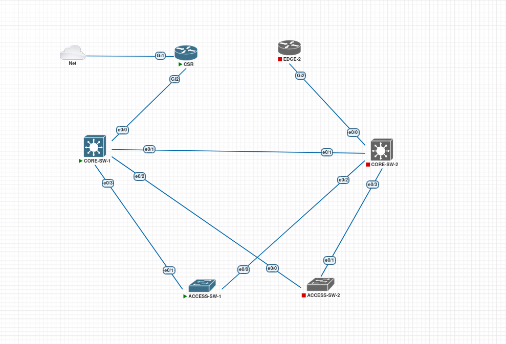

### Table of Contents

- [1. Intended State: NetBox Source of Truth (Access Ports)](#1-intended-state-netbox-source-of-truth-access-ports)
- [2. Live Device State Collection & Parsing Engine](#2-live-device-state-collection--parsing-engine)
- [3. Access Port Compliance Resolution & Drift Detection](#3-access-port-compliance-resolution--drift-detection)
- [4. Automated Access Port Remediation](#4-automated-access-port-remediation)
- [5. Dry-Run Safety Evaluation](#5-dry-run-safety-evaluation)
- [6. Closed-Loop Post-Remediation Validation](#6-closed-loop-post-remediation-validation)
- [7. Audit Logging & Splunk Telemetry Pipeline](#7-audit-logging--splunk-telemetry-pipeline)
- [8. Automated Unit Testing & CI/CD Validation](#8-automated-unit-testing--cicd-validation)

## Automation Workflow

The VLAN automation process follows these stages:

1. **Source of Truth:** Retrieve intended VLAN configuration from NetBox.
2. **Inventory Processing:** Load VLAN configuration into the automation context.
3. **State Collection:** Collect existing VLAN information from the network device using Netmiko and Genie.
4. **Compliance Checking:** Compare the actual VLAN configuration against the intended configuration.
5. **Remediation:** Generate configuration commands using a Jinja2 template and apply them to the device.
6. **Post-Validation:** Collect device state again and verify that remediation resolved the detected drift.
7. **Event Logging:** Forward configuration and validation events to Splunk.
8. **Unit Testing:** Test VLAN collection and compliance logic using pytest.

***

## 1. Intended State: NetBox Source of Truth (Access Ports)

In this architecture, switchport VLAN assignments are declared centrally in **NetBox DCIM** under the device interface schema. Network engineers define operational intent directly within NetBox rather than configuring devices manually via the CLI.

Before initiating compliance audits or remediation routines, the engine queries NetBox to extract the declared 802.1Q port modes and untagged VLAN memberships for access-layer switches like `ACCESS-SW-1`.

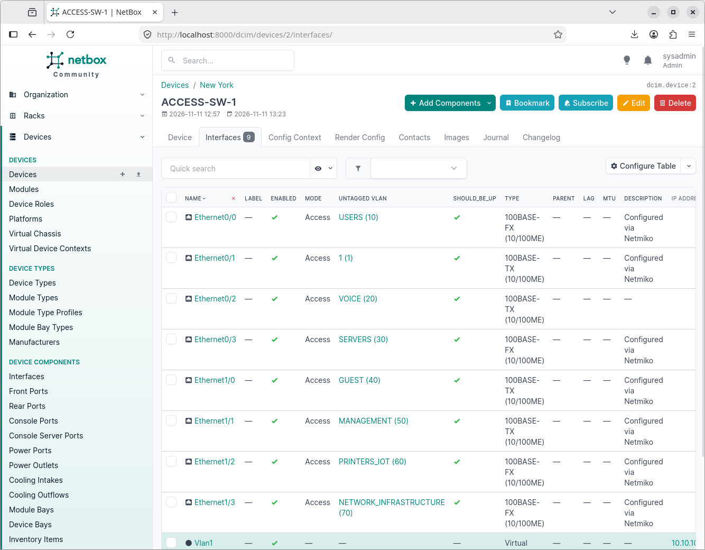

### Interface Baseline: `ACCESS-SW-1`

The switchport baseline for `ACCESS-SW-1` declares 8 physical access interfaces assigned to designated broadcast domains, alongside an internal virtual management interface (`Vlan1`):

| Interface | 802.1Q Mode | Untagged VLAN Name | VID (`untagged_vlan`) | Intended State (`should_be_up`) | Interface Type | Description |
| :--- | :---: | :--- | :---: | :---: | :--- | :--- |
| **Ethernet0/0** | `Access` | `USERS` | **10** | `True` | 100BASE-FX | Configured via Netmiko |
| **Ethernet0/1** | `Access` | `default` | **1** | `True` | 100BASE-TX | Configured via Netmiko |
| **Ethernet0/2** | `Access` | `VOICE` | **20** | `True` | 100BASE-TX | — |
| **Ethernet0/3** | `Access` | `SERVERS` | **30** | `True` | 100BASE-FX | Configured via Netmiko |
| **Ethernet1/0** | `Access` | `GUEST` | **40** | `True` | 100BASE-TX | Configured via Netmiko |
| **Ethernet1/1** | `Access` | `MANAGEMENT` | **50** | `True` | 100BASE-TX | Configured via Netmiko |
| **Ethernet1/2** | `Access` | `PRINTERS_IOT` | **60** | `True` | 100BASE-FX | Configured via Netmiko |
| **Ethernet1/3** | `Access` | `NETWORK_INFRASTRUCTURE` | **70** | `True` | 100BASE-FX | Configured via Netmiko |
| *Vlan1* | *None* | *None* | *—* | *—* | *Virtual* | *(Filtered out: SVI)* |

---

### Ingestion & Defensive Filtering (`src/sot/inventory.py`)

When loading device context from NetBox, the inventory engine evaluates interface metadata to differentiate physical access switchports from 802.1Q trunk links, routed interfaces, or virtual SVIs.

Only physical interfaces with `mode.value == "access"` and an active `untagged_vlan` object are ingested into the access-port validation pipeline. Virtual interfaces (such as `Vlan1`) are gracefully bypassed:

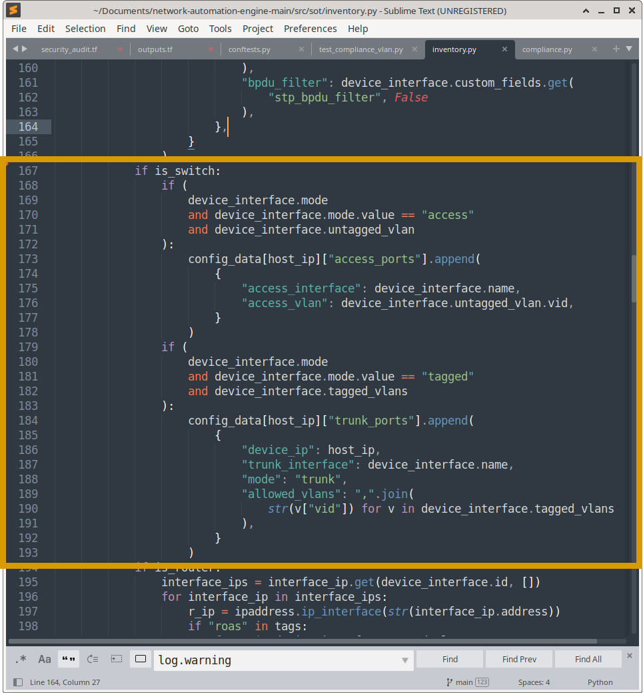

```python
# src/sot/inventory.py (Switchport Ingestion Logic)

if is_switch:
    # 1. Filter and extract dedicated Access Switchports
    if (
        device_interface.mode
        and device_interface.mode.value == "access"
        and device_interface.untagged_vlan
    ):
        config_data[host_ip]["access_ports"].append(
            {
                "access_interface": device_interface.name,
                "access_vlan": device_interface.untagged_vlan.vid,
            }
        )

    # 2. Filter and extract 802.1Q Trunk Switchports
    if (
        device_interface.mode
        and device_interface.mode.value == "tagged"
        and device_interface.tagged_vlans
    ):
        config_data[host_ip]["trunk_ports"].append(
            {
                "device_ip": host_ip,
                "trunk_interface": device_interface.name,
                "mode": "trunk",
                "allowed_vlans": ",".join(
                    str(v["vid"]) for v in device_interface.tagged_vlans
                ),
            }
        )
```

---

### Normalized Desired State Output

The resulting data structure built by `inventory.py` provides the compliance engine with a clean, normalized list of access interfaces and their mandatory VLAN IDs. Non-switchport and virtual interfaces are omitted automatically:

```json
[
  {
    "access_interface": "Ethernet0/0",
    "access_vlan": 10
  },
  {
    "access_interface": "Ethernet0/1",
    "access_vlan": 1
  },
  {
    "access_interface": "Ethernet0/2",
    "access_vlan": 20
  },
  {
    "access_interface": "Ethernet0/3",
    "access_vlan": 30
  },
  {
    "access_interface": "Ethernet1/0",
    "access_vlan": 40
  },
  {
    "access_interface": "Ethernet1/1",
    "access_vlan": 50
  },
  {
    "access_interface": "Ethernet1/2",
    "access_vlan": 60
  },
  {
    "access_interface": "Ethernet1/3",
    "access_vlan": 70
  }
]
```
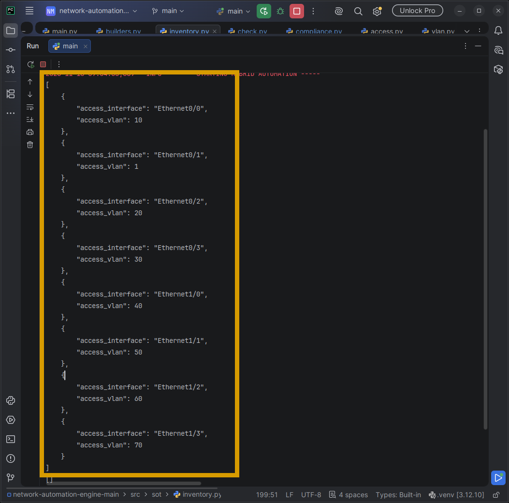

> **Design Principle:**
> By evaluating `device_interface.mode.value == "access"` and strictly extracting `untagged_vlan.vid`, the compliance checker (`check_access()`) receives an unambiguous list of expected interface-to-VLAN mappings. Any switchport configured in dynamic trunking mode, trunk mode, or mapped to the wrong access VLAN on the physical device will immediately trigger a drift detection event.

***

## 2. Live Device State Collection & Parsing Engine

To evaluate live infrastructure against NetBox without brittle screen-scraping, the engine follows a decoupled, two-stage extraction architecture:

1. **Collector Layer (`collector.py`):** Coordinates multi-command data extraction over SSH via Netmiko, leveraging Cisco pyATS/Genie parsers and isolating failures with granular exception handling.
2. **Builder Layer (`builders.py`):** Ingests raw parsed structures, sanitizes keys, filters out non-applicable operational modes (such as 802.1Q trunks), and flattens data into a normalized lookup table.

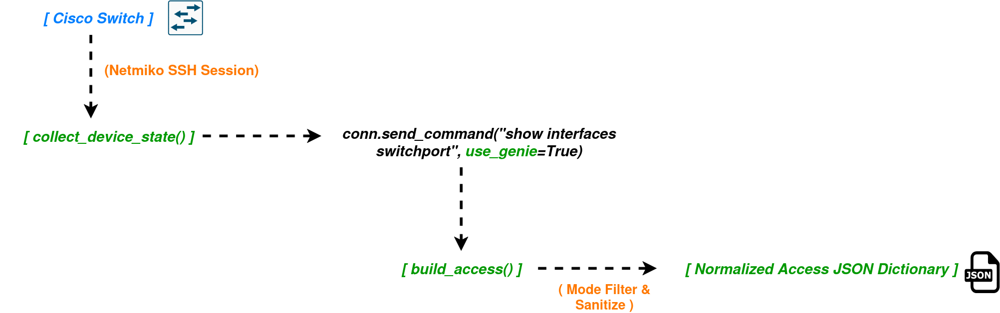

---

### Stage 1: Resilient Multi-Command Collection (`src/collectors/cli/collector.py`)

The `collect_device_state()` routine queries the switch for its operational baseline. Each command is wrapped in its own `try/except` boundary, ensuring that a single unsupported command or timeout does not fail the entire audit pipeline.

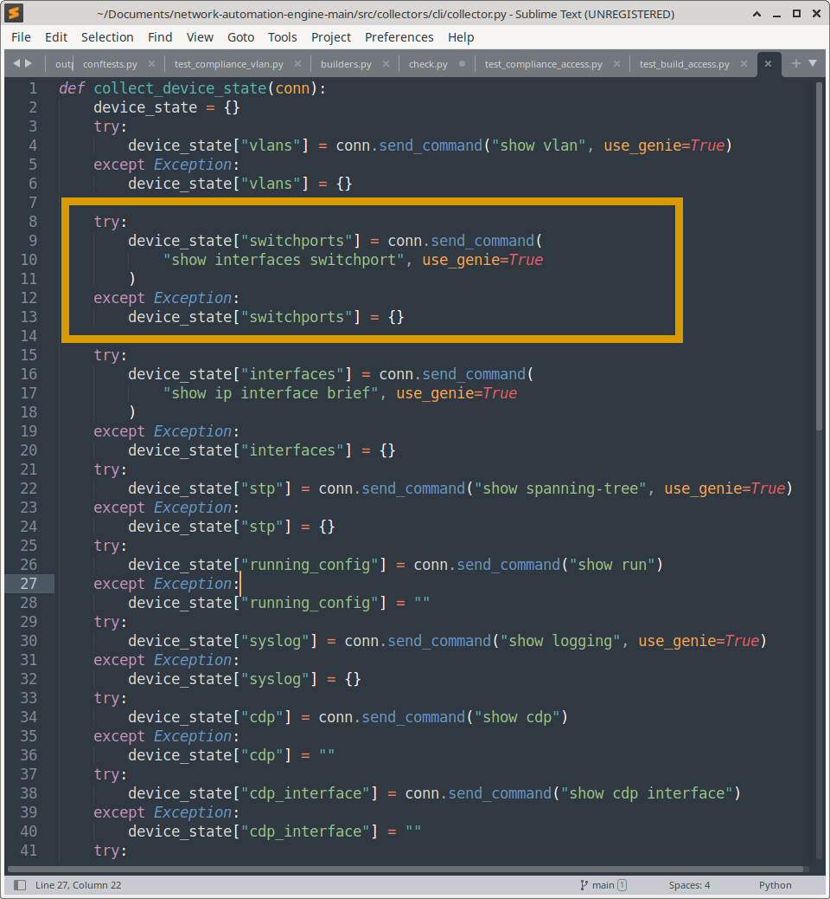

```python
# src/collectors/cli/collector.py

def collect_device_state(conn) -> dict:
    """
    Executes operational show commands over Netmiko with Genie parsing enabled.
    Isolates command failures to ensure pipeline resilience.
    """
    device_state = {}

    # 1. VLAN Database Collection
    try:
        device_state["vlans"] = conn.send_command("show vlan", use_genie=True)
    except Exception:
        device_state["vlans"] = {}

    # 2. Switchport Operational State Collection (Access/Trunk)
    try:
        device_state["switchports"] = conn.send_command(
            "show interfaces switchport", use_genie=True
        )
    except Exception:
        device_state["switchports"] = {}
```

#### Collector Design Highlights:
* **`use_genie=True` Integration:** By integrating Cisco pyATS/Genie directly into Netmiko's `send_command`, the engine bypasses fragile regular expressions and ingests structured Python dictionaries directly from the CLI.
* **Fault-Tolerant Isolation:** If an optional protocol (such as CDP or Syslog) is disabled or throws a syntax error on a given platform, the collector falls back to safe empty defaults (`{}` or `""`), allowing switchport and VLAN compliance checks to proceed uninterrupted.

---

### Stage 2: Mode Filtering & State Normalization (`src/collectors/cli/builders.py`)

Once `collect_device_state()` returns the composite dictionary, domain-specific builders extract and normalize the required keys. 

The `build_access()` builder pulls `device_state["switchports"]`, verifies the operational mode, and transforms vendor-specific metadata into a lean lookup dictionary optimized for diff evaluation:

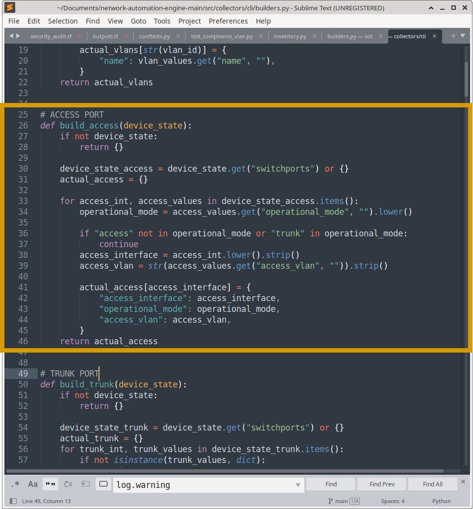

```python
# src/collectors/cli/builders.py

# ACCESS PORT
def build_access(device_state: dict) -> dict:
    """
    Consumes composite device_state, isolates switchport operational data,
    filters out active trunks, and normalizes access interface assignments.
    """
    if not device_state:
        return {}

    device_state_access = device_state.get("switchports") or {}
    actual_access = {}

    for access_int, access_values in device_state_access.items():
        operational_mode = access_values.get("operational_mode", "").lower()

        # Filter Guard: Strictly drop trunk ports and non-access links
        if "access" not in operational_mode or "trunk" in operational_mode:
            continue

        # Normalization: Lowercase & strip interface names and VLAN strings
        access_interface = access_int.lower().strip()
        access_vlan = str(access_values.get("access_vlan", "")).strip()

        actual_access[access_interface] = {
            "access_interface": access_interface,
            "operational_mode": operational_mode,
            "access_vlan": access_vlan,
        }

    return actual_access
```

#### Builder Design Highlights:
* **Granular Domain Decoupling:** `collector.py` only gathers data; it does not contain business logic. `builders.py` shapes data; it does not touch SSH connections.
* **Strict Trunk Exclusion:** Checking `if "access" not in operational_mode or "trunk" in operational_mode:` prevents 802.1Q trunk interfaces from leaking into access-port compliance audits.
* **Case & Primitive Sanitization:** Enforcing `.lower().strip()` on interface identifiers and `str()` on VLAN numbers ensures deterministic, bug-free comparisons against NetBox values.

---

### Normalized Live State Output

Following execution against `ACCESS-SW-1`, the aggregate device state is refined into a clean, normalized operational dictionary ready for the compliance engine:

```json
{
  "ethernet0/0": {
    "access_interface": "ethernet0/0",
    "operational_mode": "static access",
    "access_vlan": "1"
  },
  "ethernet0/2": {
    "access_interface": "ethernet0/2",
    "operational_mode": "static access",
    "access_vlan": "1"
  },
  "ethernet0/3": {
    "access_interface": "ethernet0/3",
    "operational_mode": "static access",
    "access_vlan": "1"
  },
  "ethernet1/0": {
    "access_interface": "ethernet1/0",
    "operational_mode": "static access",
    "access_vlan": "1"
  },
  "ethernet1/1": {
    "access_interface": "ethernet1/1",
    "operational_mode": "static access",
    "access_vlan": "1"
  },
  "ethernet1/2": {
    "access_interface": "ethernet1/2",
    "operational_mode": "static access",
    "access_vlan": "1"
  },
  "ethernet1/3": {
    "access_interface": "ethernet1/3",
    "operational_mode": "static access",
    "access_vlan": "1"
  }
}
```
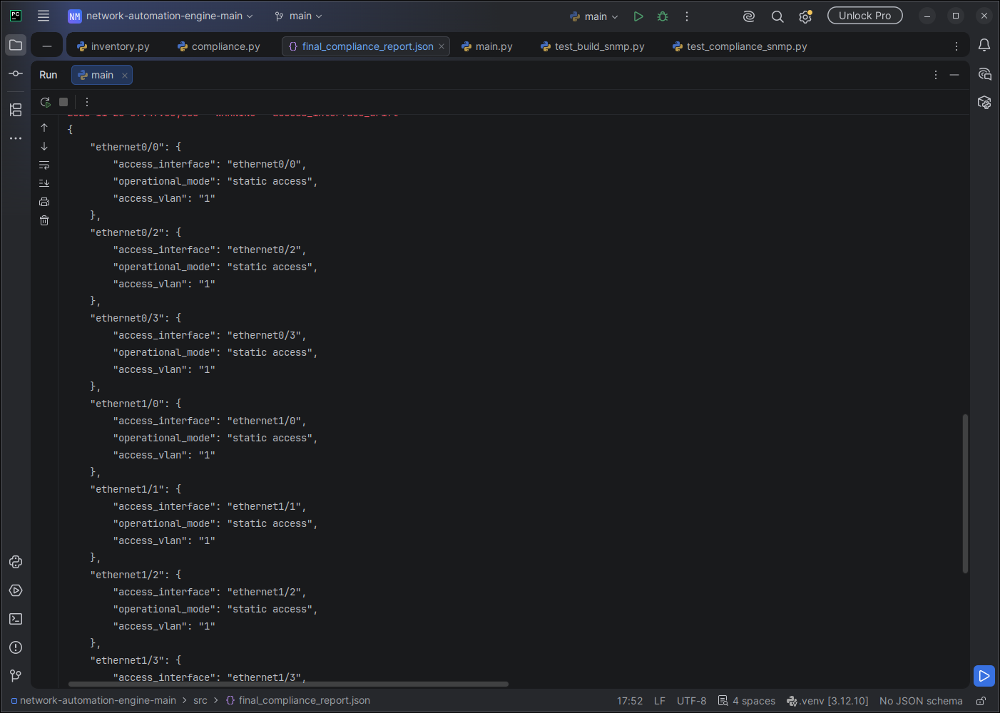

> **Design Principle:**  
> By decoupling raw CLI collection (`collector.py`) from state normalization (`builders.py`), the downstream compliance engine only receives a predictable, standardized data contract. This architecture makes testing mockable, keeps checks vendor-neutral, and prevents CLI syntax differences from breaking audit logic.

## 3. Access Port Compliance Resolution & Drift Detection

The access‑port compliance module reconciles live switchport state against the NetBox Source of Truth. Operating as a closed‑loop state machine, it filters compliant interfaces, detects configuration drift, applies targeted remediations, and performs automated post‑validation.

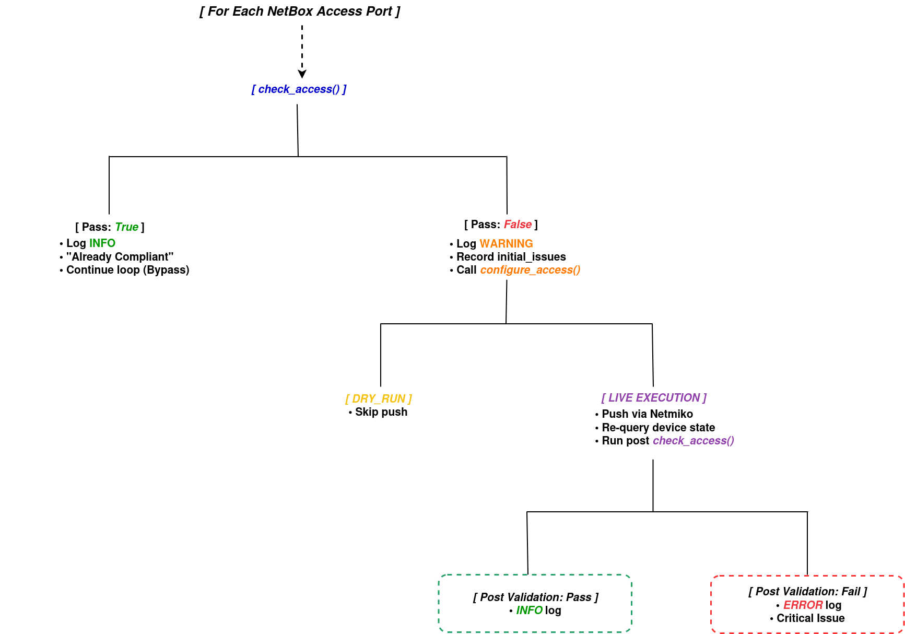

---

### 1. Multi‑Gate Diff Engine (`src/compliance/switching/access/check.py`)

The `check_access()` function validates every expected port against three deterministic failure gates:

1. **Port Existence & Trunk Isolation:** Confirms the port exists in the normalized dictionary. Because `build_access()` explicitly excludes trunk ports, an interface missing from the dictionary means it is either absent or has drifted into **Trunk Mode**.
2. **Access VLAN Assignment:** Enforces that the active access VLAN matches NetBox intent (`exp_vlan == actual_vlan`).
3. **Operational Mode Verification:** Validates the switchport is operating strictly as `static access`.

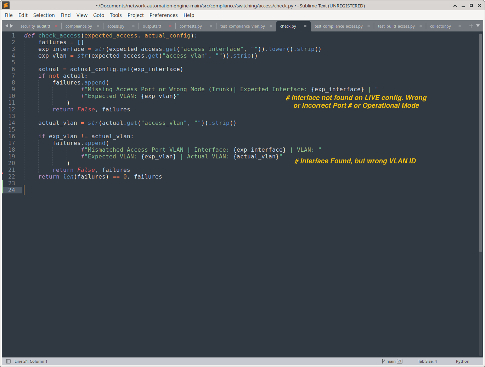

```python
# src/compliance/switching/access/check.py

def check_access(expected_access: dict, actual_config: dict) -> tuple[bool, list]:
    """
    Validates physical switchport against declarative NetBox baseline:
    1. Verifies interface exists and is not operating as a trunk.
    2. Compares active access VLAN ID against intended VLAN.
    3. Confirms operational switchport mode is 'static access'.
    """
    failures = []
    exp_interface = str(expected_access.get("access_interface", "")).lower().strip()
    exp_vlan = str(expected_access.get("access_vlan", "")).strip()

    actual = actual_config.get(exp_interface)

    # Gate 1: Check existence and verify port is not an 802.1Q trunk
    if not actual:
        failures.append(
            f"Missing Access Port or Wrong Mode (Trunk)| Expected Interface: {exp_interface} | "
            f"Expected VLAN: {exp_vlan}"
        )
        return False, failures

    actual_vlan = str(actual.get("access_vlan", "")).strip()

    # Gate 2: Compare active Access VLAN assignment
    if exp_vlan != actual_vlan:
        failures.append(
            f"Mismatched Access Port VLAN | Interface: {exp_interface} | VLAN: "
            f"Expected VLAN: {exp_vlan} | Actual VLAN: {actual_vlan}"
        )
        return False, failures

    # Gate 3: Enforce static access operational mode
    actual_mode = actual.get("operational_mode", "").lower().strip()
    if actual_mode != "static access":
        failures.append(
            f"Wrong Interface Operational Mode | Actual: {actual_mode} | "
            f"Expected: static access"
        )

    return len(failures) == 0, failures
```

---

### 2. Closed‑Loop Compliance Orchestrator (`src/compliance/switching/access/compliance.py`)

The compliance manager (`compliance_access()`) iterates through expected access ports, emits audit telemetry, bypasses compliant items, records drift, dispatches remediation, and triggers a post‑validation pass.


**Code Commentary Breakdown Part 1**

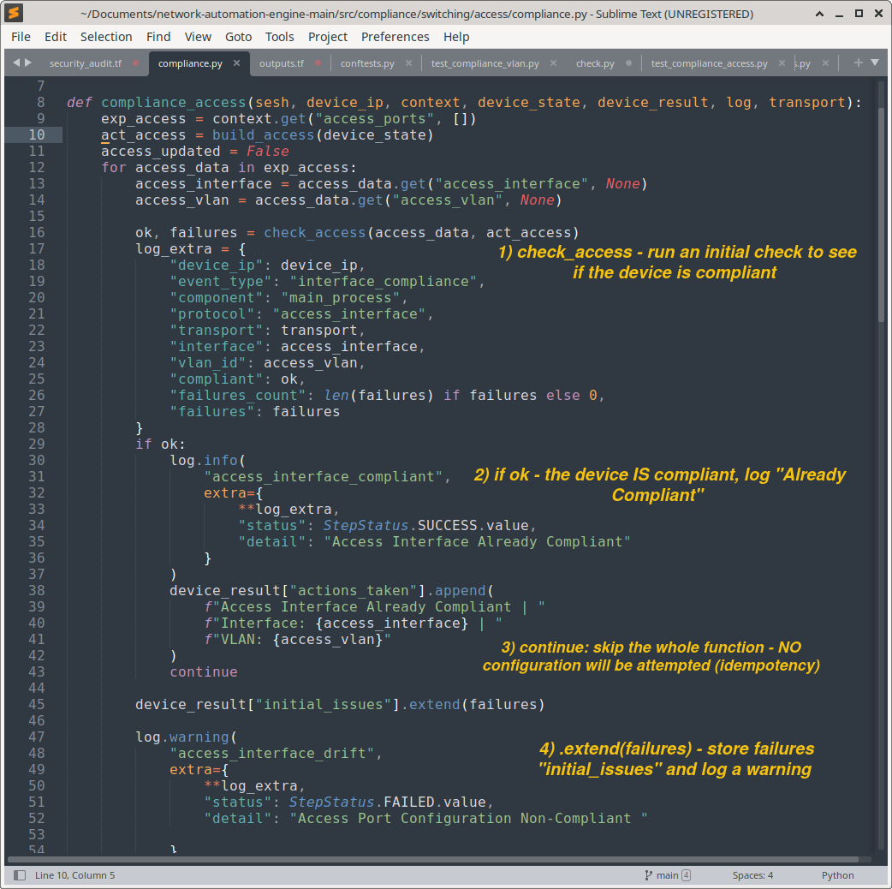

```python
# src/compliance/switching/access/compliance.py  (Lifecycle Head: lines 7-62)

def compliance_access(sesh, device_ip, context, device_state, device_result, log, transport):
    exp_access = context.get("access_ports", [])
    act_access = build_access(device_state)
    access_updated = False

    for access_data in exp_access:
        access_interface = access_data.get("access_interface", None)
        access_vlan = access_data.get("access_vlan", None)

        # 1. Run multi-gate compliance check
        ok, failures = check_access(access_data, act_access)
        log_extra = {
            "device_ip": device_ip,
            "event_type": "interface_compliance",
            "component": "main_process",
            "protocol": "access_interface",
            "transport": transport,
            "interface": access_interface,
            "vlan_id": access_vlan,
            "compliant": ok,
            "failures_count": len(failures) if failures else 0,
            "failures": failures,
        }

        # 2. Compliant Path: log and bypass
        if ok:
            log.info(
                "access_interface_compliant",
                extra={
                    **log_extra,
                    "status": StepStatus.SUCCESS.value,
                    "detail": "Access Interface Already Compliant",
                },
            )
            device_result["actions_taken"].append(
                f"Access Interface Already Compliant | Interface: {access_interface} | VLAN: {access_vlan}"
            )
            continue

        # 3. Drift Path: record issues and warn
        device_result["initial_issues"].extend(failures)
        log.warning(
            "access_interface_drift",
            extra={
                **log_extra,
                "status": StepStatus.FAILED.value,
                "detail": "Access Interface Configuration Non-Compliant",
            },
        )

        # 4. Dispatch remediation
        result = configure_access(sesh, access_data, device_ip, transport, log)
        summary = result.get("summary")
        if summary:
            device_result["actions_taken"].append(summary)
        if result.get("status") == OperationalStatus.SUCCESS.value:
            access_updated = True
        else:
            device_result["status"] = OperationalStatus.FAILED_CONFIG.value
            device_result["critical_issues"].append(
                "Failed To Remediate Access Port | "
                f"Interface: {access_interface} | "
                f"VLAN: {access_vlan}"
            )
```
**Code Commentary Part 2**

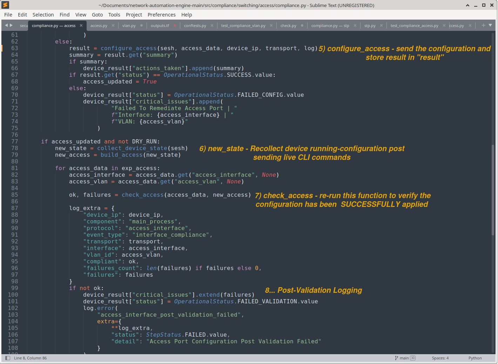

```python
# src/compliance/switching/access/compliance.py  (Post-Validation: lines 63-103)

    # 5. Closed-Loop Post-Validation (skipped under DRY_RUN)
    if access_updated and not DRY_RUN:
        new_state = collect_device_state(sesh)
        new_access = build_access(new_state)

        for access_data in exp_access:
            access_interface = access_data.get("access_interface", None)
            access_vlan = access_data.get("access_vlan", None)

            ok, failures = check_access(access_data, new_access)
            log_extra = {
                "device_ip": device_ip,
                "component": "main_process",
                "protocol": "access_interface",
                "event_type": "interface_compliance",
                "transport": transport,
                "interface": access_interface,
                "vlan_id": access_vlan,
                "compliant": ok,
                "failures_count": len(failures) if failures else 0,
                "failures": failures,
            }

            if not ok:
                device_result["critical_issues"].extend(failures)
                device_result["status"] = OperationalStatus.FAILED_VALIDATION.value
                log.error(
                    "access_interface_post_validation_failed",
                    extra={**log_extra, "detail": "Post-Remediation Validation Failed"},
                )
            else:
                log.info(
                    "access_interface_post_validation_success",
                    extra={**log_extra, "detail": "Post-Remediation Validation OK"},
                )
```

---

### 3. Runtime Verification & Injected Drift Scenarios

The engine was tested against two real‑world failure modes on `ACCESS-SW-1`.

#### Scenario A - Access VLAN Assignment Drift
Interfaces were left in access mode but pinned to default `VLAN 1` instead of their NetBox broadcast domains (`10`, `20`, `30`, `40`, `50`, `60`, `70`):

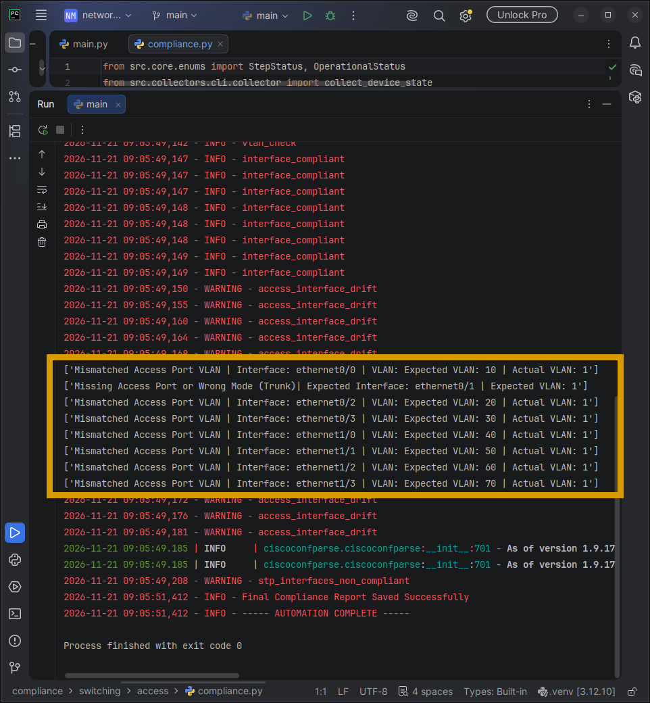

```text
2026-11-18 08:13:10,686 - WARNING - access_interface_drift
['Mismatched Access Port VLAN | Interface: ethernet0/0 | VLAN: Expected VLAN: 10 | Actual VLAN: 1']
2026-11-18 08:13:10,692 - WARNING - access_interface_drift
['Missing Access Port | Expected Interface: ethernet0/1 | Expected VLAN: 20']
2026-11-18 08:13:10,699 - WARNING - access_interface_drift
['Mismatched Access Port VLAN | Interface: ethernet0/3 | VLAN: Expected VLAN: 30 | Actual VLAN: 1']
2026-11-18 08:13:10,703 - WARNING - access_interface_drift
['Mismatched Access Port VLAN | Interface: ethernet1/0 | VLAN: Expected VLAN: 40 | Actual VLAN: 1']
['Mismatched Access Port VLAN | Interface: ethernet1/1 | VLAN: Expected VLAN: 50 | Actual VLAN: 1']
['Mismatched Access Port VLAN | Interface: ethernet1/2 | VLAN: Expected VLAN: 60 | Actual VLAN: 1']
['Mismatched Access Port VLAN | Interface: ethernet1/3 | VLAN: Expected VLAN: 70 | Actual VLAN: 1']
2026-11-18 08:13:10,708 - WARNING - access_interface_drift
2026-11-18 08:13:10,713 - WARNING - access_interface_drift
2026-11-18 08:13:10,715 - WARNING - access_interface_drift
2026-11-18 08:13:10,734 - WARNING - stp_interfaces_non_compliant
2026-11-18 08:13:12,937 - INFO - Final Compliance Report Saved Successfully
2026-11-18 08:13:12,937 - INFO - ----- AUTOMATION COMPLETE -----
```

#### Scenario B - Severe Drift: Unauthorized Mode Change (Trunk Hijack)
An out‑of‑band manual change on the switch console forced access interfaces `Ethernet0/0`–`Ethernet0/3` into 802.1Q trunking mode:

```cisco
ACCESS-SW-1(config)# int range e0/0-3
ACCESS-SW-1(config-if-range)# switchport trunk encapsulation dot1q
ACCESS-SW-1(config-if-range)# switchport mode trunk
*Nov 18 13:14:26.438: %LINEPROTO-5-UPDOWN: Line protocol on Interface Ethernet0/0, changed state to down
*Nov 18 13:14:26.439: %LINEPROTO-5-UPDOWN: Line protocol on Interface Ethernet0/2, changed state to down
*Nov 18 13:14:26.439: %LINEPROTO-5-UPDOWN: Line protocol on Interface Ethernet0/3, changed state to down
*Nov 18 13:14:29.444: %LINEPROTO-5-UPDOWN: Line protocol on Interface Ethernet0/0, changed state to up
*Nov 18 13:14:29.445: %LINEPROTO-5-UPDOWN: Line protocol on Interface Ethernet0/2, changed state to up
*Nov 18 13:14:29.445: %LINEPROTO-5-UPDOWN: Line protocol on Interface Ethernet0/3, changed state to up
```
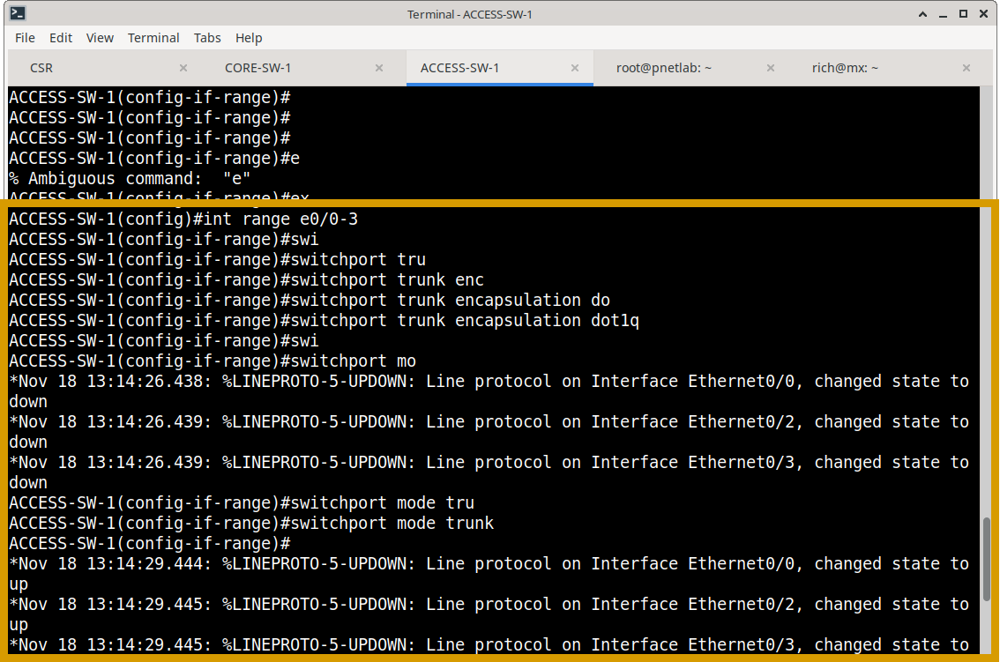

```text
2026-11-18 08:16:51,757 - WARNING - access_interface_drift
['Missing Access Port or Wrong Mode (Trunk)| Expected Interface: ethernet0/0 | Expected VLAN: 10']
2026-11-18 08:16:51,760 - WARNING - access_interface_drift
['Missing Access Port or Wrong Mode (Trunk)| Expected Interface: ethernet0/1 | Expected VLAN: 20']
2026-11-18 08:16:51,764 - WARNING - access_interface_drift
['Missing Access Port or Wrong Mode (Trunk)| Expected Interface: ethernet0/3 | Expected VLAN: 30']
2026-11-18 08:16:51,768 - WARNING - access_interface_drift
['Mismatched Access Port VLAN | Interface: ethernet1/0 | VLAN: Expected VLAN: 40 | Actual VLAN: 1']
['Mismatched Access Port VLAN | Interface: ethernet1/1 | VLAN: Expected VLAN: 50 | Actual VLAN: 1']
['Mismatched Access Port VLAN | Interface: ethernet1/2 | VLAN: Expected VLAN: 60 | Actual VLAN: 1']
['Mismatched Access Port VLAN | Interface: ethernet1/3 | VLAN: Expected VLAN: 70 | Actual VLAN: 1']
2026-11-18 08:16:51,811 - WARNING - stp_interfaces_non_compliant
2026-11-18 08:16:54,016 - INFO - Final Compliance Report Saved Successfully
2026-11-18 08:16:54,017 - INFO - ----- AUTOMATION COMPLETE -----
```
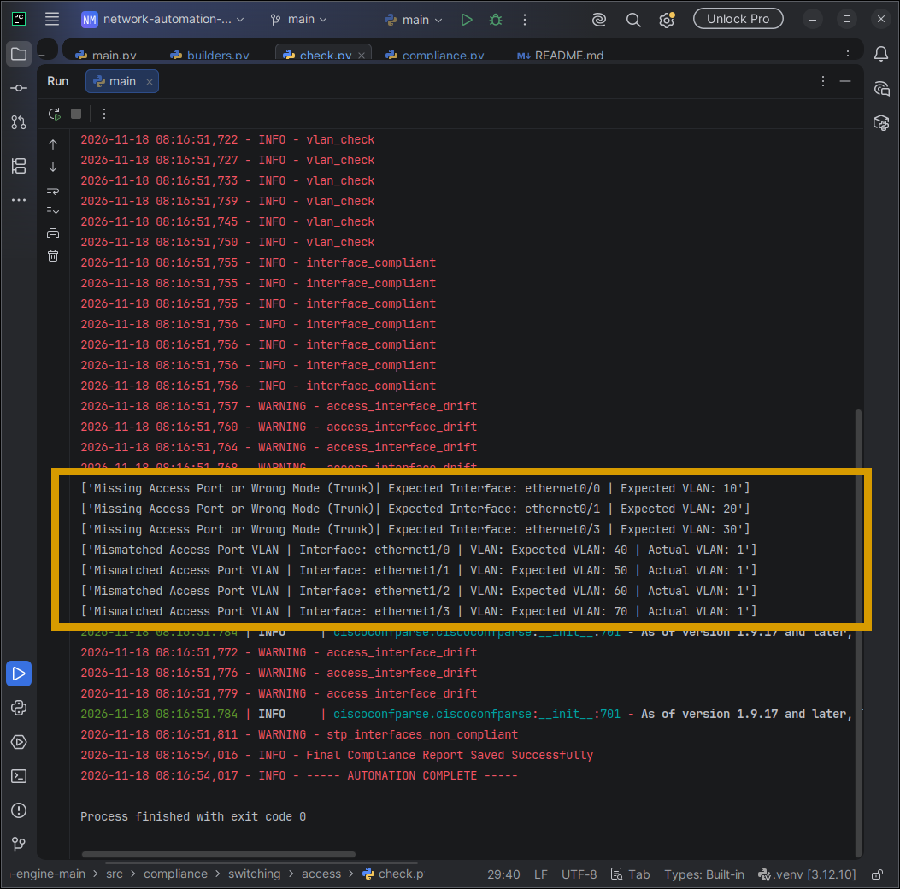

#### Scenario C - Fully Compliant Baseline (Zero Failures / Fast‑Path Bypass)

When the live switch configuration already mirrors the NetBox Source of Truth, the engine executes a non‑disruptive, read‑only audit. All 8 physical access interfaces on `ACCESS-SW-1` (`Ethernet0/0` through `Ethernet1/3`) were evaluated against their assigned broadcast domains. Because the operational mode was verified as `static access` and every access VLAN matched NetBox intent:

1. `check_access()` returned `(True, [])` for every port.
2. The engine logged `access_interface_compliant` at `INFO` severity.
3. Remediation (`configure_access()`), SSH configuration pushes, and post‑validation re‑polling were completely bypassed (`continue`).

The engine emits `access_interface_compliant` informational logs, bypasses configuration push commands entirely, and generates a clean final compliance report:

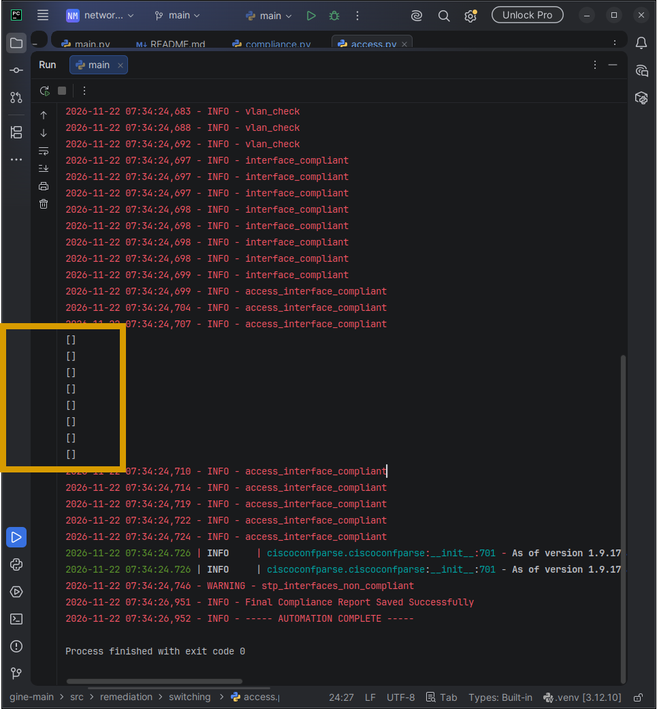

```text
2026-11-22 07:34:24,683 - INFO - vlan_check
2026-11-22 07:34:24,688 - INFO - vlan_check
2026-11-22 07:34:24,692 - INFO - vlan_check
2026-11-22 07:34:24,697 - INFO - interface_compliant
2026-11-22 07:34:24,697 - INFO - interface_compliant
2026-11-22 07:34:24,697 - INFO - interface_compliant
2026-11-22 07:34:24,698 - INFO - interface_compliant
2026-11-22 07:34:24,698 - INFO - interface_compliant
2026-11-22 07:34:24,698 - INFO - interface_compliant
2026-11-22 07:34:24,698 - INFO - interface_compliant
2026-11-22 07:34:24,699 - INFO - interface_compliant
2026-11-22 07:34:24,699 - INFO - access_interface_compliant
2026-11-22 07:34:24,704 - INFO - access_interface_compliant
2026-11-22 07:34:24,707 - INFO - access_interface_compliant
[]
[]
[]
[]
[]
[]
[]
[]
2026-11-22 07:34:24,710 - INFO - access_interface_compliant
2026-11-22 07:34:24,714 - INFO - access_interface_compliant
2026-11-22 07:34:24,719 - INFO - access_interface_compliant
2026-11-22 07:34:24,722 - INFO - access_interface_compliant
2026-11-22 07:34:24,724 - INFO - access_interface_compliant
2026-11-22 07:34:24,726 | INFO | ciscoconfparse.ciscoconfparse:__init__:701 - As of version 1.9.17 and later, ...
2026-11-22 07:34:24,726 | INFO | ciscoconfparse.ciscoconfparse:__init__:701 - As of version 1.9.17 and later, ...
2026-11-22 07:34:24,746 - WARNING - stp_interfaces_non_compliant
2026-11-22 07:34:26,951 - INFO - Final Compliance Report Saved Successfully
2026-11-22 07:34:26,952 - INFO - ----- AUTOMATION COMPLETE -----
Process finished with exit code 0
```
---

### 4. Compliance Evaluation Matrix

| Live Device State | NetBox Declared Intent | `check_access()` Result | Action Taken |
| :--- | :--- | :---: | :--- |
| `mode: static access`<br>`vlan: 10` | `mode: access`<br>`vlan: 10` | **PASS (Compliant)** | Log `access_interface_compliant`; bypass changes. |
| `mode: static access`<br>`vlan: 1` | `mode: access`<br>`vlan: 10` | **FAIL (VLAN Mismatch)** | Log `access_interface_drift`; queue remediation command. |
| `mode: trunk`<br>`vlan: 10` | `mode: access`<br>`vlan: 10` | **FAIL (Wrong Mode / Trunk)** | Identify mode violation; reconfigure port to `switchport mode access`. |
| Port unconfigured / down | `mode: access`<br>`vlan: 10` | **FAIL (Missing Port)** | Raise drift alert; deploy interface baseline configuration. |

---


## 4. Automated Access Port Remediation

When the compliance engine flags an interface for configuration drift or mode violation, it routes the drifted interface data into `configure_access()` in `src/remediation/switching/access.py`.

To guarantee that complex drift (such as an interface hijacked into an 802.1Q trunk) is remediated cleanly without lingering trunk encapsulation commands or native VLAN overrides, the engine uses an **interface defaulting strategy** via Jinja2 before applying the declarative baseline.

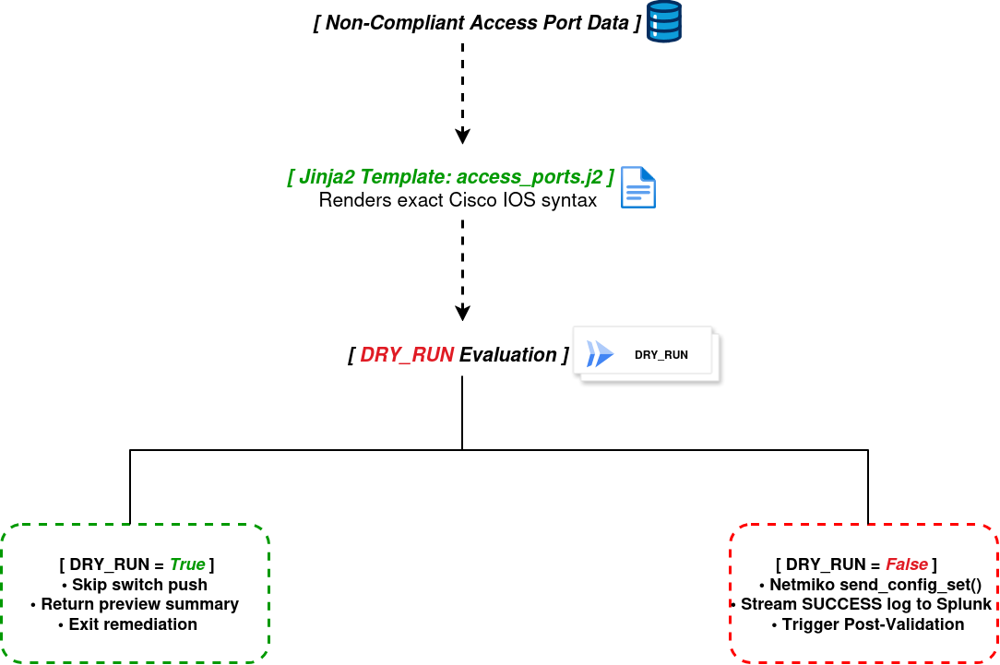

---

### 1. Declarative Interface Template (`templates/access_port.j2`)

The remediation template first resets the physical port using `default interface` to remove conflicting trunk encapsulation (`dot1q`), channel‑group bindings, or lingering QoS parameters. It then explicitly locks the port into `switchport mode access` and sets the intended access VLAN:

```jinja2
{# templates/access_port.j2 #}

default interface {{ a.access_interface }}
interface {{ a.access_interface }}
 switchport mode access
 switchport access vlan {{ a.access_vlan }}

```
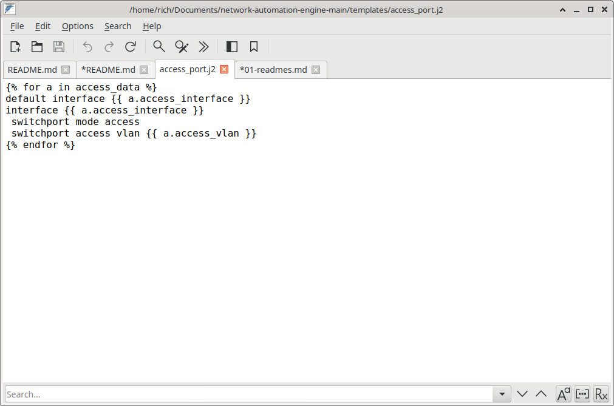

#### Rendered Remediation Example:
To heal `Ethernet0/0` after the unauthorized trunk injection in Scenario B, the renderer outputs:

```cisco
default interface ethernet0/0
interface ethernet0/0
 switchport mode access
 switchport access vlan 10
```

> **Engineering Design Decision:**
> Issuing `default interface <id>` wipes any residual trunk encapsulation (`switchport trunk encapsulation dot1q`), native VLANs, or allowed lists from the running configuration, guaranteeing the port enters a deterministic access state.

---

### 2. Remediation Handler Implementation (`src/remediation/switching/access.py`)

The `configure_access()` function renders the Jinja2 template, evaluates the dry‑run safety gate, applies the configuration set over Netmiko, and logs structured audit telemetry:

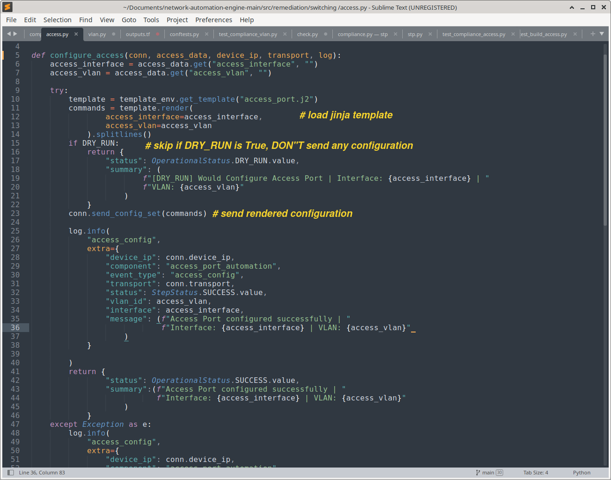

```python
# src/remediation/switching/access.py

def configure_access(conn, access_data, device_ip, transport, log):
    access_interface = access_data.get("access_interface", "")
    access_vlan = access_data.get("access_vlan", "")

    try:
        # Step 1: Render Jinja2 template with expected SoT parameters
        template = template_env.get_template("access_port.j2")
        commands = template.render(
            access_interface=access_interface,
            access_vlan=access_vlan
        ).splitlines()

        # Step 2: Safe Deployment Guard — Dry Run Evaluation
        if DRY_RUN:
            return {
                "status": OperationalStatus.DRY_RUN.value,
                "summary": (
                    f"[DRY_RUN] Would Configure Access Port | "
                    f"Interface: {access_interface} | VLAN: {access_vlan}"
                )
            }

        # Step 3: Atomic configuration push via Netmiko
        conn.send_config_set(commands)

        # Step 4: Stream structured remediation telemetry to Splunk
        log.info(
            "access_config",
            extra={
                "device_ip": device_ip,
                "component": "access_port_automation",
                "event_type": "access_config",
                "transport": transport,
                "status": StepStatus.SUCCESS.value,
                "vlan_id": access_vlan,
                "interface": access_interface,
                "message": (f"Access Port configured successfully | "
                            f"Interface: {access_interface} | VLAN: {access_vlan}"
                )
            }
        )
        return {
            "status": OperationalStatus.SUCCESS.value,
            "summary": (f"Access Port configured successfully | "
                        f"Interface: {access_interface} | VLAN: {access_vlan}"
            )
        }

    except Exception as e:
        log.info(
            "access_config",
            extra={
                "device_ip": device_ip,
                "component": "access port automation",
                "interface": access_interface,
                "error": str(e)
            }
        )
        return {
            "status": OperationalStatus.FAILED_CONFIG.value,
            "summary": f"Failed to configure interface {access_interface}: {str(e)}"
        }
```
---

## 5. Dry‑Run Safety Evaluation

The automation engine includes a globally configurable `DRY_RUN` safety switch (`src/core/settings.py`). This allows operations teams to audit live devices and review planned changes without modifying switch state.

When `DRY_RUN = True`:
* Compliance audits run completely against the live network.
* Drift detection flags all mismatched and missing switchports.
* Jinja2 templates render and are verified in memory.
* **Socket transmissions (`conn.send_config_set`) are bypassed entirely.**
* Planned actions are cataloged for review without modifying physical hardware.


---

### Machine-Readable Dry-Run Audit: `final_compliance_report.json`

During dry-run execution on `ACCESS-SW-1`, the engine compiles the complete audit into `src/final_compliance_report.json`.

The `actions_taken` collection documents the exact, port-by-port remediation commands that **would** be executed, while also validating that trunk links (`Ethernet0/1`), SNMP, and Syslog configurations are already compliant:

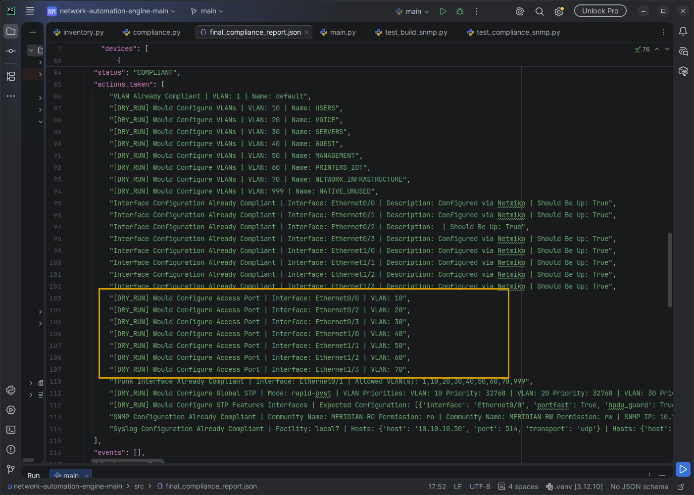

```json
{
  "device_name": "ACCESS-SW-1",
  "device_ip": "10.10.10.20",
  "status": "COMPLIANT",
  "actions_taken": [
    "VLAN Already Compliant | VLAN: 1 | Name: default",
    "[DRY_RUN] Would Configure VLANs | VLAN: 10 | Name: USERS",
    "[DRY_RUN] Would Configure VLANs | VLAN: 20 | Name: VOICE",
    "[DRY_RUN] Would Configure VLANs | VLAN: 30 | Name: SERVERS",
    "[DRY_RUN] Would Configure VLANs | VLAN: 40 | Name: GUEST",
    "[DRY_RUN] Would Configure VLANs | VLAN: 50 | Name: MANAGEMENT",
    "[DRY_RUN] Would Configure VLANs | VLAN: 60 | Name: PRINTERS_IOT",
    "[DRY_RUN] Would Configure VLANs | VLAN: 70 | Name: NETWORK_INFRASTRUCTURE",
    "[DRY_RUN] Would Configure VLANs | VLAN: 999 | Name: NATIVE_UNUSED",
    "Interface Configuration Already Compliant | Interface: Ethernet0/0 | Description: Configured via Netmiko | Should Be Up: True",
    "Interface Configuration Already Compliant | Interface: Ethernet0/1 | Description: Configured via Netmiko | Should Be Up: True",
    "Interface Configuration Already Compliant | Interface: Ethernet0/2 | Description:  | Should Be Up: True",
    "Interface Configuration Already Compliant | Interface: Ethernet0/3 | Description: Configured via Netmiko | Should Be Up: True",
    "Interface Configuration Already Compliant | Interface: Ethernet1/0 | Description: Configured via Netmiko | Should Be Up: True",
    "Interface Configuration Already Compliant | Interface: Ethernet1/1 | Description: Configured via Netmiko | Should Be Up: True",
    "Interface Configuration Already Compliant | Interface: Ethernet1/2 | Description: Configured via Netmiko | Should Be Up: True",
    "Interface Configuration Already Compliant | Interface: Ethernet1/3 | Description: Configured via Netmiko | Should Be Up: True",
    "[DRY_RUN] Would Configure Access Port | Interface: Ethernet0/0 | VLAN: 10",
    "[DRY_RUN] Would Configure Access Port | Interface: Ethernet0/2 | VLAN: 20",
    "[DRY_RUN] Would Configure Access Port | Interface: Ethernet0/3 | VLAN: 30",
    "[DRY_RUN] Would Configure Access Port | Interface: Ethernet1/0 | VLAN: 40",
    "[DRY_RUN] Would Configure Access Port | Interface: Ethernet1/1 | VLAN: 50",
    "[DRY_RUN] Would Configure Access Port | Interface: Ethernet1/2 | VLAN: 60",
    "[DRY_RUN] Would Configure Access Port | Interface: Ethernet1/3 | VLAN: 70",
    "Trunk Interface Already Compliant | Interface: Ethernet0/1 | Allowed VLAN(s): 1,10,20,30,40,50,60,70,999",
    "[DRY_RUN] Would Configure Global STP | Mode: rapid-pvst | VLAN Priorities: VLAN: 10 Priority: 32768 | VLAN: 20 Priority: 32768 | VLAN: 30 Priority: …",
    "[DRY_RUN] Would Configure STP Features Interfaces | Expected Configuration: [{'interface': 'Ethernet0/0', 'portfast': True, 'bpdu_guard': Tru …",
    "SNMP Configuration Already Compliant | Community Name: MERIDIAN-RO Permission: ro | Community Name: MERIDIAN-RW Permission: rw | SNMP IP: 10.…",
    "SysLog Configuration Already Compliant | Facility: local7 | Hosts: {'host': '10.10.10.50', 'port': 514, 'transport': 'udp'} | Hosts: {'host': …"
  ]
}
```

## 6. Closed‑Loop Post‑Remediation Validation

Pushing commands over SSH does not guarantee that a switch accepted or applied them correctly. Network operating systems can reject syntax, drop commands due to hardware state, or overwrite settings asynchronously.

To ensure configuration integrity, the module runs a **closed‑loop verification pass**:

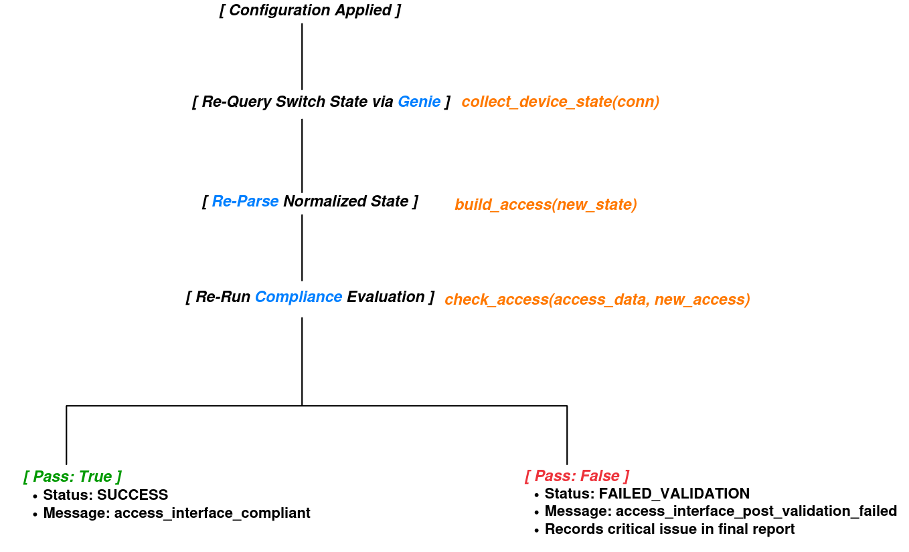

### Validation Outcomes:

| Outcome | Engine Status | Operational Meaning |
| :--- | :--- | :--- |
| **Pass** | `OperationalStatus.SUCCESS` | Operational switch state was re‑polled and verified to match NetBox intent. |
| **Fail** | `OperationalStatus.FAILED_VALIDATION` | The configuration command was sent, but the switch operational state still does not match NetBox. The failure is flagged as a critical issue for investigation. |

### 6.1 Physical Switch Verification: Before vs. After Remediation

To verify that the remediation commands took effect on physical hardware, running configurations were extracted from access switch `ACCESS-SW-1` before and after automated execution.

---

#### 1. Device State: BEFORE Remediation (Configuration Drift)

Prior to running remediation:
* Physical interfaces (`Ethernet0/0`, `Ethernet0/2`, `Ethernet0/3`, `Ethernet1/0`, `Ethernet1/1`) were locked into `switchport mode access`, but **omitted explicit access VLAN assignments**.
* As a result, all access switchports defaulted to untagged `VLAN 1`, segregating users from their intended departmental broadcast domains:

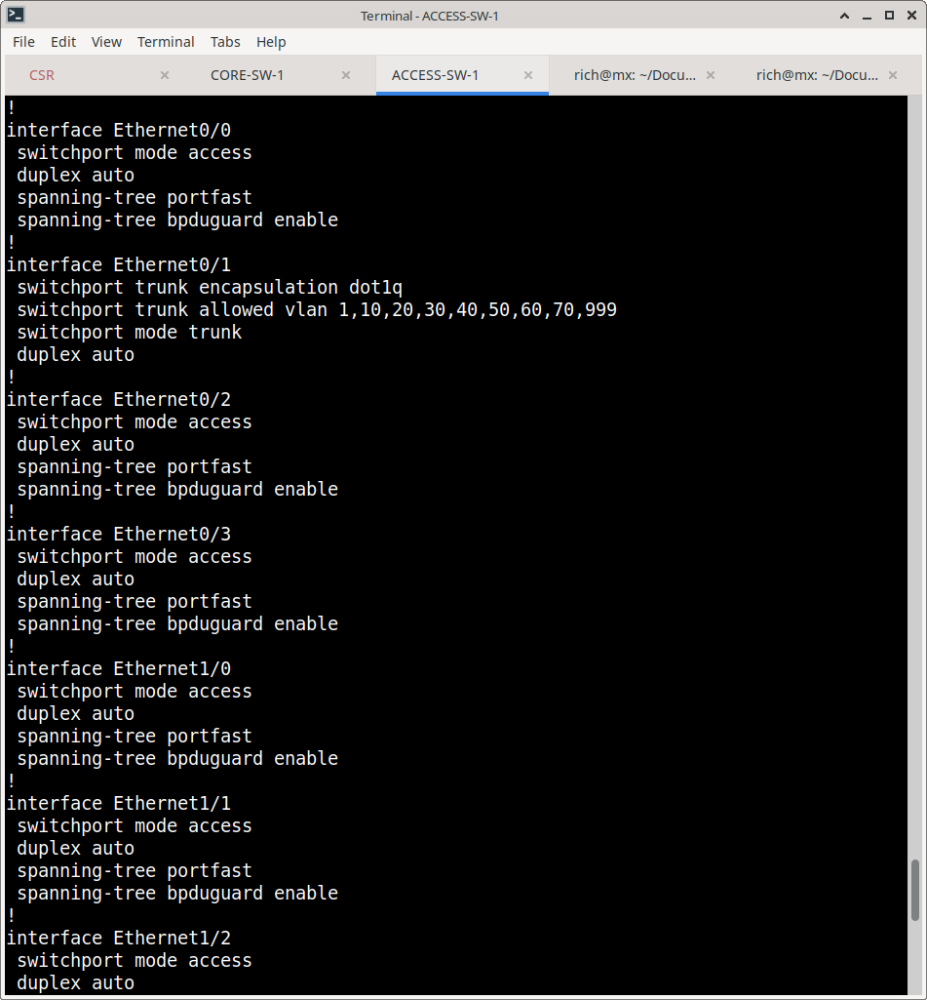

```cisco
! --- ACCESS-SW-1: Running Configuration BEFORE Remediation ---
interface Ethernet0/0
 switchport mode access
 duplex auto
 spanning-tree portfast
 spanning-tree bpduguard enable
!
interface Ethernet0/1
 switchport trunk encapsulation dot1q
 switchport trunk allowed vlan 1,10,20,30,40,50,60,70,999
 switchport mode trunk
 duplex auto
!
interface Ethernet0/2
 switchport mode access
 duplex auto
 spanning-tree portfast
 spanning-tree bpduguard enable
!
interface Ethernet0/3
 switchport mode access
 duplex auto
 spanning-tree portfast
 spanning-tree bpduguard enable
!
interface Ethernet1/0
 switchport mode access
 duplex auto
 spanning-tree portfast
 spanning-tree bpduguard enable
!
interface Ethernet1/1
 switchport mode access
 duplex auto
 spanning-tree portfast
 spanning-tree bpduguard enable
!
interface Ethernet1/2
 switchport mode access
 duplex auto
```

---

#### 2. Execution Audit: Cisco Console Syslog Logs (`vty0`)

When the remediation engine connected to `ACCESS-SW-1`, the switch console generated sequential `%SYS-5-CONFIG_I` syslog messages confirming that the automation service account (`sysadmin`) pushed configuration across `vty0`. The 17 commits are the **engine-wide** total for this run, decomposing exactly against the §5 dry-run plan: 8 VLAN sessions + 7 access-port sessions + 1 STP-global session + 1 STP-interface session (SNMP and Syslog were already compliant and contributed none):

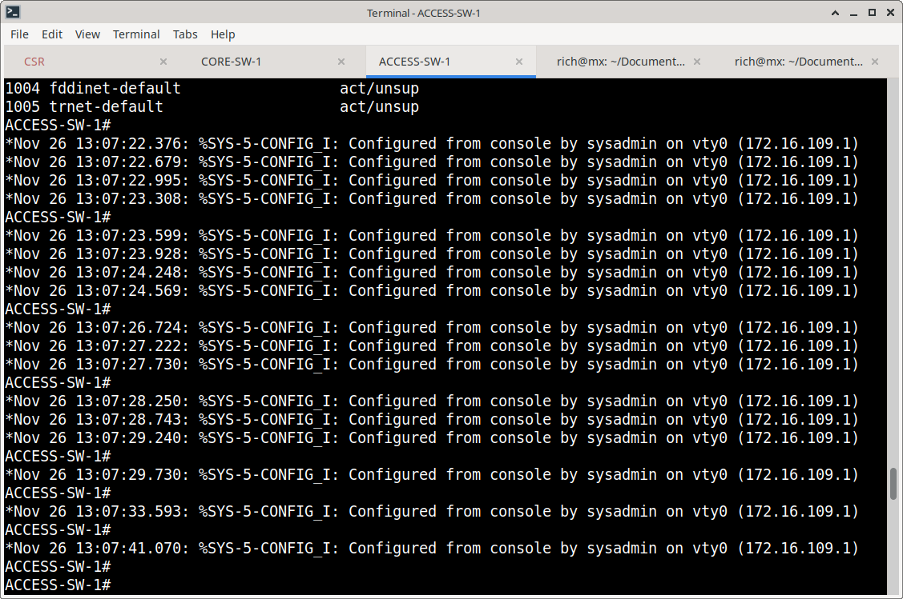

```text
*Nov 26 13:07:22.376: %SYS-5-CONFIG_I: Configured from console by sysadmin on vty0 (172.16.109.1)
*Nov 26 13:07:22.679: %SYS-5-CONFIG_I: Configured from console by sysadmin on vty0 (172.16.109.1)
*Nov 26 13:07:22.995: %SYS-5-CONFIG_I: Configured from console by sysadmin on vty0 (172.16.109.1)
*Nov 26 13:07:23.308: %SYS-5-CONFIG_I: Configured from console by sysadmin on vty0 (172.16.109.1)
*Nov 26 13:07:23.599: %SYS-5-CONFIG_I: Configured from console by sysadmin on vty0 (172.16.109.1)
*Nov 26 13:07:23.928: %SYS-5-CONFIG_I: Configured from console by sysadmin on vty0 (172.16.109.1)
*Nov 26 13:07:24.248: %SYS-5-CONFIG_I: Configured from console by sysadmin on vty0 (172.16.109.1)
*Nov 26 13:07:24.569: %SYS-5-CONFIG_I: Configured from console by sysadmin on vty0 (172.16.109.1)
*Nov 26 13:07:26.724: %SYS-5-CONFIG_I: Configured from console by sysadmin on vty0 (172.16.109.1)
*Nov 26 13:07:27.222: %SYS-5-CONFIG_I: Configured from console by sysadmin on vty0 (172.16.109.1)
*Nov 26 13:07:27.730: %SYS-5-CONFIG_I: Configured from console by sysadmin on vty0 (172.16.109.1)
*Nov 26 13:07:28.250: %SYS-5-CONFIG_I: Configured from console by sysadmin on vty0 (172.16.109.1)
*Nov 26 13:07:28.743: %SYS-5-CONFIG_I: Configured from console by sysadmin on vty0 (172.16.109.1)
*Nov 26 13:07:29.240: %SYS-5-CONFIG_I: Configured from console by sysadmin on vty0 (172.16.109.1)
*Nov 26 13:07:29.730: %SYS-5-CONFIG_I: Configured from console by sysadmin on vty0 (172.16.109.1)
*Nov 26 13:07:33.593: %SYS-5-CONFIG_I: Configured from console by sysadmin on vty0 (172.16.109.1)
*Nov 26 13:07:41.070: %SYS-5-CONFIG_I: Configured from console by sysadmin on vty0 (172.16.109.1)
```

---

#### 3. Device State: AFTER Automated Remediation (Fully Compliant)

Following automated execution and closed-loop post-validation:
* Every physical access interface was bound to its explicit NetBox untagged VLAN. The visible panel shows `Ethernet0/0`→`10`, `Ethernet0/2`→`20`, `Ethernet0/3`→`30`, `Ethernet1/0`→`40`, `Ethernet1/1`→`50`; `Ethernet1/2`→`60` and `Ethernet1/3`→`70` were healed identically but are scrolled below the capture's bottom edge.
* Distribution trunk uplink `Ethernet0/1` and Spanning Tree edge protections (`portfast`, `bpduguard enable`) remained intact:

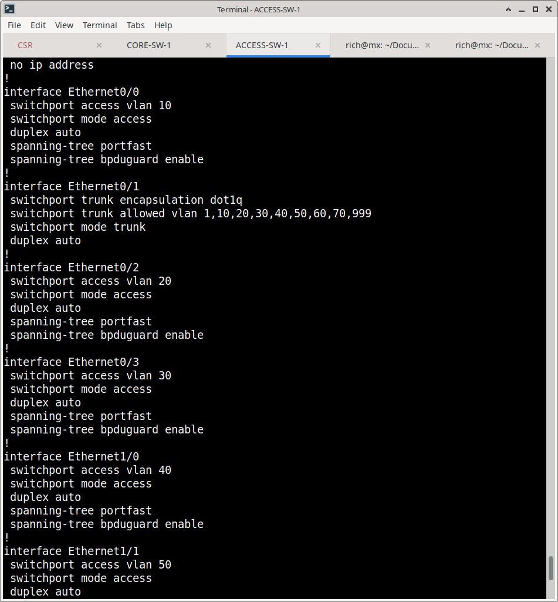

```cisco
! --- ACCESS-SW-1: Running Configuration AFTER Remediation ---
interface Ethernet0/0
 switchport access vlan 10
 switchport mode access
 duplex auto
 spanning-tree portfast
 spanning-tree bpduguard enable
!
interface Ethernet0/1
 switchport trunk encapsulation dot1q
 switchport trunk allowed vlan 1,10,20,30,40,50,60,70,999
 switchport mode trunk
 duplex auto
!
interface Ethernet0/2
 switchport access vlan 20
 switchport mode access
 duplex auto
 spanning-tree portfast
 spanning-tree bpduguard enable
!
interface Ethernet0/3
 switchport access vlan 30
 switchport mode access
 duplex auto
 spanning-tree portfast
 spanning-tree bpduguard enable
!
interface Ethernet1/0
 switchport access vlan 40
 switchport mode access
 duplex auto
 spanning-tree portfast
 spanning-tree bpduguard enable
!
interface Ethernet1/1
 switchport access vlan 50
 switchport mode access
 duplex auto
```

---

#### 4. Visual Configuration Diff

```diff

 interface Ethernet0/0
+ switchport access vlan 10
  switchport mode access
  duplex auto
  spanning-tree portfast
  spanning-tree bpduguard enable
 !
 interface Ethernet0/2
+ switchport access vlan 20
  switchport mode access
  duplex auto
  spanning-tree portfast
  spanning-tree bpduguard enable
 !
 interface Ethernet0/3
+ switchport access vlan 30
  switchport mode access
  duplex auto
  spanning-tree portfast
  spanning-tree bpduguard enable
 !
 interface Ethernet1/0
+ switchport access vlan 40
  switchport mode access
  duplex auto
  spanning-tree portfast
  spanning-tree bpduguard enable
 !
 interface Ethernet1/1
+ switchport access vlan 50
  switchport mode access
  duplex auto
```

> **Takeaway:**
> The physical switch verification proves complete reconciliation. Without disrupting existing Spanning Tree protections or adjacent trunk uplinks, the engine mapped each access port directly to its NetBox-defined broadcast domain, resolving the silent default-VLAN drift across the access layer.
```

---

## 7. Audit Logging & Splunk Telemetry Pipeline

To meet enterprise compliance and SIEM auditing requirements, every stage of the access‑port workflow generates structured JSON telemetry dispatched directly to **Splunk via the HTTP Event Collector (HEC)** (`index="network_automation"`, `sourcetype="_json"`). This delivers an immutable, real‑time audit trail for SecOps and Network Operations, mapping every physical switchport state change to standard Cisco syslog severity levels (`cisco_sev`) and enabling automated alerts for configuration drift and security regressions.

```spl
index="network_automation" sourcetype="_json" dev="10.10.10.20" protocol="access_interface"
| table asctime cisco_sev event_type message interface vlan_id status compliant detail
```

> **Tip:** In the screenshots the events were isolated with keyword filters appended to the base search — `index="network_automation" "Configured"` for the push event and `index="network_automation" "Already"` for the compliant event — which is a fast way to pull a single lifecycle stage from the index.

---

### Telemetry Lifecycle Matrix

The engine records four discrete event transitions across the access‑switchport lifecycle on `ACCESS-SW-1` (`10.10.10.20`):

| Lifecycle Phase | Event Type (`event_type`) | Message (`message`) | Cisco Severity | Compliance / Status | Operational Meaning |
| :--- | :--- | :--- | :---: | :---: | :--- |
| **1. Drift Detected** | `interface_compliance` | `access_interface_drift` | `4 (WARN)` | `compliant: false` / `FAILED` | Unauthorized VLAN or mode detected; diff logged. |
| **2. Remediation Push** | `access_config` | `access_config` | `6 (INFO)` | `status: SUCCESS` | Template commands pushed to device over Netmiko. |
| **3. Pre‑Check Pass** | `interface_compliance` | `access_interface_compliant` | `6 (INFO)` | `compliant: true` / `SUCCESS` | Port matches NetBox baseline; skipped without change. |
| **4. Post‑Validation** | `interface_compliance` | `access_interface_post_validation_success` | `6 (INFO)` | `compliant: true` / `SUCCESS` | Re‑queried device state confirms drift is resolved. |

---

### Splunk Event Timeline (`ACCESS-SW-1` / `10.10.10.20`)

### Payload Breakdown

#### 1. Configuration Drift Alert (`access_interface_drift`)
Triggered when an interface deviates from NetBox intent (e.g., `Ethernet1/2` was left in default `VLAN 1` instead of assigned `VLAN 60`). The engine flags a `WARNING` (Cisco severity 4) with the exact diff:

```json
{
  "asctime": "2026-11-18 08:18:12,813",
  "cisco_appname": "SRC",
  "cisco_msgname": "WARNING",
  "cisco_sev": 4,
  "compliant": false,
  "component": "main_process",
  "detail": "Access Port Configuration Non-Compliant",
  "dev": "10.10.10.20",
  "device_ip": "10.10.10.20",
  "event_type": "interface_compliance",
  "failures": [
    "Mismatched Access Port VLAN | Interface: ethernet1/2 | VLAN: Expected VLAN: 60 | Actual VLAN: 1"
  ],
  "failures_count": 1,
  "hostname": "mx",
  "interface": "Ethernet1/2",
  "level": "WARNING",
  "message": "access_interface_drift",
  "protocol": "access_interface",
  "seqnum": 35,
  "status": "FAILED",
  "tags": {},
  "taskName": null,
  "transport": "NETMIKO",
  "vlan_id": 60
}
```
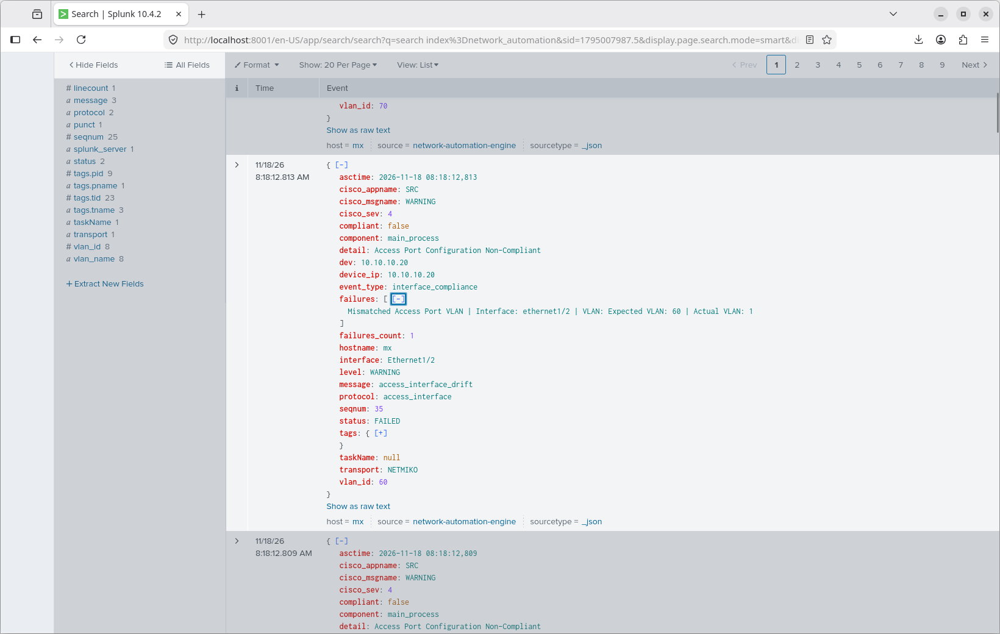

---

#### 2. Targeted Remediation Execution (`access_config`)
Emitted immediately after Netmiko pushes the rendered Jinja2 template commands to heal a port (e.g., configuring `Ethernet0/2` into `VLAN 20`):

```json
{
  "asctime": "2026-11-18 08:53:17,606",
  "cisco_appname": "SRC",
  "cisco_msgname": "INFO",
  "cisco_sev": 6,
  "component": "access_port_automation",
  "detail": "Access Port configured successfully | Interface: Ethernet0/2 | VLAN: 20",
  "dev": "10.10.10.20",
  "device_ip": "10.10.10.20",
  "event_type": "access_config",
  "hostname": "mx",
  "interface": "Ethernet0/2",
  "level": "INFO",
  "message": "access_config",
  "seqnum": 52,
  "status": "SUCCESS",
  "tags": {},
  "taskName": null,
  "transport": "NETMIKO",
  "vlan_id": 20
}
```
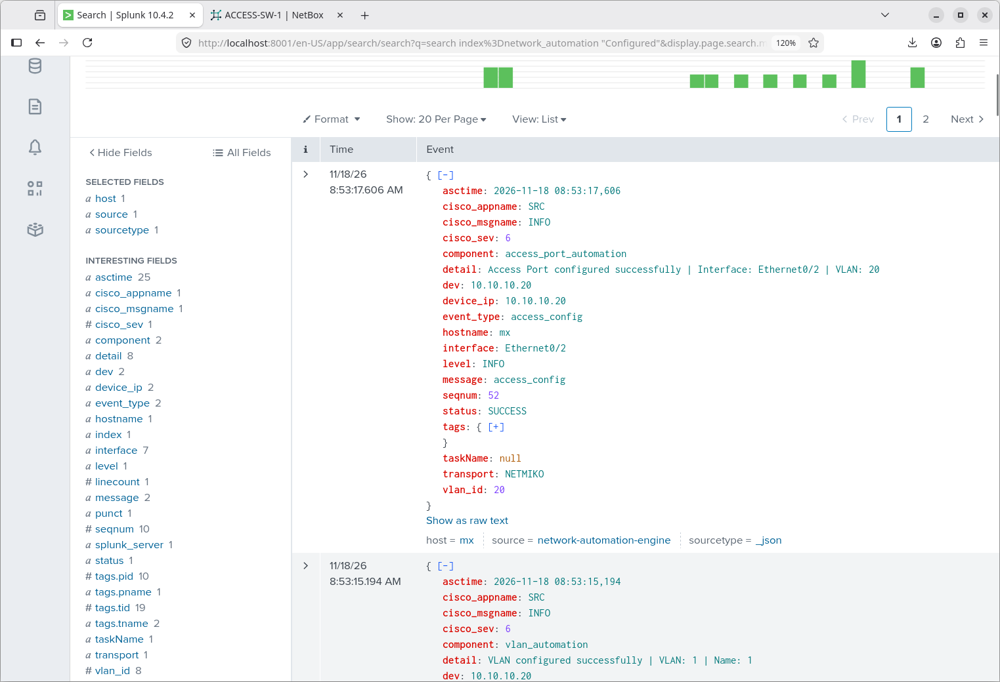

---

#### 3. Pre‑Audit Baseline Pass (`access_interface_compliant`)
When an interface (e.g., `Ethernet1/3`) already matches NetBox specifications on initial scan, an informational audit event is logged with zero failures, and the port is bypassed:

```json
{
  "asctime": "2026-11-18 08:53:17,631",
  "cisco_appname": "SRC",
  "cisco_msgname": "INFO",
  "cisco_sev": 6,
  "compliant": true,
  "component": "main_process",
  "detail": "Access Interface Already Compliant",
  "dev": "10.10.10.20",
  "device_ip": "10.10.10.20",
  "event_type": "interface_compliance",
  "failures": [],
  "failures_count": 0,
  "hostname": "mx",
  "interface": "Ethernet1/3",
  "level": "INFO",
  "message": "access_interface_compliant",
  "protocol": "access_interface",
  "seqnum": 57,
  "status": "SUCCESS",
  "tags": {},
  "taskName": null,
  "transport": "NETMIKO",
  "vlan_id": 70
}
```
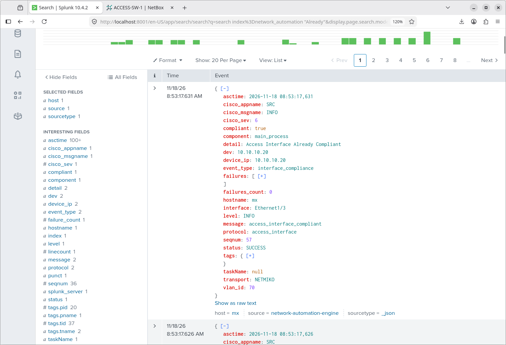

---

#### 4. Closed‑Loop Post‑Validation Success (`access_interface_post_validation_success`)
After the configuration is pushed, the engine re‑collects live device state via Genie to verify that the operational switchport matches NetBox intent:

```json
{
  "asctime": "2026-11-18 08:53:28,187",
  "cisco_appname": "SRC",
  "cisco_msgname": "INFO",
  "cisco_sev": 6,
  "compliant": true,
  "component": "main_process",
  "detail": "Access Interface Post Validation Successful",
  "dev": "10.10.10.20",
  "device_ip": "10.10.10.20",
  "event_type": "interface_compliance",
  "failures": [],
  "failures_count": 0,
  "hostname": "mx",
  "interface": "Ethernet1/3",
  "level": "INFO",
  "message": "access_interface_post_validation_success",
  "protocol": "access_interface",
  "seqnum": 65,
  "status": "SUCCESS",
  "tags": {},
  "taskName": null,
  "transport": "NETMIKO",
  "vlan_id": 70
}
```
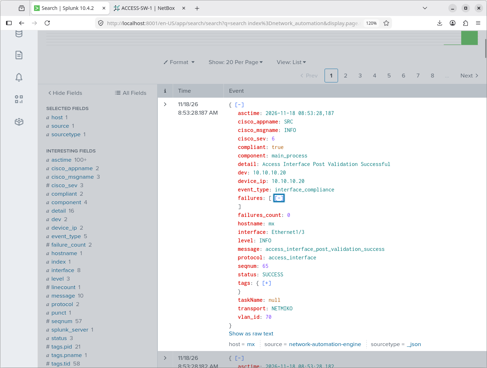

---

### Internal Execution Tracking

Beyond real‑time SIEM streaming, the automation engine maintains state inside the device execution context to generate `final_compliance_report.json` and `network_compliance_report.txt`:

* **`device_result["initial_issues"]`**: Collects all initial diffs detected before remediation (used to quantify network drift rates).
* **`device_result["actions_taken"]`**: Records every remediation command or `[DRY_RUN]` preview executed during the run.
* **`device_result["critical_issues"]`**: Populated only if remediation fails over SSH or if post‑validation fails after changes were applied.

## 8. Automated Unit Testing & CI/CD Validation

To ensure deterministic reliability without depending on live network switches, the access-port module includes an isolated unit-testing suite powered by **Pytest** and **unittest.mock**.

The test suite runs **100% offline** using mock sessions and pre-captured Genie fixtures (`access_trunk_genie_output`), verifying both data normalization and the full compliance state machine in **under 1.4 seconds**.

---

### Layer 1: Builder & Parser Validation (`test_build_access.py`)

This suite validates that `build_access()` correctly normalizes Genie switchport operational data, enforces strict port mode isolation, and guards against malformed payloads.

#### Test Cases Covered:
1. **`test_build_access_valid_path`**: Ingests realistic Genie output (`access_trunk_genie_output`). Confirms `gigabitethernet0/0` (VLAN 98, static access) and `gigabitethernet0/1` (VLAN 20, static access) are parsed accurately.
2. **`test_build_access_ingore_trunk`**: Injects an interface in `operational_mode: "trunk"` and verifies the builder drops it completely, returning `{}`.
3. **`test_build_access_mixed`**: Provides a dictionary with both trunk (`gigabitethernet0/3`) and access (`gigabitethernet1/0`) interfaces; asserts that only the access interface is retained (`len == 1`).
4. **`test_build_access_no_vlan`**: Tests defensive fallback when an interface is in access mode but missing a VLAN attribute, verifying `access_vlan` defaults safely to `""`.
5. **`test_build_access_empty`**: Boundary test confirming `build_access({})` returns `{}` without raising `KeyError`.
6. **`test_build_access_no_dict`**: Tests unexpected dictionary structures (missing `"switchports"` key), confirming safe fallback to `{}`.

#### Terminal Execution:

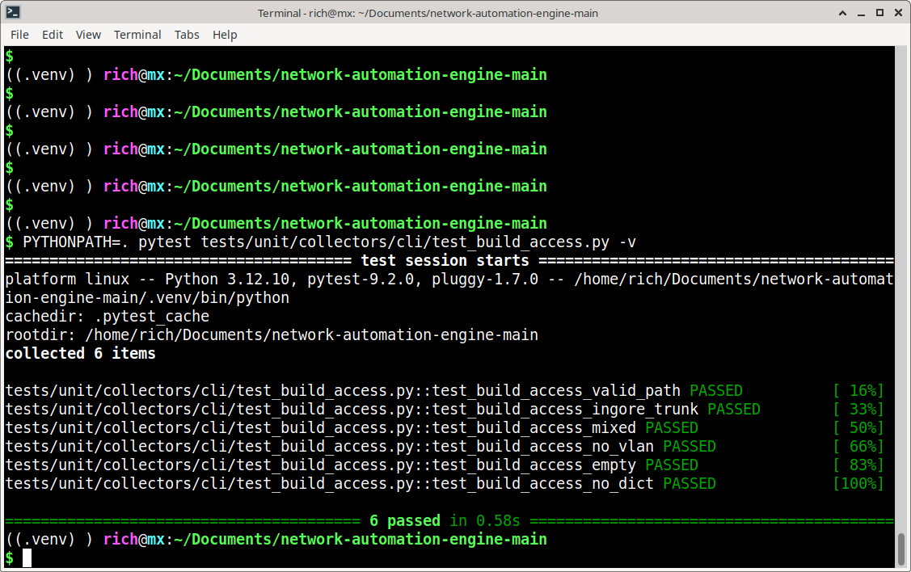

```bash
$ PYTHONPATH=. pytest tests/unit/collectors/cli/test_build_access.py -v
============================= test session starts ==============================
platform linux -- Python 3.12.10, pytest-9.2.0, pluggy-1.7.0
rootdir: /home/rich/Documents/network-automation-engine-main
collected 6 items

tests/unit/collectors/cli/test_build_access.py::test_build_access_valid_path PASSED   [ 16%]
tests/unit/collectors/cli/test_build_access.py::test_build_access_ingore_trunk PASSED [ 33%]
tests/unit/collectors/cli/test_build_access.py::test_build_access_mixed PASSED        [ 50%]
tests/unit/collectors/cli/test_build_access.py::test_build_access_no_vlan PASSED     [ 66%]
tests/unit/collectors/cli/test_build_access.py::test_build_access_empty PASSED       [ 83%]
tests/unit/collectors/cli/test_build_access.py::test_build_access_no_dict PASSED      [100%]

============================== 6 passed in 0.58s ===============================
```

---

### Layer 2: Compliance & Lifecycle Mock Tests (`test_compliance_access.py`)

Using `@patch` and `MagicMock`, this suite isolates `compliance_access()` from live SSH sockets. It uses mock side effects (`side_effect = [(False, [...]), (True, [])]`) to simulate dynamic multi-pass workflows such as drift detection, remediation, and post-validation.

#### Test Cases Covered:
1. **`test_compliance_access_already_compliant`**:
   * Simulates a switchport matching NetBox.
   * Asserts `mock_log.warning` was **never called**, `mock_log.info` was called once, and `initial_issues` remains empty.
2. **`test_compliance_access_non_compliant_config_successful`**:
   * Simulates initial VLAN mismatch drift followed by a successful remediation push.
   * Asserts warning log was called, `initial_issues` recorded the diff, action summary was tracked, and status resolved to `OperationalStatus.SUCCESS`.
3. **`test_compliance_access_non_compliant_config_failed`**:
   * Simulates an SSH/CLI push failure (`OperationalStatus.FAILED_CONFIG`).
   * Asserts that remediation failure is captured under `critical_issues` and the overall status is marked `FAILED_CONFIG`.
4. **`test_compliance_access_dry_run`**:
   * Patches `DRY_RUN = True`.
   * Verifies drift is identified and recorded, but `configure_access()` is **never invoked**, and the action log reflects `[DRY_RUN] Would Configure Access Port`.
5. **`test_compliance_access_post_validation_successful`**:
   * Simulates the full closed loop: pre-check fails → remediation succeeds → `collect_device_state()` re-runs → post-check passes.
   * Asserts that `collect_device_state` was called exactly once and post-validation success was recorded in `actions_taken`.
6. **`test_compliance_access_post_validation_failed`**:
   * Simulates persistent drift where the command is pushed, but the subsequent post-check still detects a mismatch.
   * Asserts `mock_log.error` was called, status becomes `OperationalStatus.FAILED_VALIDATION`, and the failure is appended to `critical_issues`.
7. **`test_compliance_access_empty`**:
   * Tests empty NetBox context (`{"access_ports": {}}`).
   * Asserts the module completes gracefully with zero issues and zero actions taken.

#### Representative Mock Pattern (`test_compliance_access.py` Excerpt):

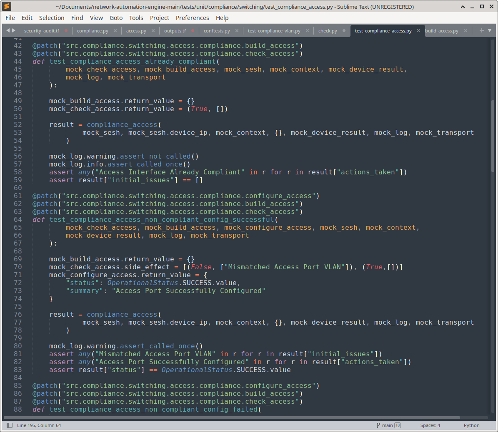

```python
@patch("src.compliance.switching.access.compliance.collect_device_state")
@patch("src.compliance.switching.access.compliance.configure_access")
@patch("src.compliance.switching.access.compliance.build_access")
@patch("src.compliance.switching.access.compliance.check_access")
def test_compliance_access_post_validation_successful(
    mock_check_access, mock_build_access, mock_configure_access, mock_collect_device_state,
    mock_sesh, mock_context, mock_device_result, mock_transport, mock_log
):
    # Simulate: Pass 1 fails (drift detected), Pass 2 succeeds (healed)
    mock_build_access.return_value = {}
    mock_check_access.side_effect = [(False, ["Mismatched Access Port VLAN"]), (True, [])]
    mock_configure_access.return_value = {
        "status": OperationalStatus.SUCCESS.value,
        "summary": "Access Port Successfully Configured"
    }
    mock_collect_device_state.return_value = {}

    result = compliance_access(
        mock_sesh, mock_sesh.device_ip, mock_context, {}, mock_device_result, mock_log, mock_transport
    )

    # Assert closed-loop state transitions
    mock_log.warning.assert_called_once()
    mock_collect_device_state.assert_called_once()
    assert any("Mismatched Access Port VLAN" in r for r in result["initial_issues"])
    assert any("Access Interface Post Validation Successful" in r for r in result["actions_taken"])
    assert result["status"] == OperationalStatus.SUCCESS.value
```

#### Terminal Execution:

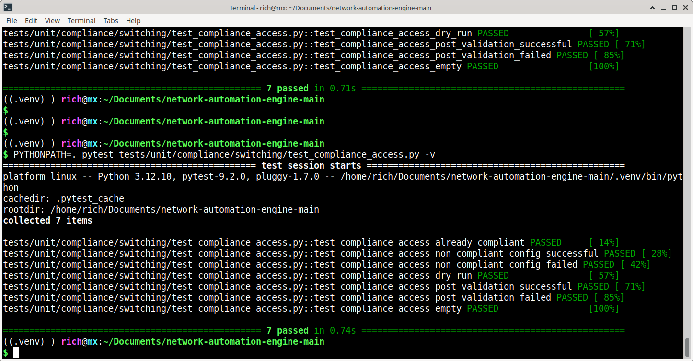

```bash
$ PYTHONPATH=. pytest tests/unit/compliance/switching/test_compliance_access.py -v
============================= test session starts ==============================
platform linux -- Python 3.12.10, pytest-9.2.0, pluggy-1.7.0
rootdir: /home/rich/Documents/network-automation-engine-main
collected 7 items

tests/unit/compliance/switching/test_compliance_access.py::test_compliance_access_already_compliant PASSED             [ 14%]
tests/unit/compliance/switching/test_compliance_access.py::test_compliance_access_non_compliant_config_successful PASSED [ 28%]
tests/unit/compliance/switching/test_compliance_access.py::test_compliance_access_non_compliant_config_failed PASSED     [ 42%]
tests/unit/compliance/switching/test_compliance_access.py::test_compliance_access_dry_run PASSED                         [ 57%]
tests/unit/compliance/switching/test_compliance_access.py::test_compliance_access_post_validation_successful PASSED     [ 71%]
tests/unit/compliance/switching/test_compliance_access.py::test_compliance_access_post_validation_failed PASSED         [ 85%]
tests/unit/compliance/switching/test_compliance_access.py::test_compliance_access_empty PASSED                          [100%]

============================== 7 passed in 0.74s ===============================
```

---

### Continuous Integration Ready

The test framework is designed for CI/CD pipeline integration:

```yaml
# .github/workflows/test.yml (GitHub Actions Example)
name: Run Unit Tests

on: [push, pull_request]

jobs:
  test:
    runs-on: ubuntu-latest
    steps:
      - uses: actions/checkout@v3
      - name: Set up Python
        uses: actions/setup-python@v4
        with:
          python-version: '3.12'
      - name: Install dependencies
        run: pip install -r requirements.txt
      - name: Run tests with coverage                            <--------- Pytests 
        run: pytest tests/unit/ --cov=src --cov-report=xml
      - name: Upload coverage to Codecov
        uses: codecov/codecov-action@v3
```
---

### Test Suite Execution Summary

| Test Suite | File Path | Scope & Scenarios Covered | Status | Execution Time |
| :--- | :--- | :--- | :---: | :---: |
| **Builder Tests** | `tests/unit/collectors/cli/test_build_access.py` | Operational Genie parsing, trunk filtering, mixed switchport payloads, missing VLANs, boundary guards | **PASSED (6/6)** | 0.58s |
| **Compliance Tests** | `tests/unit/compliance/switching/test_compliance_access.py` | State-machine reconciliation, bypass logic, remediation push, dry-run safety, closed-loop post-validation | **PASSED (7/7)** | 0.74s |
| **Total** | | **Comprehensive Offline Verification** | **13 / 13** | **1.32s** |

---

## Conclusion & Engineering Takeaways

This module demonstrates that access-port hygiene is not just about assigning VLANs and typing `switchport mode access`. By decoupling data collection, normalization, decisioning, and remediation, this engine transforms edge-port security from a manual, error-prone chore into a **deterministic, observable, and reversible software pipeline**.

Key architectural wins validated in this project include:
1. **Trunk Hijack Detection:** The builder explicitly filters out trunk ports, so any interface that drifts from `static access` to `trunk` mode is immediately flagged as a critical security violation, preventing unauthorized exposure of all VLANs to a single endpoint.
2. **Default Interface Purge Strategy:** Rather than attempting to surgically remove individual trunk commands (which can leave residual `switchport trunk encapsulation dot1q` or native VLAN overrides), the engine issues `default interface <id>` to wipe the port clean before applying the authorized baseline, guaranteeing true idempotency.
3. **Multi-Gate Diff Engine:** The three-gate validation (existence/trunk isolation → VLAN assignment → operational mode) ensures that every failure mode is caught with a specific, actionable error message no generic "port is wrong" alerts.
4. **Closed-Loop Verification:** Pushing a config via Netmiko is not proof of compliance. Re-querying the device via Genie and re-running the diff engine guarantees the hardware actually accepted and applied the change, catching silent syntax errors or mode conflicts.
5. **Resilient Exception Handling:** A broken Jinja2 template or SSH timeout doesn't crash the pipeline. The `try/except` boundary catches the error, streams it to Splunk as an `ERROR` event for immediate triage, and allows the audit of remaining ports to continue uninterrupted.

### Next Steps & Future Enhancements
To further evolve this automation engine, the following enhancements are planned:
- **Voice VLAN Validation:** Extend the compliance checks to validate `switchport voice vlan` assignments for IP telephony ports, ensuring QoS and security policies are enforced.
- **Port Security Integration:** Add support for auditing and remediating `switchport port-security` configurations, including maximum MAC addresses, violation actions, and sticky MAC bindings.
- **802.1X Authentication:** Validate dot1x port-based authentication settings to ensure only authorized devices can access the network.
- **Multi-Vendor Abstraction:** Leverage Genie's vendor-agnostic parsing to extend this exact same compliance logic to Arista (EOS) and Juniper (Junos) platforms without rewriting the core diff engine.
- **CI/CD Pipeline Integration:** Embed the existing 13-case Pytest suite into GitHub Actions to automatically block Pull Requests that introduce regressions to the compliance logic or Jinja2 templates.

---

### Return to Main Repository

This module is part of a broader Network Automation Engine portfolio.

**Explore other modules:**
- [VLAN Compliance & Remediation](../vlan-compliance/)
- [SNMP Compliance & Remediation](../snmp-compliance/)
- [Syslog Compliance & Remediation](../syslog-compliance/)
- [Spanning Tree Protocol (STP) Compliance](../stp-compliance/)
- [Interface Compliance & Remediation](../interface-compliance/)
- [Trunk Port Compliance & Remediation](../trunk-ports/)
- [F5 BIG-IP LTM Load Balancing](../f5-big-ip-ltm-lab/)

**[Return to Main Repository README](../README.md)**
