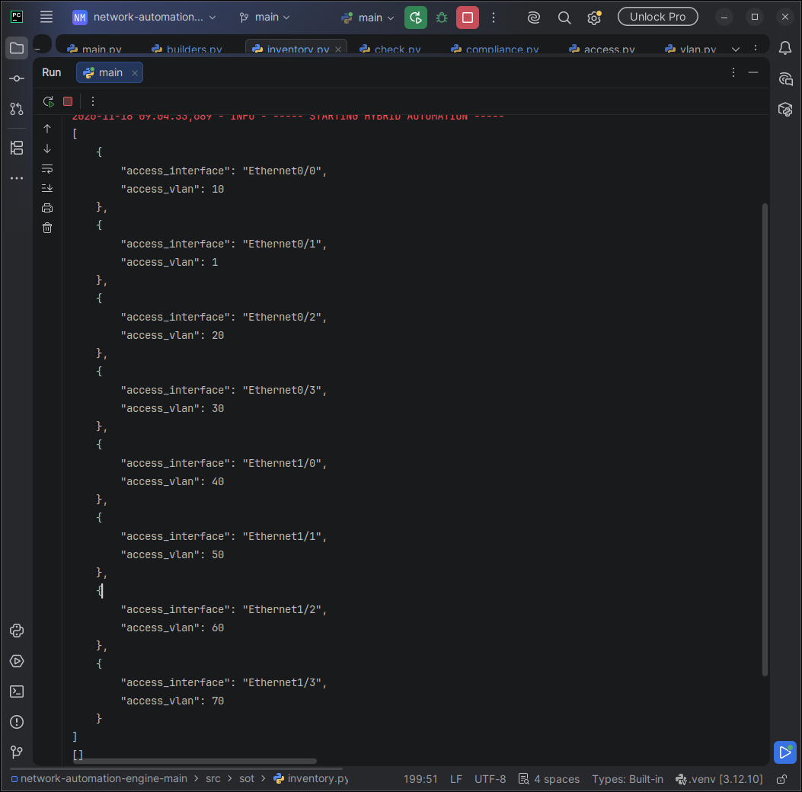

# Access Port Compliance & Remediation

## Overview

The Access Port Compliance module is part of the network automation engine. It validates Cisco switch access-port configurations against the expected network configuration stored in NetBox.

The module identifies access ports with incorrect VLAN assignments or operational modes, reports configuration drift, and can automatically remediate non-compliant interfaces.

The implementation uses NetBox as the Source of Truth (SoT), Genie for parsing device state, and Netmiko for device configuration.

## Objectives

- Retrieve expected access-port configurations from NetBox.
- Collect actual switchport configurations from Cisco devices.
- Identify access ports with incorrect VLAN assignments.
- Detect interfaces operating in the wrong mode.
- Automatically configure non-compliant access ports.
- Validate configuration changes after remediation.
- Record compliance results and remediation activity through structured logging.
- Support dry-run execution without modifying device configurations.

## Architecture

The access-port compliance workflow consists of five main components:

| Component | Responsibility |
|---|---|
| NetBox Inventory | Supplies expected access interfaces and VLAN assignments. |
| Genie Collector | Collects and parses actual switchport configurations. |
| Access Builder | Normalizes collected switchport data. |
| Compliance Checker | Compares expected and actual interface configurations. |
| Remediation Engine | Applies configuration changes and supports post-remediation validation. |

## Workflow

```text
             NetBox
                |
                v
       Expected Access Ports
                |
                v
        Genie Device Collector
                |
                v
          build_access()
                |
                v
          check_access()
                |
          +-----+-----+
          |           |
       Compliant   Non-Compliant
          |           |
          v           v
       Log Result   DRY_RUN?
                      |
                 +----+----+
                 |         |
                Yes        No
                 |         |
                 v         v
             Log Planned  configure_access()
             Remediation      |
                              v
                       Collect New State
                              |
                              v
                       Post-Validation
                              |
                              v
                       Record Final Result
```

## 1. Intended State: NetBox Source of Truth (Access Ports)

In this architecture, switchport VLAN assignments are declared centrally in **NetBox DCIM** under the device interface schema. Network engineers define operational intent directly within NetBox never by manually editing switch CLI configurations.

Before initiating compliance audits or remediation routines, the engine queries NetBox to extract the declared 802.1Q port modes and untagged VLAN memberships for access-layer switches like `ACCESS-SW-1`.


### Interface Baseline: `ACCESS-SW-1`

The switchport baseline for `ACCESS-SW-1` declares 8 physical access interfaces assigned to designated broadcast domains, alongside an internal virtual

management interface (`Vlan1`):

| Interface | 802.1Q Mode | Untagged VLAN Name | VID (`untagged_vlan`) | Intended State (`should_be_up`) | Interface Type | Description |
| :--- | :---: | :--- | :---: | :---: | :--- | :--- |
| **Ethernet0/0** | `Access` | `USERS` | **10** | `True` | 100BASE-FX | Configured via Netmiko |
| **Ethernet0/1** | `Access` | `default` | **1** | `True` | 100BASE-TX | Configured via Netmiko |
| **Ethernet0/2** | `Access` | `VOICE` | **20** | `False` | 100BASE-TX | — |
| **Ethernet0/3** | `Access` | `SERVERS` | **30** | `True` | 100BASE-FX | Configured via Netmiko |
| **Ethernet1/0** | `Access` | `GUEST` | **40** | `True` | 100BASE-TX | Configured via Netmiko |
| **Ethernet1/1** | `Access` | `MANAGEMENT` | **50** | `True` | 100BASE-TX | Configured via Netmiko |
| **Ethernet1/2** | `Access` | `PRINTERS_IOT` | **60** | `True` | 100BASE-FX | Configured via Netmiko |
| **Ethernet1/3** | `Access` | `NETWORK_

INFRASTRUCTURE` | **70** | `True` | 100BASE-FX | Configured via Netmiko |
| *Vlan1* | *None* | *None* | *—* | *—* | *Virtual* | *(Filtered out: SVI)* |

---

### Ingestion & Defensive Filtering (`src/sot/inventory.py`)

When loading device context from NetBox, the inventory engine evaluates interface metadata to differentiate physical access switchports from 802.1Q trunk links, routed interfaces, or virtual SVIs.

Only physical interfaces with `mode.value == "access"` and an active `untagged_vlan` object are ingested into the access-port validation pipeline. Virtual interfaces (such as `Vlan1`) are gracefully bypassed:


```python
# src/sot/inventory.py (Switchport Ingestion Logic)

if is_switch:
    # 1. Filter and extract dedicated Access Switchports
    if (
        device_interface.mode
        and device_interface.mode.value == "access"
        Here is the complete, uninterrupted section ready to paste directly into your README:

---

```markdown
## 1. Intended State: NetBox Source of Truth (and device_interface.untagged_vlan
    ):
        config_data[host_ip]["Access Ports)

In this architecture, switchport access assignments are declared centrally in **NetBox DCIM** under the device interfaceaccess_ports"].append(
            {
                "access_interface": device_interface.name,
                "access_vlan": device_interface.untagged_vlan.vid,
            }
         schema. Network engineers define operational intent within NetBox—including 802.1Q port mode, administrative state, and)

    # 2. Filter and extract 802.1Q Trunk Switchports
    if ( untagged VLAN membership—rather than configuring devices manually via the CLI.

The automation engine queries the NetBox REST API (
        device_interface.mode
        and device_interface.mode.value == "tagged"
        and device_interface.tagged_vlans
    ):
        config_data[host_ip]["trunk_ports`/api/dcim/interfaces/`) to establish the baseline of expected switchports and their associated VLAN IDs for target device"].append(
            {
                "device_ip": host_ip,
                "trunk_interface": `ACCESS-SW-1`.


### Interface Specification: `ACCESS-SW-1`

Thejoin(
                    str(v["vid"]) for v in device_interface.tagged_vlans
                ), switchport baseline for `ACCESS-SW-1` declares 8 physical access interfaces mapped to operational VLANs, alongside
            }
        )
```

---

### Normalized Desired State Output

The resulting data structure built by a virtual management SVI (`Vlan1`):

| Interface | 802.1Q Mode | Untagged VLAN (`untagged_vlan`) | VID | Intended State (`should_be_up`) | Interface Type `inventory.py` provides the compliance engine with a clean, normalized list of access interfaces and their mandatory VLAN IDs. | Description |
| :--- | :---: | :--- | :---: | :---: | : Non-switchport and virtual interfaces are omitted automatically:


```json
[
  {
    "access_interface": "Ethernet0/0",
    "access_vlan": 10
  },
  {
    "access10** | `True` | 100BASE-FX | Configured via Netmiko |
| **Ethernet0/1** | `Access` | `default` | **1** | `True_interface": "Ethernet0/1",
    "access_vlan": 1
  },
  {
    "access_interface": "Ethernet0/2",
    "access_vlan":` | 100BASE-TX | Configured via Netmiko |
| **Ethernet0/2** | `Access` | `VOICE` | **20** | `False` | 100 20
  },
  {
    "access_interface": "Ethernet0/3",
    "access_vlan": 30
  },
  {
    "access_interface": "BASE-TX | — |
| **Ethernet0/3** | `Access` | `SERVERSEthernet1/0",
    "access_vlan": 40
  },
  {
` | **30** | `True` | 100BASE-FX | Configured via Netmiko |    "access_interface": "Ethernet1/1",
    "access_vlan": 50
| **Ethernet1/0** | `Access` | `GUEST` | **40** |
  },
  {
    "access_interface": "Ethernet1/2",
    "access `True` | 100BASE-TX | Configured via Netmiko |
| **Ethernet1_vlan": 60
  },
  {
    "access_interface": "Ethernet1/3",
    "access_vlan": 70
  }
]
```


> **/1** | `Access` | `MANAGEMENT` | **50** | `True` | 100BASE-TX | Configured via Netmiko |
| **Ethernet1/2** | `AccessDesign Principle:**  
> By evaluating `device_interface.mode.value == "access"` and strictly extracting ` | `PRINTERS_IOT` | **60** | `True` | 100BASE`untagged_vlan.vid`, the compliance checker (`check_access()`) receives an unambiguous list of expected-FX | Configured via Netmiko |
| **Ethernet1/3** | `Access` | `NETWORK_INFRASTRUCTURE` | **70** | `True` | 100BASE-FX interface-to-VLAN mappings. Any switchport configured in dynamic trunking mode, trunk mode, or mapped to the wrong access VLAN on the physical device will immediately trigger a drift detection event.


## 2. Device State Collection

The collector retrieves actual switchport information from the Cisco device.

Genie provides structured output that is passed to the `build_access()` function.

The builder normalizes the collected information into a consistent dictionary.

Example normalized output:

```python
{
    "gigabitethernet0/0": {
        "access_interface": "gigabitethernet0/0",
        "operational_mode": "static access",
        "access_vlan": "98"
    },
    "gigabitethernet0/1": {
        "access_interface": "gigabitethernet0/1",
        "operational_mode": "static access",
        "access_vlan": "20"
    }
}
```

Trunk interfaces are excluded from the access-port compliance results.

## 3. Compliance Validation

The `check_access()` function compares the expected interface configuration against the normalized device state.

The checker validates:

- Interface existence.
- Operational mode.
- Access VLAN assignment.

Example expected configuration:

```python
{
    "access_interface": "gigabitethernet0/0",
    "access_vlan": 98
}
```

Example actual configuration:

```python
{
    "gigabitethernet0/0": {
        "access_interface": "gigabitethernet0/0",
        "operational_mode": "static access",
        "access_vlan": "98"
    }
}
```

The checker normalizes VLAN values to strings before comparison.

Possible compliance results include:

| Condition | Result |
|---|---|
| Interface exists, correct access mode, correct VLAN | Compliant |
| Interface missing from access-port results | Non-compliant |
| VLAN assignment differs from NetBox | Non-compliant |
| Interface operating in trunk mode | Non-compliant |

## 4. Automated Remediation

When configuration drift is detected, the compliance engine records the issue and invokes `configure_access()` when dry-run mode is disabled.

The remediation function receives:

- Device session.
- Expected access-port configuration.
- Logger.
- Device management IP.
- Transport type.

The remediation process is responsible for applying the required interface configuration.

Example Cisco IOS configuration:

```cisco
interface Ethernet0/0
 switchport mode access
 switchport access vlan 10
```

Successful remediation is recorded in the device results.

Failed remediation updates the device status to `FAILED_CONFIG` and records the failure as a critical issue.

## 5. Dry-Run Mode

The module supports a dry-run mode through the project-wide `DRY_RUN` setting.

When enabled:

- Compliance checks still execute.
- Configuration drift is identified.
- Planned remediation is recorded.
- No configuration commands are sent to the device.

Example action:

```text
[DRY_RUN] Would Configure Access Port |
Interface: Ethernet0/0 |
VLAN: 10
```

This allows configuration changes to be reviewed before they are applied.

## 6. Post-Remediation Validation

After successful remediation, the module collects device state again.

The updated state is normalized using `build_access()` and compared against the expected configuration using `check_access()`.

The final result is recorded as either:

- `SUCCESS` — the interface now matches the expected configuration.
- `FAILED_VALIDATION` — the interface still does not meet the expected configuration.

This provides a verification step instead of assuming that a successful configuration command guarantees compliance.

## 7. Logging and Reporting

The compliance engine records structured events for access-port validation and remediation.

Logged fields include:

| Field | Description |
|---|---|
| `device_ip` | Device management IP address |
| `event_type` | Compliance event classification |
| `component` | Component responsible for the event |
| `protocol` | Access-interface compliance identifier |
| `transport` | Device connection transport |
| `interface` | Interface being evaluated |
| `vlan_id` | Expected access VLAN |
| `compliant` | Compliance result |
| `failures_count` | Number of detected failures |
| `failures` | Detailed compliance failures |
| `status` | Execution status |
| `detail` | Event description |

The device result maintains three important collections:

- `initial_issues` — configuration drift detected before remediation.
- `actions_taken` — successful actions and planned dry-run actions.
- `critical_issues` — remediation or post-validation failures.

## 8. Unit Testing

The access-port functionality includes pytest coverage for the builder and compliance workflow.

### Builder Tests

| Test | Purpose |
|---|---|
| `test_build_access_valid_path` | Validates parsing of Genie switchport output. |
| `test_build_access_ingore_trunk` | Ensures trunk interfaces are excluded. |
| `test_build_access_mixed` | Tests mixed access and trunk interface data. |
| `test_build_access_no_vlan` | Validates handling of an access interface without a VLAN value. |
| `test_build_access_empty` | Validates empty input handling. |
| `test_build_access_no_dict` | Validates input without switchport data. |

### Compliance Tests

| Test | Purpose |
|---|---|
| `test_compliance_access_already_compliant` | Confirms compliant interfaces are not remediated. |
| `test_compliance_access_non_compliant_config_successful` | Tests successful remediation. |
| `test_compliance_access_non_compliant_config_failed` | Tests failed remediation handling. |
| `test_compliance_access_dry_run` | Confirms no configuration is applied during dry-run execution. |
| `test_compliance_access_post_validation_successful` | Tests successful post-remediation validation. |
| `test_compliance_access_post_validation_failed` | Tests failed post-remediation validation. |
| `test_compliance_access_empty` | Tests behavior when no expected access ports exist. |

### Running the Tests

From the project root:

```bash
PYTHONPATH=. pytest tests/unit/collectors/cli/test_build_access.py -v
```

Run the compliance tests:

```bash
PYTHONPATH=. pytest tests/unit/compliance/switching/access -v
```

Run the complete test suite:

```bash
PYTHONPATH=. pytest -v
```

## Technologies

- **Python** — Automation and compliance logic.
- **NetBox** — Network Source of Truth and inventory.
- **Netmiko** — Network device connectivity and configuration.
- **Genie** — Structured network device output parsing.
- **Jinja2** — Configuration template rendering.
- **pytest** — Automated testing and validation.

## Design Considerations

The module separates inventory retrieval, device-state collection, normalization, compliance validation, and remediation.

This separation makes individual components easier to test and maintain while allowing the compliance engine to follow a consistent workflow.

The use of post-remediation validation helps ensure that configuration changes achieve the intended result rather than relying solely on command execution status.


## 1. Intended State: NetBox Source of Truth (Access Ports)

In this architecture, switchport VLAN assignments are declared centrally in **NetBox DCIM** under the device interface schema. Network engineers define operational intent directly within NetBox never by manually editing switch CLI configurations.

Before initiating compliance audits or remediation routines, the engine queries NetBox to extract the declared 802.1Q port modes and untagged VLAN memberships for access-layer switches like `ACCESS-SW-1`.


### Interface Baseline: `ACCESS-SW-1`

The switchport baseline for `ACCESS-SW-1` declares 8 physical access interfaces assigned to designated broadcast domains, alongside an internal virtual

management interface (`Vlan1`):

| Interface | 802.1Q Mode | Untagged VLAN Name | VID (`untagged_vlan`) | Intended State (`should_be_up`) | Interface Type | Description |
| :--- | :---: | :--- | :---: | :---: | :--- | :--- |
| **Ethernet0/0** | `Access` | `USERS` | **10** | `True` | 100BASE-FX | Configured via Netmiko |
| **Ethernet0/1** | `Access` | `default` | **1** | `True` | 100BASE-TX | Configured via Netmiko |
| **Ethernet0/2** | `Access` | `VOICE` | **20** | `False` | 100BASE-TX | — |
| **Ethernet0/3** | `Access` | `SERVERS` | **30** | `True` | 100BASE-FX | Configured via Netmiko |
| **Ethernet1/0** | `Access` | `GUEST` | **40** | `True` | 100BASE-TX | Configured via Netmiko |
| **Ethernet1/1** | `Access` | `MANAGEMENT` | **50** | `True` | 100BASE-TX | Configured via Netmiko |
| **Ethernet1/2** | `Access` | `PRINTERS_IOT` | **60** | `True` | 100BASE-FX | Configured via Netmiko |
| **Ethernet1/3** | `Access` | `NETWORK_

INFRASTRUCTURE` | **70** | `True` | 100BASE-FX | Configured via Netmiko |
| *Vlan1* | *None* | *None* | *—* | *—* | *Virtual* | *(Filtered out: SVI)* |

---

### Ingestion & Defensive Filtering (`src/sot/inventory.py`)

When loading device context from NetBox, the inventory engine evaluates interface metadata to differentiate physical access switchports from 802.1Q trunk links, routed interfaces, or virtual SVIs.

Only physical interfaces with `mode.value == "access"` and an active `untagged_vlan` object are ingested into the access-port validation pipeline. Virtual interfaces (such as `Vlan1`) are gracefully bypassed:


```python
# src/sot/inventory.py (Switchport Ingestion Logic)

if is_switch:
    # 1. Filter and extract dedicated Access Switchports
    if (
        device_interface.mode
        and device_interface.mode.value == "access"
        Here is the complete, uninterrupted section ready to paste directly into your README:

---

```markdown
## 1. Intended State: NetBox Source of Truth (and device_interface.untagged_vlan
    ):
        config_data[host_ip]["Access Ports)

In this architecture, switchport access assignments are declared centrally in **NetBox DCIM** under the device interfaceaccess_ports"].append(
            {
                "access_interface": device_interface.name,
                "access_vlan": device_interface.untagged_vlan.vid,
            }
         schema. Network engineers define operational intent within NetBox—including 802.1Q port mode, administrative state, and)

    # 2. Filter and extract 802.1Q Trunk Switchports
    if ( untagged VLAN membership—rather than configuring devices manually via the CLI.

The automation engine queries the NetBox REST API (
        device_interface.mode
        and device_interface.mode.value == "tagged"
        and device_interface.tagged_vlans
    ):
        config_data[host_ip]["trunk_ports`/api/dcim/interfaces/`) to establish the baseline of expected switchports and their associated VLAN IDs for target device"].append(
            {
                "device_ip": host_ip,
                "trunk_interface": `ACCESS-SW-1`.


### Interface Specification: `ACCESS-SW-1`

Thejoin(
                    str(v["vid"]) for v in device_interface.tagged_vlans
                ), switchport baseline for `ACCESS-SW-1` declares 8 physical access interfaces mapped to operational VLANs, alongside
            }
        )
```

---

### Normalized Desired State Output

The resulting data structure built by a virtual management SVI (`Vlan1`):

| Interface | 802.1Q Mode | Untagged VLAN (`untagged_vlan`) | VID | Intended State (`should_be_up`) | Interface Type `inventory.py` provides the compliance engine with a clean, normalized list of access interfaces and their mandatory VLAN IDs. | Description |
| :--- | :---: | :--- | :---: | :---: | : Non-switchport and virtual interfaces are omitted automatically:


```json
[
  {
    "access_interface": "Ethernet0/0",
    "access_vlan": 10
  },
  {
    "access10** | `True` | 100BASE-FX | Configured via Netmiko |
| **Ethernet0/1** | `Access` | `default` | **1** | `True_interface": "Ethernet0/1",
    "access_vlan": 1
  },
  {
    "access_interface": "Ethernet0/2",
    "access_vlan":` | 100BASE-TX | Configured via Netmiko |
| **Ethernet0/2** | `Access` | `VOICE` | **20** | `False` | 100 20
  },
  {
    "access_interface": "Ethernet0/3",
    "access_vlan": 30
  },
  {
    "access_interface": "BASE-TX | — |
| **Ethernet0/3** | `Access` | `SERVERSEthernet1/0",
    "access_vlan": 40
  },
  {
` | **30** | `True` | 100BASE-FX | Configured via Netmiko |    "access_interface": "Ethernet1/1",
    "access_vlan": 50
| **Ethernet1/0** | `Access` | `GUEST` | **40** |
  },
  {
    "access_interface": "Ethernet1/2",
    "access `True` | 100BASE-TX | Configured via Netmiko |
| **Ethernet1_vlan": 60
  },
  {
    "access_interface": "Ethernet1/3",
    "access_vlan": 70
  }
]
```

> **/1** | `Access` | `MANAGEMENT` | **50** | `True` | 100BASE-TX | Configured via Netmiko |
| **Ethernet1/2** | `AccessDesign Principle:**  
> By evaluating `device_interface.mode.value == "access"` and strictly extracting ` | `PRINTERS_IOT` | **60** | `True` | 100BASE`untagged_vlan.vid`, the compliance checker (`check_access()`) receives an unambiguous list of expected-FX | Configured via Netmiko |
| **Ethernet1/3** | `Access` | `NETWORK_INFRASTRUCTURE` | **70** | `True` | 100BASE-FX interface-to-VLAN mappings. Any switchport configured in dynamic trunking mode, trunk mode, or mapped to the wrong access VLAN on the physical device will immediately trigger a drift detection event.
```


