# HSRP First Hop Redundancy Compliance & NETCONF Remediation 

## Overview

In high-availability campus and branch topologies, First Hop Redundancy Protocols (FHRP) like HSRP are the last line of defense against silent gateway outages. A drifted Virtual IP, a disabled preemption flag, or a rogue standby group doesn't just misconfigure a port it breaks transparent failover, strands subnets without a default gateway, or causes asymmetric routing during a primary router reboot.

The **HSRP Compliance & NETCONF Remediation** module is a production-grade, closed-loop automation engine built specifically for this failure class. It is the portfolio's only **NETCONF-over-SSH** module: rather than screen-scraping `show standby`, it reads the router's live state as a structured **YANG data model** over SSH port 830, parses the XML payload via `xmltodict`, and diffs it against a **NetBox Source of Truth** using a unique **two-tier evaluation strategy** a device-level rogue-group pre-gate (`check_extra_hsrp`) followed by a per-group attribute parity gate (`check_hsrp`).

Because HSRP groups are keyed by `(interface, router_vlan, group)`, the engine introduces a set-difference pattern to catch unauthorized standby groups (e.g., a rogue `standby 1` on a physical uplink) and route them straight to `critical_issues`, while attribute drifts (wrong VIP, priority, preempt, version) are logged as `initial_issues`. Remediation is executed via a declarative Jinja2 XML template (`hsrp.j2`) and an atomic NETCONF `<edit-config>` RPC.

### Core Engineering Objectives
- **Declarative Baseline via Config Context:** Establish NetBox Config Contexts as the single source of truth for HSRP group numbers, Virtual IPs, administrative priorities, preemption flags, and protocol versions.
- **Model-Driven Collection (NETCONF/XML):** Query `/Cisco-IOS-XE-native:native/interface` over SSH using `ncclient` and `xmltodict`, parsing the `<standby-list>` containers directly instead of scraping terminal output.
- **Two-Tier Diff Semantics:** `check_extra_hsrp()` isolates rogue groups via set-difference on `(interface, vlan, group)` keys, while `check_hsrp()` validates VIP, priority, preempt, and version parity for every authorized group.
- **Atomic XML Remediation:** `configure_hsrp()` renders `hsrp.j2` into a complete `<native>` YANG payload and issues a single `edit_config` RPC, naturally idempotent on re-run.
- **Closed-Loop Verification:** Re-issue the NETCONF `<get-config>`, re-run `build_hsrp()` + `check_hsrp()` against fresh operational state, and assert the standby group is actually active before marking success.
- **Enterprise Observability:** Stream severity-coded JSON to Splunk via HEC, with the documented orchestrator-vs-handler schema asymmetry (`protocol`/`priority` vs `RID`/`networks`-style field splits) made explicit.
- **CI/CD Readiness:** Validate the state machine with 13 offline Pytest cases (6 builder + 7 compliance); HSRP is NETCONF-only, so unlike SNMP/Syslog/STP, the compliance suite is *not* transport-parametrized.

---

## Architecture

The HSRP module follows the project's Source-of-Truth-driven architecture, but with a NETCONF-over-SSH collection/remediation path unique to this module:

| Component | Responsibility |
|---|---|
| **NetBox (Config Contexts)** | Supplies expected HSRP groups, VIPs, priorities, preemption flags, and versions per interface. |
| **NETCONF Collector** | `collect_netconf_state()` GETs the native interface YANG tree over SSH via `ncclient`, deserializing XML with `xmltodict`. |
| **HSRP Builder** | `build_hsrp()` traverses the XML tree, filters to `<standby-list>` containers, and emits a normalized `[{interface, version, group, vip, preempt, priority, router_vlan}]` list. |
| **Compliance Checker** | `check_extra_hsrp()` runs the rogue-group set-diff; `check_hsrp()` runs the per-group attribute parity diff with short-circuit on missing groups. |
| **Remediation Engine** | `configure_hsrp()` renders `hsrp.j2` into a YANG XML payload and issues an atomic NETCONF `<edit-config>` RPC. |
| **Post-Validation** | Re-GETs the interface container, re-builds, re-checks, and confirms the standby group is live on the data plane. |

## Topology 

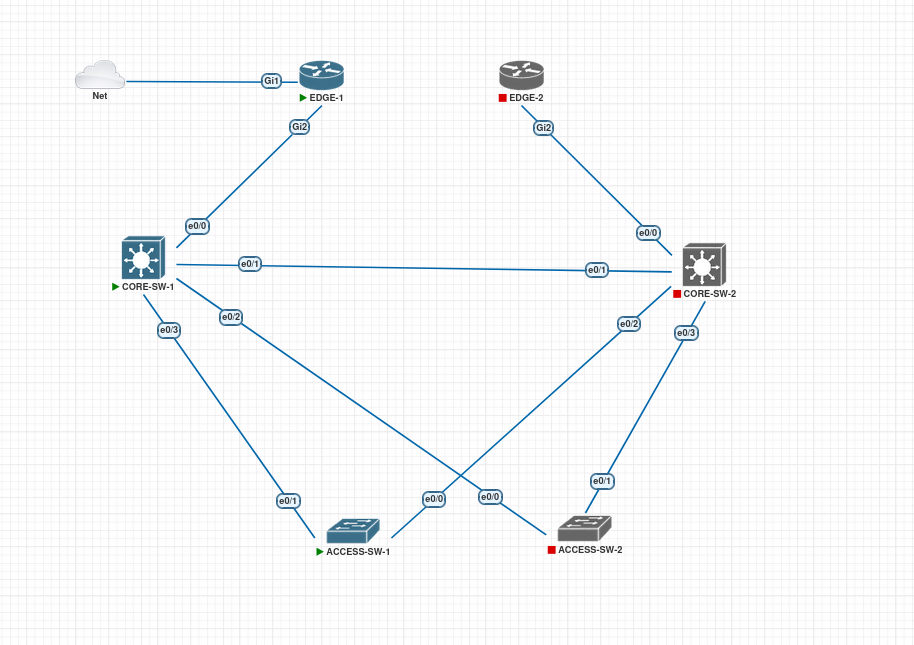

## End to End Execution 

https://github.com/user-attachments/assets/3f4c55f7-d3c9-413a-b9bf-28b173dbd62b

### Table of Contents

- [1. Intended State: NetBox Source of Truth (First Hop Redundancy - HSRP)](#1-intended-state-netbox-source-of-truth-first-hop-redundancy---hsrp)
- [2. Live Device State Collection & NETCONF Parsing (HSRP)](#2-live-device-state-collection--netconf-parsing-hsrp)
- [3. HSRP Compliance Diff Engine & Drift Detection](#3-hsrp-compliance-diff-engine--drift-detection)
- [4. Configuration Remediation](#4-configuration-remediation)
- [5. Safe Change Management: Dry-Run Mode](#5-safe-change-management-dry-run-mode)
- [6. Post-Remediation Validation & Physical Device Proof](#6-post-remediation-validation--physical-device-proof)
- [7. Audit Logging & Splunk Telemetry Pipeline (HSRP via NETCONF)](#7-audit-logging--splunk-telemetry-pipeline-hsrp-via-netconf)
- [8. Automated Unit Testing & CI/CD Validation (HSRP via NETCONF)](#8-automated-unit-testing--cicd-validation-hsrp-via-netconf)

## 1. Intended State: NetBox Source of Truth (First Hop Redundancy - HSRP)

In high-availability routing architectures, default gateway redundancy is critical to preventing single points of failure. **Hot Standby Router Protocol (HSRP)** provides transparent failover for edge hosts by sharing a Virtual IP (VIP) and virtual MAC address across a pair of active and standby routers.

A common operational failure mode is priority mismatch or disabled preemption, causing asymmetric routing or preventing an upgraded primary router from reclaiming its active forwarding role after a reboot.

To ensure deterministic gateway behavior, the automation engine establishes **NetBox** as the authoritative Source of Truth (SoT). The HSRP baseline is declared as structured JSON within **NetBox Config Contexts** (`dcim/devices/<id>/config-context/`).

---

### 1. Declaring HSRP Baseline in NetBox Config Context

On edge router `HQ-EDGE-1` (`192.168.255.10`), two distinct HSRP standby groups are defined across physical routed interfaces `GigabitEthernet1` and `GigabitEthernet2`:

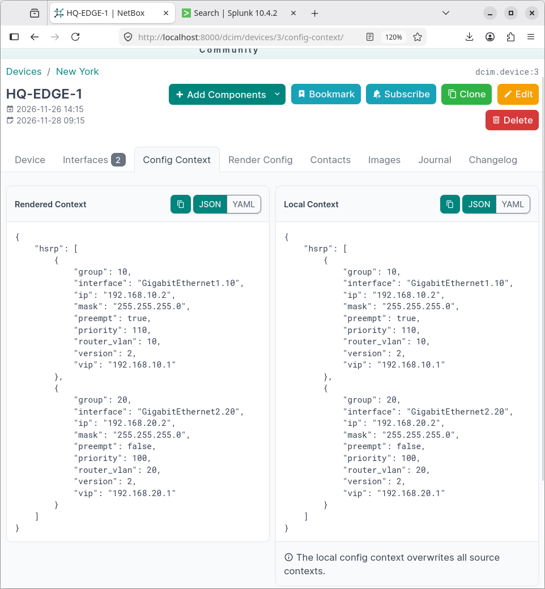

```json
{
  "hsrp": [
    {
      "group": 10,
      "interface": "GigabitEthernet1",
      "ip": "10.10.10.1",
      "preempt": true,
      "priority": 110,
      "router_vlan": 10,
      "version": 2
    },
    {
      "group": 20,
      "interface": "GigabitEthernet2",
      "ip": "192.168.20.1",
      "preempt": false,
      "priority": 100,
      "router_vlan": 20,
      "version": 2
    }
  ]
}
```

> NetBox renders this identically in the **Rendered Context** and **Local Context** panels (`The local config context overwrites all source contexts.`), confirming the HSRP policy is authored directly on the device with no inherited source contexts.

---

### Policy Specification & Traffic Engineering

| Interface | HSRP Group | Virtual IP (`vip`) | Priority | Preempt | Version | Traffic Engineering Role |
| :--- | :---: | :---: | :---: | :---: | :---: | :--- |
| **`GigabitEthernet1`** | **10** | `10.10.10.1` | **`110`** | **`True`** | `2` | **Active Gateway (Primary):** Priority elevated above default (100) with preemption enabled to actively reclaim routing forwarding upon recovery. |
| **`GigabitEthernet2`** | **20** | `192.168.20.1` | **`100`** | **`False`** | `2` | **Standby Gateway (Secondary):** Default priority without preemption, designated as backup forwarder. |

> **Key Architectural Standards:**
> * **HSRP Version 2:** Mandated across all groups to support millisecond timers, expanded group ranges (`0 - 4095`), and mitigation against v1 multicast collisions.
> * **Virtual IP Validation:** Enforces exact alignment between the declared VIP and downstream subnet gateway allocations.

---

### 2. Inventory Ingestion Engine (`src/sot/inventory.py`)

During inventory synchronization, the engine extracts the `hsrp_context` from NetBox device context and structures it into the target device configuration dictionary. Note the key mapping: NetBox declares the address as `"ip"`, but the engine normalizes it to `"vip"` internally:

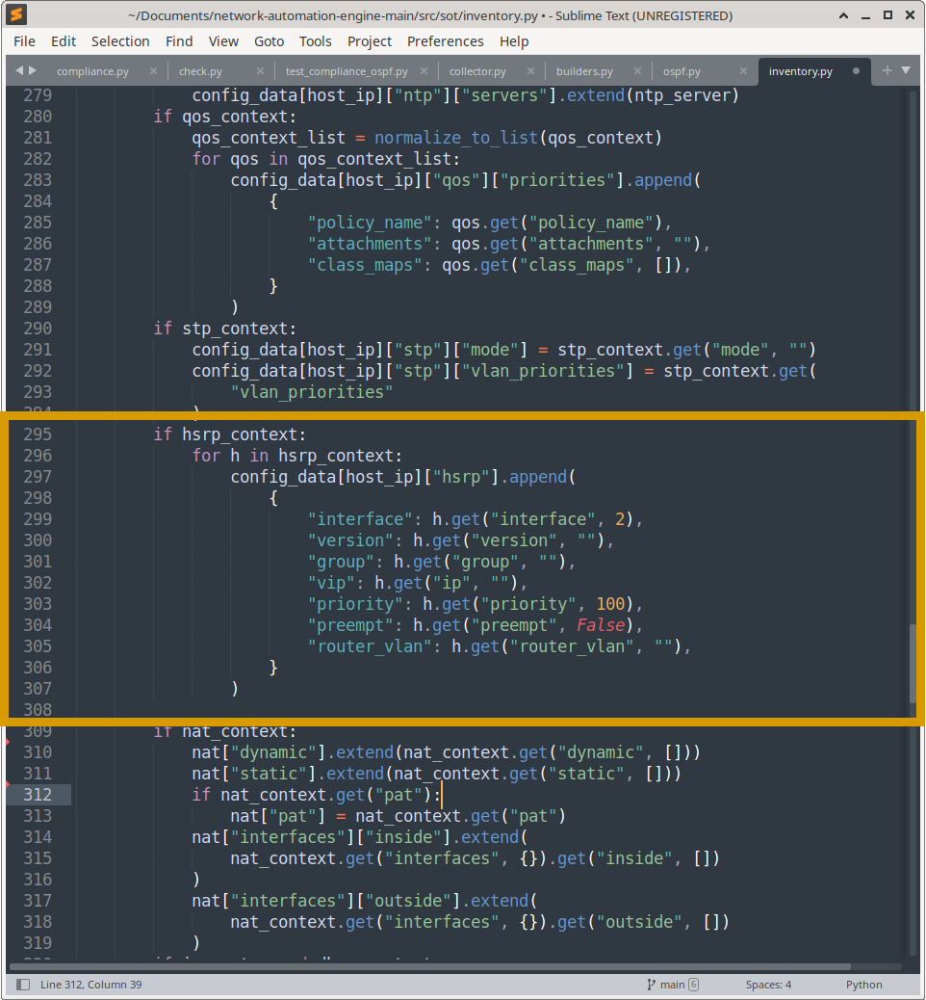

```python
# src/sot/inventory.py (HSRP Ingestion Logic)

        if hsrp_context:
            for h in hsrp_context:
                config_data[host_ip]["hsrp"].append(
                    {
                        "interface": h.get("interface", 2),
                        "version": h.get("version", ""),
                        "group": h.get("group", ""),
                        "vip": h.get("ip", ""),
                        "priority": h.get("priority", 100),
                        "preempt": h.get("preempt", False),
                        "router_vlan": h.get("router_vlan", ""),
                    }
                )
```

---

### 3. Normalized Desired-State Output

At runtime, the inventory engine compiles the NetBox declarations and produces an immutable HSRP contract for `HQ-EDGE-1`:

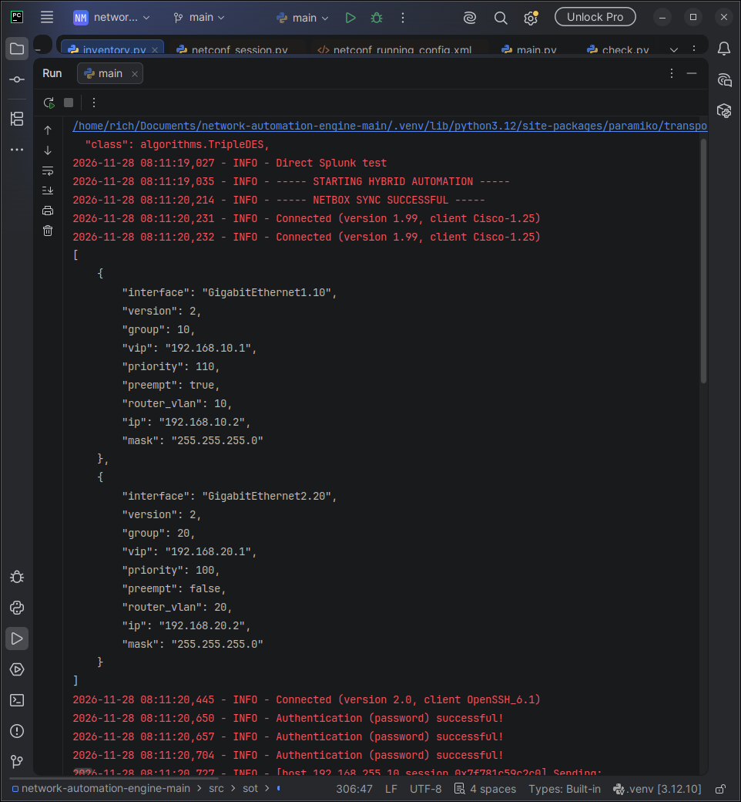

```json
[
  {
    "interface": "GigabitEthernet1",
    "version": 2,
    "group": 10,
    "vip": "10.10.10.1",
    "priority": 110,
    "preempt": true,
    "router_vlan": 10
  },
  {
    "interface": "GigabitEthernet2",
    "version": 2,
    "group": 20,
    "vip": "192.168.20.1",
    "priority": 100,
    "preempt": false,
    "router_vlan": 20
  }
]
```
--- 

## 2. Live Device State Collection & NETCONF Parsing (HSRP)

To audit First Hop Redundancy without relying on screen-scraping CLI tables, the engine collects live operational state via **NETCONF** over SSH (port 830) using the `Cisco-IOS-XE-native` YANG data model.

The collection pipeline operates in two distinct stages:
1. **NETCONF Subtree Extraction (`collector.py`):** Establishes an encrypted RPC session via `ncclient`, issues an XML `<get-config>` request filtered to the `<native>` root container, and deserializes the XML payload into structured Python dictionaries using `xmltodict`.
2. **HSRP Schema Normalization Builder (`builders.py`):** Traverses the native interface schema, inspects active `standby` containers across all interface types, and maps groups, virtual IPs, priorities, versions, and preemption flags into normalized records.

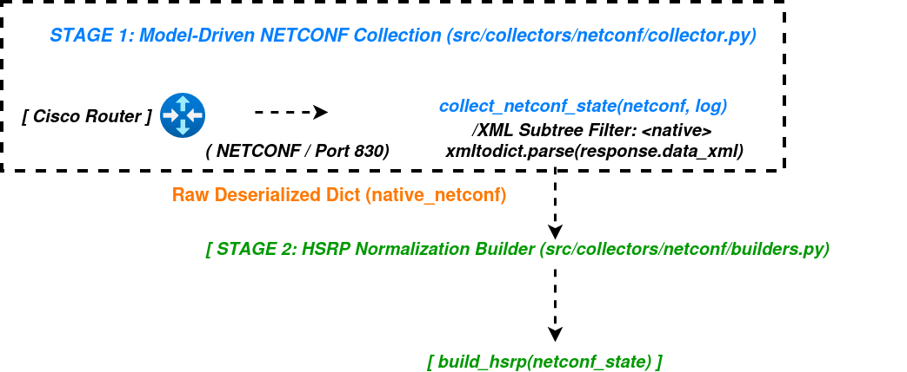

---

### 1. NETCONF XML Subtree Collection (`src/collectors/netconf/collector.py`)

The `collect_netconf_state()` function executes a `<get-config>` RPC targeting the router's running datastore. It uses a subtree XML filter bound to the Cisco native YANG namespace (`http://cisco.com/ns/yang/Cisco-IOS-XE-native`) and wraps the session inside an isolated exception boundary:

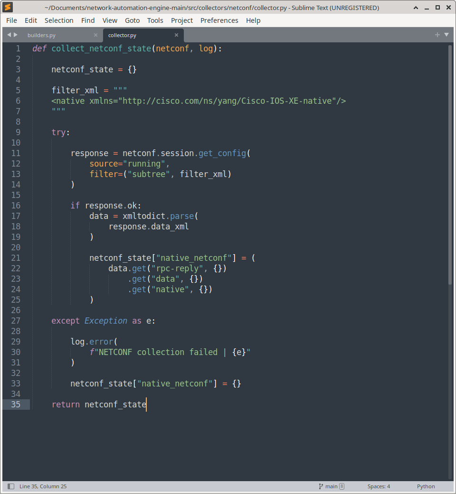

```python
# src/collectors/netconf/collector.py

import xmltodict

def collect_netconf_state(netconf, log):
    netconf_state = {}

    filter_xml = """
    <native xmlns="http://cisco.com/ns/yang/Cisco-IOS-XE-native"/>
    """

    try:
        response = netconf.session.get_config(
            source="running",
            filter=("subtree", filter_xml)
        )
        if response.ok:
            parsed = xmltodict.parse(response.data_xml)
            data = parsed.get("data") or parsed.get("rpc-reply", {}).get("data") or {}
            netconf_state["native_netconf"] = data.get("native") or {}

    except Exception as e:
        log.error(
            f"NETCONF collection failed | {e}"
        )
        netconf_state["native_netconf"] = {}

    return netconf_state
```
---

### 2. HSRP State Normalization Builder (`src/collectors/netconf/builders.py`)

The `build_hsrp()` builder parses the deserialized `native_netconf` tree.

It handles multiple interface types (`interfaces.items()`), normalizes single or multi-element standby lists with `normalize_to_list()`, extracts the virtual IP (`vip`), determines preemption from the standby container, and safely converts group numbers, versions, and VLAN tags to integers:

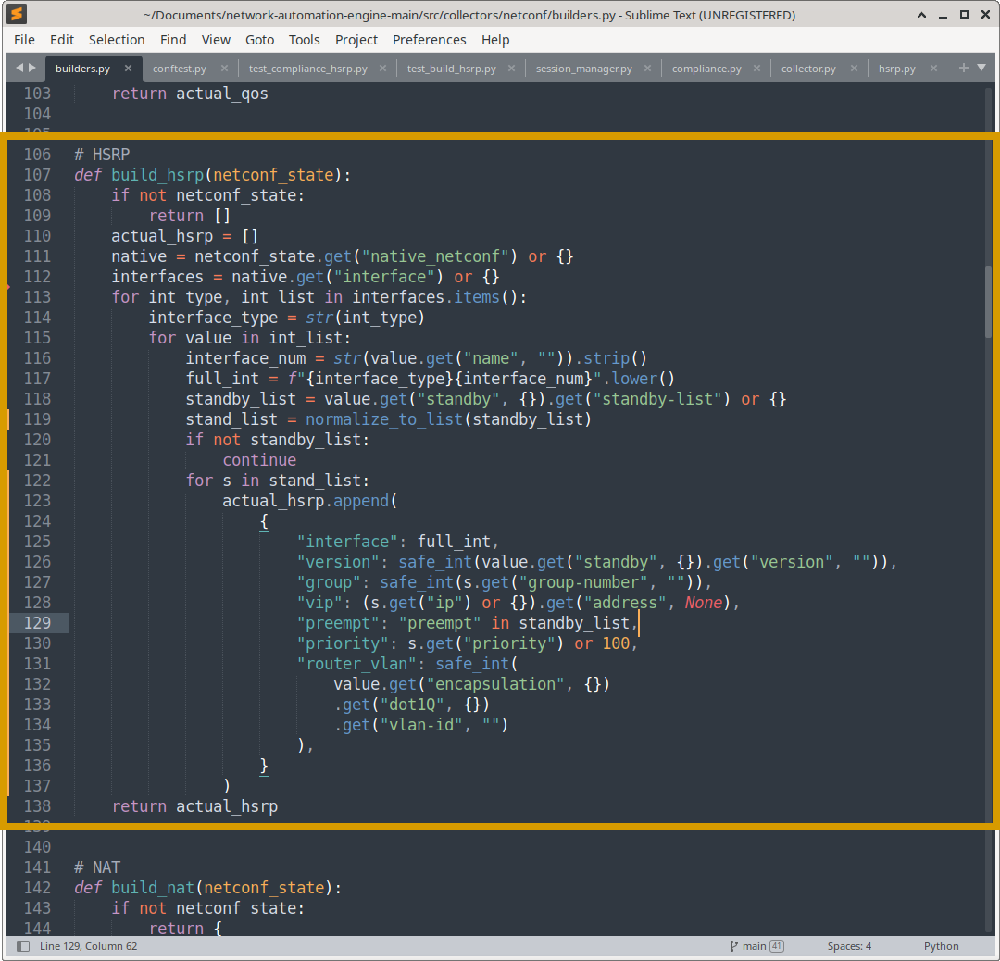

```python
# src/collectors/netconf/builders.py 

# HSRP
def build_hsrp(netconf_state):
    if not netconf_state:
        return []
    actual_hsrp = []
    native = netconf_state.get("native_netconf") or {}
    interfaces = native.get("interface") or {}
    for int_type, int_list in interfaces.items():
        interface_type = str(int_type)
        for value in int_list:
            interface_num = str(value.get("name", "")).strip()
            full_int = f"{interface_type}{interface_num}".lower()
            standby_list = value.get("standby", {}).get("standby-list") or {}
            stand_list = normalize_to_list(standby_list)
            if not standby_list:
                continue
            for s in stand_list:
                actual_hsrp.append(
                    {
                        "interface": full_int,
                        "version": safe_int(value.get("standby", {}).get("version", "")),
                        "group": safe_int(s.get("group-number", "")),
                        "vip": (s.get("ip") or {}).get("address", None),
                        "preempt": "preempt" in standby_list,
                        "priority": s.get("priority") or 100,
                        "router_vlan": safe_int(
                            value.get("encapsulation", {})
                            .get("dot1Q", {})
                            .get("vlan-id", "")
                        ),
                    }
                )
    return actual_hsrp
```

#### Key Engineering Highlights in `build_hsrp()`:
* **Interface-Type Agnostic:** Loops through all interface types dynamically (`for int_type, int_list in interfaces.items():`), accurately assembling full interface names (e.g., `gigabitethernet1`).
* **XML-to-List Normalization:** In XML, a single `<standby-list>` element parses as a dictionary, whereas multiple groups parse as a list. `normalize_to_list()` standardizes both into iterable collections.
* **Default Priority Fallback:** Enforces Cisco's default standby priority (`100`) if unconfigured (`s.get("priority") or 100`).

---

### 3. Live Router State vs. Injected HSRP Drift

To test model-driven extraction, out-of-band configuration drift was present on `EDGE-1`. The relevant section from the live paged `show running-config` (shot 4):

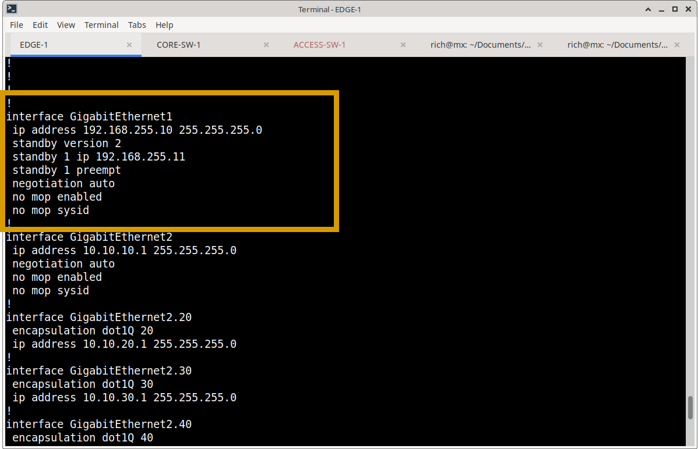

```cisco
! --- EDGE-1: show running-config (paged) GigabitEthernet1 carries a rogue standby group ---
interface GigabitEthernet1
 ip address 192.168.255.10 255.255.255.0
 standby version 2
 standby 1 ip 192.168.255.11
 standby 1 preempt
 negotiation auto
 no mop enabled
 no mop sysid
!
interface GigabitEthernet2
 ip address 10.10.10.1 255.255.255.0
 negotiation auto
 no mop enabled
 no mop sysid
!
```

#### Normalized Builder Runtime Output:
When the collector audited `EDGE-1`, `build_hsrp()` traversed the deserialized YANG tree and emitted the following operational list (shot 2). Only `gigabitethernet1` appears, because `gigabitethernet2` has no `standby` container:

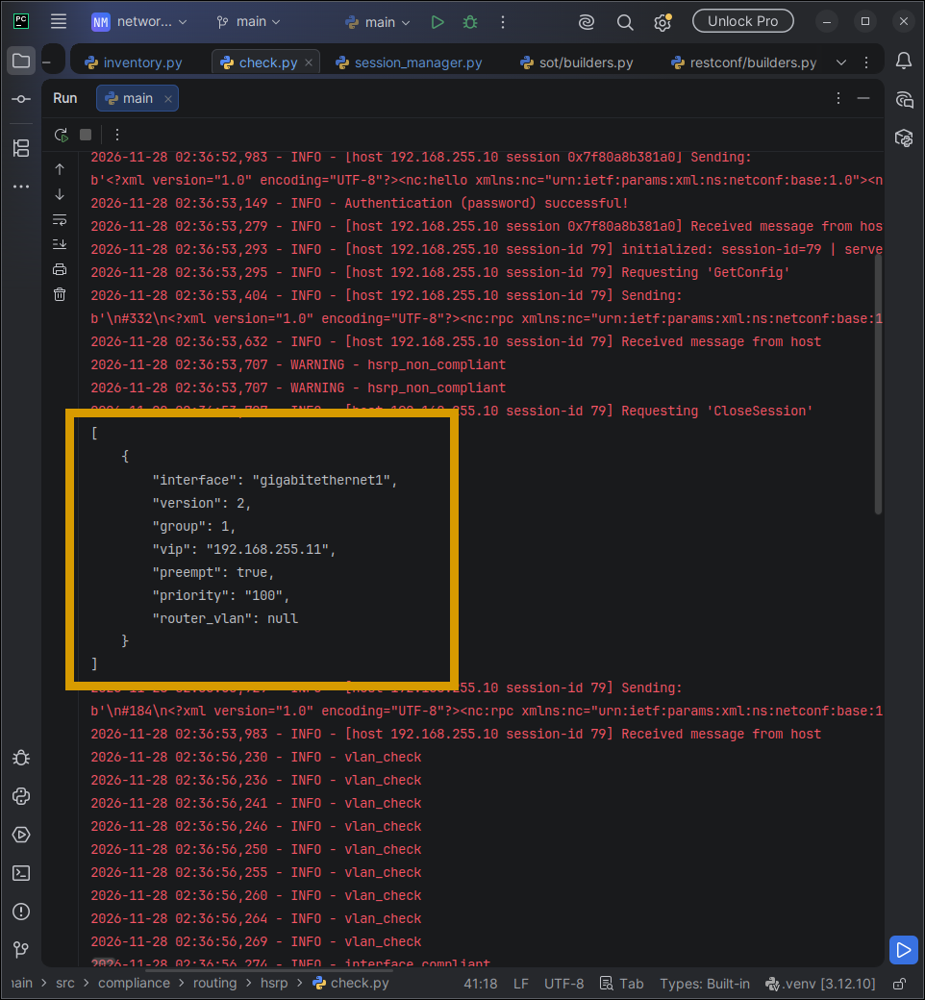

```json
[
    {
        "interface": "gigabitethernet1",
        "version": 2,
        "group": 1,
        "vip": "192.168.255.11",
        "preempt": true,
        "priority": "100",
        "router_vlan": null
    }
]
```
---

### 4. Operational Drift Baseline

Comparing this normalized operational state against the **NetBox Desired State** immediately reveals multi-parameter First Hop Redundancy drift across `EDGE-1`:

| Standby Parameter | NetBox Declared Intent | Observed Router State | Compliance Evaluation |
| :--- | :--- | :--- | :---: |
| **`GigabitEthernet1` Group** | Group `10` | Group `1` | **DRIFT (Mismatched Group ID)** |
| **`GigabitEthernet1` VIP** | `10.10.10.1` | `192.168.255.11` | **DRIFT (Mismatched Virtual Gateway IP)** |
| **`GigabitEthernet1` Priority** | `110` (Elevated Primary) | `"100"` (Default) | **DRIFT (Priority Too Low / Suboptimal Root)** |
| **`GigabitEthernet2` Group** | Group `20` (`192.168.20.1`) | Not Configured | **DRIFT (Missing HSRP Standby Group)** |

---

## 3. HSRP Compliance Diff Engine & Drift Detection

The First Hop Redundancy compliance engine continuously audits running default gateway configurations against NetBox intent.

Operating as a closed-loop state machine over **NETCONF**, the engine enforces a two-tier evaluation strategy:
1. **Rogue Standby Group Isolation (`check_extra_hsrp`):** A device-level pre-gate that performs set-difference analysis on `(interface, router_vlan, group)` tuples to detect unauthorized standby groups and route them straight to `critical_issues`.
2. **Multi-Parameter Attribute Verification (`check_hsrp`):** A per-group gate that audits virtual IPs, administrative priorities, preemption flags, and HSRP protocol versions for every authorized gateway, returning early on a missing group.

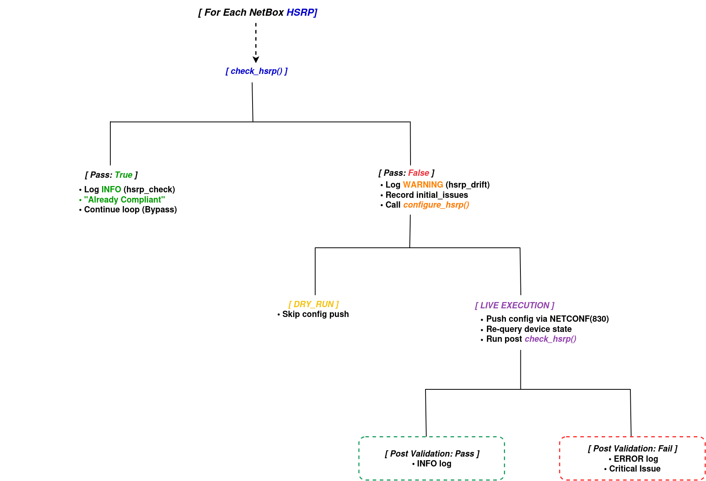

---

### 1. Two-Tier Diff Engine (`src/compliance/routing/hsrp/check.py`)

The diff engine decouples rogue configuration detection from attribute verification. Note the two different key-normalization defaults: `check_hsrp` builds its expected key with `expected_hsrp.get("router_vlan", "")` while `check_extra_hsrp` uses `… or None`

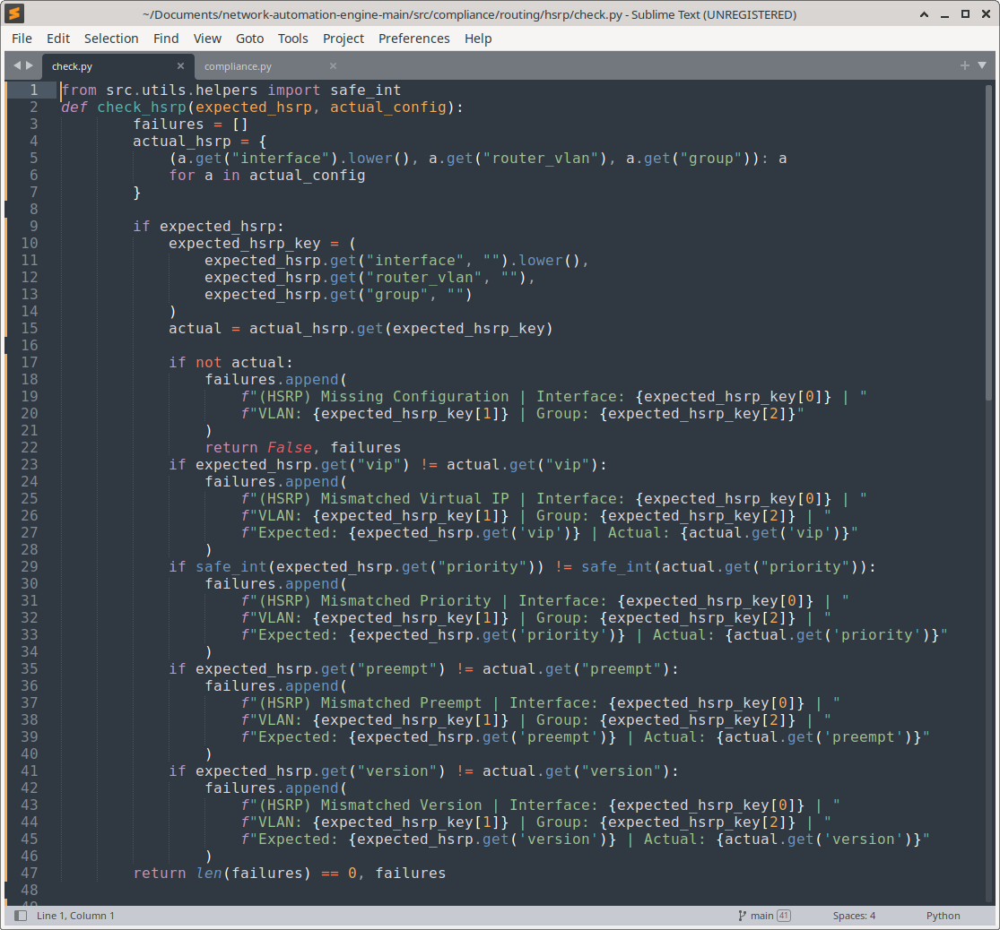

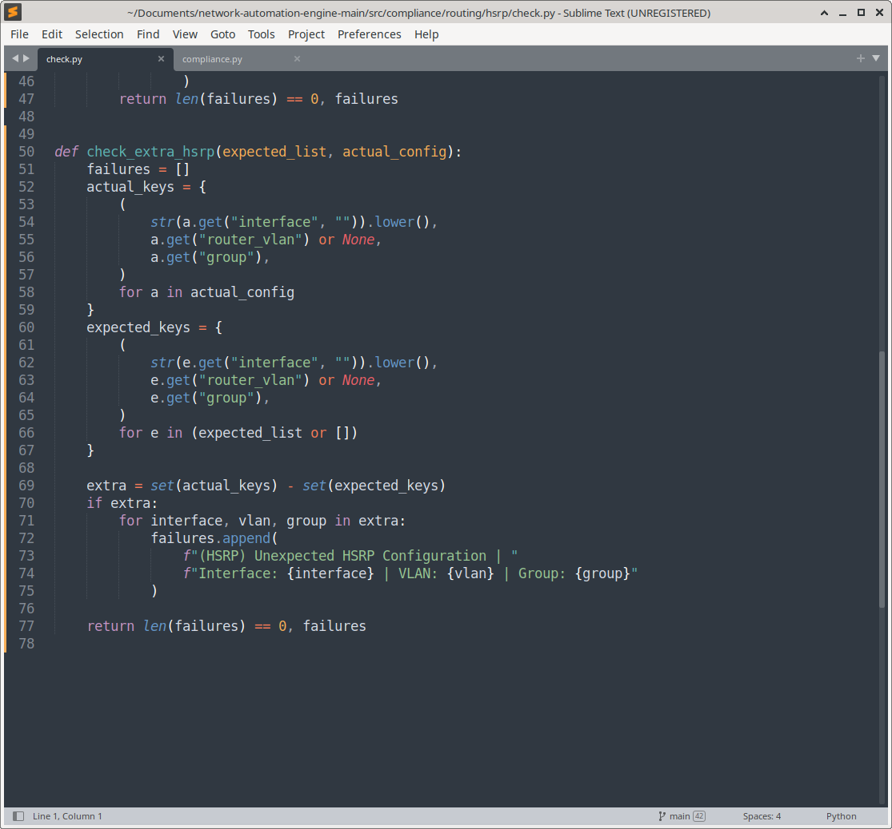

```python
# src/compliance/routing/hsrp/check.py

from src.utils.helpers import safe_int


def check_hsrp(expected_hsrp, actual_config):
    failures = []
    actual_hsrp = {
        (a.get("interface").lower(), a.get("router_vlan"), a.get("group")): a
        for a in actual_config
    }

    if expected_hsrp:
        expected_hsrp_key = (
            expected_hsrp.get("interface", "").lower(),
            expected_hsrp.get("router_vlan", ""),
            expected_hsrp.get("group", "")
        )
        actual = actual_hsrp.get(expected_hsrp_key)

        if not actual:
            failures.append(
                f"(HSRP) Missing Configuration | Interface: {expected_hsrp_key[0]} | "
                f"VLAN: {expected_hsrp_key[1]} | Group: {expected_hsrp_key[2]}"
            )
            return False, failures
        if expected_hsrp.get("vip") != actual.get("vip"):
            failures.append(
                f"(HSRP) Mismatched Virtual IP | Interface: {expected_hsrp_key[0]} | "
                f"VLAN: {expected_hsrp_key[1]} | Group: {expected_hsrp_key[2]} | "
                f"Expected: {expected_hsrp.get('vip')} | Actual: {actual.get('vip')}"
            )
        if safe_int(expected_hsrp.get("priority")) != safe_int(actual.get("priority")):
            failures.append(
                f"(HSRP) Mismatched Priority | Interface: {expected_hsrp_key[0]} | "
                f"VLAN: {expected_hsrp_key[1]} | Group: {expected_hsrp_key[2]} | "
                f"Expected: {expected_hsrp.get('priority')} | Actual: {actual.get('priority')}"
            )
        if expected_hsrp.get("preempt") != actual.get("preempt"):
            failures.append(
                f"(HSRP) Mismatched Preempt | Interface: {expected_hsrp_key[0]} | "
                f"VLAN: {expected_hsrp_key[1]} | Group: {expected_hsrp_key[2]} | "
                f"Expected: {expected_hsrp.get('preempt')} | Actual: {actual.get('preempt')}"
            )
        if expected_hsrp.get("version") != actual.get("version"):
            failures.append(
                f"(HSRP) Mismatched Version | Interface: {expected_hsrp_key[0]} | "
                f"VLAN: {expected_hsrp_key[1]} | Group: {expected_hsrp_key[2]} | "
                f"Expected: {expected_hsrp.get('version')} | Actual: {actual.get('version')}"
            )
    return len(failures) == 0, failures


def check_extra_hsrp(expected_list, actual_config):
    failures = []
    actual_keys = {
        (
            str(a.get("interface", "")).lower(),
            a.get("router_vlan") or None,
            a.get("group"),
        )
        for a in actual_config
    }
    expected_keys = {
        (
            str(e.get("interface", "")).lower(),
            e.get("router_vlan") or None,
            e.get("group"),
        )
        for e in (expected_list or [])
    }

    extra = set(actual_keys) - set(expected_keys)
    if extra:
        for interface, vlan, group in extra:
            failures.append(
                f"(HSRP) Unexpected HSRP Configuration | "
                f"Interface: {interface} | VLAN: {vlan} | Group: {group}"
            )

    return len(failures) == 0, failures
```

#### Validation Gates:
1. **Rogue Group Gate (`check_extra_hsrp`):** Set-difference of `(interface, vlan, group)` keys; any actual key absent from the expected set is a `critical_issue` (e.g. the rogue `standby 1` on `GigabitEthernet1`).
2. **Group Existence Gate (`check_hsrp`):** Confirms the authorized `(interface, vlan, group)` triple exists; if not, emits `Missing Configuration` and **short-circuits**.
3. **Attribute Parity Gate (`check_hsrp`):** For an existing group, validates VIP, priority (via `safe_int`, so the builder's string/int inconsistency is normalized), preempt, and version.

---

### 2. Closed-Loop Compliance Orchestrator (`src/compliance/routing/hsrp/compliance.py`)

The `compliance_hsrp()` function runs the device-level rogue gate once, then iterates every authorized group through the attribute gate, gates on `DRY_RUN`, pushes NETCONF remediation, and re-audits both gates post-change:

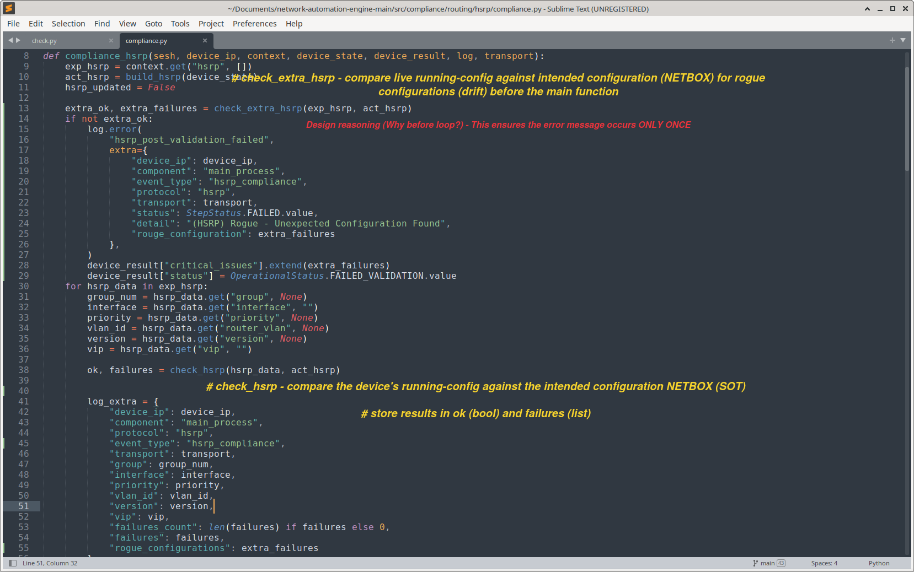 

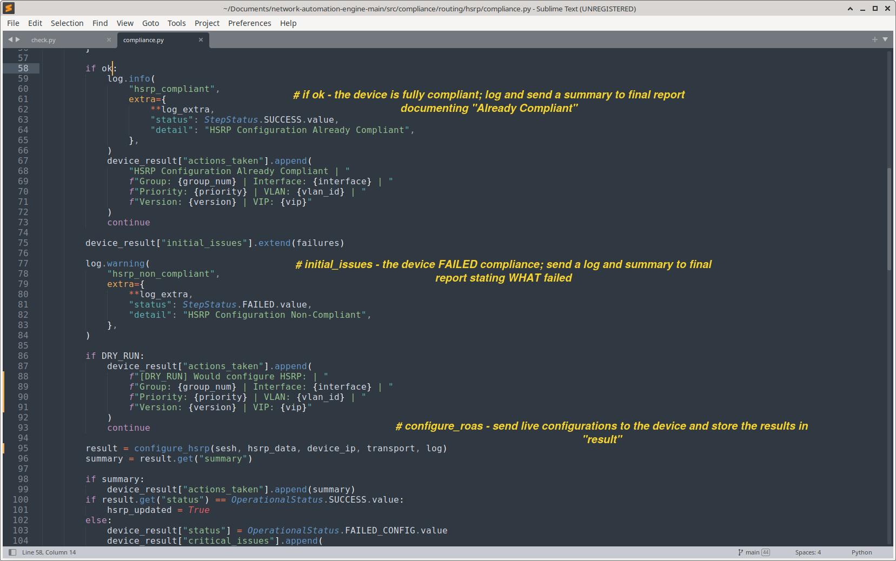

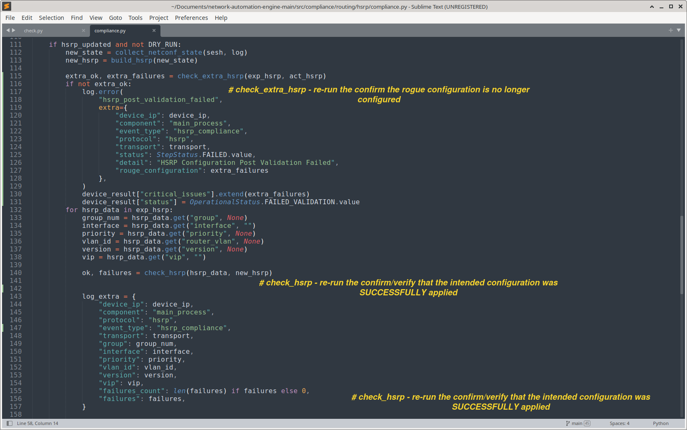

```python
# src/compliance/routing/hsrp/compliance.py

from src.core.enums import StepStatus, OperationalStatus
from src.collectors.netconf.collector import collect_netconf_state
from src.remediation.routing.hsrp import configure_hsrp
from src.collectors.netconf.builders import build_hsrp
from src.compliance.routing.hsrp.check import check_hsrp, check_extra_hsrp
from src.core.settings import DRY_RUN


def compliance_hsrp(sesh, device_ip, context, device_state, device_result, log, transport):
    exp_hsrp = context.get("hsrp", [])
    act_hsrp = build_hsrp(device_state)
    hsrp_updated = False

    extra_ok, extra_failures = check_extra_hsrp(exp_hsrp, act_hsrp)
    if not extra_ok:
        log.error(
            "hsrp_post_validation_failed",
            extra={
                "device_ip": device_ip,
                "component": "main_process",
                "event_type": "hsrp_compliance",
                "protocol": "hsrp",
                "transport": transport,
                "status": StepStatus.FAILED.value,
                "detail": "(HSRP) Rogue - Unexpected Configuration Found",
                "rouge_configuration": extra_failures
            },
        )
        device_result["critical_issues"].extend(extra_failures)
        device_result["status"] = OperationalStatus.FAILED_VALIDATION.value

    for hsrp_data in exp_hsrp:
        group_num = hsrp_data.get("group", None)
        interface = hsrp_data.get("interface", "")
        priority = hsrp_data.get("priority", None)
        vlan_id = hsrp_data.get("router_vlan", None)
        version = hsrp_data.get("version", None)
        vip = hsrp_data.get("vip", "")

        ok, failures = check_hsrp(hsrp_data, act_hsrp)

        log_extra = {
            "device_ip": device_ip,
            "component": "main_process",
            "protocol": "hsrp",
            "event_type": "hsrp_compliance",
            "transport": transport,
            "group": group_num,
            "interface": interface,
            "priority": priority,
            "vlan_id": vlan_id,
            "version": version,
            "vip": vip,
            "failures_count": len(failures) if failures else 0,
            "failures": failures,
            "rogue_configurations": extra_failures
        }

        if ok:
            log.info(
                "hsrp_compliant",
                extra={
                    **log_extra,
                    "status": StepStatus.SUCCESS.value,
                    "detail": "HSRP Configuration Already Compliant",
                },
            )
            device_result["actions_taken"].append(
                "HSRP Configuration Already Compliant | "
                f"Group: {group_num} | Interface: {interface} | "
                f"Priority: {priority} | VLAN: {vlan_id} | "
                f"Version: {version} | VIP: {vip}"
            )
            continue

        device_result["initial_issues"].extend(failures)

        log.warning(
            "hsrp_non_compliant",
            extra={
                **log_extra,
                "status": StepStatus.FAILED.value,
                "detail": "HSRP Configuration Non-Compliant",
            },
        )

        if DRY_RUN:
            device_result["actions_taken"].append(
                f"[DRY_RUN] Would configure HSRP: | "
                f"Group: {group_num} | Interface: {interface} | "
                f"Priority: {priority} | VLAN: {vlan_id} | "
                f"Version: {version} | VIP: {vip}"
            )
            continue

        result = configure_hsrp(sesh, hsrp_data, device_ip, transport, log)
        summary = result.get("summary")

        if summary:
            device_result["actions_taken"].append(summary)
        if result.get("status") == OperationalStatus.SUCCESS.value:
            hsrp_updated = True
        else:
            device_result["status"] = OperationalStatus.FAILED_CONFIG.value
            device_result["critical_issues"].append(
                f"Failed to Remediate HSRP | "
                f"Group: {group_num} | Interface: {interface} | "
                f"Priority: {priority} | VLAN: {vlan_id} | "
                f"Version: {version} | VIP: {vip}"
            )

    if hsrp_updated and not DRY_RUN:
        new_state = collect_netconf_state(sesh, log)
        new_hsrp = build_hsrp(new_state)

        extra_ok, extra_failures = check_extra_hsrp(exp_hsrp, act_hsrp)
        if not extra_ok:
            log.error(
                "hsrp_post_validation_failed",
                extra={
                    "device_ip": device_ip,
                    "component": "main_process",
                    "event_type": "hsrp_compliance",
                    "protocol": "hsrp",
                    "transport": transport,
                    "status": StepStatus.FAILED.value,
                    "detail": "HSRP Configuration Post Validation Failed",
                    "rouge_configuration": extra_failures
                },
            )
            device_result["critical_issues"].extend(extra_failures)
            device_result["status"] = OperationalStatus.FAILED_VALIDATION.value

        for hsrp_data in exp_hsrp:
            group_num = hsrp_data.get("group", None)
            interface = hsrp_data.get("interface", "")
            priority = hsrp_data.get("priority", None)
            vlan_id = hsrp_data.get("router_vlan", None)
            version = hsrp_data.get("version", None)
            vip = hsrp_data.get("vip", "")

            ok, failures = check_hsrp(hsrp_data, new_hsrp)

            log_extra = {
                "device_ip": device_ip,
                "component": "main_process",
                "protocol": "hsrp",
                "event_type": "hsrp_compliance",
                "transport": transport,
                "group": group_num,
                "interface": interface,
                "priority": priority,
                "vlan_id": vlan_id,
                "version": version,
                "vip": vip,
                "failures_count": len(failures) if failures else 0,
                "failures": failures,
            }

            if not ok:
                log.error(
                    "hsrp_post_validation_failed",
                    extra={
                        **log_extra,
                        "status": StepStatus.FAILED.value,
                        "detail": "HSRP Configuration Post Validation Failed",
                    },
                )
                device_result["critical_issues"].extend(failures)
                device_result["status"] = OperationalStatus.FAILED_VALIDATION.value
            else:
                device_result["actions_taken"].append(
                    "HSRP Configuration Post Validation Successful | "
                    f"Group: {group_num} | Interface: {interface} | "
                    f"Priority: {priority} | VLAN: {vlan_id} | "
                    f"Version: {version} | VIP: {vip}"
                )
                log.info(
                    "hsrp_post_validation_success",
                    extra={
                        **log_extra,
                        "status": StepStatus.SUCCESS.value,
                        "detail": "HSRP Configuration Post Validation Successful",
                    },
                )
    return device_result
```
---

### 3. Real-World Injected Drift Scenarios & Runtime Evidence

To validate both diff engines, multiple drift conditions were applied on `EDGE-1`.

#### A. Multi-Attribute Drift Injection
The router carried an **unauthorized** standby group (`standby 1` on physical `GigabitEthernet1`), an **incomplete** standby definition on subinterface `GigabitEthernet1.10` (wrong VIP `192.168.10.3`, default priority, no `preempt`, no `standby 10 version` → v1), and a **completely missing** standby group on `GigabitEthernet2.20`. The relevant section from the live paged `show running-config` (shot 3):

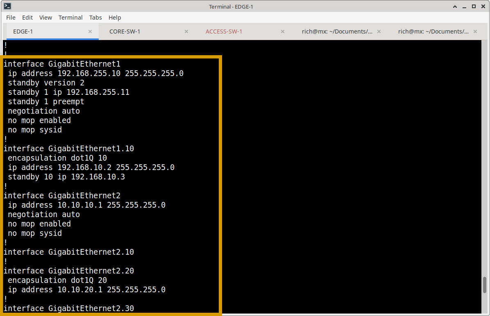

```cisco
interface GigabitEthernet1
 ip address 192.168.255.10 255.255.255.0
 standby version 2
 standby 1 ip 192.168.255.11
 standby 1 preempt
 negotiation auto
 no mop enabled
 no mop sysid
!
interface GigabitEthernet1.10
 encapsulation dot1Q 10
 ip address 192.168.10.2 255.255.255.0
 standby 10 ip 192.168.10.3
!
interface GigabitEthernet2
 ip address 10.10.10.1 255.255.255.0
 negotiation auto
 no mop enabled
 no mop sysid
!
interface GigabitEthernet2.20
 encapsulation dot1Q 20
 ip address 10.10.20.1 255.255.255.0
!
```

#### B. Compliance Engine Detection & Runtime Terminal Proof
When the engine executed its NETCONF audit against `EDGE-1`, `check_extra_hsrp()` flagged the rogue group into `critical_issues`, while `check_hsrp()` caught every attribute discrepancy on the authorized groups:

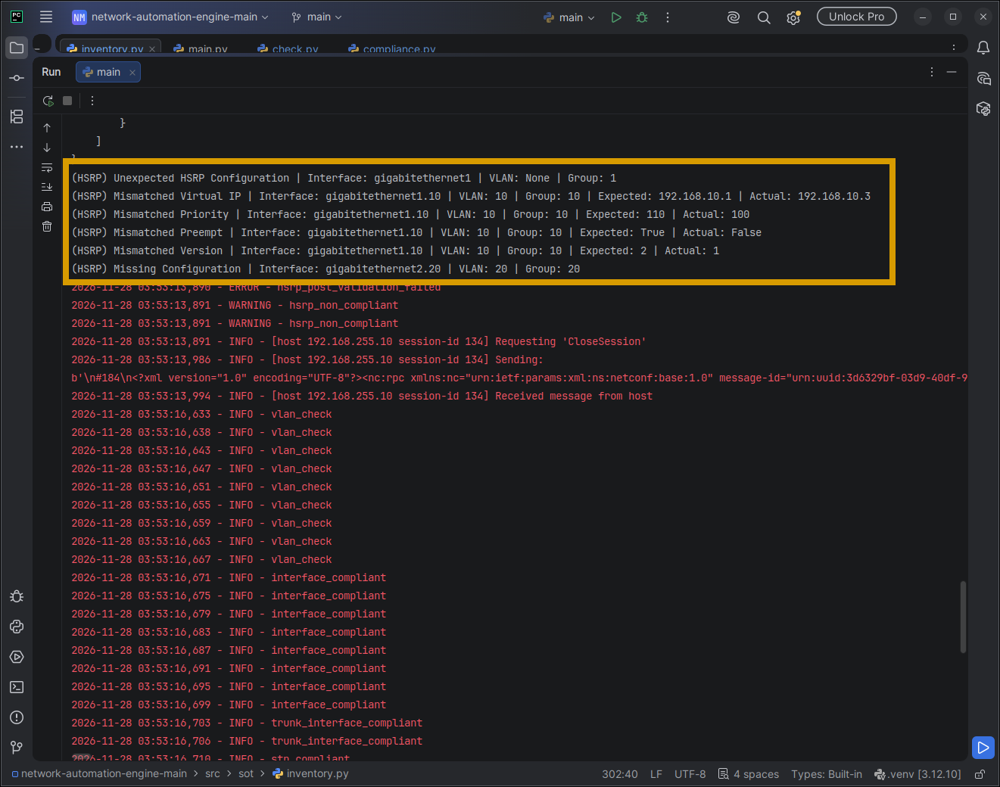

```text
(HSRP) Unexpected HSRP Configuration | Interface: gigabitethernet1 | VLAN: None | Group: 1
(HSRP) Mismatched Virtual IP | Interface: gigabitethernet1.10 | VLAN: 10 | Group: 10 | Expected: 192.168.10.1 | Actual: 192.168.10.3
(HSRP) Mismatched Priority | Interface: gigabitethernet1.10 | VLAN: 10 | Group: 10 | Expected: 110 | Actual: 100
(HSRP) Mismatched Preempt | Interface: gigabitethernet1.10 | VLAN: 10 | Group: 10 | Expected: True | Actual: False
(HSRP) Mismatched Version | Interface: gigabitethernet1.10 | VLAN: 10 | Group: 10 | Expected: 2 | Actual: 1
(HSRP) Missing Configuration | Interface: gigabitethernet2.20 | VLAN: 20 | Group: 20
2026-11-28 03:53:13,890 - ERROR - hsrp_post_validation_failed
2026-11-28 03:53:13,891 - WARNING - hsrp_non_compliant
2026-11-28 03:53:13,891 - WARNING - hsrp_non_compliant
```
---

### 4. Machine-Readable Audit Record: `final_compliance_report.json`

The engine segregates initial attribute drift from critical rogue configurations inside `final_compliance_report.json`:

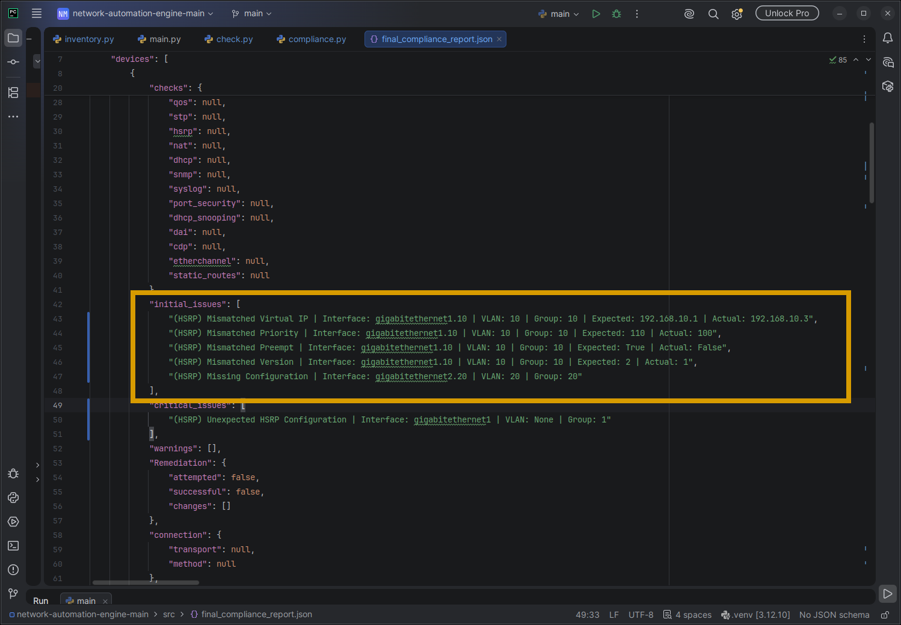

```json
{
  "initial_issues": [
    "(HSRP) Mismatched Virtual IP | Interface: gigabitethernet1.10 | VLAN: 10 | Group: 10 | Expected: 192.168.10.1 | Actual: 192.168.10.3",
    "(HSRP) Mismatched Priority | Interface: gigabitethernet1.10 | VLAN: 10 | Group: 10 | Expected: 110 | Actual: 100",
    "(HSRP) Mismatched Preempt | Interface: gigabitethernet1.10 | VLAN: 10 | Group: 10 | Expected: True | Actual: False",
    "(HSRP) Mismatched Version | Interface: gigabitethernet1.10 | VLAN: 10 | Group: 10 | Expected: 2 | Actual: 1",
    "(HSRP) Missing Configuration | Interface: gigabitethernet2.20 | VLAN: 20 | Group: 20"
  ],
  "critical_issues": [
    "(HSRP) Unexpected HSRP Configuration | Interface: gigabitethernet1 | VLAN: None | Group: 1"
  ]
}
```
---

### 5. HSRP Compliance Evaluation Matrix

| Evaluated Parameter | NetBox Desired Intent | Observed Router State | Compliance Evaluation | Operational Remediation |
| :--- | :--- | :--- | :---: | :--- |
| **Standby Group Scope** | Authorized: Groups `10`, `20` | Rogue Group `1` on `Gi1` | **CRITICAL FAIL (`Unexpected Configuration`)** | Remove rogue standby group `1`. |
| **Virtual IP (VIP)** | `192.168.10.1` | `192.168.10.3` | **FAIL (`Mismatched Virtual IP`)** | Apply `standby 10 ip 192.168.10.1`. |
| **Standby Priority** | `110` (Elevated Primary) | `100` (Default) | **FAIL (`Mismatched Priority`)** | Apply `standby 10 priority 110`. |
| **Preemption** | `True` | `False` | **FAIL (`Mismatched Preempt`)** | Apply `standby 10 preempt`. |
| **Protocol Version** | `2` | `1` | **FAIL (`Mismatched Version`)** | Apply `standby 10 version 2`. |
| **Standby Instance** | Group `20` on `Gi2.20` | Absent from device | **FAIL (`Missing Configuration`)** | Deploy full HSRP Group 20 baseline. |

---

## 4. Configuration Remediation

When HSRP configuration drift or missing gateway groups are detected, remediation is executed programmatically via **NETCONF** through `configure_hsrp()` in `src/remediation/routing/hsrp.py`.

The remediation controller decouples vendor XML syntax using a **declarative Jinja2 XML template** (`templates/hsrp.j2`). It extracts the interface type and number using a regular expression, renders the `Cisco-IOS-XE-native` YANG XML payload, and executes an `edit_config` RPC against the router's running datastore over NETCONF.


---

### 1. Declarative YANG XML Template (`templates/hsrp.j2`)

The template models the XML structure required by the `Cisco-IOS-XE-native` YANG module, configuring the 802.1Q subinterface encapsulation, primary IP addressing, standby version, group, priority, VIP, and conditional preemption:

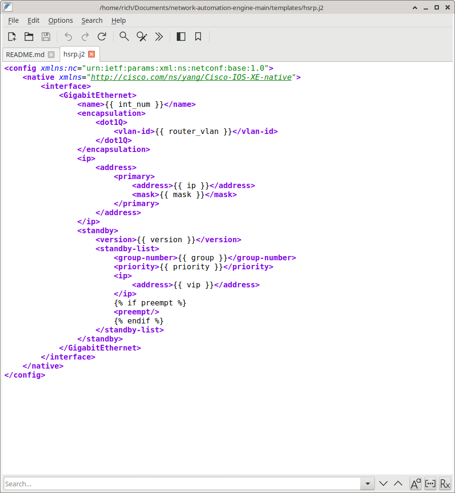

```jinja2
<config xmlns:nc="urn:ietf:params:xml:ns:netconf:base:1.0">
  <native xmlns="http://cisco.com/ns/yang/Cisco-IOS-XE-native">
    <interface>
      <GigabitEthernet>
        <name>{{ int_num }}</name>
        <encapsulation>
          <dot1Q>
            <vlan-id>{{ router_vlan }}</vlan-id>
          </dot1Q>
        </encapsulation>
        <ip>
          <address>
            <primary>
              <address>{{ ip }}</address>
              <mask>{{ mask }}</mask>
            </primary>
          </address>
        </ip>
        <standby>
          <version>{{ version }}</version>
          <standby-list>
            <group-number>{{ group }}</group-number>
            <priority>{{ priority }}</priority>
            <ip>
              <address>{{ vip }}</address>
            </ip>
            
            <preempt/>
            
          </standby-list>
        </standby>
      </GigabitEthernet>
    </interface>
  </native>
</config>
```

---

### 2. Remediation Handler Implementation (`src/remediation/routing/hsrp.py`)

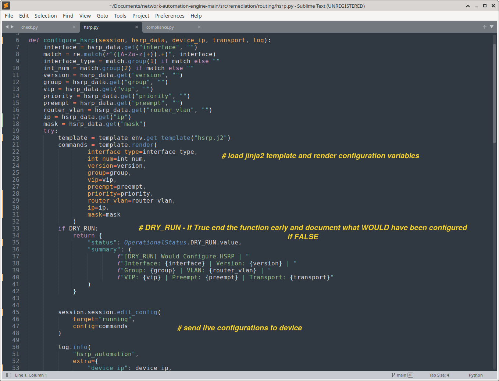 

```python
# src/remediation/routing/hsrp.py (NETCONF HSRP Remediation Handler)

import re
from src.core.settings import DRY_RUN
from src.core.enums import StepStatus, OperationalStatus
from src.remediation.template_env import template_env

def configure_hsrp(session, hsrp_data, device_ip, transport, log):
    interface = hsrp_data.get("interface", "")
    match = re.match(r"([A-Za-z]+)(.+)", interface)
    interface_type = match.group(1) if match else ""
    int_num = match.group(2) if match else ""
    version = hsrp_data.get("version", "")
    group = hsrp_data.get("group", "")
    vip = hsrp_data.get("vip", "")
    priority = hsrp_data.get("priority", "")
    preempt = hsrp_data.get("preempt", "")
    router_vlan = hsrp_data.get("router_vlan", "")
    ip = hsrp_data.get("ip")
    mask = hsrp_data.get("mask")
    try:
        template = template_env.get_template("hsrp.j2")
        commands = template.render(
            interface_type=interface_type,
            int_num=int_num,
            version=version,
            group=group,
            vip=vip,
            preempt=preempt,
            priority=priority,
            router_vlan=router_vlan,
            ip=ip,
            mask=mask
        )
        if DRY_RUN:
            return {
                "status": OperationalStatus.DRY_RUN.value,
                "summary": (
                    f"[DRY_RUN] Would Configure HSRP | "
                    f"Interface: {interface} | Version: {version} | "
                    f"Group: {group} | VLAN: {router_vlan} | "
                    f"VIP: {vip} | Preempt: {preempt} | Transport: {transport}"
                )
            }

        session.session.edit_config(
            target="running",
            config=commands
        )

        log.info(
            "hsrp_automation",
            extra={
                "device_ip": device_ip,
                "component": "hsrp_config",
                "event_type": "hsrp_config",
                "transport": transport,
                "status": StepStatus.SUCCESS.value,
                "interface": interface,
                "group": group,
                "vlan_id": router_vlan,
                "vip": vip,
                "version": version,
                "detail": (
                    f"HSRP Configuration Successful | "
                    f"Interface: {interface} | Version: {version} | "
                    f"Group: {group} | VLAN: {router_vlan} | "
                    f"VIP: {vip} | Preempt: {preempt} "
                )
            }
        )
        return {
            "status": OperationalStatus.SUCCESS.value,
            "summary": (
                f"HSRP Configuration Successful | "
                f"Interface: {interface} | Version: {version} | "
                f"Group: {group} | VLAN: {router_vlan} | "
                f"VIP: {vip} | Preempt: {preempt} | Transport: {transport}"
            )
        }

    except Exception as e:
        log.info(
            "hsrp_config",
            extra={
                "device_ip": device_ip,
                "component": "hsrp_automation",
                "event_type": "hsrp_config",
                "transport": transport,
                "status": StepStatus.ERROR.value,
                "interface": interface,
                "group": group,
                "vlan_id": router_vlan,
                "vip": vip,
                "version": version,
                "error": str(e),
                "detail": (
                    f"Try/Exception Error | HSRP Configuration | "
                    f"Interface: {interface} | Version: {version} | "
                    f"Group: {group} | VLAN: {router_vlan} | "
                    f"VIP: {vip} | Preempt: {preempt} | "
                    f"Error: {str(e)}"
                )
            }
        )
        return {
            "status": OperationalStatus.ERROR.value,
            "summary": (
                f"Try/Exception Error | HSRP Configuration | "
                f"Interface: {interface} | Version: {version} | "
                f"Group: {group} | VLAN: {router_vlan} | "
                f"VIP: {vip} | Preempt: {preempt} | Transport: {transport} | "
                f"Error: {str(e)}"
            ),
            "error": str(e)
        }
```

---

## 5. Safe Change Management: Dry-Run Mode

To support production Change Advisory Board (CAB) review windows, the engine supports a global `DRY_RUN` setting (`src/core/settings.py`).

When `DRY_RUN = True`:
* Live NETCONF state collection and compliance audits execute normally.
* Configuration drift is detected, reported, and logged to Splunk.
* Planned HSRP standby group configurations are compiled into `src/final_compliance_report.json` under `actions_taken`.
* **NETCONF `<edit-config>` RPC requests are bypassed entirely.**


### Machine-Readable Dry-Run Audit: `final_compliance_report.json`

During dry-run execution on `HQ-EDGE-1`, the engine catalogs the planned remediation of both HSRP standby groups:

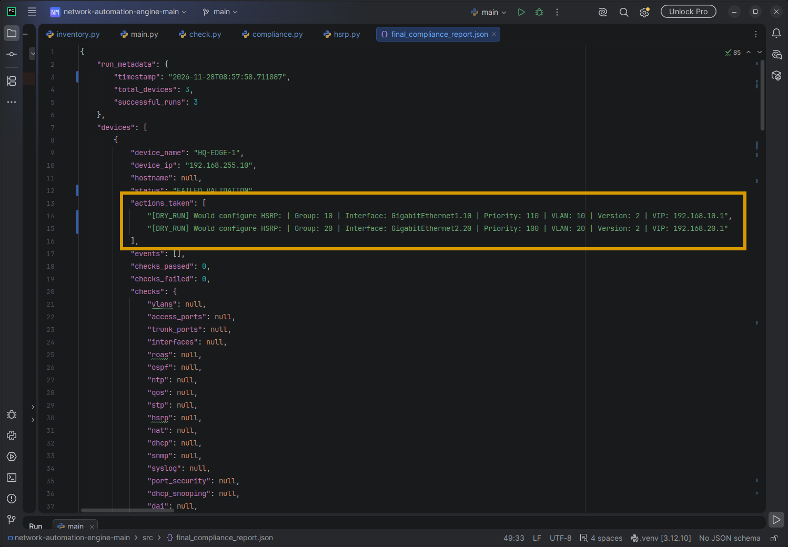 

```json
{
  "device_name": "HQ-EDGE-1",
  "device_ip": "192.168.255.10",
  "hostname": null,
  "status": "FAILED_VALIDATION",
  "actions_taken": [
    "[DRY_RUN] Would configure HSRP: | Group: 10 | Interface: GigabitEthernet1.10 | Priority: 110 | VLAN: 10 | Version: 2 | VIP: 192.168.10.1",
    "[DRY_RUN] Would configure HSRP: | Group: 20 | Interface: GigabitEthernet2.20 | Priority: 100 | VLAN: 20 | Version: 2 | VIP: 192.168.20.1"
  ]
}
```
---

## 6. Post-Remediation Validation & Physical Device Proof

After live remediation commands are dispatched via NETCONF, the engine initiates a **closed-loop verification pass**:
1. It re-collects live device operational state over NETCONF (`collect_netconf_state(sesh, log)`).
2. It re-normalizes HSRP operational state through `build_hsrp(new_state)`.
3. It re-evaluates both `check_extra_hsrp()` and `check_hsrp()` to verify that rogue groups are purged and that virtual IPs, priorities, versions, and preemption flags match NetBox intent.

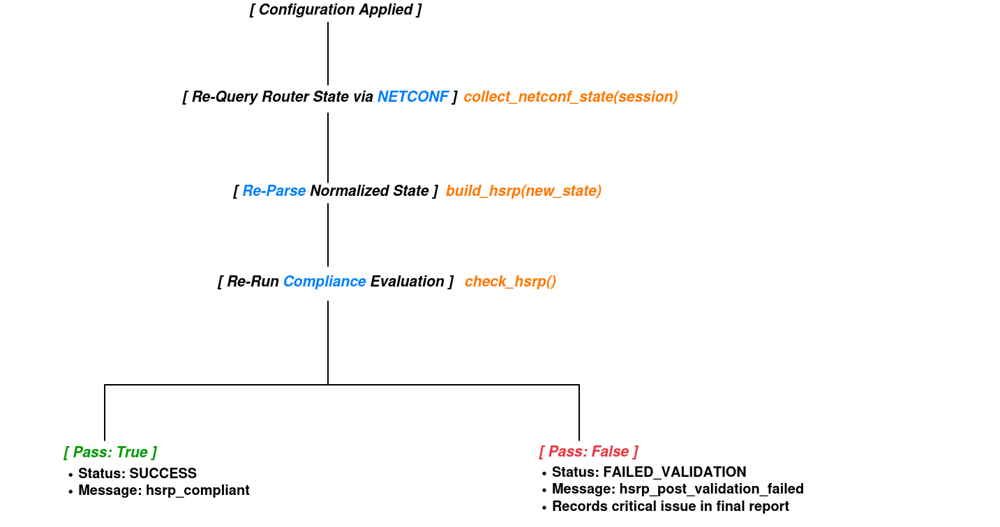

### Post-Validation Compliance Artifact (`final_compliance_report.json`)

Following live remediation and post-validation, the report confirms all standby groups applied and verified:

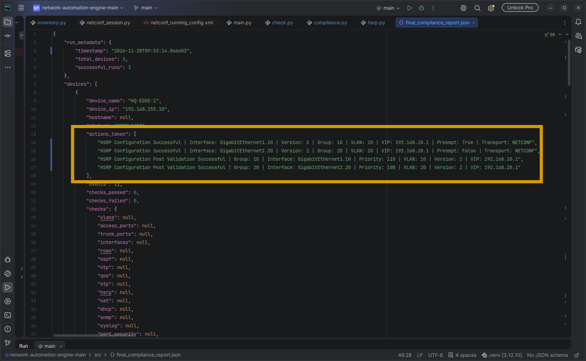 


```json
{
  "device_name": "HQ-EDGE-1",
  "device_ip": "192.168.255.10",
  "hostname": null,
  "status": "COMPLIANT",
  "actions_taken": [
    "HSRP Configuration Successful | Interface: GigabitEthernet1.10 | Version: 2 | Group: 10 | VLAN: 10 | VIP: 192.168.10.1 | Preempt: True | Transport: NETCONF",
    "HSRP Configuration Successful | Interface: GigabitEthernet2.20 | Version: 2 | Group: 20 | VLAN: 20 | VIP: 192.168.20.1 | Preempt: False | Transport: NETCONF",
    "HSRP Configuration Post Validation Successful | Group: 10 | Interface: GigabitEthernet1.10 | Priority: 110 | VLAN: 10 | Version: 2 | VIP: 192.168.10.1",
    "HSRP Configuration Post Validation Successful | Group: 20 | Interface: GigabitEthernet2.20 | Priority: 100 | VLAN: 20 | Version: 2 | VIP: 192.168.20.1"
  ]
}
```
---

### Physical Device Verification: Before vs. After Execution

#### 1. Device State: BEFORE Remediation (`EDGE-1`)

Prior to remediation:
* Physical interface `GigabitEthernet1` carried an unauthorized rogue standby group (`standby 1 ip 192.168.255.11`).
* Subinterface `GigabitEthernet1.10` had the wrong VIP (`192.168.10.3`), default priority 100, no preemption, and legacy version 1 (no `standby 10 version`).
* Subinterface `GigabitEthernet2.20` was completely missing its HSRP standby group:

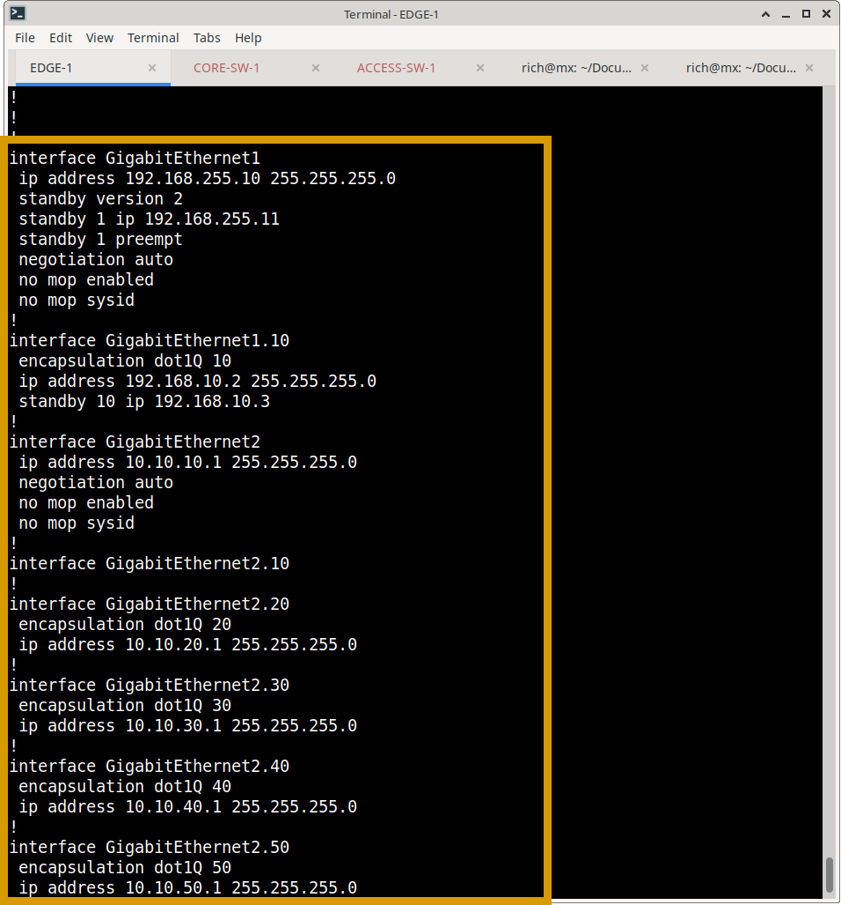

```cisco
interface GigabitEthernet1
 ip address 192.168.255.10 255.255.255.0
 standby version 2
 standby 1 ip 192.168.255.11
 standby 1 preempt
 negotiation auto
 no mop enabled
 no mop sysid
!
interface GigabitEthernet1.10
 encapsulation dot1Q 10
 ip address 192.168.10.2 255.255.255.0
 standby 10 ip 192.168.10.3
!
interface GigabitEthernet2
 ip address 10.10.10.1 255.255.255.0
 negotiation auto
 no mop enabled
 no mop sysid
!
interface GigabitEthernet2.20
 encapsulation dot1Q 20
 ip address 10.10.20.1 255.255.255.0
!
```

---

#### 2. Device State: AFTER Automated Remediation (`EDGE-1`)

Following automated NETCONF `<edit-config>` execution:
* Subinterface `GigabitEthernet1.10` was upgraded to `standby version 2`, VIP `192.168.10.1`, priority `110`, with `preempt` enabled.
* Subinterface `GigabitEthernet2.20` was provisioned with `standby version 2`, Group 20, VIP `192.168.20.1` and its primary address was rewritten to `192.168.20.2` by the template's `<ip>` block.
* The rogue `standby 1` on `GigabitEthernet1` is absent in the AFTER capture but the shown `configure_hsrp` has no `remove` path for it.

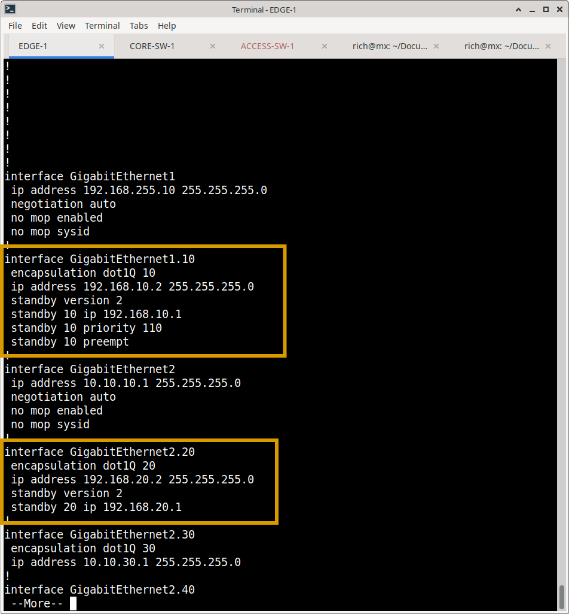

```cisco
! --- EDGE-1: Running Configuration AFTER Remediation ---
interface GigabitEthernet1
 ip address 192.168.255.10 255.255.255.0
 negotiation auto
 no mop enabled
 no mop sysid
!
interface GigabitEthernet1.10
 encapsulation dot1Q 10
 ip address 192.168.10.2 255.255.255.0
 standby version 2
 standby 10 ip 192.168.10.1
 standby 10 priority 110
 standby 10 preempt
!
interface GigabitEthernet2
 ip address 10.10.10.1 255.255.255.0
 negotiation auto
 no mop enabled
 no mop sysid
!
interface GigabitEthernet2.20
 encapsulation dot1Q 20
 ip address 192.168.20.2 255.255.255.0
 standby version 2
 standby 20 ip 192.168.20.1
!
```

---

#### 3. Visual Configuration Diff

```diff
 interface GigabitEthernet1
  ip address 192.168.255.10 255.255.255.0
- standby version 2
- standby 1 ip 192.168.255.11
- standby 1 preempt
  negotiation auto
  no mop enabled
  no mop sysid
 !
 interface GigabitEthernet1.10
  encapsulation dot1Q 10
  ip address 192.168.10.2 255.255.255.0
- standby 10 ip 192.168.10.3
+ standby version 2
+ standby 10 ip 192.168.10.1
+ standby 10 priority 110
+ standby 10 preempt
 !
 interface GigabitEthernet2
  ip address 10.10.10.1 255.255.255.0
  negotiation auto
  no mop enabled
  no mop sysid
 !
 interface GigabitEthernet2.20
  encapsulation dot1Q 20
- ip address 10.10.20.1 255.255.255.0
+ ip address 192.168.20.2 255.255.255.0
+ standby version 2
+ standby 20 ip 192.168.20.1
```
---

#### 4. Operational State Verification (`show standby brief`)

##### BEFORE Remediation
Rogue group 1 on physical `Gi1`, and `Gi1.10` at default priority 100 / no preempt / wrong VIP `192.168.10.3`:

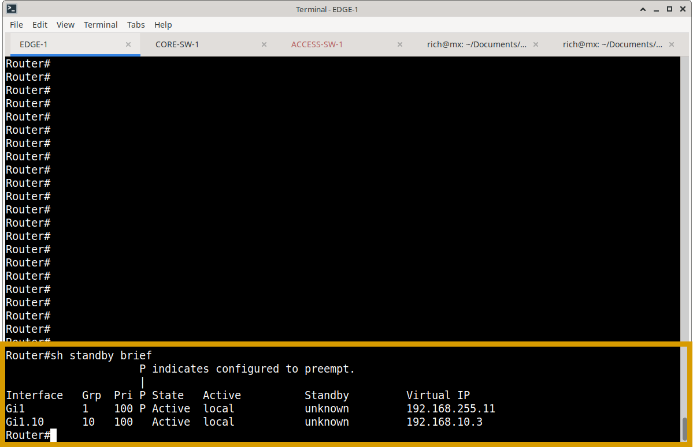

```text
Router#sh standby brief
                     P indicates configured to preempt.
                     |
Interface   Grp  Pri P State   Active          Standby         Virtual IP
Gi1         1    100 P Active  local           unknown         192.168.255.11
Gi1.10      10   100   Active  local           unknown         192.168.10.3
```

##### AFTER Remediation
Rogue group 1 gone, Group 10 elevated to `110` with preemption (`P`), Group 20 active on `Gi2.20` (no `P`,  `preempt: False` per contract), all VIPs matching NetBox:


```text
Router#sh standby brief
                     P indicates configured to preempt.
                     |
Interface   Grp  Pri P State   Active          Standby         Virtual IP
Gi1.10      10   110 P Active  local           unknown         192.168.10.1
Gi2.20      20   100   Active  local           unknown         192.168.20.1
```
---

## 7. Audit Logging & Splunk Telemetry Pipeline (HSRP via NETCONF)

To satisfy enterprise change governance and high-availability auditing standards, every operational phase of the HSRP workflow baseline verification, drift detection, NETCONF `<edit-config>` execution, schema exception handling, and post-validation generates structured JSON events streamed directly to **Splunk via the HTTP Event Collector (HEC)** (`index="network_automation"`, `sourcetype="_json"`).

Unlike ROAS, **every HSRP event carries `transport: "NETCONF"`** including the remediation-handler events because `configure_hsrp`'s success and `except` `extra` dicts both include `transport`. Note, however, the **orchestrator-vs-handler schema asymmetry**: orchestrator events (`event_type: hsrp_compliance`) carry `protocol`, `priority`, and (in the main loop only) `rogue_configurations`, while handler events (`event_type: hsrp_config`) omit `protocol`/`priority`/`rogue_configurations`. Neither family carries a `compliant` field (HSRP's `log_extra` never sets one). The SPL below therefore filters on `protocol` *or* `event_type` and tables only the union of fields that actually exist.

```spl
index="network_automation" sourcetype="_json" (protocol="hsrp" OR event_type="hsrp_config")
| table asctime cisco_sev event_type message interface group vip priority version vlan_id status detail
```
---

### Telemetry Lifecycle Matrix

The telemetry pipeline records five distinct operational events across `HQ-EDGE-1` (`192.168.255.10`):

| Lifecycle Phase | Event Type (`event_type`) | Splunk Message (`message`) | Cisco Severity | Status | Operational Significance |
| :--- | :--- | :--- | :---: | :---: | :--- |
| **1. Pre-Check Pass** | `hsrp_compliance` | `hsrp_compliant` | `6 (INFO)` | `SUCCESS` | Standby Group 20 and VIP `192.168.20.1` match NetBox; bypassed. |
| **2. Drift Detected** | `hsrp_compliance` | `hsrp_non_compliant` | `4 (WARN)` | `FAILED` | Missing HSRP standby group or VIP/preempt mismatch detected. |
| **3. Remediation Push** | `hsrp_config` | `hsrp_automation`* | `6 (INFO)` | `SUCCESS` | Declarative YANG XML payload pushed via NETCONF `<edit-config>`. |
| **4. Post-Validation Pass** | `hsrp_compliance` | `hsrp_post_validation_success` | `6 (INFO)` | `SUCCESS` | Re-queried live NETCONF state confirms gateway is active on data plane. |
| **5. Exception Capture** | `hsrp_config` | `hsrp_config`* | `6 (INFO)`† | `ERROR` | Catches NETCONF schema validation errors (`"None" is not a valid value`) without crashing. |

---

### Splunk Event Evidence & Payload Breakdown

#### 1. Baseline Compliant Pass (`hsrp_compliant`)
When HSRP Group 20 on `GigabitEthernet2.20` already matches NetBox specifications on initial scan, an informational pass is indexed with zero failures:

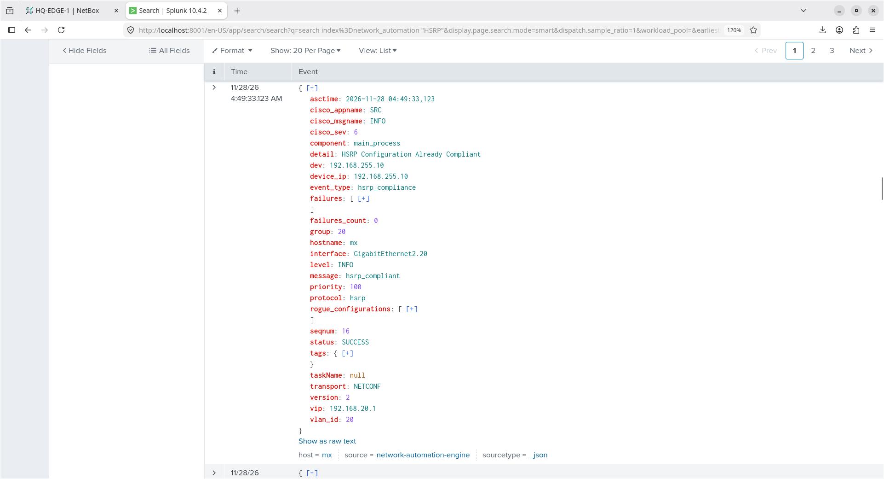

```json
{
  "asctime": "2026-11-28 04:49:33,123",
  "cisco_appname": "SRC",
  "cisco_msgname": "INFO",
  "cisco_sev": 6,
  "component": "main_process",
  "detail": "HSRP Configuration Already Compliant",
  "dev": "192.168.255.10",
  "device_ip": "192.168.255.10",
  "event_type": "hsrp_compliance",
  "failures": [],
  "failures_count": 0,
  "group": 20,
  "hostname": "mx",
  "interface": "GigabitEthernet2.20",
  "level": "INFO",
  "message": "hsrp_compliant",
  "priority": 100,
  "protocol": "hsrp",
  "rogue_configurations": [],
  "seqnum": 16,
  "status": "SUCCESS",
  "taskName": null,
  "transport": "NETCONF",
  "version": 2,
  "vip": "192.168.20.1",
  "vlan_id": 20
}
```

---

#### 2. Configuration Drift Alert (`hsrp_non_compliant`)
When an intended standby group is missing from the router (Group 20 absent on subinterface `GigabitEthernet2.20`), a `WARNING` (severity 4) alert is indexed with the failure diff. Note the casing asymmetry: the `interface` field keeps NetBox's CamelCase (`GigabitEthernet2.20`) while the `failures` string is lowercased by `check_hsrp()` (`gigabitethernet2.20`):

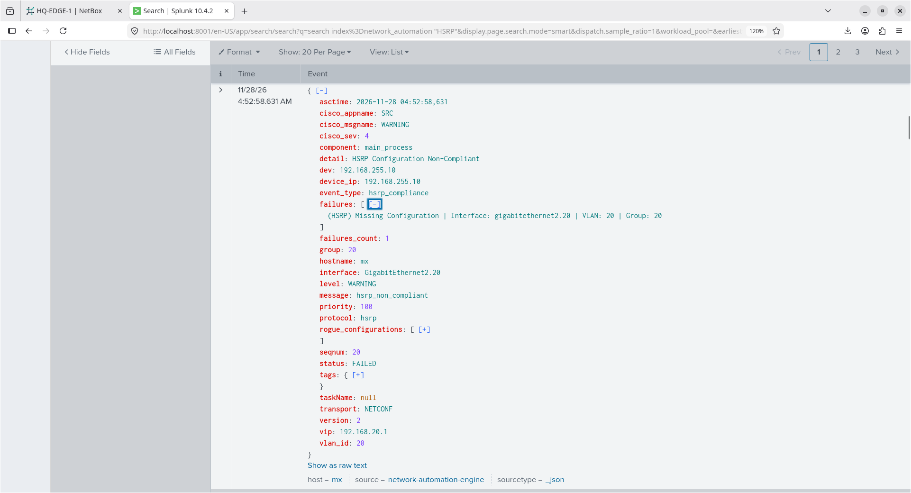

```json
{
  "asctime": "2026-11-28 04:52:58,631",
  "cisco_appname": "SRC",
  "cisco_msgname": "WARNING",
  "cisco_sev": 4,
  "component": "main_process",
  "detail": "HSRP Configuration Non-Compliant",
  "dev": "192.168.255.10",
  "device_ip": "192.168.255.10",
  "event_type": "hsrp_compliance",
  "failures": [
    "(HSRP) Missing Configuration | Interface: gigabitethernet2.20 | VLAN: 20 | Group: 20"
  ],
  "failures_count": 1,
  "group": 20,
  "hostname": "mx",
  "interface": "GigabitEthernet2.20",
  "level": "WARNING",
  "message": "hsrp_non_compliant",
  "priority": 100,
  "protocol": "hsrp",
  "rogue_configurations": [],
  "seqnum": 20,
  "status": "FAILED",
  "taskName": null,
  "transport": "NETCONF",
  "version": 2,
  "vip": "192.168.20.1",
  "vlan_id": 20
}
```

---

#### 3. Targeted NETCONF Remediation Push (`hsrp_config`)
Emitted immediately after the NETCONF `<edit-config>` RPC successfully applies Group 20, VIP `192.168.20.1`, and version 2 to subinterface `GigabitEthernet2.20`. This event originates from the **remediation handler**, so it carries no `protocol`, no `priority`, and no `rogue_configurations` and note the swapped `message="hsrp_automation"` / `component="hsrp_config"`:

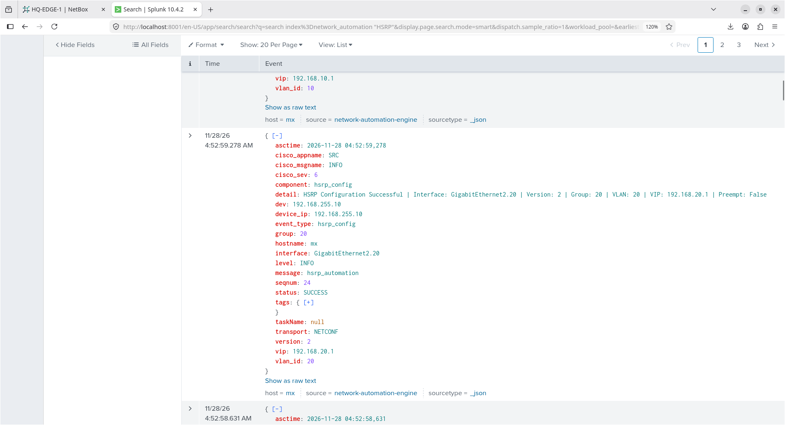

```json
{
  "asctime": "2026-11-28 04:52:59,278",
  "cisco_appname": "SRC",
  "cisco_msgname": "INFO",
  "cisco_sev": 6,
  "component": "hsrp_config",
  "detail": "HSRP Configuration Successful | Interface: GigabitEthernet2.20 | Version: 2 | Group: 20 | VLAN: 20 | VIP: 192.168.20.1 | Preempt: False",
  "dev": "192.168.255.10",
  "device_ip": "192.168.255.10",
  "event_type": "hsrp_config",
  "group": 20,
  "hostname": "mx",
  "interface": "GigabitEthernet2.20",
  "level": "INFO",
  "message": "hsrp_automation",
  "seqnum": 24,
  "status": "SUCCESS",
  "taskName": null,
  "transport": "NETCONF",
  "version": 2,
  "vip": "192.168.20.1",
  "vlan_id": 20
}
```

---

#### 4. Closed-Loop Post-Validation Success (`hsrp_post_validation_success`)
Following remediation, the engine re-queries the running datastore via NETCONF. When the live standby state confirms Group 20 is active and matching NetBox parameters, post-validation success is indexed. Note this orchestrator event omits `rogue_configurations` (the post-validation `log_extra` does not set it, unlike the main loop):

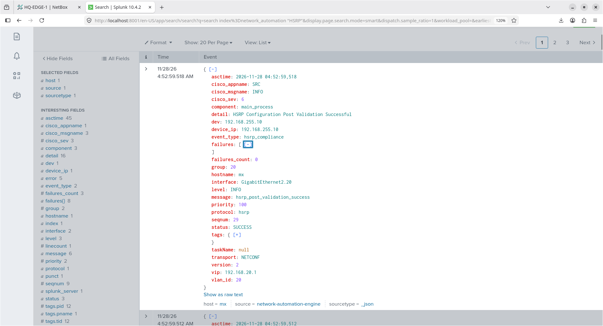

```json
{
  "asctime": "2026-11-28 04:52:59,518",
  "cisco_appname": "SRC",
  "cisco_msgname": "INFO",
  "cisco_sev": 6,
  "component": "main_process",
  "detail": "HSRP Configuration Post Validation Successful",
  "dev": "192.168.255.10",
  "device_ip": "192.168.255.10",
  "event_type": "hsrp_compliance",
  "failures": [],
  "failures_count": 0,
  "group": 20,
  "hostname": "mx",
  "interface": "GigabitEthernet2.20",
  "level": "INFO",
  "message": "hsrp_post_validation_success",
  "priority": 100,
  "protocol": "hsrp",
  "seqnum": 29,
  "status": "SUCCESS",
  "taskName": null,
  "transport": "NETCONF",
  "version": 2,
  "vip": "192.168.20.1",
  "vlan_id": 20
}
```

---

#### 5. Exception & NETCONF Schema Fault Observability (`status: ERROR`)

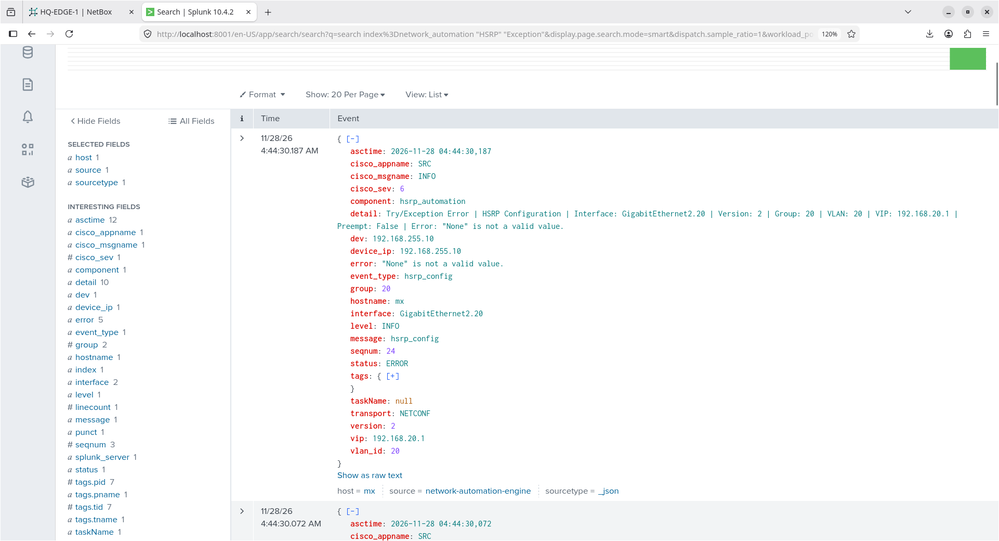

```json
{
  "asctime": "2026-11-28 04:44:30,187",
  "cisco_appname": "SRC",
  "cisco_msgname": "INFO",
  "cisco_sev": 6,
  "component": "hsrp_automation",
  "detail": "Try/Exception Error | HSRP Configuration | Interface: GigabitEthernet2.20 | Version: 2 | Group: 20 | VLAN: 20 | VIP: 192.168.20.1 | Preempt: False | Error: \"None\" is not a valid value.",
  "dev": "192.168.255.10",
  "device_ip": "192.168.255.10",
  "error": "\"None\" is not a valid value.",
  "event_type": "hsrp_config",
  "group": 20,
  "hostname": "mx",
  "interface": "GigabitEthernet2.20",
  "level": "INFO",
  "message": "hsrp_config",
  "seqnum": 24,
  "status": "ERROR",
  "taskName": null,
  "transport": "NETCONF",
  "version": 2,
  "vip": "192.168.20.1",
  "vlan_id": 20
}
```

---

### Internal Execution Tracking

Throughout execution, the engine updates the device result context used to generate `final_compliance_report.json` and `network_compliance_report.txt`:

| Result Collection Field | Operational Purpose & Behavior |
| :--- | :--- |
| **`device_result["initial_issues"]`** | Catalogs all attribute discrepancies detected during initial audit passes before remediation runs (used to calculate drift rates). |
| **`device_result["actions_taken"]`** | Records verified compliant standby groups, executed NETCONF `<edit-config>` operations, and `[DRY_RUN]` change previews for audit compliance. |
| **`device_result["critical_issues"]`** | Populated when rogue standby groups are detected via `check_extra_hsrp()`, when NETCONF RPCs fail, or if post-validation fails after changes were pushed. |
| **`device_result["status"]`** | Reflects overall device health: `COMPLIANT`, `FAILED_CONFIG`, or `FAILED_VALIDATION`. |

---

## 8. Automated Unit Testing & CI/CD Validation (HSRP via NETCONF)

To ensure high-speed verification of model-driven NETCONF redundancy pipelines without requiring access to live routers, the HSRP module includes a comprehensive offline unit-testing suite powered by **Pytest** and **unittest.mock**.

The test suite validates XML-to-dictionary deserialization, default standby value fallbacks, multiple interface extractions, and the complete closed-loop compliance state machine in **just 0.34 seconds across 13 test cases** (0.05s builder + 0.29s compliance).


---

### Layer 1: NETCONF HSRP Builder Tests (`test_build_hsrp.py`)

This suite validates that `build_hsrp()` accurately extracts standby groups from the `Cisco-IOS-XE-native:native/interface` data model, handles default values, and normalizes multi-interface structures:

#### Test Scenarios Covered (6 Tests):
1. **`test_build_hsrp_valid`**: Evaluates real NETCONF fixture data (`hsrp_netconf`). Confirms `gigabitethernet1.50` is parsed with Version `2`, Group `10`, Virtual IP `192.168.10.1`, Preempt `True`, Priority `"110"`, and Router VLAN `10`.
2. **`test_build_hsrp_empty`**: Defensive boundary tests confirming `build_hsrp({})`, `build_hsrp(None)`, `{"not_netconf": {}}`, and `{"native_netconf": {}}` safely return `[]`.
3. **`test_build_no_standby`**: Ingests an interface configuration that lacks the `<standby>` container; asserts the builder returns `[]`.
4. **`test_build_hsrp_no_interface`**: Boundary test ensuring malformed payloads missing the `<interface>` key (here spelled `"interfaces"`) return `[]`.
5. **`test_build_hsrp_default`**: Tests default attribute fallbacks when optional XML tags are omitted, confirming `version` is `None`, `group` is `None`, `vip` is `None`, `router_vlan` is `None`, and `preempt` defaults to `False`.
6. **`test_build_hsrp_multiple_interfaces`**: Ingests complex multi-interface payloads spanning both `GigabitEthernet` (`1.50`) and `FastEthernet` (`1.60`, `1.70`), asserting all 3 subinterfaces are extracted (`len == 3`).

#### Code Excerpt (`test_build_hsrp.py`):

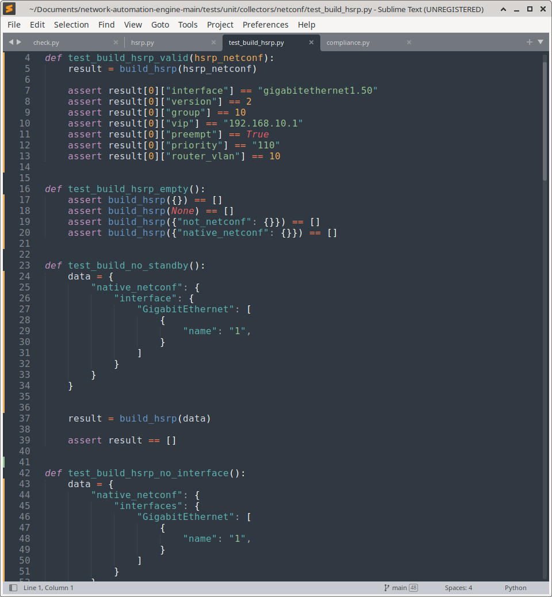

```python
def test_build_hsrp_valid(hsrp_netconf):
    result = build_hsrp(hsrp_netconf)

    assert result[0]["interface"] == "gigabitethernet1.50"
    assert result[0]["version"] == 2
    assert result[0]["group"] == 10
    assert result[0]["vip"] == "192.168.10.1"
    assert result[0]["preempt"] == True
    assert result[0]["priority"] == "110"
    assert result[0]["router_vlan"] == 10


def test_build_hsrp_empty():
    assert build_hsrp({}) == []
    assert build_hsrp(None) == []
    assert build_hsrp({"not_netconf": {}}) == []
    assert build_hsrp({"native_netconf": {}}) == []


def test_build_no_standby():
    data = {
        "native_netconf": {
            "interface": {
                "GigabitEthernet": [
                    {
                        "name": "1",
                    }
                ]
            }
        }
    }
    result = build_hsrp(data)
    assert result == []
```

#### Terminal Execution:

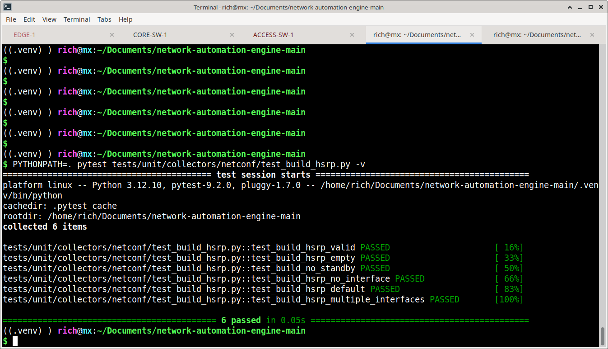

```bash
$ PYTHONPATH=. pytest tests/unit/collectors/netconf/test_build_hsrp.py -v
============================= test session starts ==============================
platform linux -- Python 3.12.10, pytest-9.2.0, pluggy-1.7.0 -- /home/rich/Documents/network-automation-engine-main/.venv/bin/python
cachedir: .pytest_cache
rootdir: /home/rich/Documents/network-automation-engine-main
collected 6 items

tests/unit/collectors/netconf/test_build_hsrp.py::test_build_hsrp_valid PASSED               [ 16%]
tests/unit/collectors/netconf/test_build_hsrp.py::test_build_hsrp_empty PASSED               [ 33%]
tests/unit/collectors/netconf/test_build_hsrp.py::test_build_no_standby PASSED               [ 50%]
tests/unit/collectors/netconf/test_build_hsrp.py::test_build_hsrp_no_interface PASSED        [ 66%]
tests/unit/collectors/netconf/test_build_hsrp.py::test_build_hsrp_default PASSED             [ 83%]
tests/unit/collectors/netconf/test_build_hsrp.py::test_build_hsrp_multiple_interfaces PASSED [100%]

============================== 6 passed in 0.05s ===============================
```

---

### Layer 2: HSRP Compliance Decision Engine Tests (`test_compliance_hsrp.py`)

Using `@patch` and `MagicMock`, this suite evaluates `compliance_hsrp()` across all 7 operational paths. Like ROAS/OSPF (and unlike the dual-transport SNMP/Syslog/STP suites), HSRP is **NETCONF-only**, so these tests are *not* parametrized over `TRANSPORT` a single `mock_transport = "NETCONF"` fixture is threaded through every call.

#### Test Scenarios Covered (7 Tests):
1. **`test_compliance_hsrp_already_compliant`**: Confirms that when HSRP groups, VIPs, and priorities match NetBox, `mock_log.info` is called, `mock_log.warning` is not called, and `initial_issues` remains empty.
2. **`test_compliance_hsrp_non_compliant_and_config_successful`**: Simulates a Virtual IP mismatch (`(HSRP) Mismatched Virtual IP`), verifies remediation executes, and status resolves to `OperationalStatus.SUCCESS`.
3. **`test_compliance_hsrp_configuration_failed`**: Simulates a NETCONF `<edit-config>` RPC rejection, confirming status is updated to `FAILED_CONFIG` and captured under `critical_issues`.
4. **`test_compliance_hsrp_post_validation_successful`**: Tests the closed-loop recovery cycle: initial check fails → NETCONF RPC applied → re-collected operational state passes post-validation.
5. **`test_compliance_hsrp_post_validation_failed`**: Tests failure handling when a standby parameter remains drifted after remediation, asserting status is set to `FAILED_VALIDATION`.
6. **`test_compliance_hsrp_empty`**: Verifies that an empty NetBox context (`{"hsrp": []}`) completes gracefully with zero actions and zero errors.
7. **`test_compliance_hsrp_dry_run`**: Verifies that when `DRY_RUN = True`, drift is recorded, but no NETCONF RPCs are transmitted to physical hardware.

#### Code Excerpt (`test_compliance_hsrp.py`):

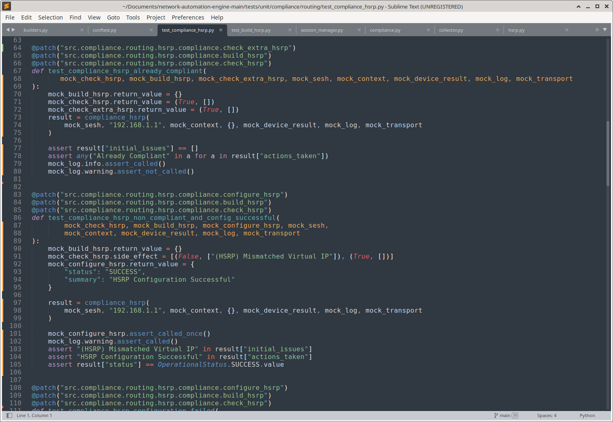

```python
@patch("src.compliance.routing.hsrp.compliance.check_extra_hsrp")
@patch("src.compliance.routing.hsrp.compliance.build_hsrp")
@patch("src.compliance.routing.hsrp.compliance.check_hsrp")
def test_compliance_hsrp_already_compliant(
       mock_check_hsrp, mock_build_hsrp, mock_check_extra_hsrp, mock_sesh, mock_context, mock_device_result, mock_log, mock_transport
):
    mock_build_hsrp.return_value = {}
    mock_check_hsrp.return_value = (True, [])
    mock_check_extra_hsrp.return_value = (True, [])
    result = compliance_hsrp(
        mock_sesh, "192.168.1.1", mock_context, {}, mock_device_result, mock_log, mock_transport
    )

    assert result["initial_issues"] == []
    assert any("Already Compliant" in a for a in result["actions_taken"])
    mock_log.info.assert_called()
    mock_log.warning.assert_not_called()


@patch("src.compliance.routing.hsrp.compliance.configure_hsrp")
@patch("src.compliance.routing.hsrp.compliance.build_hsrp")
@patch("src.compliance.routing.hsrp.compliance.check_hsrp")
def test_compliance_hsrp_non_compliant_and_config_successful(
        mock_check_hsrp, mock_build_hsrp, mock_configure_hsrp, mock_sesh,
        mock_context, mock_device_result, mock_log, mock_transport
):
    mock_build_hsrp.return_value = {}
    mock_check_hsrp.side_effect = [(False, ["(HSRP) Mismatched Virtual IP"]), (True, [])]
    mock_configure_hsrp.return_value = {
        "status": "SUCCESS",
        "summary": "HSRP Configuration Successful"
    }

    result = compliance_hsrp(
        mock_sesh, "192.168.1.1", mock_context, {}, mock_device_result, mock_log, mock_transport
    )

    mock_configure_hsrp.assert_called_once()
    mock_log.warning.assert_called()
    assert "(HSRP) Mismatched Virtual IP" in result["initial_issues"]
    assert "HSRP Configuration Successful" in result["actions_taken"]
    assert result["status"] == OperationalStatus.SUCCESS.value
```

#### Terminal Execution:

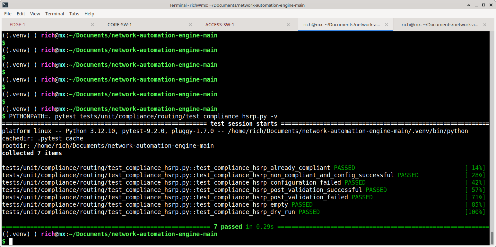

```bash
$ PYTHONPATH=. pytest tests/unit/compliance/routing/test_compliance_hsrp.py -v
============================= test session starts ==============================
platform linux -- Python 3.12.10, pytest-9.2.0, pluggy-1.7.0 -- /home/rich/Documents/network-automation-engine-main/.venv/bin/python
cachedir: .pytest_cache
rootdir: /home/rich/Documents/network-automation-engine-main
collected 7 items

tests/unit/compliance/routing/test_compliance_hsrp.py::test_compliance_hsrp_already_compliant PASSED                 [ 14%]
tests/unit/compliance/routing/test_compliance_hsrp.py::test_compliance_hsrp_non_compliant_and_config_successful PASSED [ 28%]
tests/unit/compliance/routing/test_compliance_hsrp.py::test_compliance_hsrp_configuration_failed PASSED             [ 42%]
tests/unit/compliance/routing/test_compliance_hsrp.py::test_compliance_hsrp_post_validation_successful PASSED        [ 57%]
tests/unit/compliance/routing/test_compliance_hsrp.py::test_compliance_hsrp_post_validation_failed PASSED            [ 71%]
tests/unit/compliance/routing/test_compliance_hsrp.py::test_compliance_hsrp_empty PASSED                              [ 85%]
tests/unit/compliance/routing/test_compliance_hsrp.py::test_compliance_hsrp_dry_run PASSED                            [100%]

============================== 7 passed in 0.29s ===============================
```
### Continuous Integration Ready

The test framework is designed for CI/CD pipeline integration:

```yaml
# .github/workflows/test.yml (GitHub Actions Example)
name: Run Unit Tests

on: [push, pull_request]

jobs:
  test:
    runs-on: ubuntu-latest
    steps:
      - uses: actions/checkout@v3
      - name: Set up Python
        uses: actions/setup-python@v4
        with:
          python-version: '3.12'
      - name: Install dependencies
        run: pip install -r requirements.txt
      - name: Run tests with coverage                            <--------- Pytests 
        run: pytest tests/unit/ --cov=src --cov-report=xml
      - name: Upload coverage to Codecov
        uses: codecov/codecov-action@v3
```
---

### Test Suite Execution Summary

| Test Suite | File Path | Scope & Boundary Scenarios Covered | Status | Execution Time |
| :--- | :--- | :--- | :---: | :---: |
| **NETCONF HSRP Builder** | `tests/unit/collectors/netconf/test_build_hsrp.py` | YANG XML parsing, missing container boundaries, default priority/version fallbacks, multi-interface models | **PASSED (6/6)** | 0.05s |
| **HSRP Compliance Suite** | `tests/unit/compliance/routing/test_compliance_hsrp.py` | State-machine reconciliation, bypass logic, NETCONF `<edit-config>` remediation, dry-run safety, post-validation | **PASSED (7/7)** | 0.29s |
| **Total** | | **Comprehensive Offline NETCONF HSRP Test Suite** | **13 / 13** | **0.34s** |

---

---

## Conclusion & Engineering Takeaways

This module demonstrates that First Hop Redundancy assurance is not a CLI problem it is a **data-model problem**, and the cleanest way to solve it is to stop scraping text and start reading the device's own structured state. By treating the router as a YANG resource tree and the HSRP contract as a NetBox declaration, the engine turns silent failover failures into a deterministic, observable, and reversible pipeline.

Key architectural wins validated in this project include:
1. **NETCONF-over-SSH, Not Screen-Scraped:** HSRP is the portfolio's only pure-NETCONF module. Parsing `<standby-list>` containers from an `xmltodict` payload removes the regex fragility that every CLI-scraping module carries, and the test suite proves it with synthetic XML fixtures rather than captured terminal text.
2. **Two-Tier Diff Semantics:** Separating rogue group detection (`check_extra_hsrp`) from attribute parity (`check_hsrp`) keeps `critical_issues` (rogue groups) and `initial_issues` (drifted VIPs/priorities) strictly separated in the audit report a distinction that matters for NOC triage.
3. **Atomic XML Remediation:** Because `configure_hsrp()` renders a complete `<native>` YANG payload and issues a single `edit_config` RPC, remediation is naturally idempotent re-running the same RPC is a no-op, and the entire group is reconciled in one atomic transaction.
4. **Short-Circuit Validation:** The existence gate's early `return` in `check_hsrp()` keeps drift reports honest: a missing group yields exactly one `Missing Configuration` line, while an existing-but-wrong group yields the specific attribute mismatches (VIP, priority, preempt, version) the two failure classes never blur.

### Next Steps & Future Enhancements
To further evolve this module, the following are planned:
- **VRRP/GLBP Support:** Extend the builder and template to parse `<vrrp>` and `<glbp>` YANG containers, applying the same two-tier diff engine to alternative FHRP protocols.
- **NETCONF Reply Validation:** The current `edit_config` call discards the RPC reply; adding `reply.ok` assertion would catch schema rejections before logging SUCCESS.
- **CI/CD Pipeline Integration:** Embed the 13-case suite into GitHub Actions to block PRs that regress the XML traversal or the two-tier diff logic.

---

### Return to Main Repository

This module is part of a broader Network Automation Engine portfolio.

**Explore other modules:**
- [VLAN Compliance & Remediation](../vlan-compliance/)
- [Access Port Compliance & Remediation](../access-ports/)
- [Trunk Port Compliance & Remediation](../trunk-ports/)
- [Interface Compliance & Remediation](../interface-compliance/)
- [Spanning Tree Protocol (STP) Compliance](../stp-compliance/)
- [Syslog Compliance & Remediation](../syslog-compliance/)
- [SNMP Compliance & Remediation](../snmp-compliance/)
- [Router-on-a-Stick (ROAS) Compliance](../roas-compliance/)
- [OSPF Dynamic Routing Compliance](../ospf-compliance/)
- [F5 BIG-IP LTM Cloud Load Balancing](../f5-big-ip-ltm-lab/)

**[Return to Main Repository README](../README.md)**
