# OSPF Dynamic Routing Compliance & RESTCONF Remediation

## Overview

In enterprise routing architectures, Open Shortest Path First (OSPF) misconfigurations mismatched area IDs, incorrect wildcard masks, or conflicting Router IDs prevent neighbor adjacency and cause silent routing failures. Unlike a drifted switchport (which strands one endpoint), a drifted OSPF process can silently black-hole an entire site's inter-VLAN traffic while the control plane appears healthy.

The **OSPF Dynamic Routing Compliance & RESTCONF Remediation** module is a production-grade, closed-loop automation engine built specifically for this failure class. It is the portfolio's only **multi-process, model-driven** routing module: rather than screen-scraping `show ip ospf`, it reads the router's live state as a structured **YANG data model** over **RESTCONF**, diffs it against a **NetBox Source of Truth** using a three-tier short-circuit gate (process existence → Router ID → bidirectional network statements), and heals drift via an **unconditional purge-and-rebuild** strategy HTTP `DELETE` every observed process, then HTTP `PATCH` the NetBox baseline, then a native `cisco-ia:save-config` RPC to persist to NVRAM.

Because OSPF's `network` statements are area-scoped wildcard advertisements, the engine introduces a **bidirectional diff** pattern: Gate 3a flags every *expected* subnet missing from the router, while Gate 3b flags every *actual* subnet not present in the NetBox baseline. This catches both omissions and unauthorized advertisements in a single pass the same rigor you'd apply to firewall rule audits, now applied to routing.

### Core Engineering Objectives
- **Declarative Baseline via Tagged SoT:** Establish NetBox IPAM + the `ospf` interface tag + custom fields (`ospf_process_id`, `area_id`) as the single source of truth for process membership, Router ID, and network advertisements.
- **Model-Driven Collection (RESTCONF/YANG):** Query `/data/Cisco-IOS-XE-native:native/router` and `/data/Cisco-IOS-XE-ospf_oper:ospf-oper-data` over HTTPS, parsing the JSON-encoded YANG tree instead of scraping terminal output eliminating regex fragility on multi-process OSPF syntax.
- **Short-Circuit Three-Tier Diff:** `check_ospf()` evaluates process existence → RID parity → bidirectional network statements, returning early at each gate so a missing process never produces spurious RID/network mismatches.
- **Unconditional Purge-and-Rebuild Remediation:** `configure_ospf()` issues HTTP `DELETE` against every observed process (including the authorized one), then HTTP `PATCH` the NetBox baseline, then a native `cisco-ia:save-config` RPC a clean-slate reconcile that is naturally idempotent on re-run.
- **Programmatic Wildcard Derivation:** The inventory engine uses `ipaddress.ip_interface().network.hostmask` to compute inverted wildcard masks from CIDR, eliminating manual engineering calculation errors across complex subnets.
- **Closed-Loop Verification:** Re-issue the RESTCONF GET, re-run `build_ospf()` + `check_ospf()` against fresh operational state, and assert the process is actually active before marking success.
- **Enterprise Observability:** Stream severity-coded JSON to Splunk via HEC, with the documented orchestrator-vs-handler schema asymmetry (`router_id`/`interfaces` vs `RID`/`networks`) made explicit.
- **CI/CD Readiness:** Validate the state machine with 22 offline Pytest cases (15 builder + 7 compliance); OSPF is RESTCONF-only, so unlike SNMP/Syslog/STP the compliance suite is *not* transport-parametrized.

---

## Architecture

The OSPF module follows the project's Source-of-Truth-driven architecture, but with a model-driven collection/remediation path unique to this module:

| Component | Responsibility |
|---|---|
| **NetBox (Interfaces + Tags + Custom Fields + Config Context)** | Supplies expected OSPF process IDs, Router IDs, interface-area bindings, and the `ospf` policy tag. |
| **RESTCONF Collector** | `collect_restconf_state()` GETs the native router YANG tree + OSPF operational data over HTTPS with per-request fault isolation. |
| **OSPF Builder** | `build_ospf()` traverses the YANG model, extracts `id`/`router-id`/`network` lists, and emits a normalized `{process_id: {process_id, router_id, network_list}}` lookup. |
| **Compliance Checker** | `check_ospf()` runs the three-gate diff with short-circuit returns and a bidirectional network statement check. |
| **Remediation Engine** | `configure_ospf()` renders `ospf.j2` into a YANG JSON payload, issues HTTP `DELETE` on every observed process, HTTP `PATCH` the baseline, and a native `cisco-ia:save-config` RPC. |
| **Post-Validation** | Re-GETs the router container, re-builds, re-checks, and confirms the process is live on the data plane. |

## Topology 

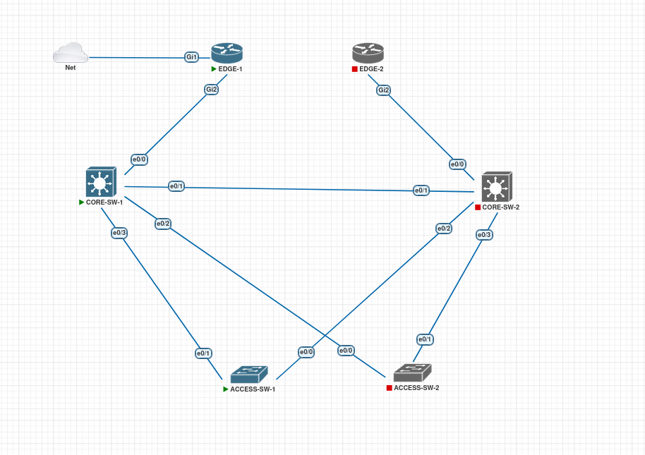

## End to End Demonstration 

https://github.com/user-attachments/assets/f52c5313-c549-4929-b94e-0f1a08e6d71a

### Table of Contents

- [1. Intended State: NetBox Source of Truth (OSPF Dynamic Routing)](#1-intended-state-netbox-source-of-truth-ospf-dynamic-routing)
- [2. Live Device State Collection & RESTCONF Parsing](#2-live-device-state-collection--restconf-parsing)
- [3. OSPF Compliance Diff Engine & Drift Detection](#3-ospf-compliance-diff-engine--drift-detection)
- [4. Configuration Remediation](#4-configuration-remediation)
- [5. Safe Change Management: Dry-Run Mode](#5-safe-change-management-dry-run-mode)
- [6. Post-Remediation Validation & Physical Device Proof](#6-post-remediation-validation--physical-device-proof)
- [7. Audit Logging & Splunk Telemetry Pipeline (OSPF via RESTCONF)](#7-audit-logging--splunk-telemetry-pipeline-ospf-via-restconf)
- [8. Automated Unit Testing & CI/CD Validation (OSPF via RESTCONF)](#8-automated-unit-testing--cicd-validation-ospf-via-restconf)

## 1. Intended State: NetBox Source of Truth (OSPF Dynamic Routing)

In enterprise routing architectures Open Shortest Path First (OSPF) misconfigurations such as mismatched area IDs incorrect wildcard masks or conflicting Router IDs prevent neighbor adjacency and cause silent routing failures.

To enforce deterministic dynamic routing baselines the automation engine establishes **NetBox** as the single authoritative Source of Truth (SoT). The OSPF architecture is modeled using a hybrid declarative design:
1. **Global Process Context (NetBox Config Context):** Declares OSPF process IDs and explicit loopback Router IDs (`router_id`).
2. **Interface Attachment & Wildcard Calculation (NetBox Custom Fields & Tags):** Identifies participating routing links using the `ospf` tag assigns areas via custom fields and uses Python's `ipaddress` library to programmatically derive subnets and wildcard masks from interface CIDRs.

---

### 1. Extending NetBox: Custom Fields & Administrative Tags

To attach physical and logical interfaces to OSPF processes NetBox was extended with three dedicated **Custom Fields** and an administrative **Tag**:

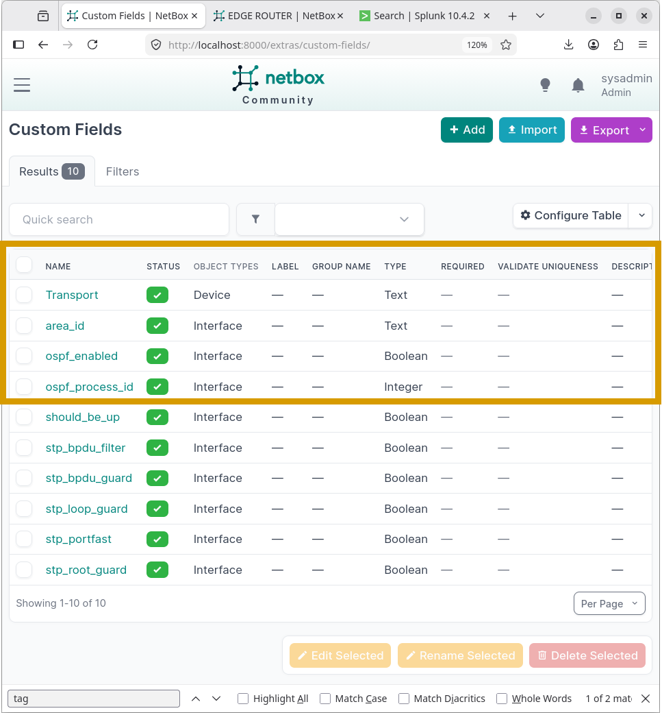

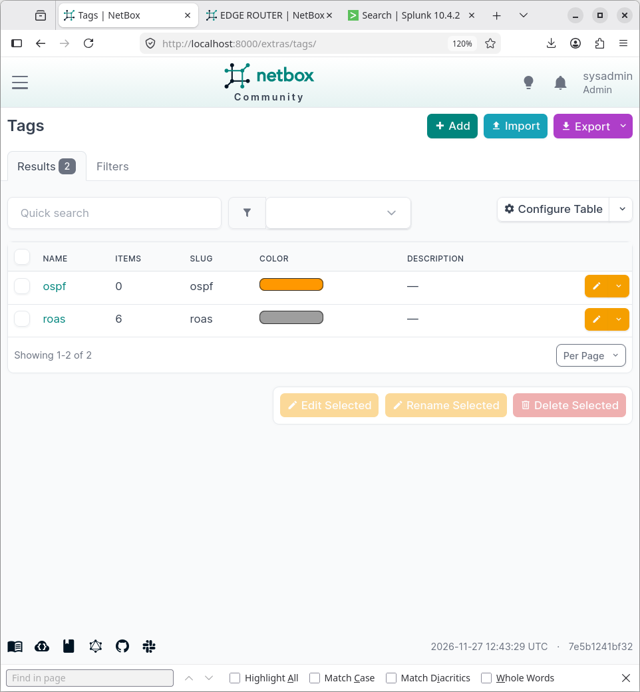

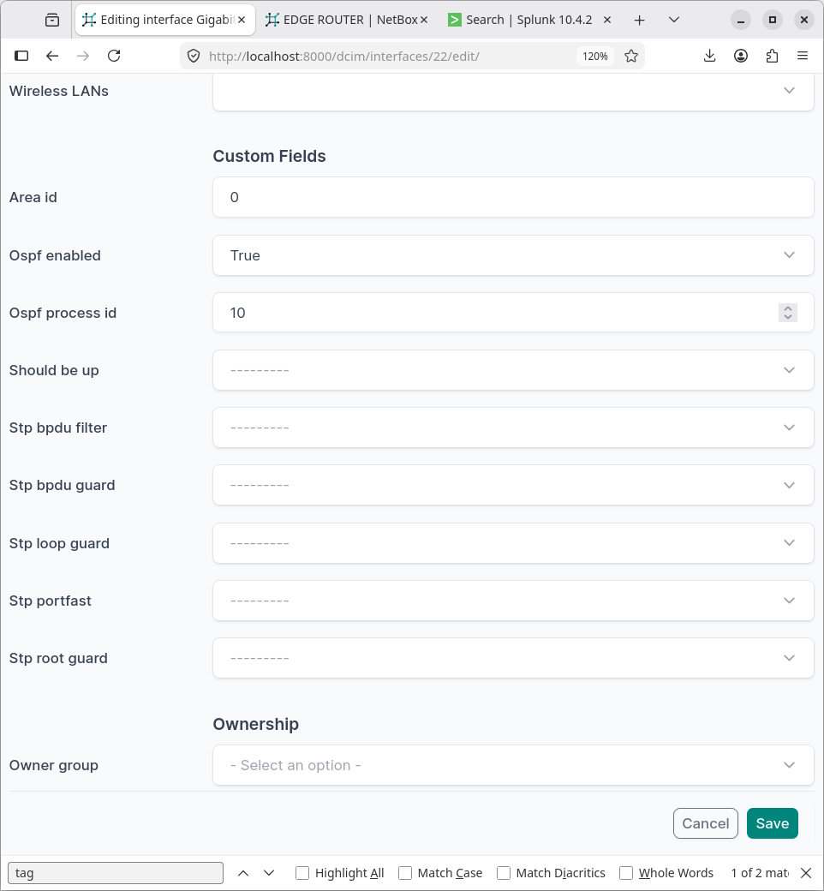

#### Custom Fields Specification:
* **`ospf_enabled`** (`Boolean`): Administrative toggle enabling OSPF routing on the target interface.
* **`ospf_process_id`** (`Integer`): Binds the interface to the declared local OSPF routing process (e.g., `10`).
* **`area_id`** (`Text`): Defines the OSPF area assignment (e.g., Area `0` / Backbone).

#### Tag Specification:
* **Tag Name:** `ospf` | **Slug:** `ospf` | **Color:** `Orange`
* **Purpose:** Instructs the inventory engine to ingest the interface's assigned IP addresses into the OSPF `network_list`.

---

### 2. Global OSPF Process Baseline: `HQ-EDGE-1` (`192.168.255.10`)

Inside `HQ-EDGE-1`'s NetBox **Config Context** (`dcim/devices/3/config-context/`) the global process and Router ID are declared:

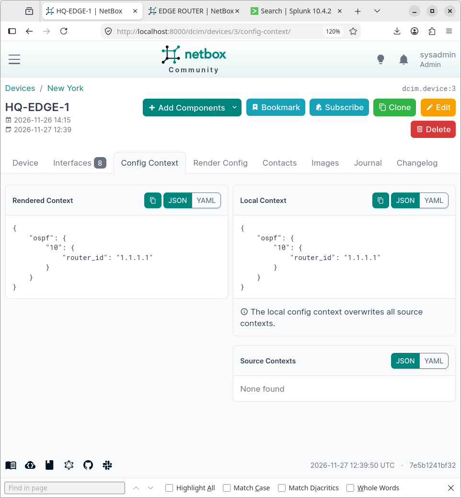

```json
{
  "ospf": {
    "10": {
      "router_id": "1.1.1.1"
    }
  }
}
```

> NetBox renders this identically in the **Rendered Context** and **Local Context** panels (`The local config context overwrites all source contexts.`) with **Source Contexts: None found** confirming the OSPF process is authored directly on the device.

---

### 3. Inventory Ingestion Engine (`src/sot/inventory.py`)

When building the OSPF context, the engine checks for the `ospf` tag, correlates interface custom fields with global config contexts and leverages `ipaddress.ip_interface` to **programmatically calculate the network address and inverted wildcard mask (`hostmask`)** eliminating manual engineering calculation errors:

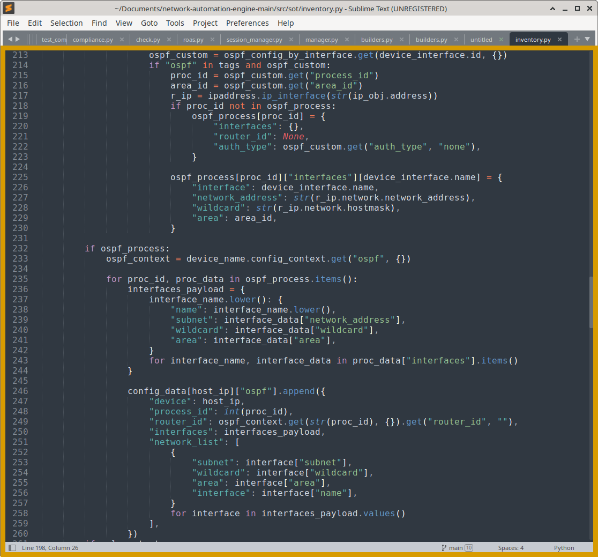

```python
# src/sot/inventory.py (OSPF Ingestion Logic)

            ospf_custom = ospf_config_by_interface.get(device_interface.id, {})
            if "ospf" in tags and ospf_custom:
                proc_id = ospf_custom.get("process_id")
                area_id = ospf_custom.get("area_id")
                r_ip = ipaddress.ip_interface(str(ip_obj.address))
                if proc_id not in ospf_process:
                    ospf_process[proc_id] = {
                        "interfaces": {},
                        "router_id": None,
                        "auth_type": ospf_custom.get("auth_type", "none"),
                    }
                ospf_process[proc_id]["interfaces"][device_interface.name] = {
                    "interface": device_interface.name,
                    "network_address": str(r_ip.network.network_address),
                    "wildcard": str(r_ip.network.hostmask),
                    "area": area_id,
                }

        
        if ospf_process:
            ospf_context = device_name.config_context.get("ospf", {})
            for proc_id, proc_data in ospf_process.items():
                interfaces_payload = {
                    interface_name.lower(): {
                        "name": interface_name.lower(),
                        "subnet": interface_data["network_address"],
                        "wildcard": interface_data["wildcard"],
                        "area": interface_data["area"],
                    }
                    for interface_name, interface_data in proc_data["interfaces"].items()
                }
                config_data[host_ip]["ospf"].append({
                    "device": host_ip,
                    "process_id": int(proc_id),
                    "router_id": ospf_context.get(str(proc_id), {}).get("router_id", ""),
                    "interfaces": interfaces_payload,
                    "network_list": [
                        {
                            "subnet": interface["subnet"],
                            "wildcard": interface["wildcard"],
                            "area": interface["area"],
                            "interface": interface["name"],
                        }
                        for interface in interfaces_payload.values()
                    ],
                })
```

---

### 4. Normalized Desired-State Output

At runtime, the inventory engine compiles the declarative data into an immutable OSPF model for `HQ-EDGE-1`:

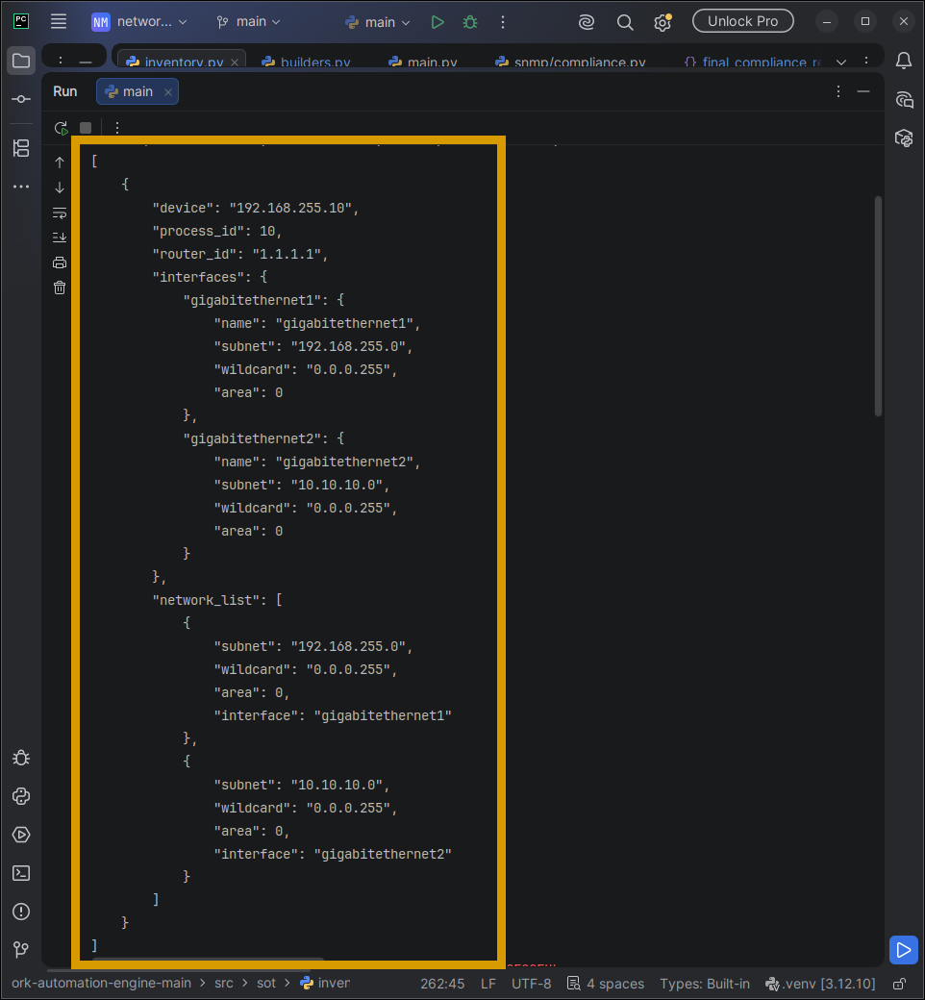

```json
[
  {
    "device": "192.168.255.10",
    "process_id": 10,
    "router_id": "1.1.1.1",
    "interfaces": {
      "gigabitethernet1": {
        "name": "gigabitethernet1",
        "subnet": "192.168.255.0",
        "wildcard": "0.0.0.255",
        "area": 0
      },
      "gigabitethernet2": {
        "name": "gigabitethernet2",
        "subnet": "10.10.10.0",
        "wildcard": "0.0.0.255",
        "area": 0
      }
    },
    "network_list": [
      {
        "subnet": "192.168.255.0",
        "wildcard": "0.0.0.255",
        "area": 0,
        "interface": "gigabitethernet1"
      },
      {
        "subnet": "10.10.10.0",
        "wildcard": "0.0.0.255",
        "area": 0,
        "interface": "gigabitethernet2"
      }
    ]
  }
]
```

> **Design Principle:**
> By pairing NetBox interface tagging (`ospf`) with automated wildcard mask derivation (`r_ip.network.hostmask`), the compliance engine (`check_ospf()`) audits both the global routing process and the network advertisement statements against an exact mathematical baseline, eliminating human syntax errors across complex subnets.

## 2. Live Device State Collection & RESTCONF Parsing

To audit dynamic routing without relying on brittle CLI scraping, the engine collects live OSPF state over **RESTCONF** using native Cisco IOS-XE YANG data models.

The extraction pipeline operates in two distinct stages:
1. **RESTCONF Collector Layer (`collector.py`):** Queries both the configuration data model (`/Cisco-IOS-XE-native:native/router`) and operational runtime data (`/Cisco-IOS-XE-ospf_oper:ospf-oper-data`) via HTTPS GET requests with persistent session handling.
2. **Schema Normalization Builder (`builders.py`):** Traverses the JSON-encoded YANG structure, extracts the active OSPF process IDs, unmasks loopback Router IDs, and normalizes the network advertisement statements (`ip`, `mask`, `area`).

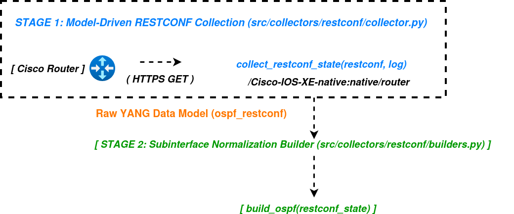

---

### 1. RESTCONF OSPF Collection (`src/collectors/restconf/collector.py`)

The `collect_restconf_state()` function queries the router's RESTCONF API. Both the routing configuration container and the OSPF operational state tree are retrieved under isolated exception boundaries:

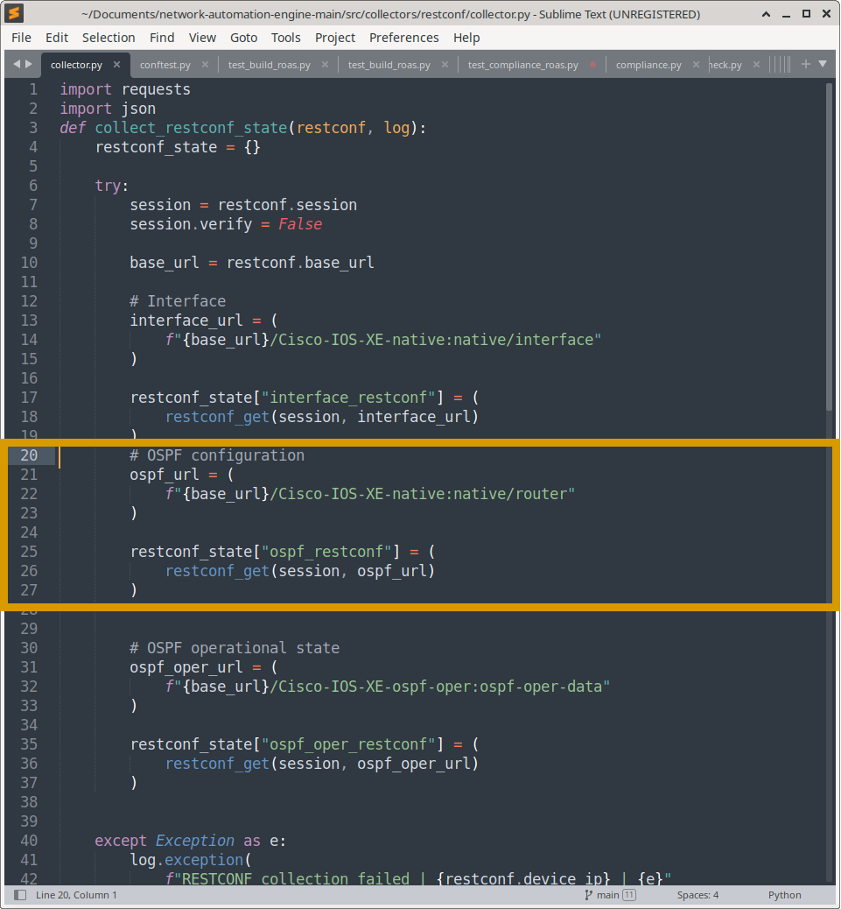

```python
# src/collectors/restconf/collector.py (OSPF Collection lines 20 - 36)

        # OSPF configuration
        ospf_url = (
            f"{base_url}/Cisco-IOS-XE-native:native/router"
        )

        restconf_state["ospf_restconf"] = (
            restconf_get(session, ospf_url)
        )

        # OSPF operational state
        ospf_oper_url = (
            f"{base_url}/Cisco-IOS-XE-ospf-oper:ospf-oper-data"
        )

        restconf_state["ospf_oper_restconf"] = (
            restconf_get(session, ospf_oper_url)
        )
```
---

### 2. OSPF State Normalization Builder (`src/collectors/restconf/builders.py`)

The `build_ospf()` function parses the raw YANG dictionary. It extracts process identifiers, maps the configured `router-id` and normalizes each `network` statement into a clean list of subnets, wildcard masks, and areas:

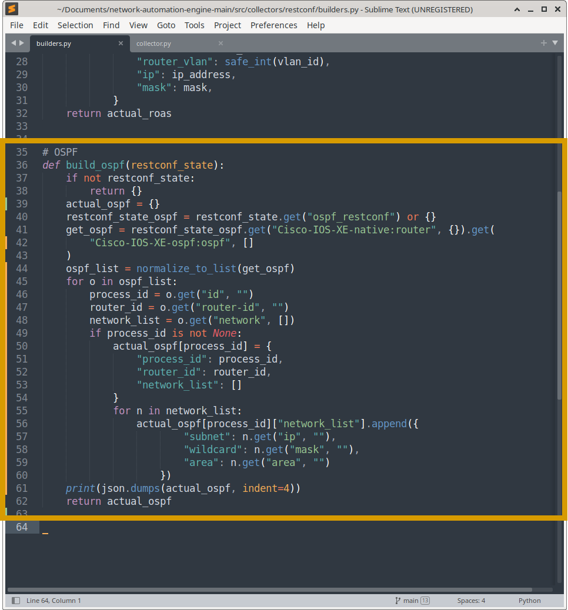

```python
# src/collectors/restconf/builders.py (OSPF Normalization Builder)

# OSPF
def build_ospf(restconf_state):
    if not restconf_state:
        return {}
    actual_ospf = {}
    restconf_state_ospf = restconf_state.get("ospf_restconf") or {}
    get_ospf = restconf_state_ospf.get("Cisco-IOS-XE-native:router", {}).get(
        "Cisco-IOS-XE-ospf:ospf", []
    )
    ospf_list = normalize_to_list(get_ospf)
    for o in ospf_list:
        process_id = o.get("id", "")
        router_id = o.get("router-id", "")
        network_list = o.get("network", [])
        if process_id is not None:
            actual_ospf[process_id] = {
                "process_id": process_id,
                "router_id": router_id,
                "network_list": []
            }
            for n in network_list:
                actual_ospf[process_id]["network_list"].append({
                    "subnet": n.get("ip", ""),
                    "wildcard": n.get("mask", ""),
                    "area": n.get("area", "")
                })
    print(json.dumps(actual_ospf, indent=4))
    return actual_ospf
```

---

### 3. Live State Verification & Injected OSPF Drift

To test model-driven extraction and diffing, unauthorized OSPF configuration drift was manually applied directly on `EDGE-1`:

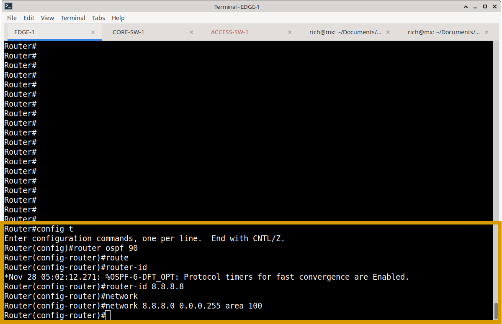

```cisco
EDGE-1# config t
Enter configuration commands, one per line.  End with CNTL/Z.
EDGE-1(config)# router ospf 90
EDGE-1(config-router)# router-id 8.8.8.8
*Nov 28 05:02:12.271: %OSPF-6-DFT_OPT: Protocol timers for fast convergence are Enabled.
EDGE-1(config-router)# network 8.8.8.0 0.0.0.255 area 100
EDGE-1(config-router)#
```

#### Normalized Builder Runtime Output:
When the collector audited `EDGE-1`, `build_ospf()` traversed the native YANG payload and generated the following structured operational dictionary:

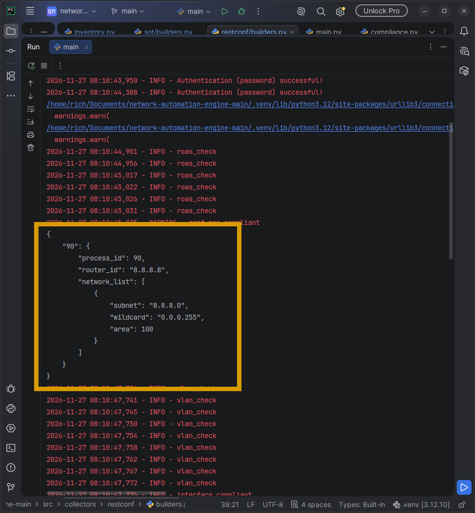

```json
{
    "90": {
        "process_id": 90,
        "router_id": "8.8.8.8",
        "network_list": [
            {
                "subnet": "8.8.8.0",
                "wildcard": "0.0.0.255",
                "area": 100
            }
        ]
    }
}
```

```text
2026-11-27 08:10:45,035 - WARNING - ospf_non_compliant
```

---

### 4. Operational Drift Baseline

Comparing this normalized operational state against the **NetBox Desired State** immediately reveals multi-parameter dynamic routing drift across `EDGE-1`:

| OSPF Parameter | NetBox Declared Intent | Observed Router State | Compliance Evaluation |
| :--- | :--- | :--- | :---: |
| **Process ID** | `10` | `90` | **DRIFT (Rogue Process ID / Missing Authorized)** |
| **Router ID** | `1.1.1.1` | `8.8.8.8` | **DRIFT (Unauthorized Router ID)** |
| **Network Advertisements** | `192.168.255.0 0.0.0.255 area 0`<br>`10.10.10.0 0.0.0.255 area 0` | `8.8.8.0 0.0.0.255 area 100` | **DRIFT (Wrong Area ID & Unauthorized Subnet)** |

> **Next Step:** This normalized observed dictionary is fed directly into `check_ospf()`, triggering targeted remediation to remove rogue OSPF process 90, instantiate authorized process 10, bind Router ID `1.1.1.1`, and advertise the authorized Area 0 subnets.

---

## 3. OSPF Compliance Diff Engine & Drift Detection

The OSPF dynamic routing compliance engine evaluates live routing processes, loopback Router IDs, and network advertisement statements against the NetBox declarative baseline.

Operating as a closed-loop state machine over **RESTCONF**, the engine filters compliant routing processes, detects configuration drift across three distinct operational gates, triggers automated RESTCONF remediations, and performs closed-loop post-validation.

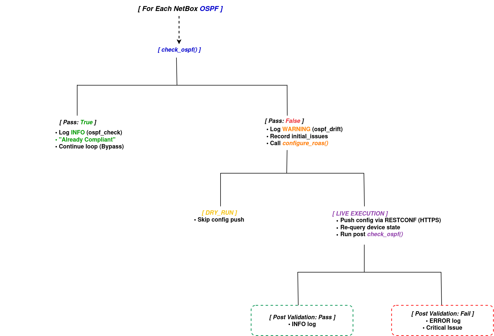
---

### 1. Three-Tier OSPF Validation Gates

The `check_ospf()` diff engine validates live model-driven state across three deterministic gates:
1. **Process ID Existence Gate:** Confirms that the declared OSPF process (e.g., Process `10`) is actively instantiated under `/Cisco-IOS-XE-native:native/router`. If absent, the engine reports `Missing Process ID (OSPF) | ID: 10` and **short-circuits** (no RID/network checks run).
2. **Router ID (RID) Gate:** Compares the active 32-bit Router ID against the NetBox Config Context baseline. If a rogue or default interface IP was elected, it flags `(OSPF) Mismatched Router ID` and **short-circuits** (network checks skipped).
3. **Network Advertisement & Area Gate:** Verifies that all expected subnets, wildcard masks, and OSPF Area IDs are present in the router's active `network` block, and that no unauthorized networks remain.

---

### 2. Multi-Tier Diff Engine (`src/compliance/routing/ospf/check.py`)

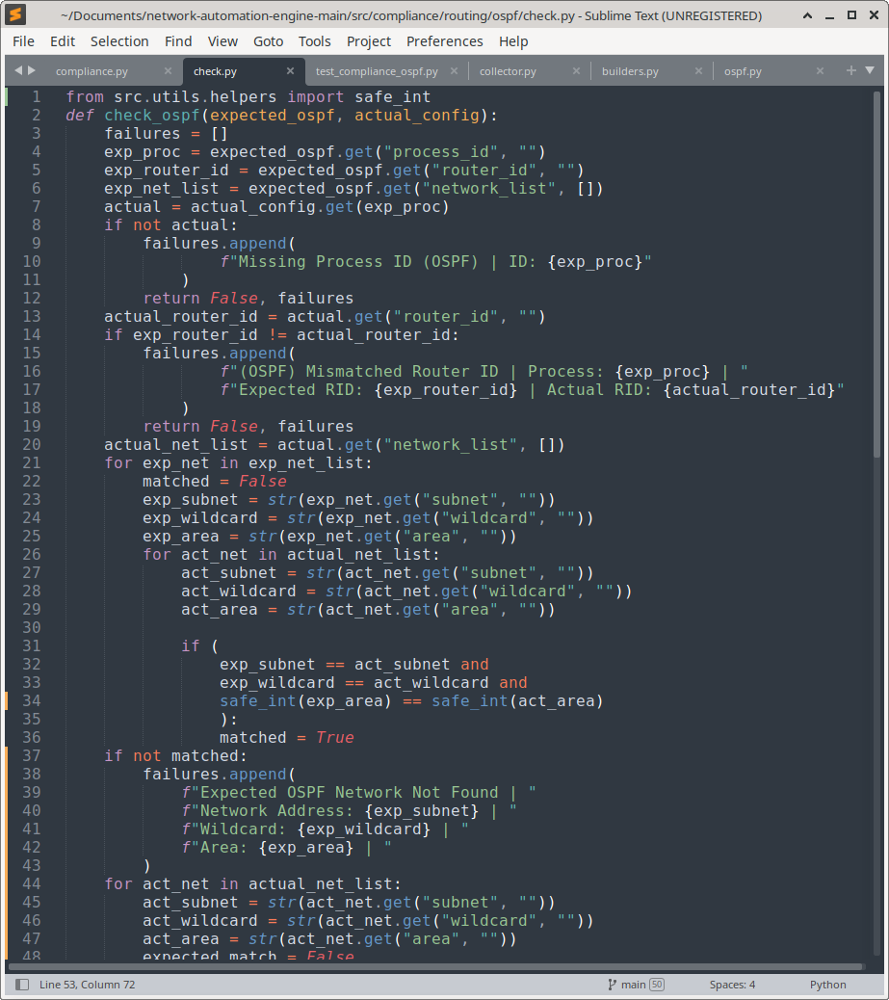

```python
# src/compliance/routing/ospf/check.py

from src.utils.helpers import safe_int


def check_ospf(expected_ospf, actual_config):
    failures = []
    exp_proc = expected_ospf.get("process_id", "")
    exp_router_id = expected_ospf.get("router_id", "")
    exp_net_list = expected_ospf.get("network_list", [])

    # Gate 1: Process ID existence (short-circuits)
    actual = actual_config.get(exp_proc)
    if not actual:
        failures.append(f"Missing Process ID (OSPF) | ID: {exp_proc}")
        return False, failures

    # Gate 2: Router ID parity (short-circuits)
    actual_router_id = actual.get("router_id", "")
    if exp_router_id != actual_router_id:
        failures.append(
            f"(OSPF) Mismatched Router ID | Process: {exp_proc} | "
            f"Expected RID: {exp_router_id} | Actual RID: {actual_router_id}"
        )
        return False, failures

    # Gate 3a: Every expected network must be present (per-iteration guard)
    actual_net_list = actual.get("network_list", [])
    for exp_net in exp_net_list:
        matched = False
        exp_subnet = str(exp_net.get("subnet", ""))
        exp_wildcard = str(exp_net.get("wildcard", ""))
        exp_area = str(exp_net.get("area", ""))
        for act_net in actual_net_list:
            act_subnet = str(act_net.get("subnet", ""))
            act_wildcard = str(act_net.get("wildcard", ""))
            act_area = str(act_net.get("area", ""))
            if (
                exp_subnet == act_subnet
                and exp_wildcard == act_wildcard
                and safe_int(exp_area) == safe_int(act_area)
            ):
                matched = True
        if not matched:
            failures.append(
                f"Expected OSPF Network Not Found | "
                f"Network Address: {exp_subnet} | "
                f"Wildcard: {exp_wildcard} | "
                f"Area: {exp_area}"
            )

    # Gate 3b: No unexpected networks may remain
    for act_net in actual_net_list:
        act_subnet = str(act_net.get("subnet", ""))
        act_wildcard = str(act_net.get("wildcard", ""))
        act_area = str(act_net.get("area", ""))
        expected_match = False
        for exp_net in exp_net_list:
            if (
                act_subnet == str(exp_net.get("subnet", ""))
                and act_wildcard == str(exp_net.get("wildcard", ""))
                and safe_int(act_area) == safe_int(exp_net.get("area", ""))
            ):
                expected_match = True
                break
        if not expected_match:
            failures.append(
                f"Unexpected OSPF Network Found | "
                f"Network Address: {act_subnet} | "
                f"Wildcard: {act_wildcard} | "
                f"Area: {act_area}"
            )
    return len(failures) == 0, failures
```
---

### 3. Closed-Loop Compliance Orchestrator (`src/compliance/routing/ospf/compliance.py`)

The `compliance_ospf()` function coordinates diff evaluation, logs drift warnings, gates on `DRY_RUN`, executes RESTCONF remediation, and performs closed-loop post-validation re-audits:

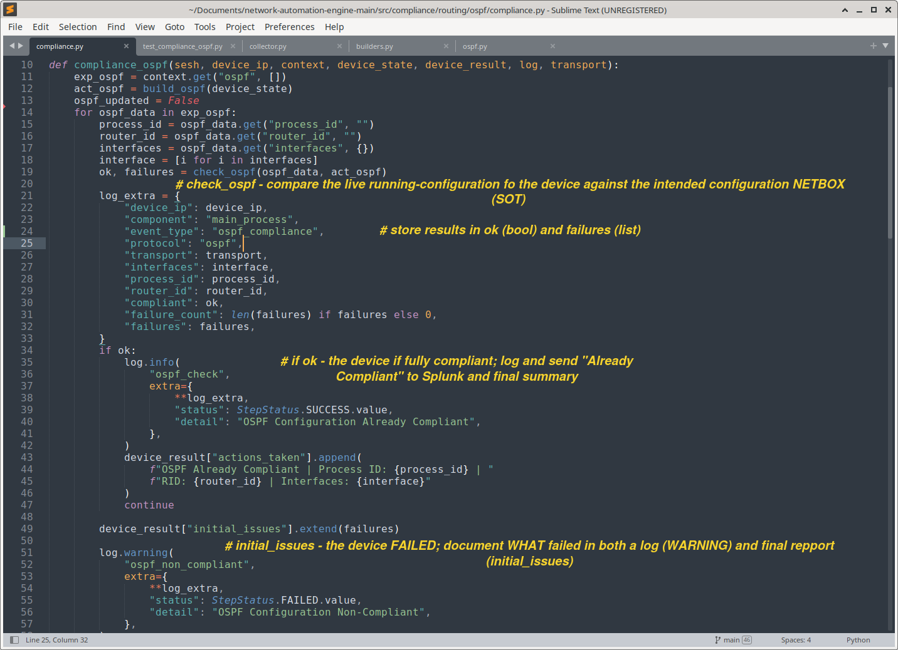

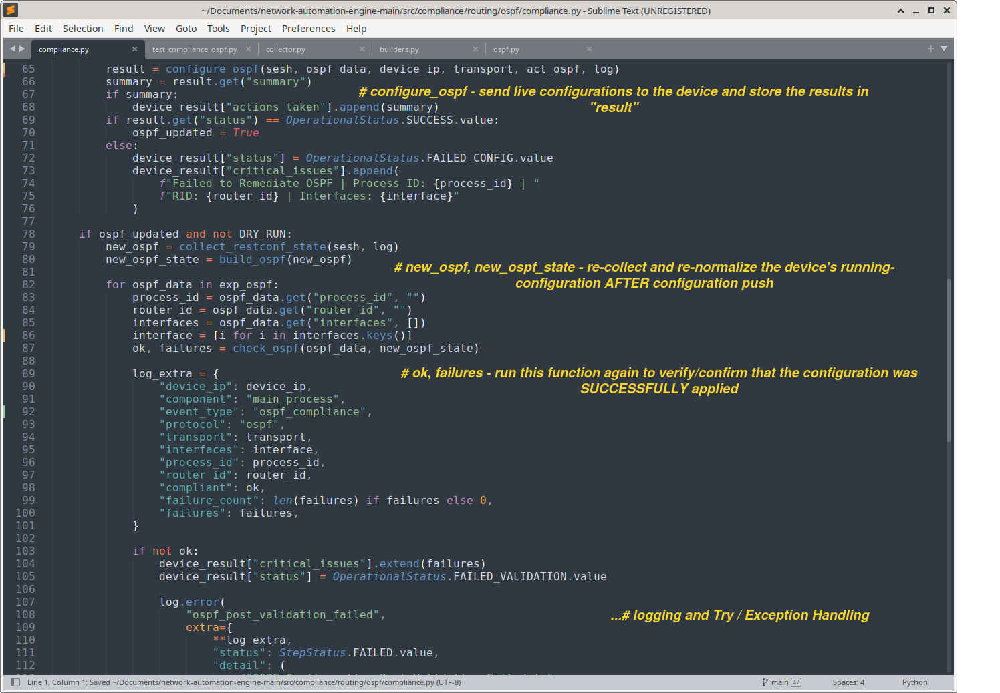

```python
# src/compliance/routing/ospf/compliance.py

from src.core.enums import StepStatus, OperationalStatus
from src.collectors.restconf.collector import collect_restconf_state
from src.remediation.routing.ospf import configure_ospf
from src.collectors.restconf.builders import build_ospf
from src.compliance.routing.ospf.check import check_ospf
from src.core.settings import DRY_RUN


def compliance_ospf(sesh, device_ip, context, device_state, device_result, log, transport):
    exp_ospf = context.get("ospf", [])
    act_ospf = build_ospf(device_state)
    ospf_updated = False
    for ospf_data in exp_ospf:
        process_id = ospf_data.get("process_id", "")
        router_id = ospf_data.get("router_id", "")
        interfaces = ospf_data.get("interfaces", {})
        interface = [i for i in interfaces]
        ok, failures = check_ospf(ospf_data, act_ospf)

        log_extra = {
            "device_ip": device_ip,
            "component": "main_process",
            "event_type": "ospf_compliance",
            "protocol": "ospf",
            "transport": transport,
            "interfaces": interface,
            "process_id": process_id,
            "router_id": router_id,
            "compliant": ok,
            "failure_count": len(failures) if failures else 0,
            "failures": failures,
        }
        if ok:
            log.info(
                "ospf_check",
                extra={
                    **log_extra,
                    "status": StepStatus.SUCCESS.value,
                    "detail": "OSPF Configuration Already Compliant",
                },
            )
            device_result["actions_taken"].append(
                f"OSPF Already Compliant | Process ID: {process_id} | "
                f"RID: {router_id} | Interfaces: {interface}"
            )
            continue

        device_result["initial_issues"].extend(failures)

        log.warning(
            "ospf_non_compliant",
            extra={
                **log_extra,
                "status": StepStatus.FAILED.value,
                "detail": "OSPF Configuration Non-Compliant",
            },
        )

        if DRY_RUN:
            device_result["actions_taken"].append(
                f"[DRY_RUN] Would Configure OSPF | Process ID: {process_id} | "
                f"RID: {router_id} | Interfaces: {interface}"
            )
            continue
        result = configure_ospf(sesh, ospf_data, device_ip, transport, act_ospf, log)
        summary = result.get("summary")
        if summary:
            device_result["actions_taken"].append(summary)
        if result.get("status") == OperationalStatus.SUCCESS.value:
            ospf_updated = True
        else:
            device_result["status"] = OperationalStatus.FAILED_CONFIG.value
            device_result["critical_issues"].append(
                f"Failed to Remediate OSPF | Process ID: {process_id} | "
                f"RID: {router_id} | Interfaces: {interface}"
            )

    if ospf_updated and not DRY_RUN:
        new_ospf = collect_restconf_state(sesh, log)
        new_ospf_state = build_ospf(new_ospf)

        for ospf_data in exp_ospf:
            process_id = ospf_data.get("process_id", "")
            router_id = ospf_data.get("router_id", "")
            interfaces = ospf_data.get("interfaces", [])
            interface = [i for i in interfaces.keys()]
            ok, failures = check_ospf(ospf_data, new_ospf_state)

            log_extra = {
                "device_ip": device_ip,
                "component": "main_process",
                "event_type": "ospf_compliance",
                "protocol": "ospf",
                "transport": transport,
                "interfaces": interface,
                "process_id": process_id,
                "router_id": router_id,
                "compliant": ok,
                "failure_count": len(failures) if failures else 0,
                "failures": failures,
            }

            if not ok:
                device_result["critical_issues"].extend(failures)
                device_result["status"] = OperationalStatus.FAILED_VALIDATION.value

                log.error(
                    "ospf_post_validation_failed",
                    extra={
                        **log_extra,
                        "status": StepStatus.FAILED.value,
                        "detail": (
                            f"OSPF Configuration Post Validation Failed | "
                            f"({len(failures)}) failures"
                        ),
                    },
                )

            else:
                device_result["actions_taken"].append(
                    f"OSPF Configuration Post Validation Successful | Process ID: {process_id} | "
                    f"RID: {router_id} | Interfaces: {interface}"
                )
                log.info(
                    "ospf_post_validation_success",
                    extra={
                        **log_extra,
                        "status": StepStatus.SUCCESS.value,
                        "detail": "OSPF Configuration Post Validation Successful",
                    },
                )
    return device_result
```

---

### 4. Real-World Injected Drift Scenarios & Runtime Proofs

To validate the multi-tier diff engine  three distinct operational drift scenarios were injected on `EDGE-1`:

#### Scenario A: Missing Routing Process (Process 10 Absent)
When `EDGE-1` was running unauthorized process 90 without process 10 configured Gate 1 caught the missing process and short-circuited (no RID/network lines emitted):

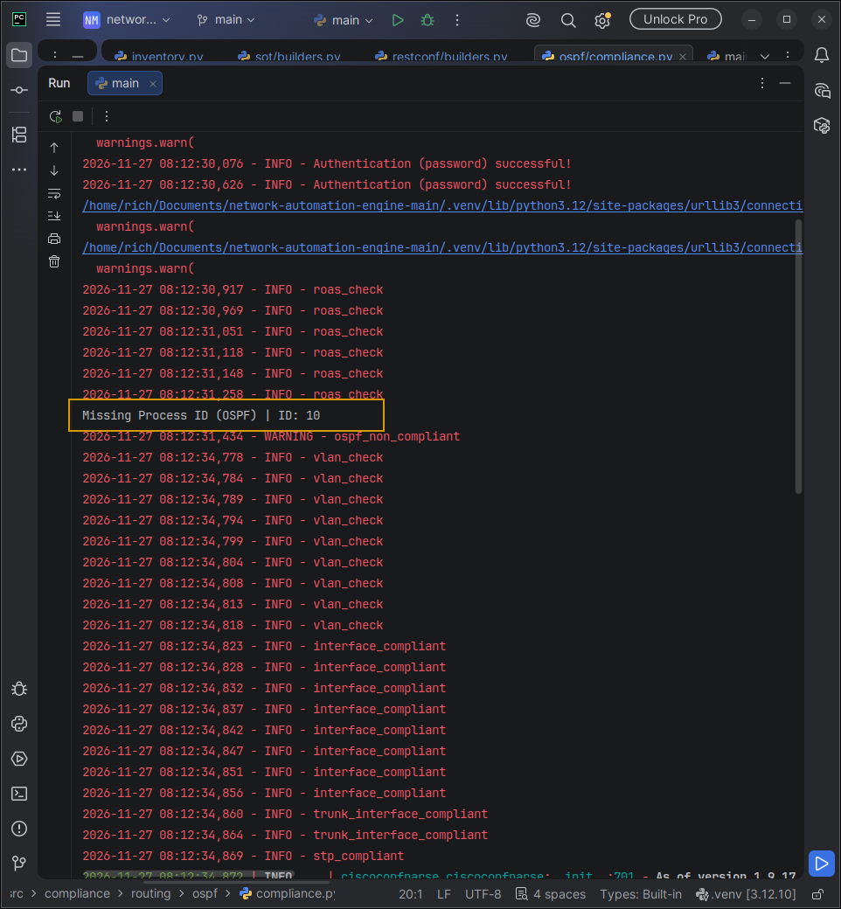

```text
Missing Process ID (OSPF) | ID: 10
2026-11-27 08:12:31 - 434 - WARNING - ospf_non_compliant
```

---

#### Scenario B: Mismatched Router ID (RID Drift)
I manually configured rogue Router ID `8.8.8.9` under process 10 instead of the NetBox-authorized loopback IP `1.1.1.1` (the initial `8.8.8.8` attempt was rejected because it was already in use by process 90):

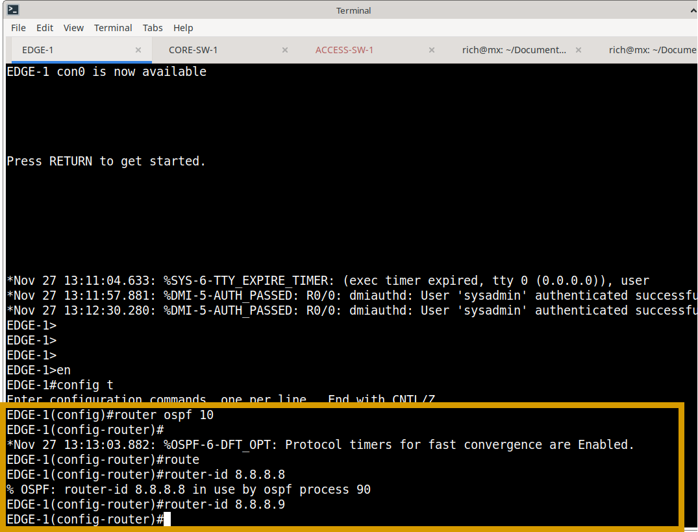

```cisco
EDGE-1(config)# router ospf 10
EDGE-1(config-router)# router-id 8.8.8.8
% OSPF: router-id 8.8.8.8 in use by ospf process 90
EDGE-1(config-router)# router-id 8.8.8.9
```

**Compliance Engine Output:**
Gate 2 isolated the RID mismatch and short-circuited (network checks skipped despite networks also being drifted):

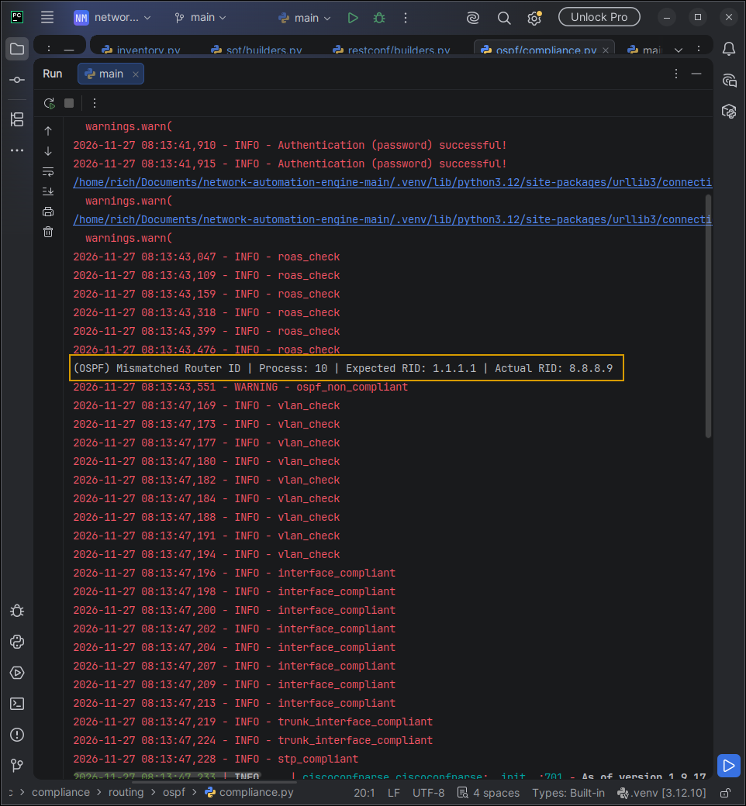

```text
(OSPF) Mismatched Router ID | Process: 10 | Expected RID: 1.1.1.1 | Actual RID: 8.8.8.9
2026-11-27 08:13:43 - 551 - WARNING - ospf_non_compliant
```

---

#### Scenario C: Missing Network Advertisements & Area Drift (Bidirectional Diff)
With process 10 and the correct RID `1.1.1.1` in place, an engineer manually configured the unauthorized network `8.8.8.0/24` in **Area 100**, while omitting the NetBox‑authorized Area 0 subnets (`192.168.255.0/24` and `10.10.10.0/24`):

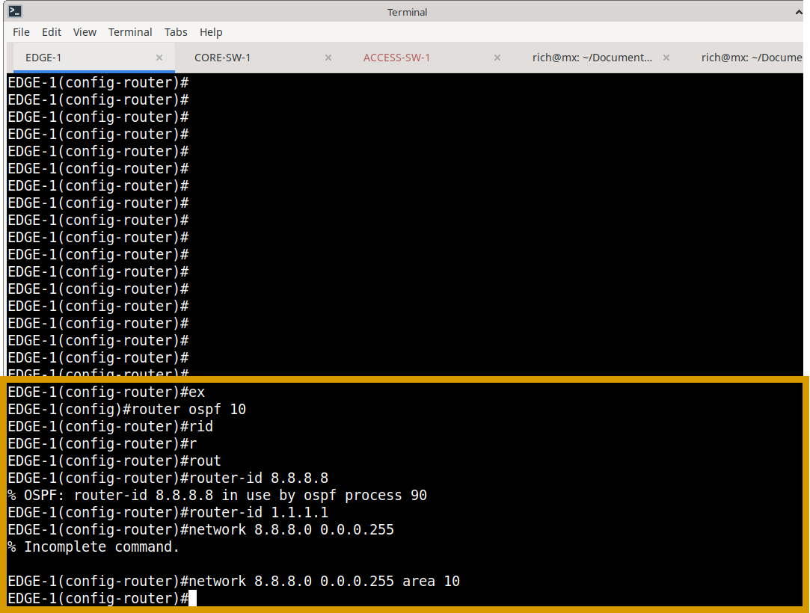

```cisco
EDGE-1(config)# router ospf 10
EDGE-1(config-router)# router-id 1.1.1.1
EDGE-1(config-router)# network 8.8.8.0 0.0.0.255 area 100
```

**Compliance Engine Output:**
The network‑advertisement gate runs a **bidirectional** diff: Gate 3a flags every *expected* Area 0 subnet missing from the router, and Gate 3b flags every *actual* network not present in the NetBox baseline. Because the unauthorized `8.8.8.0` Area 100 entry matches no expected record, both halves of the gate fire in the same pass:

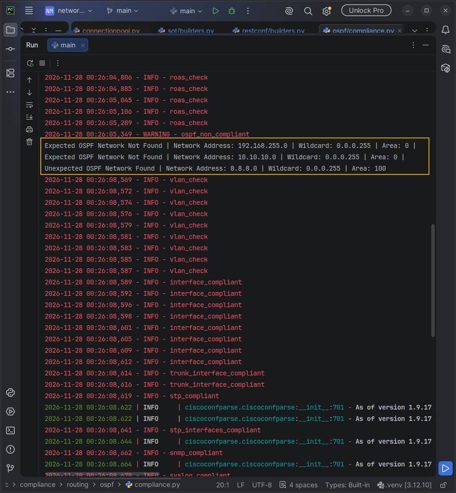

```text
Expected OSPF Network Not Found | Network Address: 192.168.255.0 | Wildcard: 0.0.0.255 | Area: 0 |
Expected OSPF Network Not Found | Network Address: 10.10.10.0 | Wildcard: 0.0.0.255 | Area: 0 |
Unexpected OSPF Network Found | Network Address: 8.8.8.0 | Wildcard: 0.0.0.255 | Area: 100
2026-11-28 00:26:05,349 - WARNING - ospf_non_compliant
```

#### Machine‑Readable Record: `final_compliance_report.json`
The full drift two missing expected advertisements plus one unauthorized advertisement is recorded under `initial_issues`:

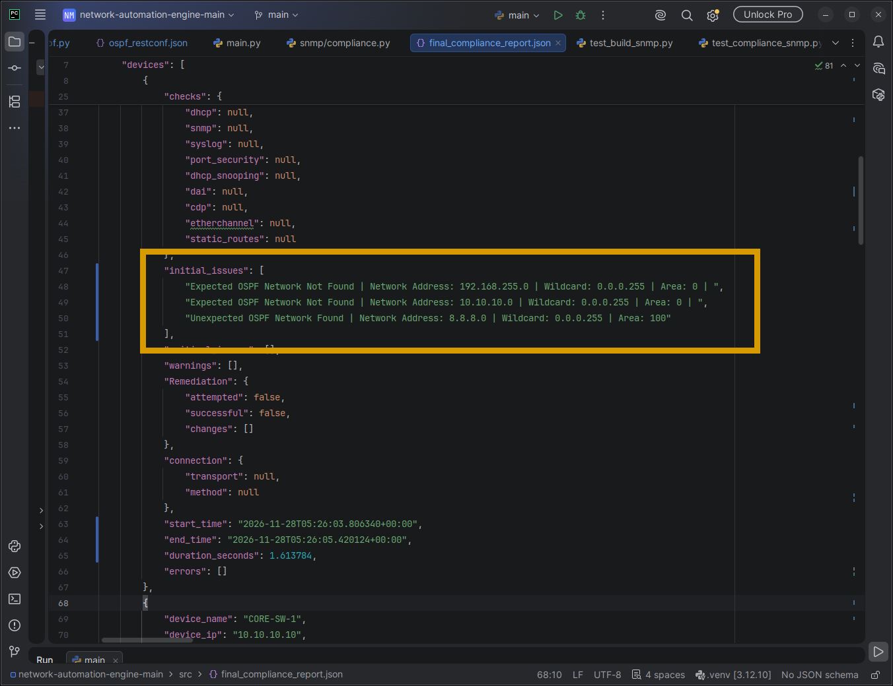

```json
{
  "initial_issues": [
    "Expected OSPF Network Not Found | Network Address: 192.168.255.0 | Wildcard: 0.0.0.255 | Area: 0 | ",
    "Expected OSPF Network Not Found | Network Address: 10.10.10.0 | Wildcard: 0.0.0.255 | Area: 0 | ",
    "Unexpected OSPF Network Found | Network Address: 8.8.8.0 | Wildcard: 0.0.0.255 | Area: 100"
  ]
}
```

---

### 5. OSPF Compliance Evaluation Matrix

| Evaluated Parameter | NetBox Desired Intent | Observed Router State | Compliance Evaluation | Operational Remediation |
| :--- | :--- | :--- | :---: | :--- |
| **Process ID** | Process `10` | Process absent | **FAIL (`Missing Process ID`)** | Send RESTCONF POST/PATCH to instantiate process 10. |
| **Router ID (RID)** | `1.1.1.1` | `8.8.8.9` | **FAIL (`Mismatched Router ID`)** | Patch YANG `router-id` container to `1.1.1.1`. |
| **Network Statement** | `192.168.255.0 0.0.0.255 area 0` | Omitted from router | **FAIL (`Expected Network Not Found`)** | Patch YANG `network` list with Area 0 subnet. |
| **Network Statement** | `10.10.10.0 0.0.0.255 area 0` | Omitted from router | **FAIL (`Expected Network Not Found`)** | Patch YANG `network` list with Area 0 subnet. |
| **Compliant Baseline** | Process 10, RID 1.1.1.1, Area 0 subnets active | Running config matches NetBox | **PASS (Compliant)** | Log `ospf_check` INFO; bypass device push. |

---

## 4. Configuration Remediation

When OSPF configuration drift is detected, remediation is executed through `configure_ospf()` in `src/remediation/routing/ospf.py`.

The function operates entirely over **RESTCONF**, implementing an **unconditional purge‑and‑rebuild strategy**:
1. **Model‑Driven Purge (HTTP DELETE):** The engine iterates **every** process present in `act_ospf` and issues an HTTP `DELETE` to `/Cisco-IOS-XE-native:native/router/Cisco-IOS-XE-ospf:ospf={proc}`. This is not a selective "rogue‑only" delete, the authorized process is removed too, so the subsequent PATCH rebuilds the entire routing block from the NetBox baseline (a clean‑slate reconcile rather than a surgical edit).
2. **YANG Data Model Deployment (HTTP PATCH):** Renders the declarative YANG JSON payload using `templates/ospf.j2` and sends an HTTP `PATCH` to `/Cisco-IOS-XE-native:native/router`.
3. **NVRAM Memory Save (HTTP POST RPC):** Executes a native RESTCONF RPC to `/operations/cisco-ia:save-config` to persist the running configuration to NVRAM.


---

### 1. Declarative YANG Model Template (`templates/ospf.j2`)

The Jinja2 template produces the exact JSON structure defined by the `Cisco-IOS-XE-native` and `Cisco-IOS-XE-ospf` YANG data models. Note the unquoted integer rendering of `"id"` and `"area"` (matching the int types the builder emits):

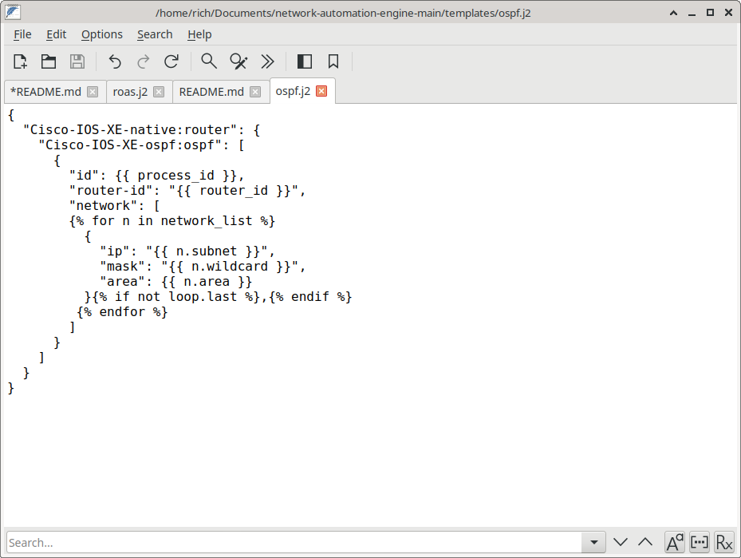

```jinja2
{
  "Cisco-IOS-XE-native:router": {
    "Cisco-IOS-XE-ospf:ospf": [
      {
        "id": {{ process_id }},
        "router-id": "{{ router_id }}",
        "network": [
          
          {
            "ip": "{{ n.subnet }}",
            "mask": "{{ n.wildcard }}",
            "area": {{ n.area }}
          },
          
        ]
      }
    ]
  }
}
```

**Example Rendered Payload** (for `process_id=10`, `router_id="1.1.1.1"`, the two Area 0 subnets from §1):
```json
{
  "Cisco-IOS-XE-native:router": {
    "Cisco-IOS-XE-ospf:ospf": [
      {
        "id": 10,
        "router-id": "1.1.1.1",
        "network": [
          { "ip": "192.168.255.0", "mask": "0.0.0.255", "area": 0 },
          { "ip": "10.10.10.0", "mask": "0.0.0.255", "area": 0 }
        ]
      }
    ]
  }
}
```

---

### 2. Remediation Handler Implementation (`src/remediation/routing/ospf.py`)

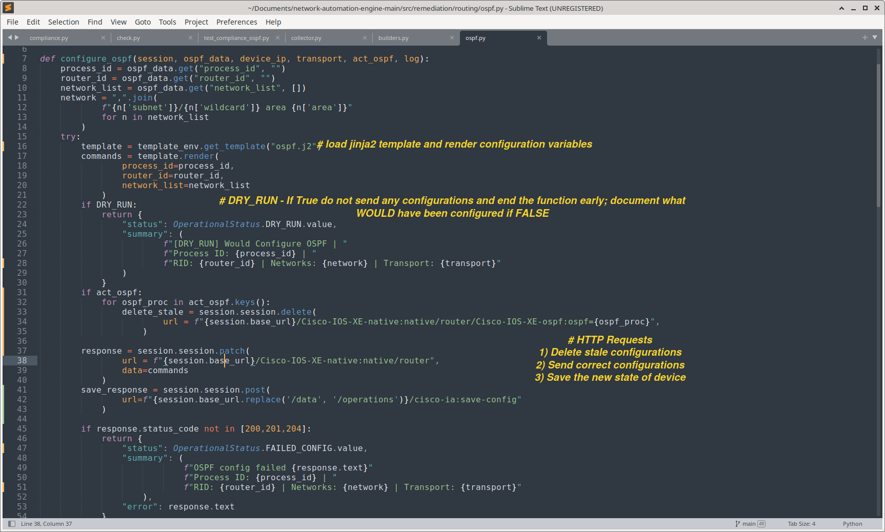

```python
# src/remediation/routing/ospf.py 

def configure_ospf(session, ospf_data, device_ip, transport, act_ospf, log):
    process_id = ospf_data.get("process_id", "")
    router_id = ospf_data.get("router_id", "")
    network_list = ospf_data.get("network_list", [])
    network = ",".join(
        f"{n['subnet']}/{n['wildcard']} area {n['area']}"
        for n in network_list
    )
    try:
        template = template_env.get_template("ospf.j2")
        commands = template.render(
            process_id=process_id,
            router_id=router_id,
            network_list=network_list
        )
        if DRY_RUN:
            return {
                "status": OperationalStatus.DRY_RUN.value,
                "summary": (
                    f"[DRY_RUN] Would Configure OSPF | "
                    f"Process ID: {process_id} | "
                    f"RID: {router_id} | Networks: {network} | Transport: {transport}"
                )
            }
        if act_ospf:
            for ospf_proc in act_ospf.keys():
                delete_stale = session.session.delete(
                    url=f"{session.base_url}/Cisco-IOS-XE-native:native/router/Cisco-IOS-XE-ospf:ospf={ospf_proc}",
                )

        response = session.session.patch(
            url=f"{session.base_url}/Cisco-IOS-XE-native:native/router",
            data=commands
        )
        save_response = session.session.post(
            url=f"{session.base_url.replace('/data', '/operations')}/cisco-ia:save-config"
        )

        if response.status_code not in [200, 201, 204]:
            return {
                "status": OperationalStatus.FAILED_CONFIG.value,
                "summary": (
                    f"OSPF config failed {response.text}"
                    f"Process ID: {process_id} | "
                    f"RID: {router_id} | Networks: {network} | Transport: {transport}"
                ),
                "error": response.text
            }

        log.info(
            "ospf_config",
            extra={
                "device_ip": device_ip,
                "component": "ospf_automation",
                "event_type": "ospf_config",
                "transport": transport,
                "status": StepStatus.SUCCESS.value,
                "process_id": process_id,
                "RID": router_id,
                "networks": network,
                "detail": (
                    f"OSPF Successfully Configured | "
                    f"Process ID: {process_id} | "
                    f"RID: {router_id} | Networks: {network}"
                )
            }
        )
        return {
            "status": OperationalStatus.SUCCESS.value,
            "summary": (
                f"OSPF Successfully Configured | "
                f"Process ID: {process_id} | "
                f"RID: {router_id} | Networks: {network} | Transport: {transport}"
            )
        }
    except Exception as e:
        log.exception(
            "ospf_config",
            extra={
                "device_ip": device_ip,
                "component": "ospf_automation",
                "event_type": "ospf_config",
                "transport": transport,
                "status": StepStatus.ERROR.value,
                "process_id": process_id,
                "RID": router_id,
                "networks": network,
                "error": f"{str(e)}",
                "detail": (
                    f"Try/Exception Error | OSPF Configuration | "
                    f"Process ID: {process_id} | "
                    f"RID: {router_id} | Networks: {network}"
                )
            }
        )
        return {
            "status": OperationalStatus.ERROR.value,
            "summary": (
                f"Try/Exception Error | OSPF Configuration | "
                f"Process ID: {process_id} | "
                f"RID: {router_id} | Networks: {network} | Transport: {transport}"
            ),
            "error": str(e)
        }
```

---

## 5. Safe Change Management: Dry-Run Mode

To support production Change Advisory Board (CAB) review windows, the engine supports a global `DRY_RUN` setting (`src/core/settings.py`).

When `DRY_RUN = True`:
* Live RESTCONF state collection and OSPF compliance checks execute normally.
* Configuration drift is detected, reported, and logged to Splunk.
* Planned OSPF provisioning parameters are compiled into `src/final_compliance_report.json` under `actions_taken`.
* **HTTP `DELETE`, `PATCH`, and `POST` requests are bypassed entirely.**


### Machine-Readable Dry-Run Audit: `final_compliance_report.json`

During dry-run execution on `HQ-EDGE-1`, the engine confirms that all ROAS subinterfaces are compliant and previews the planned OSPF process remediation:

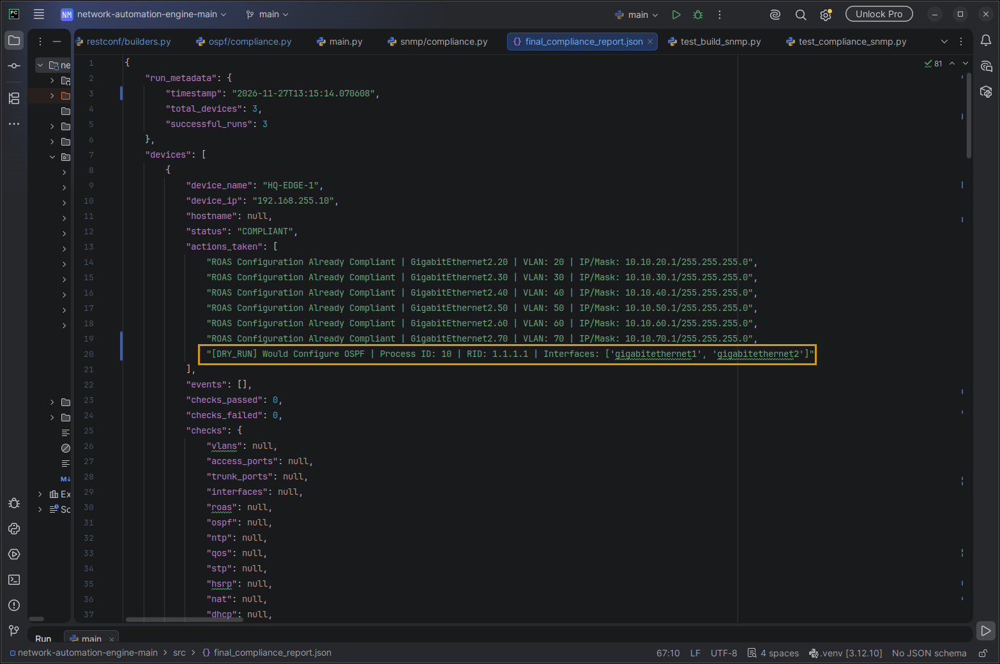

```json
{
  "device_name": "HQ-EDGE-1",
  "device_ip": "192.168.255.10",
  "hostname": null,
  "status": "COMPLIANT",
  "actions_taken": [
    "ROAS Configuration Already Compliant | GigabitEthernet2.20 | VLAN: 20 | IP/Mask: 10.10.20.1/255.255.255.0",
    "ROAS Configuration Already Compliant | GigabitEthernet2.30 | VLAN: 30 | IP/Mask: 10.10.30.1/255.255.255.0",
    "ROAS Configuration Already Compliant | GigabitEthernet2.40 | VLAN: 40 | IP/Mask: 10.10.40.1/255.255.255.0",
    "ROAS Configuration Already Compliant | GigabitEthernet2.50 | VLAN: 50 | IP/Mask: 10.10.50.1/255.255.255.0",
    "ROAS Configuration Already Compliant | GigabitEthernet2.60 | VLAN: 60 | IP/Mask: 10.10.60.1/255.255.255.0",
    "ROAS Configuration Already Compliant | GigabitEthernet2.70 | VLAN: 70 | IP/Mask: 10.10.70.1/255.255.255.0",
    "[DRY_RUN] Would Configure OSPF | Process ID: 10 | RID: 1.1.1.1 | Interfaces: ['gigabitethernet1', 'gigabitethernet2']"
  ]
}
```

> The `actions_taken` line is the **orchestrator's** DRY_RUN string (`Interfaces: [...]`), not the handler's (`Networks: … | Transport: …`). Under `DRY_RUN` the orchestrator appends its preview and `continue`s before ever calling `configure_ospf()`, so the handler's DRY_RUN branch is unreachable, identical to the ROAS §5 dual‑string situation. Only the orchestrator format lands in the report.

---

## 6. Post-Remediation Validation & Physical Device Proof

After the RESTCONF transactions are executed, the engine initiates a **closed-loop verification pass**:
1. It re-collects live device operational state via RESTCONF (`collect_restconf_state(sesh, log)`).
2. It re-normalizes OSPF processes and network statements through `build_ospf(new_ospf)`.
3. It re-runs `check_ospf()` to confirm that process 10 is active, RID `1.1.1.1` is bound, and Area 0 subnets are advertised.

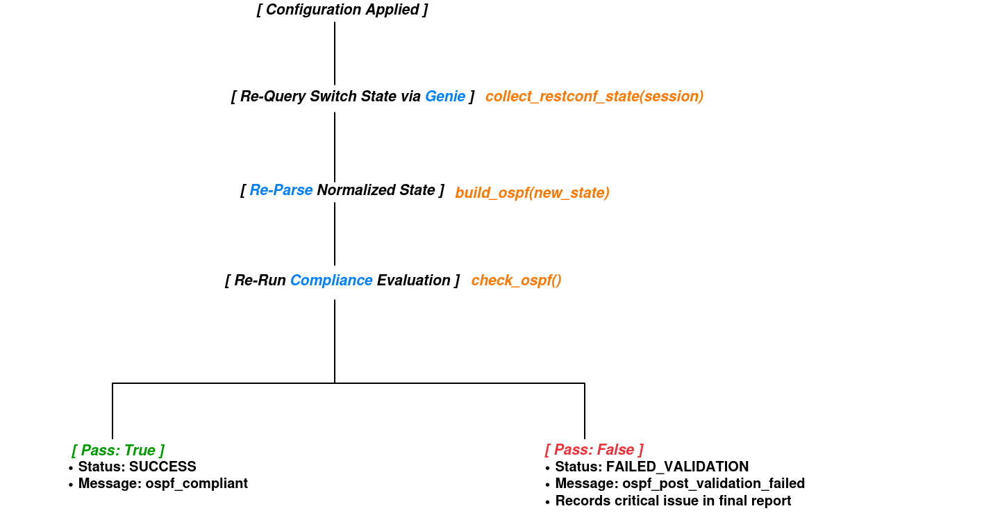

---

### Physical Device Verification: Before vs. After Execution

#### 1. Out-of-Band RESTCONF Execution Audit (`DMI-5-CONFIG_I`), *capture pending*

The supplied `EDGE-1` console capture (shot 5) records the REST‑capable service account authenticating and the **manual** drift injection, but does **not** contain the `%DMI-5-CONFIG_I … Configured from NETCONF/RESTCONF … transaction-id` line that would prove the engine's `DELETE`/`PATCH`/`POST` landed (the ROAS walkthrough captured that line; OSPF's equivalent must be re‑captured):

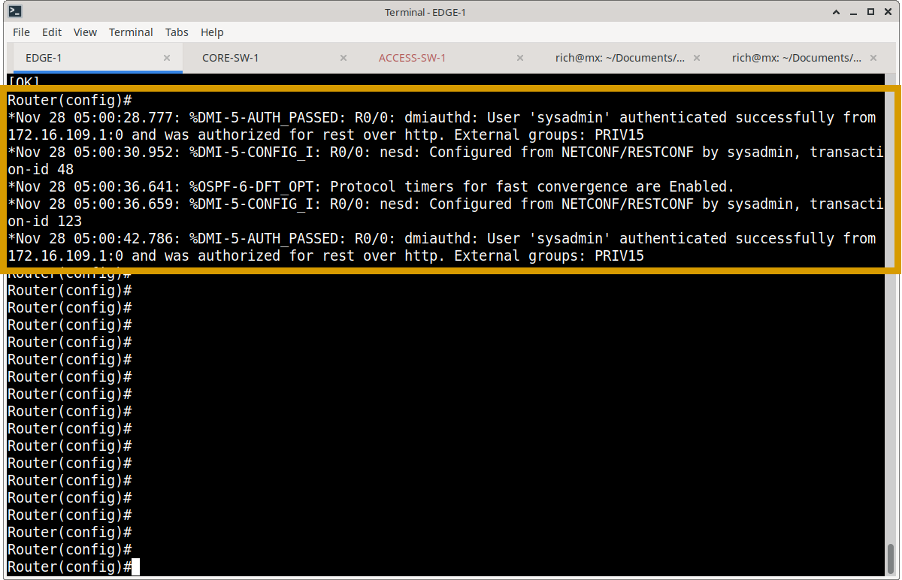

```text
*Nov 27 13:24:36.948: %SYS-5-CONFIG_I: Configured from console by console
*Nov 27 13:24:40.778: %DMI-5-AUTH_PASSED: R0/0: dmiauthd: User 'sysadmin' authenticated successfully 5
```
---

#### 2. Device State: BEFORE Remediation (`EDGE-1`)
Prior to remediation, `EDGE-1` contained severe OSPF drift:
* Rogue process `90` was running with unauthorized Router ID `8.8.8.8` and network `8.8.8.0/24` in Area 100.
* Process `10` was misconfigured with unauthorized network `8.8.8.0/24` in Area 10:

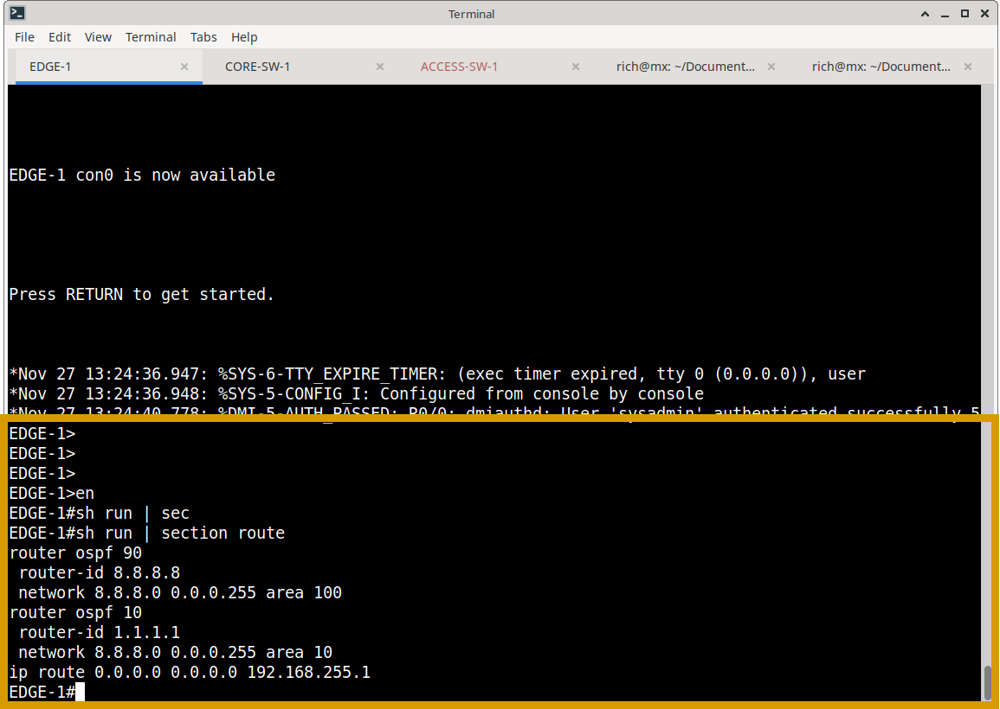

```cisco
! --- EDGE-1: Running Configuration BEFORE Remediation ---
router ospf 90
 router-id 8.8.8.8
 network 8.8.8.0 0.0.0.255 area 100
router ospf 10
 router-id 1.1.1.1
 network 8.8.8.0 0.0.0.255 area 10
```

---

#### 3. Device State: AFTER Automated Remediation (`EDGE-1`)
Following automated RESTCONF execution:
* Rogue process `90` was completely deleted via HTTP `DELETE`.
* Process `10` was rebuilt via HTTP `PATCH` to advertise the authorized Area 0 subnets (`10.10.10.0/24` and `192.168.255.0/24`) with Router ID `1.1.1.1`:

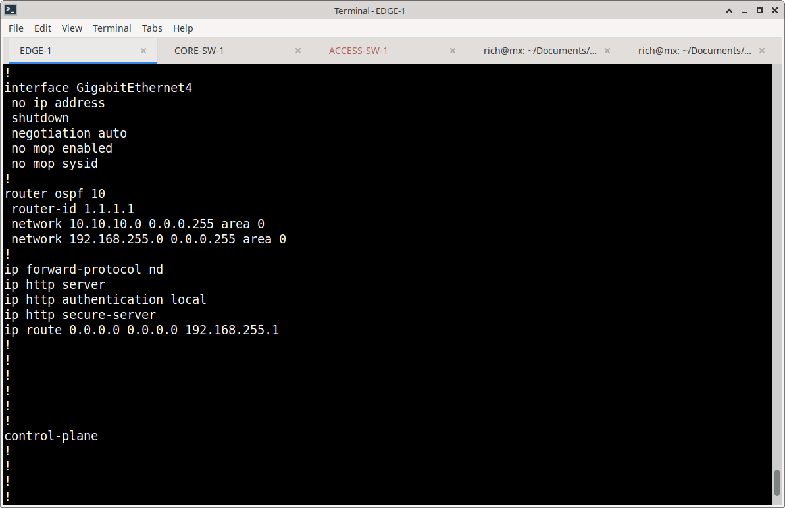

```cisco
! --- EDGE-1: Running Configuration AFTER Remediation ---
router ospf 10
 router-id 1.1.1.1
 network 10.10.10.0 0.0.0.255 area 0
 network 192.168.255.0 0.0.0.255 area 0
```

---

#### 4. Visual Configuration Diff

```diff
- router ospf 90
-  router-id 8.8.8.8
-  network 8.8.8.0 0.0.0.255 area 100
 router ospf 10
  router-id 1.1.1.1
-  network 8.8.8.0 0.0.0.255 area 10
+  network 10.10.10.0 0.0.0.255 area 0
+  network 192.168.255.0 0.0.0.255 area 0
```

> **Takeaway:**
> The physical router verification confirms complete dynamic routing reconciliation. By pairing an HTTP `DELETE` purge of every observed process with an HTTP `PATCH` rebuild from the NetBox baseline, the engine healed OSPF routing drift and persisted the configuration to NVRAM without human intervention.

## 7. Audit Logging & Splunk Telemetry Pipeline (OSPF via RESTCONF)

To satisfy enterprise routing governance and SIEM auditing requirements, every operational phase of the OSPF workflow baseline validation, drift detection, RESTCONF HTTP PATCH execution, template exception handling, and post-validation generates structured JSON events streamed directly to **Splunk via the HTTP Event Collector (HEC)** (`index="network_automation"`, `sourcetype="_json"`).

Unlike ROAS (whose `ospf_config`-style handler success omitted `transport`), **every OSPF event carries `transport: "RESTCONF"`**, including the remediation-handler events because the OSPF handler's success `extra` dict explicitly includes `transport`. Note, however, the **orchestrator-vs-handler schema asymmetry**: orchestrator events (`event_type: ospf_compliance`) carry `protocol`, `router_id`, `interfaces`, and `compliant`, while handler events (`event_type: ospf_config`) carry `RID` (uppercase), `networks`, and `transport`, but **omit `protocol` and `compliant`**. The SPL below therefore filters on `protocol` *or* `event_type` and tables the union of both field spellings.

```spl
index="network_automation" sourcetype="_json" (protocol="ospf" OR event_type="ospf_config")
| table asctime cisco_sev event_type message process_id router_id RID interfaces networks status compliant detail
```

> `router_id`/`interfaces` populate only on orchestrator events; `RID`/`networks` only on handler events. The collapsed `tags` object (runtime-varying pid/pname/tid/tname) is omitted from the curated payloads below.

---

### Telemetry Lifecycle Matrix

The telemetry pipeline records five distinct operational events across `HQ-EDGE-1` (`192.168.255.10`). These are aggregated from **separate audit passes** (an early exception run at 08:37, a compliant baseline at 09:08, and a drift/remediation/validation pass spanning 09:12–09:14) and are presented as one lifecycle for readability, not a single chronological sequence:

| Lifecycle Phase | Event Type (`event_type`) | Splunk Message (`message`) | Cisco Severity | Status | Operational Significance |
| :--- | :--- | :--- | :---: | :---: | :--- |
| **1. Pre-Check Pass** | `ospf_compliance` | `ospf_check` | `6 (INFO)` | `SUCCESS` | Process 10, RID 1.1.1.1, and Area 0 subnets match NetBox; bypassed. |
| **2. Drift Detected** | `ospf_compliance` | `ospf_non_compliant` | `4 (WARN)` | `FAILED` | Missing Area 0 network statement and four unexpected Area 1 subnets detected. |
| **3. Remediation Push** | `ospf_config` | `ospf_config` | `6 (INFO)` | `SUCCESS` | Declarative YANG JSON payload pushed via RESTCONF HTTP PATCH. |
| **4. Post-Validation Pass** | `ospf_compliance` | `ospf_post_validation_success` | `6 (INFO)` | `SUCCESS` | Re-queried live RESTCONF state confirms routing topology is compliant. |
| **5. Exception Capture** | `ospf_config` | `ospf_config` | `6 (INFO)`* | `ERROR` | Catches Jinja2 nesting syntax errors (`unknown tag 'endif'`) without crashing. |

---

### Splunk Event Evidence & Payload Breakdown

#### 1. Baseline Compliant Pass (`ospf_check`)
When OSPF Process 10 and Router ID `1.1.1.1` already match NetBox specifications on initial scan, an informational pass is indexed with zero failures:

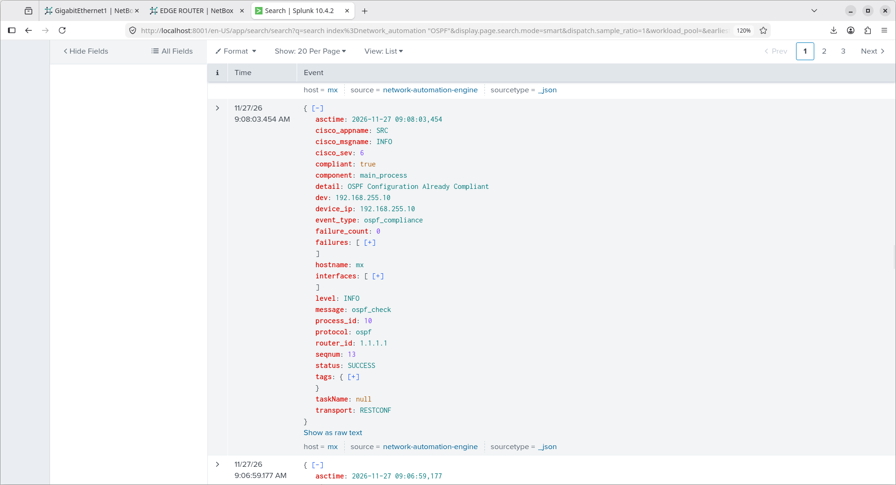

```json
{
  "asctime": "2026-11-27 09:08:03,454",
  "cisco_appname": "SRC",
  "cisco_msgname": "INFO",
  "cisco_sev": 6,
  "compliant": true,
  "component": "main_process",
  "detail": "OSPF Configuration Already Compliant",
  "dev": "192.168.255.10",
  "device_ip": "192.168.255.10",
  "event_type": "ospf_compliance",
  "failure_count": 0,
  "failures": [],
  "hostname": "mx",
  "interfaces": ["gigabitethernet1", "gigabitethernet2"],
  "level": "INFO",
  "message": "ospf_check",
  "process_id": 10,
  "protocol": "ospf",
  "router_id": "1.1.1.1",
  "seqnum": 13,
  "status": "SUCCESS",
  "taskName": null,
  "transport": "RESTCONF"
}
```

---

#### 2. Configuration Drift Alert (`ospf_non_compliant`)
When unauthorized dynamic routing configurations are detected on `EDGE-1` (the authorized Area 0 subnet `10.10.10.0/24` missing and four unexpected Area 1 subnets `8.8.8.0/24`–`8.8.11.0/24` present), a `WARNING` (severity 4) alert is indexed with the full failure array. Note the bidirectional diff: the `Expected` line carries the source's trailing `| ` and the `Nework` typo, while the `Unexpected` lines use the correctly-spelled `Network Address`:

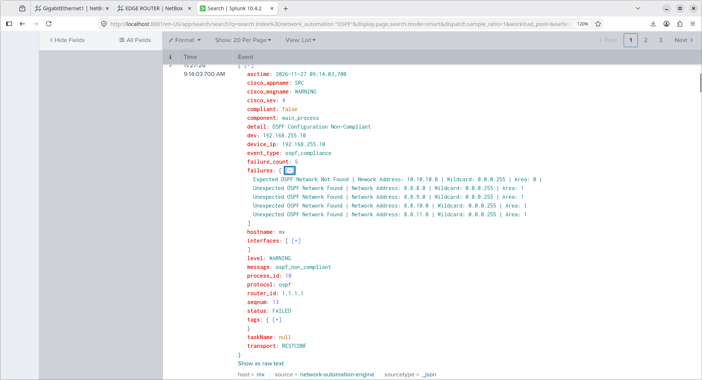

```json
{
  "asctime": "2026-11-27 09:14:03,700",
  "cisco_appname": "SRC",
  "cisco_msgname": "WARNING",
  "cisco_sev": 4,
  "compliant": false,
  "component": "main_process",
  "detail": "OSPF Configuration Non-Compliant",
  "dev": "192.168.255.10",
  "device_ip": "192.168.255.10",
  "event_type": "ospf_compliance",
  "failure_count": 5,
  "failures": [
    "Expected OSPF Network Not Found | Nework Address: 10.10.10.0 | Wildcard: 0.0.0.255 | Area: 0 | ",
    "Unexpected OSPF Network Found | Network Address: 8.8.8.0 | Wildcard: 0.0.0.255 | Area: 1",
    "Unexpected OSPF Network Found | Network Address: 8.8.9.0 | Wildcard: 0.0.0.255 | Area: 1",
    "Unexpected OSPF Network Found | Network Address: 8.8.10.0 | Wildcard: 0.0.0.255 | Area: 1",
    "Unexpected OSPF Network Found | Network Address: 8.8.11.0 | Wildcard: 0.0.0.255 | Area: 1"
  ],
  "hostname": "mx",
  "interfaces": ["gigabitethernet1", "gigabitethernet2"],
  "level": "WARNING",
  "message": "ospf_non_compliant",
  "process_id": 10,
  "protocol": "ospf",
  "router_id": "1.1.1.1",
  "seqnum": 13,
  "status": "FAILED",
  "taskName": null,
  "transport": "RESTCONF"
}
```

---

#### 3. Targeted RESTCONF Remediation Push (`ospf_config`)
Emitted immediately after the RESTCONF HTTP PATCH request successfully provisions OSPF Process 10, sets Router ID `1.1.1.1`, and advertises the authorized Area 0 networks. This event originates from the **remediation handler** (`ospf_automation`), so it uses `RID` (uppercase) and `networks`, and carries no `protocol`/`compliant`/`interfaces`:

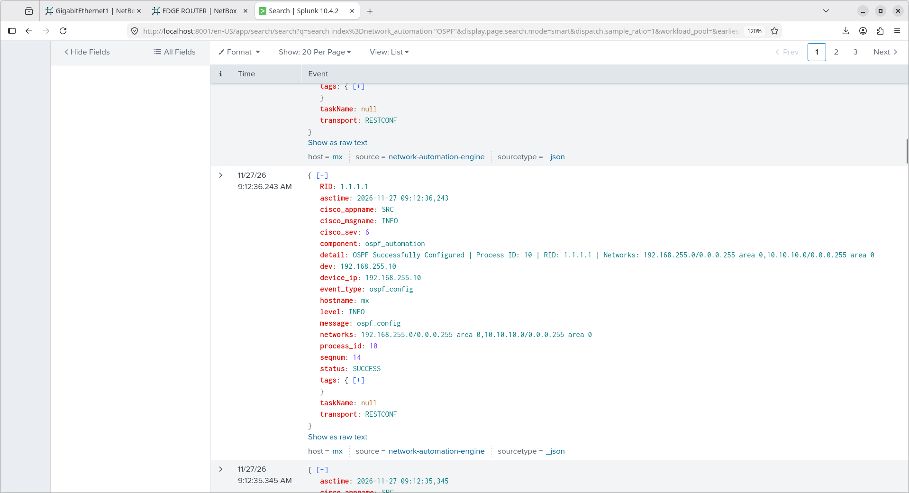

```json
{
  "RID": "1.1.1.1",
  "asctime": "2026-11-27 09:12:36,243",
  "cisco_appname": "SRC",
  "cisco_msgname": "INFO",
  "cisco_sev": 6,
  "component": "ospf_automation",
  "detail": "OSPF Successfully Configured | Process ID: 10 | RID: 1.1.1.1 | Networks: 192.168.255.0/0.0.0.255 area 0,10.10.10.0/0.0.0.255 area 0",
  "dev": "192.168.255.10",
  "device_ip": "192.168.255.10",
  "event_type": "ospf_config",
  "hostname": "mx",
  "level": "INFO",
  "message": "ospf_config",
  "networks": "192.168.255.0/0.0.0.255 area 0,10.10.10.0/0.0.0.255 area 0",
  "process_id": 10,
  "seqnum": 14,
  "status": "SUCCESS",
  "taskName": null,
  "transport": "RESTCONF"
}
```

---

#### 4. Closed-Loop Post-Validation Success (`ospf_post_validation_success`)
Following remediation, the engine re-queries `/Cisco-IOS-XE-native:native/router` via RESTCONF. When the running operational state confirms that Process 10 is active, Router ID is `1.1.1.1`, and all Area 0 subnets match NetBox, post-validation success is indexed:

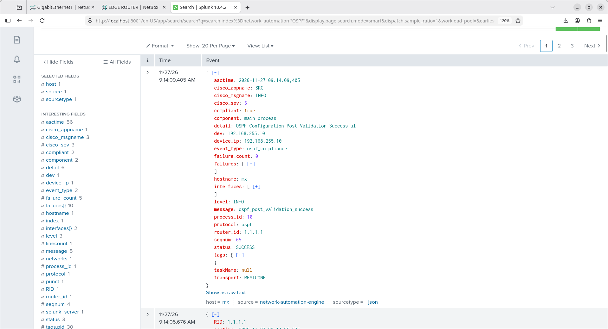

```json
{
  "asctime": "2026-11-27 09:14:09,405",
  "cisco_appname": "SRC",
  "cisco_msgname": "INFO",
  "cisco_sev": 6,
  "compliant": true,
  "component": "main_process",
  "detail": "OSPF Configuration Post Validation Successful",
  "dev": "192.168.255.10",
  "device_ip": "192.168.255.10",
  "event_type": "ospf_compliance",
  "failure_count": 0,
  "failures": [],
  "hostname": "mx",
  "interfaces": ["gigabitethernet1", "gigabitethernet2"],
  "level": "INFO",
  "message": "ospf_post_validation_success",
  "process_id": 10,
  "protocol": "ospf",
  "router_id": "1.1.1.1",
  "seqnum": 65,
  "status": "SUCCESS",
  "taskName": null,
  "transport": "RESTCONF"
}
```

---

#### 5. Exception & Template Fault Observability (`status: ERROR`)
If an exception occurs during template rendering (a Jinja2 nesting mistake: `Encountered unknown tag 'endif'`), the engine's `try...except` boundary catches it and streams an event with `status: ERROR`. **As captured, this event reads `cisco_sev: 6 / level: INFO`** a stale artifact from before the `except` block was switched to `log.exception`; the current source emits `cisco_sev: 3 / level: ERROR` with a traceback (see matrix footnote):

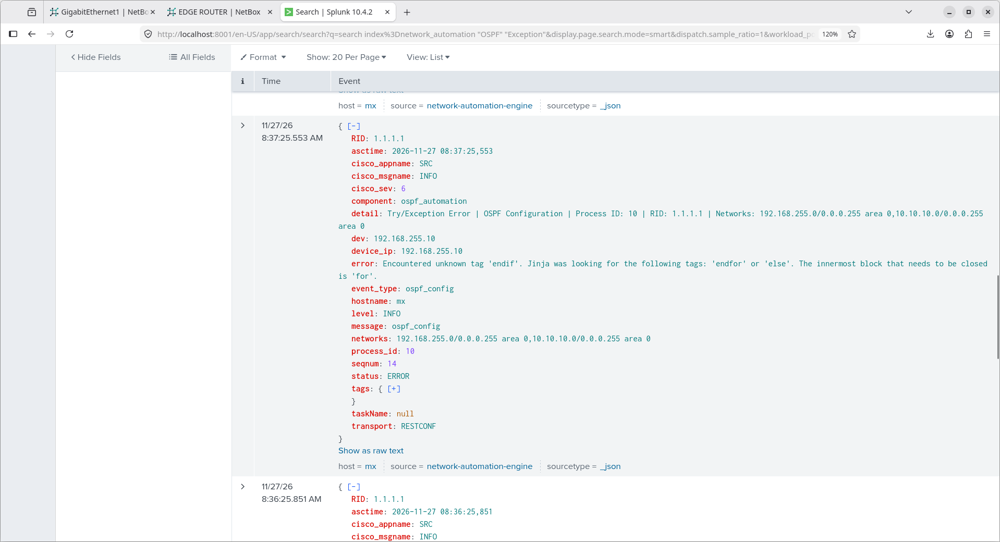

```json
{
  "RID": "1.1.1.1",
  "asctime": "2026-11-27 08:37:25,553",
  "cisco_appname": "SRC",
  "cisco_msgname": "INFO",
  "cisco_sev": 6,
  "component": "ospf_automation",
  "detail": "Try/Exception Error | OSPF Configuration | Process ID: 10 | RID: 1.1.1.1 | Networks: 192.168.255.0/0.0.0.255 area 0,10.10.10.0/0.0.0.255 area 0",
  "dev": "192.168.255.10",
  "device_ip": "192.168.255.10",
  "error": "Encountered unknown tag 'endif'. Jinja was looking for the following tags: 'endfor' or 'else'. The innermost block that needs to be closed is 'for'.",
  "event_type": "ospf_config",
  "hostname": "mx",
  "level": "INFO",
  "message": "ospf_config",
  "networks": "192.168.255.0/0.0.0.255 area 0,10.10.10.0/0.0.0.255 area 0",
  "process_id": 10,
  "seqnum": 14,
  "status": "ERROR",
  "taskName": null,
  "transport": "RESTCONF"
}
```

---

### Internal Execution Tracking

Throughout execution, the engine updates the device result context used to generate `final_compliance_report.json` and `network_compliance_report.txt`:

| Result Collection Field | Operational Purpose & Behavior |
| :--- | :--- |
| **`device_result["initial_issues"]`** | Catalogs all dynamic routing drift detected during initial audit passes before remediation runs (used to calculate drift rates). |
| **`device_result["actions_taken"]`** | Records verified compliant OSPF states, executed RESTCONF PATCH operations, and `[DRY_RUN]` change previews for audit compliance. |
| **`device_result["critical_issues"]`** | Populated exclusively when RESTCONF HTTP calls return non-2xx status codes or if post-validation fails after changes were pushed. |
| **`device_result["status"]`** | Reflects overall device health: `COMPLIANT`, `FAILED_CONFIG`, or `FAILED_VALIDATION`. |

---

## 8. Automated Unit Testing & CI/CD Validation (OSPF via RESTCONF)

To ensure deterministic routing compliance and prevent regressions in production dynamic routing fabrics, the OSPF module includes an isolated offline test suite powered by **Pytest** and **unittest.mock**.

The test suite runs **100% offline** without live network connections. Utilizing pre-captured Cisco IOS-XE RESTCONF JSON fixtures (`ospf_restconf`) and mock sessions, all **22 test cases pass** (0.12s builder + 8.43s compliance see Notes on the compliance-suite wall time).


---

### Layer 1: RESTCONF OSPF Builder Tests (`test_build_ospf.py`)

This suite validates that `build_ospf()` accurately parses the `Cisco-IOS-XE-native:router` YANG data model, unmasks loopback Router IDs, normalizes multiple concurrent OSPF processes, and guards against malformed payloads:

#### Test Scenarios Covered (15 Tests):
1. **`test_build_ospf_valid`**: Evaluates multi-process RESTCONF fixture data (`ospf_restconf`). Confirms Process 1 (RID `1.1.1.1`, Area 0 subnet `192.168.10.0/24`) and Process 2 (RID `2.2.2.2`, Area 1 subnet `192.168.20.0/24`) are extracted into normalized dictionaries.
2. **`test_build_ospf_empty[data0-3]`**: Parametrized boundary tests confirming `{}`, `None`, `{"not_restconf": {}}`, and `{"restconf_state": {}}` safely return `{}`.
3. **`test_build_ospf_parameters[...]`**: Parametrized validation across four diverse process IDs, 32-bit Router IDs (`4.4.4.4`, `192.168.5.1`, `203.0.112.1`, `200.20.1.1`), non-standard subnets, wildcard masks (`0.0.255.255`, `0.0.7.255`, `0.0.31.255`), and multi-area assignments.
4. **`test_build_ospf_no_proc_id` & `test_build_ospf_no_rid`**: Boundary checks verifying safe handling when process IDs or Router IDs are omitted.
5. **`test_build_ospf_no_networks`**, **`test_build_ospf_no_ip`**, **`test_build_ospf_no_area`**, & **`test_build_ospf_no_mask`**: Boundary tests ensuring network advertisement blocks missing essential subnet, wildcard, or area keys are bypassed safely without raising exceptions.

#### Code Excerpt (`test_build_ospf.py`):

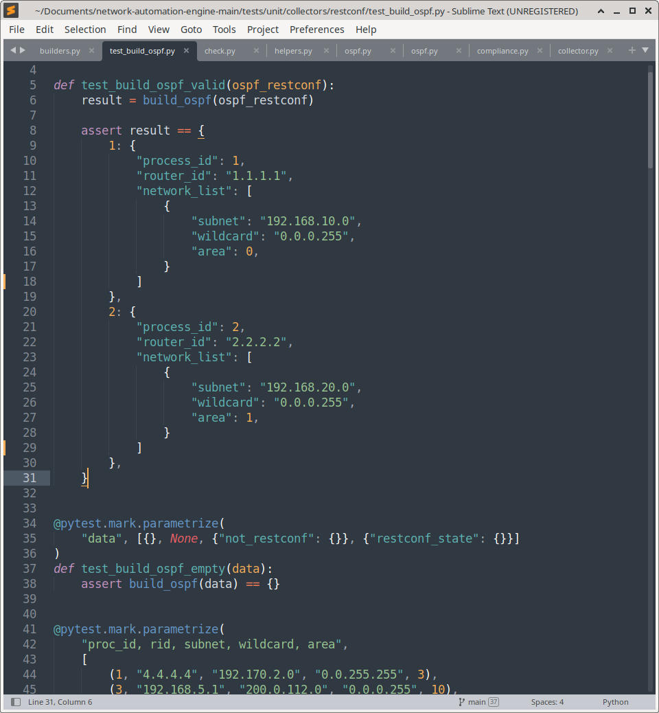

```python
def test_build_ospf_valid(ospf_restconf):
    result = build_ospf(ospf_restconf)

    assert result == {
        1: {
            "process_id": 1,
            "router_id": "1.1.1.1",
            "network_list": [
                {
                    "subnet": "192.168.10.0",
                    "wildcard": "0.0.0.255",
                    "area": 0,
                }
            ]
        },
        2: {
            "process_id": 2,
            "router_id": "2.2.2.2",
            "network_list": [
                {
                    "subnet": "192.168.20.0",
                    "wildcard": "0.0.0.255",
                    "area": 1,
                }
            ]
        },
    }


@pytest.mark.parametrize(
    "data", [{}, None, {"not_restconf": {}}, {"restconf_state": {}}]
)
def test_build_ospf_empty(data):
    assert build_ospf(data) == {}


@pytest.mark.parametrize(
    "proc_id, rid, subnet, wildcard, area",
    [
        (1, "4.4.4.4", "192.170.2.0", "0.0.255.255", 3),
        (3, "192.168.5.1", "200.0.112.0", "0.0.0.255", 10),
        (5, "203.0.112.1", "156.24.13.0", "0.0.7.255", 15),
        (10, "200.20.1.1", "160.50.20.0", "0.0.31.255", 20),
    ],
)
def test_build_ospf_parameters(proc_id, rid, subnet, wildcard, area):
    data = {
        "ospf_restconf": {
            "Cisco-IOS-XE-native:router": {
                "Cisco-IOS-XE-ospf:ospf": [
                    {
                        "id": proc_id,
                        "network": [
                            {
                                "ip": subnet,
                                "mask": wildcard,
                                "area": area
                            }
                        ],
                        "router-id": rid
                    }
                ]
            }
        }
    }

    result = build_ospf(data)

    assert result == {
        proc_id: {
            "process_id": proc_id,
            "router_id": rid,
            "network_list": [
                {
                    "subnet": subnet,
                    "wildcard": wildcard,
                    "area": area,
                }
            ],
        }
    }
```

#### Terminal Execution:

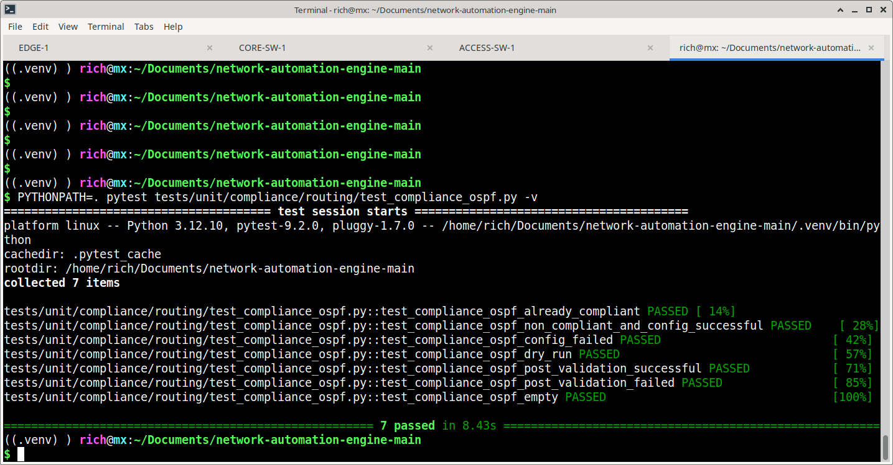

```bash
$ PYTHONPATH=. pytest tests/unit/collectors/restconf/test_build_ospf.py -v
============================= test session starts ==============================
platform linux -- Python 3.12.10, pytest-9.2.0, pluggy-1.7.0 -- /home/rich/Documents/network-automation-engine-main/.venv/bin/python
cachedir: .pytest_cache
rootdir: /home/rich/Documents/network-automation-engine-main
collected 15 items

tests/unit/collectors/restconf/test_build_ospf.py::test_build_ospf_valid PASSED                                                     [  6%]
tests/unit/collectors/restconf/test_build_ospf.py::test_build_ospf_empty[data0] PASSED                                              [ 13%]
tests/unit/collectors/restconf/test_build_ospf.py::test_build_ospf_empty[None] PASSED                                               [ 20%]
tests/unit/collectors/restconf/test_build_ospf.py::test_build_ospf_empty[data2] PASSED                                              [ 26%]
tests/unit/collectors/restconf/test_build_ospf.py::test_build_ospf_empty[data3] PASSED                                              [ 33%]
tests/unit/collectors/restconf/test_build_ospf.py::test_build_ospf_parameters[1-4.4.4.4-192.170.2.0-0.0.255.255-3] PASSED           [ 40%]
tests/unit/collectors/restconf/test_build_ospf.py::test_build_ospf_parameters[3-192.168.5.1-200.0.112.0-0.0.0.255-10] PASSED         [ 46%]
tests/unit/collectors/restconf/test_build_ospf.py::test_build_ospf_parameters[5-203.0.112.1-156.24.13.0-0.0.7.255-15] PASSED        [ 53%]
tests/unit/collectors/restconf/test_build_ospf.py::test_build_ospf_parameters[10-200.20.1.1-160.50.20.0-0.0.31.255-20] PASSED       [ 60%]
tests/unit/collectors/restconf/test_build_ospf.py::test_build_ospf_no_proc_id PASSED                                                [ 66%]
tests/unit/collectors/restconf/test_build_ospf.py::test_build_ospf_no_rid PASSED                                                    [ 73%]
tests/unit/collectors/restconf/test_build_ospf.py::test_build_ospf_no_networks PASSED                                               [ 80%]
tests/unit/collectors/restconf/test_build_ospf.py::test_build_ospf_no_ip PASSED                                                     [ 86%]
tests/unit/collectors/restconf/test_build_ospf.py::test_build_ospf_no_area PASSED                                                   [ 93%]
tests/unit/collectors/restconf/test_build_ospf.py::test_build_ospf_no_mask PASSED                                                   [100%]

============================== 15 passed in 0.12s ===============================
```

---

### Layer 2: OSPF Compliance Decision Engine Tests (`test_compliance_ospf.py`)

Using `@patch` and `MagicMock`, this suite isolates `compliance_ospf()` from live HTTP sessions, validating the routing compliance state machine across all 7 operational paths. Like ROAS (and unlike the dual-transport SNMP/Syslog/STP suites), OSPF is **RESTCONF-only**, so these tests are *not* parametrized over `TRANSPORT` a single `mock_transport = "RESTCONF"` fixture is threaded through every call.

#### Test Scenarios Covered (7 Tests):
1. **`test_compliance_ospf_already_compliant`**: Confirms that when OSPF process ID, Router ID, and Area 0 subnets match NetBox, `mock_log.info` is called once, `mock_log.warning` is not called, and `initial_issues` remains empty.
2. **`test_compliance_ospf_non_compliant_and_config_successful`**: Simulates a Router ID mismatch (`(OSPF) Mismatched Router ID`), verifies remediation executes, and status resolves to `OperationalStatus.SUCCESS`.
3. **`test_compliance_ospf_config_failed`**: Simulates a non-2xx RESTCONF response or HTTP timeout, verifying status is marked `FAILED_CONFIG` and captured under `critical_issues`.
4. **`test_compliance_ospf_dry_run`**: Verifies that when `DRY_RUN = True`, drift is recorded, but no RESTCONF `DELETE` or `PATCH` operations are transmitted.
5. **`test_compliance_ospf_post_validation_successful`**: Tests closed-loop recovery: initial check fails → RESTCONF PATCH applied → re-collected operational state passes post-validation.
6. **`test_compliance_ospf_post_validation_failed`**: Tests failure handling when an OSPF process remains drifted after remediation, setting status to `FAILED_VALIDATION`.
7. **`test_compliance_ospf_empty`**: Verifies that an empty NetBox context completes gracefully with zero actions and zero errors.

#### Code Excerpt (`test_compliance_ospf.py`):

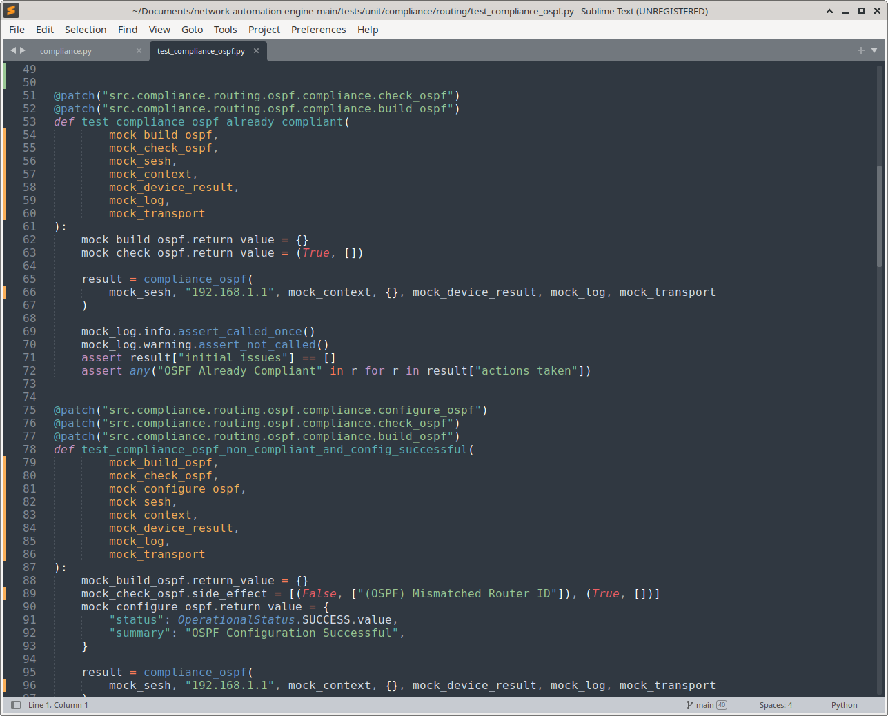

```python
@patch("src.compliance.routing.ospf.compliance.check_ospf")
@patch("src.compliance.routing.ospf.compliance.build_ospf")
def test_compliance_ospf_already_compliant(
        mock_build_ospf,
        mock_check_ospf,
        mock_sesh,
        mock_context,
        mock_device_result,
        mock_log,
        mock_transport
):
    mock_build_ospf.return_value = {}
    mock_check_ospf.return_value = (True, [])

    result = compliance_ospf(
        mock_sesh, "192.168.1.1", mock_context, {}, mock_device_result, mock_log, mock_transport
    )

    mock_log.info.assert_called_once()
    mock_log.warning.assert_not_called()
    assert result["initial_issues"] == []
    assert any("OSPF Already Compliant" in r for r in result["actions_taken"])


@patch("src.compliance.routing.ospf.compliance.configure_ospf")
@patch("src.compliance.routing.ospf.compliance.check_ospf")
@patch("src.compliance.routing.ospf.compliance.build_ospf")
def test_compliance_ospf_non_compliant_and_config_successful(
        mock_build_ospf,
        mock_check_ospf,
        mock_configure_ospf,
        mock_sesh,
        mock_context,
        mock_device_result,
        mock_log,
        mock_transport
):
    mock_build_ospf.return_value = {}
    mock_check_ospf.side_effect = [(False, ["(OSPF) Mismatched Router ID"]), (True, [])]
    mock_configure_ospf.return_value = {
        "status": OperationalStatus.SUCCESS.value,
        "summary": "OSPF Configuration Successful",
    }

    result = compliance_ospf(
        mock_sesh, "192.168.1.1", mock_context, {}, mock_device_result, mock_log, mock_transport
    )

    mock_log.warning.assert_called_once()
    mock_configure_ospf.assert_called_once()
    assert any("(OSPF) Mismatched Router ID" in r for r in result["initial_issues"])
    assert any("OSPF Configuration Successful" in r for r in result["actions_taken"])
    assert result["status"] == OperationalStatus.SUCCESS.value
```

#### Terminal Execution:


```bash
$ PYTHONPATH=. pytest tests/unit/compliance/routing/test_compliance_ospf.py -v
============================= test session starts ==============================
platform linux -- Python 3.12.10, pytest-9.2.0, pluggy-1.7.0 -- /home/rich/Documents/network-automation-engine-main/.venv/bin/python
cachedir: .pytest_cache
rootdir: /home/rich/Documents/network-automation-engine-main
collected 7 items

tests/unit/compliance/routing/test_compliance_ospf.py::test_compliance_ospf_already_compliant PASSED                 [ 14%]
tests/unit/compliance/routing/test_compliance_ospf.py::test_compliance_ospf_non_compliant_and_config_successful PASSED [ 28%]
tests/unit/compliance/routing/test_compliance_ospf.py::test_compliance_ospf_config_failed PASSED                    [ 42%]
tests/unit/compliance/routing/test_compliance_ospf.py::test_compliance_ospf_dry_run PASSED                          [ 57%]
tests/unit/compliance/routing/test_compliance_ospf.py::test_compliance_ospf_post_validation_successful PASSED       [ 71%]
tests/unit/compliance/routing/test_compliance_ospf.py::test_compliance_ospf_post_validation_failed PASSED           [ 85%]
tests/unit/compliance/routing/test_compliance_ospf.py::test_compliance_ospf_empty PASSED                            [100%]

============================== 7 passed in 8.43s ===============================
```
### Continuous Integration Ready

The test framework is designed for CI/CD pipeline integration:

```yaml
# .github/workflows/test.yml (GitHub Actions Example)
name: Run Unit Tests

on: [push, pull_request]

jobs:
  test:
    runs-on: ubuntu-latest
    steps:
      - uses: actions/checkout@v3
      - name: Set up Python
        uses: actions/setup-python@v4
        with:
          python-version: '3.12'
      - name: Install dependencies
        run: pip install -r requirements.txt
      - name: Run tests with coverage                            <--------- Pytests 
        run: pytest tests/unit/ --cov=src --cov-report=xml
      - name: Upload coverage to Codecov
        uses: codecov/codecov-action@v3
```
---

### Test Suite Execution Summary

| Test Suite | File Path | Scope & Boundary Scenarios Covered | Status | Execution Time |
| :--- | :--- | :--- | :---: | :---: |
| **RESTCONF OSPF Builder** | `tests/unit/collectors/restconf/test_build_ospf.py` | YANG model parsing, multi-process extraction, parametrized RIDs/areas, missing attribute guards | **PASSED (15/15)** | 0.12s |
| **OSPF Compliance Suite** | `tests/unit/compliance/routing/test_compliance_ospf.py` | State-machine reconciliation, bypass logic, RESTCONF PATCH remediation, dry-run safety, post-validation | **PASSED (7/7)** | 8.43s |
| **Total** | | **Comprehensive Offline RESTCONF Routing Test Suite** | **22 / 22** | **8.55s** |

---

## Conclusion & Engineering Takeaways

This module demonstrates that dynamic routing assurance is not a CLI problem it is a **data-model problem**, and the cleanest way to solve it is to stop scraping text and start reading the device's own structured state. By treating the router as a YANG resource tree and the OSPF contract as a NetBox declaration, the engine turns silent, site-wide routing outages into a deterministic, observable, and reversible pipeline.

Key architectural wins validated in this project include:
1. **Multi-Process, Model-Driven Routing:** OSPF is the portfolio's only module that natively handles multiple concurrent routing processes per device. Parsing `Cisco-IOS-XE-ospf:ospf` as a list from the YANG tree rather than regex-scraping `router ospf <id>` blocks cleanly separates process 10 from process 90 without any heuristic parsing.
2. **Unconditional Purge-and-Rebuild:** Unlike the SNMP/Syslog modules (which emit selective `no`-command purges) or the Access-Port module (which issues `default interface` wipes), OSPF's remediation is a keyed `DELETE` of every observed process followed by a `PATCH` rebuild. This is naturally idempotent re-running the same PATCH is a no-op and eliminates the "which rogue processes do I delete?" decision entirely.
3. **Bidirectional Network Diff:** Gate 3a flags every *expected* subnet missing from the router, while Gate 3b flags every *actual* subnet not present in the NetBox baseline. This catches both omissions (silent route loss) and unauthorized advertisements (route leakage) in a single pass the same rigor you'd apply to firewall rule audits, now applied to routing.
4. **Short-Circuit Validation Semantics:** The process-existence gate's early `return` and the RID gate's early `return` keep drift reports honest: a missing process yields exactly one `Missing Process ID` line, a wrong RID yields exactly one `Mismatched Router ID` line, and only when both pass do network statements get evaluated. The three failure classes never blur.
5. **Programmatic Wildcard Derivation:** Using `ipaddress.ip_interface().network.hostmask` to compute inverted wildcard masks from CIDR eliminates the single most common human error in OSPF configuration mistyping `0.0.0.255` as `255.255.255.0` or vice versa.
6. **Severity-Correct Exception Handling:** OSPF's `except` block uses `log.exception(...)`, emitting `cisco_sev: 3 / level: ERROR` with a traceback unlike ROAS/SNMP/Syslog which misused `log.info` in their `except` blocks. Any SIEM alert keyed on Severity 3 correctly catches every OSPF template/transport crash.
7. **Resilient Exception Handling:** A broken Jinja2 template doesn't crash the pipeline. The `try/except` boundary catches the error, streams it to Splunk as an `ERROR` event for immediate triage, and allows the audit of remaining processes to continue uninterrupted.

### Next Steps & Future Enhancements
To further evolve this automation engine, the following enhancements are planned:
- **VRF-Aware OSPF:** Extend the SoT schema and YANG traversal to validate OSPF processes bound to non-default VRFs (`ip vrf forwarding`), the common multi-tenant branch pattern.
- **OSPF Authentication Validation:** Add support for auditing and remediating OSPF authentication (MD5/SHA) key chains and key IDs, ensuring neighbor adjacency security.
- **Operational-State Cross-Check:** Today remediation validates the *configured* state; pairing the config PATCH with a read of `Cisco-IOS-XE-ospf_oper` adjacency would prove the process is not just present but *routing* (i.e., neighbors up, LSDB synchronized).
- **Multi-Area Hierarchical OSPF:** Extend the compliance engine to validate Area Border Routers (ABRs) and Autonomous System Boundary Routers (ASBRs) with correct area summarization and external route redistribution.
- **CI/CD Pipeline Integration:** Embed the existing 22-case Pytest suite into GitHub Actions to automatically block Pull Requests that introduce regressions to the compliance logic or Jinja2 templates.

---

### Return to Main Repository

This module is part of a broader Network Automation Engine portfolio.

**Explore other modules:**
- [VLAN Compliance & Remediation](../vlan-compliance/)
- [Access Port Compliance & Remediation](../access-ports/)
- [Trunk Port Compliance & Remediation](../trunk-ports/)
- [Interface Compliance & Remediation](../interface-compliance/)
- [Spanning Tree Protocol (STP) Compliance](../stp-compliance/)
- [Syslog Compliance & Remediation](../syslog-compliance/)
- [SNMP Compliance & Remediation](../snmp-compliance/)
- [Router-on-a-Stick (ROAS) Compliance](../roas-compliance/)
- [F5 BIG-IP LTM Cloud Load Balancing](../f5-big-ip-ltm-lab/)

**[Return to Main Repository README](../README.md)**
