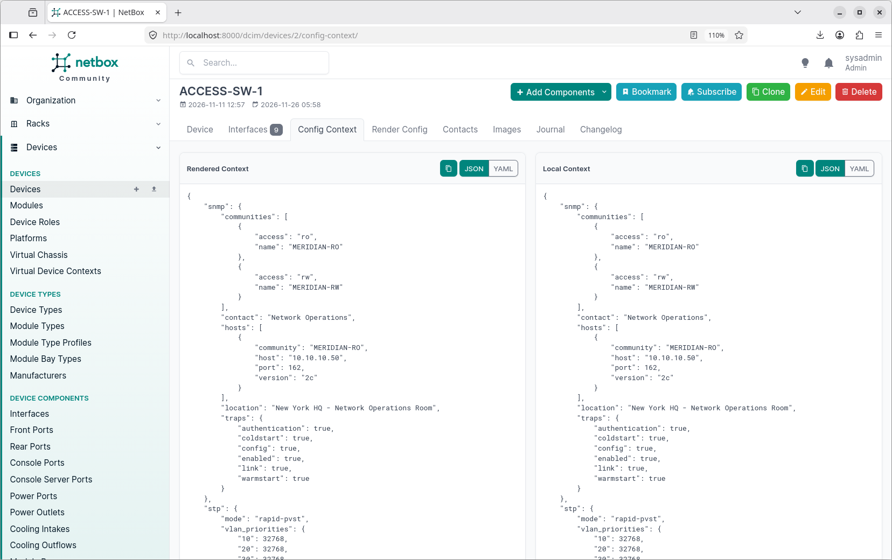
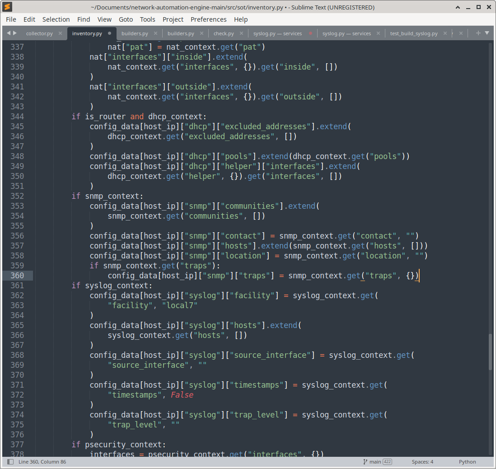
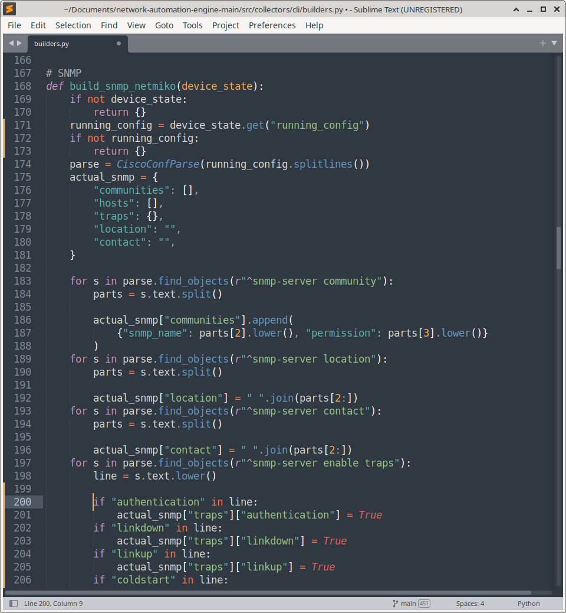
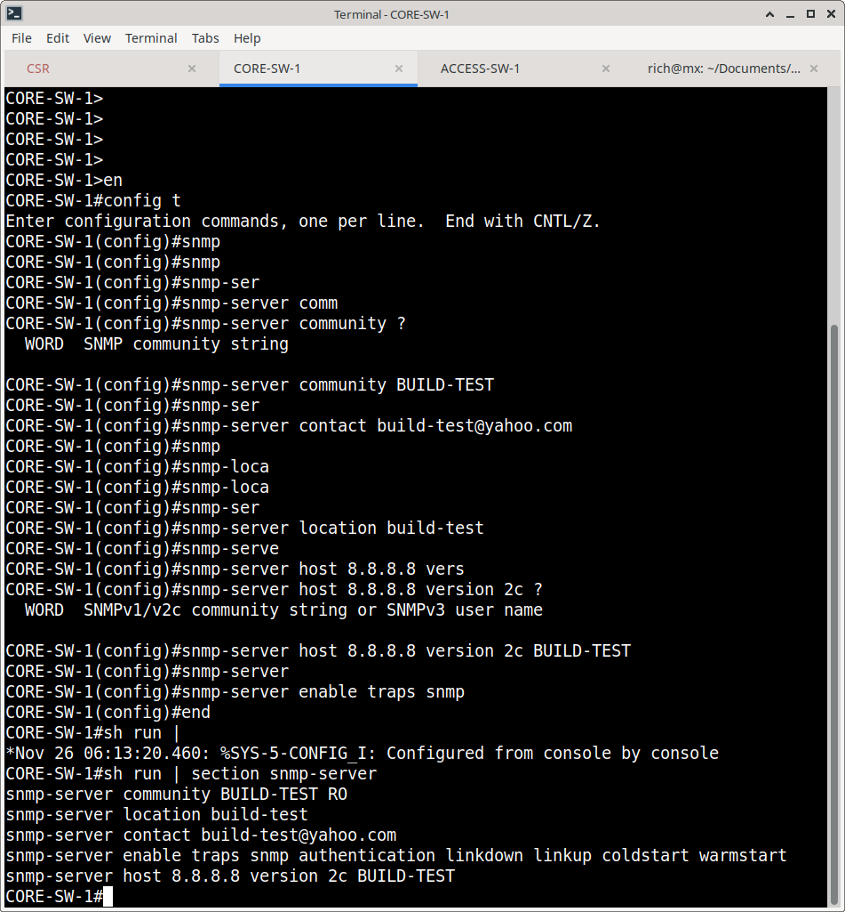

## 1. Intended State: NetBox Source of Truth (SNMP Infrastructure)

In enterprise infrastructure, Simple Network Management Protocol (SNMP) is vital for network monitoring, performance polling, and fault alerting. However, leaving default or unmanaged SNMP configurations introduces critical operational and security risks:
* **Security Exposure:** Unaudited or default community strings (such as `public` or `private`) expose running configurations and allow unauthorized write access.
* **Operational Blindspots:** Missing or misconfigured SNMP trap receivers prevent the Network Management System (NMS) from receiving immediate link-failure or authentication-alarm notifications.
* **Asset Tracking Inconsistency:** Unpopulated system MIB objects (`sysContact`, `sysLocation`) hinder datacenter and site inventory management.

To enforce standardized monitoring baselines across all network devices, the automation engine establishes **NetBox** as the single authoritative Source of Truth (SoT). The SNMP policy is declared using structured JSON within **NetBox Config Contexts** (`dcim/devices/<id>/config-context/`).

---

### 1. Declaring SNMP Baseline in NetBox Config Context

Both distribution switch `CORE-SW-1` and access switch `ACCESS-SW-1` inherit the standardized SNMP baseline directly from NetBox:




```json
{
  "snmp": {
    "communities": [
      {
        "access": "ro",
        "name": "MERIDIAN-RO"
      },
      {
        "access": "rw",
        "name": "MERIDIAN-RW"
      }
    ],
    "contact": "Network Operations",
    "hosts": [
      {
        "community": "MERIDIAN-RO",
        "host": "10.10.10.50",
        "port": 162,
        "version": "2c"
      }
    ],
    "location": "New York HQ - Network Operations Room",
    "traps": {
      "authentication": true,
      "coldstart": true,
      "config": true,
      "enabled": true,
      "link": true,
      "warmstart": true
    }
  }
}
```

> NetBox renders this identically in both the **Rendered Context** and **Local Context** panels (`The local config context overwrites all source contexts.`), confirming the SNMP policy is authored directly on each device rather than inherited from a shared source context.

---

### Policy Specification & Security Parameters

| SNMP Attribute | Intended Baseline | Security & Operational Purpose |
| :--- | :--- | :--- |
| **Read-Only Community** | `MERIDIAN-RO` (`ro`) | Restricts polling for telemetry and monitoring tools to an authorized string. |
| **Read-Write Community** | `MERIDIAN-RW` (`rw`) | Authorized community for administrative write-access via NMS. |
| **Trap Destination (NMS)** | `10.10.10.50:162` (`v2c`) | Centralized monitoring server receiving asynchronous SNMP traps. |
| **System Contact** | `Network Operations` | Populates MIB-II `sysContact` for incident ownership. |
| **System Location** | `New York HQ - Network Operations Room` | Populates MIB-II `sysLocation` for site identification. |
| **Trap Notifications** | `authentication`, `link`, `coldstart`, `warmstart`, `config` | Explicitly enables traps for link flaps, reboots, config changes, and unauthorized SNMP access attempts. |

---

### 2. Inventory Ingestion Engine (`src/sot/inventory.py`)

During inventory synchronization, the engine extracts the `snmp_context` from NetBox device context and structures it into the target device configuration dictionary:



```python
# src/sot/inventory.py (SNMP Ingestion Logic)

    if snmp_context:
        config_data[host_ip]["snmp"]["communities"].extend(
            snmp_context.get("communities", [])
        )
        config_data[host_ip]["snmp"]["contact"] = snmp_context.get("contact", "")
        config_data[host_ip]["snmp"]["hosts"].extend(snmp_context.get("hosts", []))
        config_data[host_ip]["snmp"]["location"] = snmp_context.get("location", "")
        if snmp_context.get("traps"):
            config_data[host_ip]["snmp"]["traps"] = snmp_context.get("traps", {})
```

---

### 3. Normalized Desired-State Output

At runtime, the inventory engine compiles the NetBox declarations and validates the ingested parameters before executing device audits:


```json
{
    "hosts": [
        {
            "host": "10.10.10.50",
            "port": 162,
            "version": "2c",
            "community": "MERIDIAN-RO"
        }
    ],
    "traps": {
        "link": true,
        "enabled": true,
        "coldstart": true,
        "warmstart": true,
        "authentication": true,
        "config": true
    },
    "contact": "Network Operations",
    "location": "New York HQ - Network Operations Room",
    "communities": [
        {
            "name": "MERIDIAN-RO",
            "access": "ro"
        },
        {
            "name": "MERIDIAN-RW",
            "access": "rw"
        }
    ]
}
```

> **Design Principle:**
> By centralizing SNMP parameters into declarative NetBox Config Contexts, the downstream compliance engine (`check_snmp()`) audits all monitoring parameters communities, trap targets, contact info, and trap flag as a single coherent contract across both core and access switches.
```

---

## 2. Live Device State Collection & SNMP Parsing

SNMP configurations on Cisco IOS-XE—including community permissions, trap receivers, and contact metadata—are global directives defined under `snmp-server`. Operational show commands can obscure community strings or omit specific trap categories.

To guarantee accurate extraction, the engine pairs **Netmiko** for secure CLI retrieval with **`CiscoConfParse`** for hierarchical regex parsing on the switch's running configuration.

```text
[ Cisco Switch CLI ] ──( Netmiko SSH )──► collect_device_state(conn)
                                           └── "show run" ──► device_state["running_config"]
                                                                      │
                                                                      ▼
                                                       [ CiscoConfParse Engine ]
                                                                      │
                                           ┌──────────────────────────┴──────────────────────────┐
                                           ├── r"^snmp-server community" ──► actual_snmp["communities"]
                                           ├── r"^snmp-server location"  ──► actual_snmp["location"]
                                           ├── r"^snmp-server contact"   ──► actual_snmp["contact"]
                                           ├── r"^snmp-server enable traps" ──► actual_snmp["traps"]
                                           └── r"^snmp-server host"      ──► actual_snmp["hosts"]
                                                                      │
                                                                      ▼
                                              [ Normalized SNMP Lookup Dictionary ]
```

---

### 1. Running Configuration Collection (`src/collectors/cli/collector.py`)

The collector queries `show run` over Netmiko inside an isolated `try/except` boundary to ensure that configuration capture failures fail gracefully without halting other audit domains:


```python
# src/collectors/cli/collector.py (Running-Config Extraction Boundary)

    try:
        device_state["running_config"] = conn.send_command("show run")
    except Exception:
        device_state["running_config"] = ""
```

---

### 2. SNMP State Normalization Builder (`src/collectors/cli/builders.py`)

The `build_snmp_netmiko()` builder iterates over the captured running configuration using `CiscoConfParse`, extracting community strings, permissions, system location, contact details, enabled trap categories, and target host receivers:



```python
# SNMP
def build_snmp_netmiko(device_state):
    if not device_state:
        return {}
    running_config = device_state.get("running_config")
    if not running_config:
        return {}
    parse = CiscoConfParse(running_config.splitlines())
    actual_snmp = {
        "communities": [],
        "hosts": [],
        "traps": {},
        "location": "",
        "contact": "",
    }

    for s in parse.find_objects(r"^snmp-server community"):
        parts = s.text.split()

        actual_snmp["communities"].append(
            {"snmp_name": parts[2].lower(), "permission": parts[3].lower()}
        )
    for s in parse.find_objects(r"^snmp-server location"):
        parts = s.text.split()

        actual_snmp["location"] = " ".join(parts[2:])
    for s in parse.find_objects(r"^snmp-server contact"):
        parts = s.text.split()

        actual_snmp["contact"] = " ".join(parts[2:])
    for s in parse.find_objects(r"^snmp-server enable traps"):
        line = s.text.lower()

        if "snmp" in line:
            actual_snmp["traps"]["snmp"] = True
        if "authentication" in line:
            actual_snmp["traps"]["authentication"] = True
        if "linkdown" in line:
            actual_snmp["traps"]["linkdown"] = True
        if "linkup" in line:
            actual_snmp["traps"]["linkup"] = True
        if "coldstart" in line:
            actual_snmp["traps"]["coldstart"] = True
        if "warmstart" in line:
            actual_snmp["traps"]["warmstart"] = True

    for s in parse.find_objects(r"^snmp-server host"):
        parts = s.text.split()
        if len(parts) == 7:
            actual_snmp["hosts"].append(
                {"snmp_ip": parts[2], "snmp_version": parts[4], "snmp_name": parts[6]}
            )
        if len(parts) == 6:
            actual_snmp["hosts"].append(
                {"snmp_ip": parts[2], "snmp_version": parts[4], "snmp_name": parts[5]}
            )
    return actual_snmp
```

---

### 3. Live Device State vs. Normalized Output

To test the builder's parsing accuracy, unauthorized out-of-band SNMP configuration drift was manually configured on `CORE-SW-1`:



```cisco
CORE-SW-1(config)# snmp-server community BUILD-TEST
CORE-SW-1(config)# snmp-server contact build-test@yahoo.com
CORE-SW-1(config)# snmp-server location build-test
CORE-SW-1(config)# snmp-server host 8.8.8.8 version 2c BUILD-TEST
CORE-SW-1(config)# snmp-server enable traps snmp
CORE-SW-1(config)# end
*Nov 26 06:13:20.460: %SYS-5-CONFIG_I: Configured from console by console

CORE-SW-1# show run | section snmp-server
snmp-server community BUILD-TEST RO
snmp-server location build-test
snmp-server contact build-test@yahoo.com
snmp-server enable traps snmp authentication linkdown linkup coldstart warmstart
snmp-server host 8.8.8.8 version 2c BUILD-TEST
```

#### Normalized Builder Runtime Output:
When the collector audited `CORE-SW-1`, `build_snmp_netmiko()` converted the raw CLI configuration into the following structured dictionary:


```json
{
    "communities": [
        {
            "snmp_name": "build-test",
            "permission": "ro"
        }
    ],
    "hosts": [
        {
            "snmp_ip": "8.8.8.8",
            "snmp_version": "2c",
            "snmp_name": "BUILD-TEST"
        }
    ],
    "traps": {
        "snmp": true,
        "authentication": true,
        "linkdown": true,
        "linkup": true,
        "coldstart": true,
        "warmstart": true
    },
    "location": "build-test",
    "contact": "build-test@yahoo.com"
}
```

```text
2026-11-26 01:28:46,903 - WARNING - snmp_netconf_non_compliant
```

---

### 4. Operational Drift Baseline

Comparing this normalized live state against the **NetBox Desired State** immediately highlights multi-attribute policy violations across `CORE-SW-1`:

| SNMP Attribute | NetBox Declared Intent | Observed Switch State | Compliance Evaluation |
| :--- | :--- | :--- | :---: |
| **Community Strings** | `MERIDIAN-RO` (`ro`)<br>`MERIDIAN-RW` (`rw`) | `build-test` (`ro`) | **DRIFT (Unauthorized Community / Missing Authorized)** |
| **Trap Host Receiver** | `10.10.10.50:162` (v2c, `MERIDIAN-RO`) | `8.8.8.8` (v2c, `BUILD-TEST`) | **DRIFT (Rogue Trap Destination)** |
| **System Contact** | `Network Operations` | `build-test@yahoo.com` | **DRIFT (Unauthorized MIB Contact)** |
| **System Location** | `New York HQ - Network Operations Room` | `build-test` | **DRIFT (Incorrect MIB Location)** |

> **Next Step:** This normalized observed dictionary is fed directly into `check_snmp()`, triggering targeted remediation to purge rogue community `BUILD-TEST`, delete unauthorized host `8.8.8.8`, and enforce the NetBox MIB and community standard.
```

---
