# SNMP Compliance & Remediation

## Overview

In enterprise infrastructure, Simple Network Management Protocol (SNMP) is the backbone of network monitoring, performance polling, and fault alerting. However, leaving SNMP configurations unmanaged introduces critical operational and security risks: unaudited community strings expose running configurations, missing trap receivers blind the Network Management System (NMS) to link failures, and incorrect MIB metadata (`sysContact`, `sysLocation`) hinders incident ownership and site tracking.

The **SNMP Compliance & Remediation** module is a production-grade, closed-loop automation engine designed to eliminate these risks. It enforces deterministic monitoring baselines across all network devices by reconciling live switch state against a **NetBox Source of Truth (SoT)**.

Unlike naive automation scripts that merely append configuration, this pipeline provides end-to-end lifecycle management. It extracts operational state via Cisco pyATS/Genie and `CiscoConfParse`, performs **set-equality diffing** on trap hosts (order-independent, case-insensitive on community names), and applies a **two-phase reconciliation pattern** actively purging all existing `snmp-server` lines before enforcing the authorized NetBox baseline guaranteeing true idempotency and preventing orphaned communities or rogue trap destinations.

### Core Engineering Objectives
- **Declarative Baseline:** Establish NetBox Config Contexts as the single source of truth for SNMP communities, trap receivers, MIB metadata, and trap flags.
- **Dual-Source Data Extraction:** Utilize `CiscoConfParse` for hierarchical running-config parsing, extracting communities, permissions, location, contact, traps, and hosts with regex precision.
- **Deterministic Set-Based Diffing:** Compare live operational multi-host configurations against NetBox intent using order-independent tuples `(snmp_name, snmp_ip, snmp_version)`, catching unauthorized rogue hosts or missing primaries instantly.
- **Two-Phase Idempotent Remediation:** Apply configuration changes using Jinja2 templates that explicitly negate observed drift (e.g., `no snmp-server community build-test`) *before* enforcing the authorized NetBox baseline.
- **Multi-Transport Support:** Route collection, diff evaluation, and remediation through either NETCONF (YANG operational data) or NETMIKO (CLI parsing) based on device capability.
- **Closed-Loop Verification:** Re-poll the device post-remediation to guarantee the physical data plane matches the intended state before marking the task complete.
- **Enterprise Observability:** Stream structured, severity-coded JSON telemetry to Splunk for real-time NOC/SecOps dashboards and immutable audit trails.
- **CI/CD Readiness:** Validate the entire state machine with 21 offline Pytest cases (parametrized across both transports), ensuring zero-regression deployments without requiring live hardware.

---

## Architecture

The SNMP Compliance module follows the project's Source of Truth-driven architecture, decoupling data collection, normalization, decisioning, and remediation:

| Component | Responsibility |
|---|---|
| **NetBox Inventory** | Supplies expected SNMP communities, trap hosts, MIB metadata, and trap flags. |
| **Dual Collector** | Queries `show run` (raw text) over Netmiko with isolated fault tolerance. |
| **SNMP Builder** | `build_snmp_netmiko()` uses `CiscoConfParse` to extract communities, hosts, traps, location, and contact. |
| **Compliance Checker** | Compares expected NetBox intent against actual live state using set-equality for hosts and strict matching for parameters. |
| **Remediation Engine** | Applies targeted `snmp-server` configuration changes via two-phase Jinja2 templates (purge + enforce). |
| **Post-Validation** | Re-queries and re-evaluates the device to verify that remediation achieved the expected configuration. |

## Topology


### Table of Contents

- [1. Intended State: NetBox Source of Truth (SNMP Infrastructure)](#1-intended-state-netbox-source-of-truth-snmp-infrastructure)
- [2. Live Device State Collection & SNMP Parsing](#2-live-device-state-collection--snmp-parsing)
- [3. SNMP Compliance Diff Engine & Drift Detection](#3-snmp-compliance-diff-engine--drift-detection)
- [4. Configuration Remediation](#4-configuration-remediation)
- [5. Safe Change Management: Dry-Run Mode](#5-safe-change-management-dry-run-mode)
- [6. Post-Remediation Validation & Physical Device Proof](#6-post-remediation-validation--physical-device-proof)
- [7. Audit Logging & Splunk Telemetry Pipeline (SNMP Services)](#7-audit-logging--splunk-telemetry-pipeline-snmp-services)
- [8. Automated Unit Testing & CI/CD Validation (SNMP Services)](#8-automated-unit-testing--cicd-validation-snmp-services)

## 1. Intended State: NetBox Source of Truth (SNMP Infrastructure)

In enterprise infrastructure, Simple Network Management Protocol (SNMP) is vital for network monitoring, performance polling, and fault alerting. However, leaving default or unmanaged SNMP configurations introduces critical operational and security risks:
* **Security Exposure:** Unaudited or default community strings (such as `public` or `private`) expose running configurations and allow unauthorized write access.
* **Operational Blindspots:** Missing or misconfigured SNMP trap receivers prevent the Network Management System (NMS) from receiving immediate link-failure or authentication-alarm notifications.
* **Asset Tracking Inconsistency:** Unpopulated system MIB objects (`sysContact`, `sysLocation`) hinder datacenter and site inventory management.

To enforce standardized monitoring baselines across all network devices, the automation engine establishes **NetBox** as the single authoritative Source of Truth (SoT). The SNMP policy is declared using structured JSON within **NetBox Config Contexts** (`dcim/devices/<id>/config-context/`).

---

### 1. Declaring SNMP Baseline in NetBox Config Context

Both distribution switch `CORE-SW-1` and access switch `ACCESS-SW-1` inherit the standardized SNMP baseline directly from NetBox:

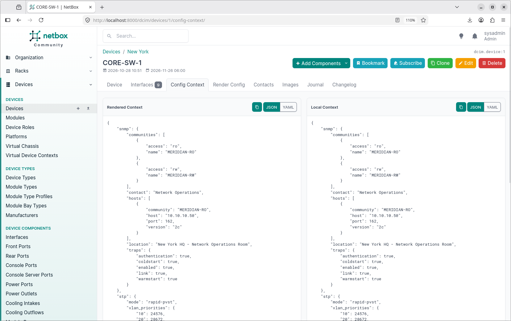


```json
{
  "snmp": {
    "communities": [
      {
        "access": "ro",
        "name": "MERIDIAN-RO"
      },
      {
        "access": "rw",
        "name": "MERIDIAN-RW"
      }
    ],
    "contact": "Network Operations",
    "hosts": [
      {
        "community": "MERIDIAN-RO",
        "host": "10.10.10.50",
        "port": 162,
        "version": "2c"
      }
    ],
    "location": "New York HQ - Network Operations Room",
    "traps": {
      "authentication": true,
      "coldstart": true,
      "config": true,
      "enabled": true,
      "link": true,
      "warmstart": true
    }
  }
}
```

> NetBox renders this identically in both the **Rendered Context** and **Local Context** panels (`The local config context overwrites all source contexts.`), confirming the SNMP policy is authored directly on each device rather than inherited from a shared source context.

---

### Policy Specification & Security Parameters

| SNMP Attribute | Intended Baseline | Security & Operational Purpose |
| :--- | :--- | :--- |
| **Read-Only Community** | `MERIDIAN-RO` (`ro`) | Restricts polling for telemetry and monitoring tools to an authorized string. |
| **Read-Write Community** | `MERIDIAN-RW` (`rw`) | Authorized community for administrative write-access via NMS. |
| **Trap Destination (NMS)** | `10.10.10.50:162` (`v2c`) | Centralized monitoring server receiving asynchronous SNMP traps. |
| **System Contact** | `Network Operations` | Populates MIB-II `sysContact` for incident ownership. |
| **System Location** | `New York HQ - Network Operations Room` | Populates MIB-II `sysLocation` for site identification. |
| **Trap Notifications** | `authentication`, `link`, `coldstart`, `warmstart`, `config` | Explicitly enables traps for link flaps, reboots, config changes, and unauthorized SNMP access attempts. |

---

### 2. Inventory Ingestion Engine (`src/sot/inventory.py`)

During inventory synchronization, the engine extracts the `snmp_context` from NetBox device context and structures it into the target device configuration dictionary:


```python
# src/sot/inventory.py (SNMP Ingestion Logic)

    if snmp_context:
        config_data[host_ip]["snmp"]["communities"].extend(
            snmp_context.get("communities", [])
        )
        config_data[host_ip]["snmp"]["contact"] = snmp_context.get("contact", "")
        config_data[host_ip]["snmp"]["hosts"].extend(snmp_context.get("hosts", []))
        config_data[host_ip]["snmp"]["location"] = snmp_context.get("location", "")
        if snmp_context.get("traps"):
            config_data[host_ip]["snmp"]["traps"] = snmp_context.get("traps", {})
```

---

### 3. Normalized Desired-State Output

At runtime, the inventory engine compiles the NetBox declarations and validates the ingested parameters before executing device audits:

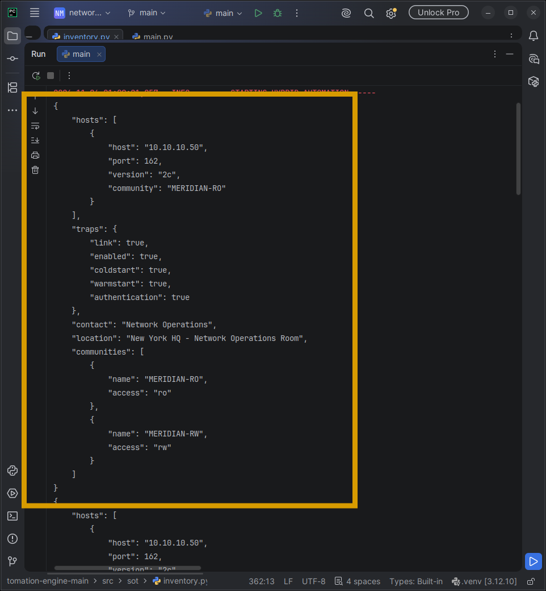

```json
{
    "hosts": [
        {
            "host": "10.10.10.50",
            "port": 162,
            "version": "2c",
            "community": "MERIDIAN-RO"
        }
    ],
    "traps": {
        "link": true,
        "enabled": true,
        "coldstart": true,
        "warmstart": true,
        "authentication": true,
        "config": true
    },
    "contact": "Network Operations",
    "location": "New York HQ - Network Operations Room",
    "communities": [
        {
            "name": "MERIDIAN-RO",
            "access": "ro"
        },
        {
            "name": "MERIDIAN-RW",
            "access": "rw"
        }
    ]
}
```

> **Design Principle:**
> By centralizing SNMP parameters into declarative NetBox Config Contexts, the downstream compliance engine (`check_snmp()`) audits all monitoring parameters communities, trap targets, contact info, and trap flag as a single coherent contract across both core and access switches.

---

## 2. Live Device State Collection & SNMP Parsing

SNMP configurations on Cisco IOS-XE including community permissions, trap receivers, and contact metadata are global directives defined under `snmp-server`. Operational show commands can obscure community strings or omit specific trap categories.

To guarantee accurate extraction, the engine pairs **Netmiko** for secure CLI retrieval with **`CiscoConfParse`** for hierarchical regex parsing on the switch's running configuration.

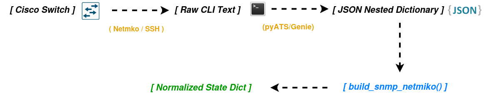

---

### 1. Running Configuration Collection (`src/collectors/cli/collector.py`)

The collector queries `show run` over Netmiko inside an isolated `try/except` boundary to ensure that configuration capture failures fail gracefully without halting other audit domains:

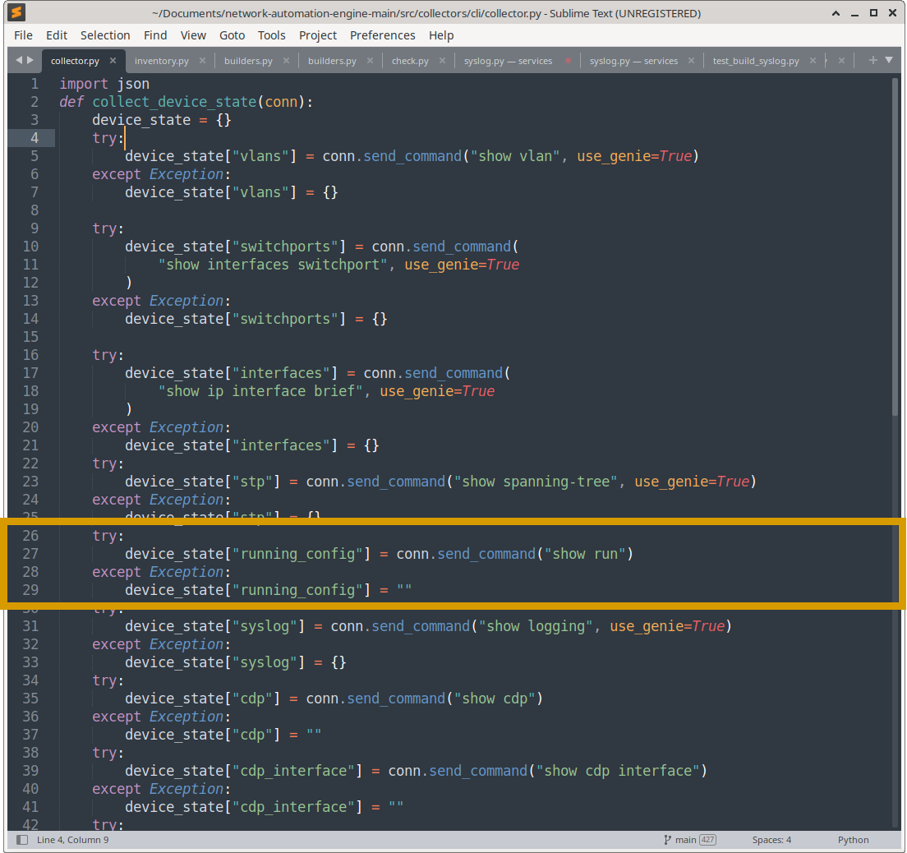

```python
# src/collectors/cli/collector.py (Running-Config Extraction Boundary)

    try:
        device_state["running_config"] = conn.send_command("show run")
    except Exception:
        device_state["running_config"] = ""
```

---

### 2. SNMP State Normalization Builder (`src/collectors/cli/builders.py`)

The `build_snmp_netmiko()` builder iterates over the captured running configuration using `CiscoConfParse`, extracting community strings, permissions, system location, contact details, enabled trap categories, and target host receivers:


```python
# SNMP
def build_snmp_netmiko(device_state):
    if not device_state:
        return {}
    running_config = device_state.get("running_config")
    if not running_config:
        return {}
    parse = CiscoConfParse(running_config.splitlines())
    actual_snmp = {
        "communities": [],
        "hosts": [],
        "traps": {},
        "location": "",
        "contact": "",
    }

    for s in parse.find_objects(r"^snmp-server community"):
        parts = s.text.split()

        actual_snmp["communities"].append(
            {"snmp_name": parts[2].lower(), "permission": parts[3].lower()}
        )
    for s in parse.find_objects(r"^snmp-server location"):
        parts = s.text.split()

        actual_snmp["location"] = " ".join(parts[2:])
    for s in parse.find_objects(r"^snmp-server contact"):
        parts = s.text.split()

        actual_snmp["contact"] = " ".join(parts[2:])
    for s in parse.find_objects(r"^snmp-server enable traps"):
        line = s.text.lower()

        if "snmp" in line:
            actual_snmp["traps"]["snmp"] = True
        if "authentication" in line:
            actual_snmp["traps"]["authentication"] = True
        if "linkdown" in line:
            actual_snmp["traps"]["linkdown"] = True
        if "linkup" in line:
            actual_snmp["traps"]["linkup"] = True
        if "coldstart" in line:
            actual_snmp["traps"]["coldstart"] = True
        if "warmstart" in line:
            actual_snmp["traps"]["warmstart"] = True

    for s in parse.find_objects(r"^snmp-server host"):
        parts = s.text.split()
        if len(parts) == 7:
            actual_snmp["hosts"].append(
                {"snmp_ip": parts[2], "snmp_version": parts[4], "snmp_name": parts[6]}
            )
        if len(parts) == 6:
            actual_snmp["hosts"].append(
                {"snmp_ip": parts[2], "snmp_version": parts[4], "snmp_name": parts[5]}
            )
    return actual_snmp
```

---

### 3. Live Device State vs. Normalized Output

To test the builder's parsing accuracy, unauthorized out-of-band SNMP configuration drift was manually configured on `CORE-SW-1`:


```cisco
CORE-SW-1(config)# snmp-server community BUILD-TEST
CORE-SW-1(config)# snmp-server contact build-test@yahoo.com
CORE-SW-1(config)# snmp-server location build-test
CORE-SW-1(config)# snmp-server host 8.8.8.8 version 2c BUILD-TEST
CORE-SW-1(config)# snmp-server enable traps snmp
CORE-SW-1(config)# end
*Nov 26 06:13:20.460: %SYS-5-CONFIG_I: Configured from console by console

CORE-SW-1# show run | section snmp-server
snmp-server community BUILD-TEST RO
snmp-server location build-test
snmp-server contact build-test@yahoo.com
snmp-server enable traps snmp authentication linkdown linkup coldstart warmstart
snmp-server host 8.8.8.8 version 2c BUILD-TEST
```

#### Normalized Builder Runtime Output:
When the collector audited `CORE-SW-1`, `build_snmp_netmiko()` converted the raw CLI configuration into the following structured dictionary:

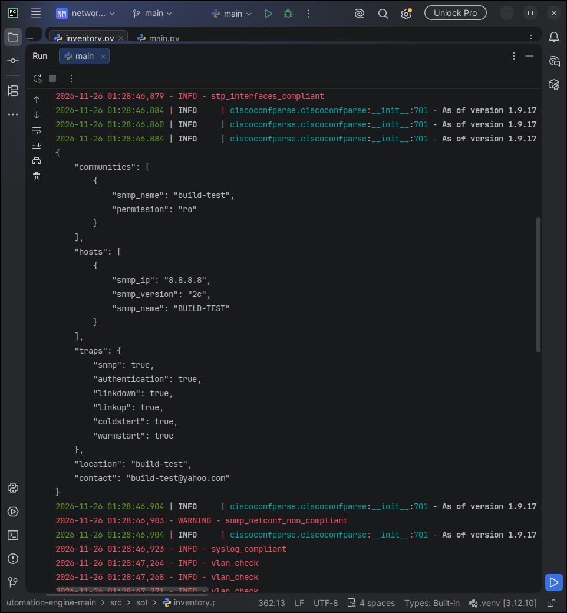

```json
{
    "communities": [
        {
            "snmp_name": "build-test",
            "permission": "ro"
        }
    ],
    "hosts": [
        {
            "snmp_ip": "8.8.8.8",
            "snmp_version": "2c",
            "snmp_name": "BUILD-TEST"
        }
    ],
    "traps": {
        "snmp": true,
        "authentication": true,
        "linkdown": true,
        "linkup": true,
        "coldstart": true,
        "warmstart": true
    },
    "location": "build-test",
    "contact": "build-test@yahoo.com"
}
```
---

### 4. Operational Drift Baseline

Comparing this normalized live state against the **NetBox Desired State** immediately highlights multi-attribute policy violations across `CORE-SW-1`:

| SNMP Attribute | NetBox Declared Intent | Observed Switch State | Compliance Evaluation |
| :--- | :--- | :--- | :---: |
| **Community Strings** | `MERIDIAN-RO` (`ro`)<br>`MERIDIAN-RW` (`rw`) | `build-test` (`ro`) | **DRIFT (Unauthorized Community / Missing Authorized)** |
| **Trap Host Receiver** | `10.10.10.50:162` (v2c, `MERIDIAN-RO`) | `8.8.8.8` (v2c, `BUILD-TEST`) | **DRIFT (Rogue Trap Destination)** |
| **System Contact** | `Network Operations` | `build-test@yahoo.com` | **DRIFT (Unauthorized MIB Contact)** |
| **System Location** | `New York HQ - Network Operations Room` | `build-test` | **DRIFT (Incorrect MIB Location)** |

> **Next Step:** This normalized observed dictionary is fed directly into `check_snmp()`, triggering targeted remediation to purge rogue community `BUILD-TEST`, delete unauthorized host `8.8.8.8`, and enforce the NetBox MIB and community standard.

---

## 3. SNMP Compliance Diff Engine & Drift Detection

The SNMP compliance module reconciles network monitoring, security access strings, and trap alerting parameters against the NetBox declarative baseline.

The compliance runner supports a **multi-transport architecture** that can audit and validate SNMP states over both **NETCONF** and **NETMIKO**, executing automated drift detection, targeted remediation, and closed-loop post-validation.

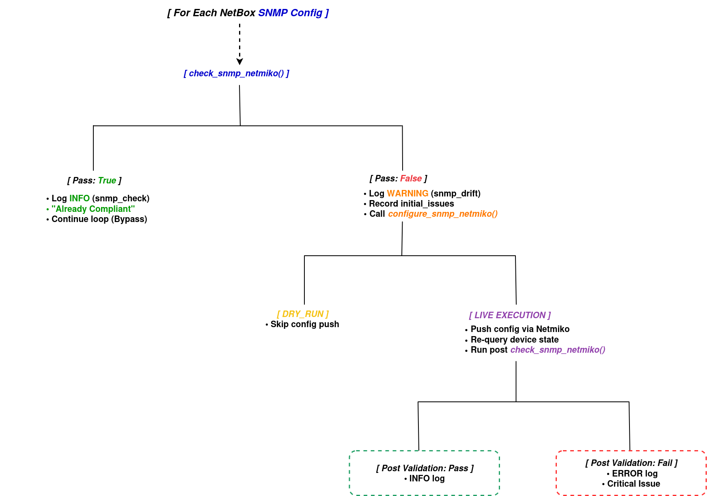

---

### 1. Multi-Attribute Diff Engine (`src/compliance/services/snmp/check.py`)

The `check_snmp()` function audits communities, MIB metadata, trap hosts, and trap flags. Communities and hosts are normalized into **lowercased key / tuple sets** so the comparison is order-independent and case-insensitive on the community name (the builder lowercases `snmp_name` in the communities loop but leaves it raw in the hosts loop see Notes).

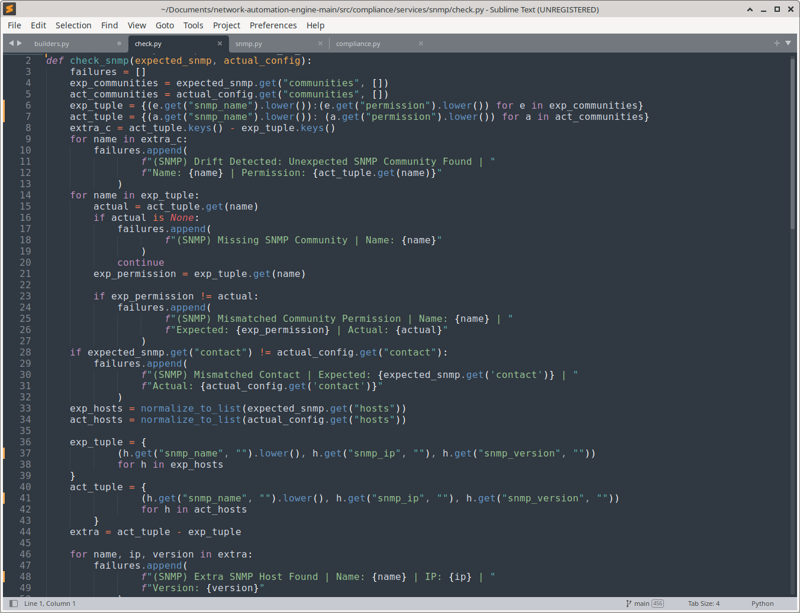

```python
# src/compliance/services/snmp/check.py

from src.utils.helpers import normalize_to_list


def check_snmp(expected_snmp, actual_config):
    failures = []

    exp_communities = expected_snmp.get("communities", [])
    act_communities = actual_config.get("communities", [])

    exp_tuple = {
        e.get("snmp_name").lower(): e.get("permission").lower()
        for e in exp_communities
    }
    act_tuple = {
        a.get("snmp_name").lower(): a.get("permission").lower()
        for a in act_communities
    }

    extra_c = act_tuple.keys() - exp_tuple.keys()
    for name in extra_c:
        failures.append(
            f"(SNMP) Drift Detected: Unexpected SNMP Community Found | "
            f"Name: {name} | Permission: {act_tuple.get(name)}"
        )

    for name in exp_tuple:
        actual = act_tuple.get(name)
        if actual is None:
            failures.append(
                f"(SNMP) Missing SNMP Community | Name: {name}"
            )
            continue
        exp_permission = exp_tuple.get(name)
        if exp_permission != actual:
            failures.append(
                f"(SNMP) Mismatched Community Permission | Name: {name} | "
                f"Expected: {exp_permission} | Actual: {actual}"
            )

    if expected_snmp.get("contact") != actual_config.get("contact"):
        failures.append(
            f"(SNMP) Mismatched Contact | Expected: {expected_snmp.get('contact')} | "
            f"Actual: {actual_config.get('contact')}"
        )

    exp_hosts = normalize_to_list(expected_snmp.get("hosts"))
    act_hosts = normalize_to_list(actual_config.get("hosts"))

    exp_tuple = {
        (h.get("snmp_name", "").lower(), h.get("snmp_ip", ""), h.get("snmp_version", ""))
        for h in exp_hosts
    }
    act_tuple = {
        (h.get("snmp_name", "").lower(), h.get("snmp_ip", ""), h.get("snmp_version", ""))
        for h in act_hosts
    }

    extra = act_tuple - exp_tuple
    for name, ip, version in extra:
        failures.append(
            f"(SNMP) Extra SNMP Host Found | Name: {name} | IP: {ip} | "
            f"Version: {version}"
        )

    act_lookup = {a.get("snmp_name").lower(): a for a in act_hosts}
    for e in exp_hosts:
        actual = act_lookup.get(e.get("snmp_name").lower())
        if not actual:
            failures.append(
                f"(SNMP) Host Configuration | Community Name Not Found | Name: {e.get('snmp_name')}"
            )
            continue
        if actual.get("snmp_ip") != e.get("snmp_ip"):
            failures.append(
                f"(SNMP) Mismatched SNMP IP Found | Name: {e.get('snmp_name')} | "
                f"Expected IP: {e.get('snmp_ip')} | Actual: {actual.get('snmp_ip')}"
            )
        if actual.get("snmp_version") != e.get("snmp_version"):
            failures.append(
                f"(SNMP) Mismatched SNMP Version | Name: {e.get('snmp_name')} | "
                f"Expected: {e.get('snmp_version')} | Actual: {actual.get('snmp_version')}"
            )

    if expected_snmp.get("location") != actual_config.get("location"):
        failures.append(
            f"(SNMP) SNMP Location Mismatch | Expected: {expected_snmp.get('location')} | "
            f"Actual: {actual_config.get('location')}"
        )

    exp_traps = expected_snmp.get("traps", {})
    act_traps = actual_config.get("traps", {})

    if exp_traps.get("authentication"):
        if exp_traps.get("authentication") != act_traps.get("authentication"):
            failures.append(
                f"(SNMP) Mismatched Traps | Authentication | Expected: {exp_traps.get('authentication')} | "
                f"Actual: {act_traps.get('authentication')}"
            )
    if exp_traps.get("linkup"):
        if exp_traps.get('linkup') != act_traps.get('linkup'):
            failures.append(
                f"(SNMP) Mismatched Traps | linkup | Expected: {exp_traps.get('linkup')} | "
                f"Actual: {act_traps.get('linkup')}"
            )
    if exp_traps.get("linkdown"):
        if exp_traps.get('linkdown') != act_traps.get('linkdown'):
            failures.append(
                f"(SNMP) Mismatched Traps | linkdown | Expected: {exp_traps.get('linkdown')} | "
                f"Actual: {act_traps.get('linkdown')}"
            )
    if exp_traps.get("coldstart"):
        if exp_traps.get('coldstart') != act_traps.get('coldstart'):
            failures.append(
                f"(SNMP) Mismatched Traps | coldstart | Expected: {exp_traps.get('coldstart')} | "
                f"Actual: {act_traps.get('coldstart')}"
            )
    if exp_traps.get("warmstart"):
        if exp_traps.get('warmstart') != act_traps.get('warmstart'):
            failures.append(
                f"(SNMP) Mismatched Traps | warmstart | Expected: {exp_traps.get('syslog')} | "
                f"Actual: {act_traps.get('syslog')}"
            )

    return len(failures) == 0, failures
```

---

### 2. Multi-Transport Compliance Orchestrator (`src/compliance/services/snmp/compliance.py`)

The `compliance_snmp()` function routes the operational state through the designated transport builder, compares expected communities, trap hosts, and MIB metadata, flags drift warnings, and executes post-validation re-audits:

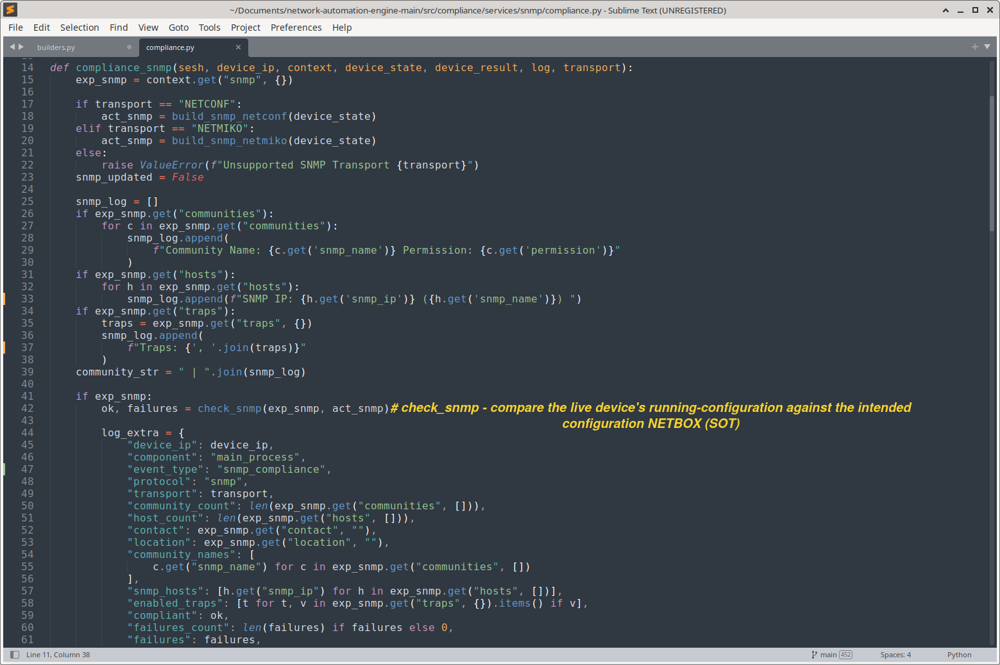

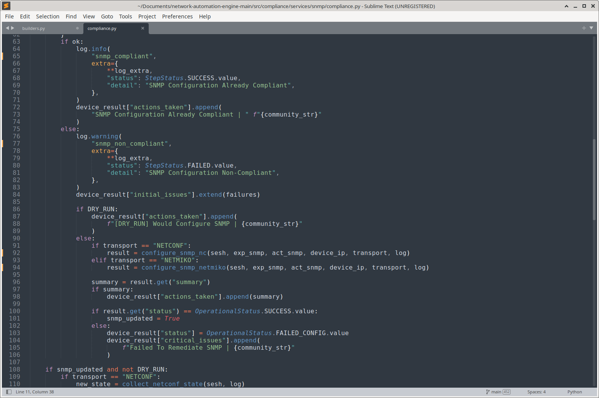

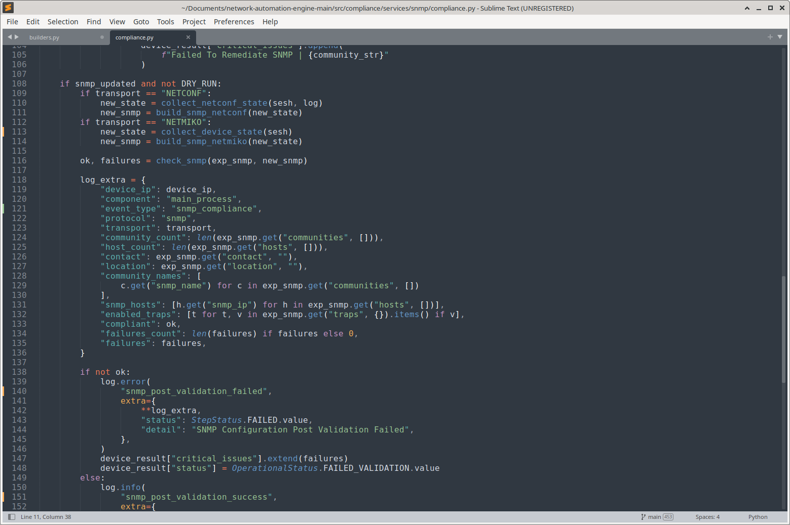

```python
# src/compliance/services/snmp/compliance.py

from src.core.enums import StepStatus, OperationalStatus
from src.collectors.cli.builders import build_snmp_netmiko
from src.collectors.netconf.builders import build_snmp_netconf
from src.collectors.cli.collector import collect_device_state
from src.collectors.netconf.collector import collect_netconf_state
from src.compliance.services.snmp.check import check_snmp
from src.remediation.services.snmp import (
    configure_snmp_nc,
    configure_snmp_netmiko,
)
from src.core.settings import DRY_RUN


def compliance_snmp(sesh, device_ip, context, device_state, device_result, log, transport):
    exp_snmp = context.get("snmp", {})

    if transport == "NETCONF":
        act_snmp = build_snmp_netconf(device_state)
    elif transport == "NETMIKO":
        act_snmp = build_snmp_netmiko(device_state)
    else:
        raise ValueError(f"Unsupported SNMP Transport {transport}")
    snmp_updated = False

    snmp_log = []
    if exp_snmp.get("communities"):
        for c in exp_snmp.get("communities"):
            snmp_log.append(
                f"Community Name: {c.get('snmp_name')} Permission: {c.get('permission')}"
            )
    if exp_snmp.get("hosts"):
        for h in exp_snmp.get("hosts"):
            snmp_log.append(f"SNMP IP: {h.get('snmp_ip')} ({h.get('snmp_name')}) ")
    if exp_snmp.get("traps"):
        traps = exp_snmp.get("traps", {})
        snmp_log.append(
            f"Traps: {', '.join(traps)}"
        )
    community_str = " | ".join(snmp_log)

    if exp_snmp:
        ok, failures = check_snmp(exp_snmp, act_snmp)

        log_extra = {
            "device_ip": device_ip,
            "component": "main_process",
            "event_type": "snmp_compliance",
            "protocol": "snmp",
            "transport": transport,
            "community_count": len(exp_snmp.get("communities", [])),
            "host_count": len(exp_snmp.get("hosts", [])),
            "contact": exp_snmp.get("contact", ""),
            "location": exp_snmp.get("location", ""),
            "community_names": [
                c.get("snmp_name") for c in exp_snmp.get("communities", [])
            ],
            "snmp_hosts": [h.get("snmp_ip") for h in exp_snmp.get("hosts", [])],
            "enabled_traps": [t for t, v in exp_snmp.get("traps", {}).items() if v],
            "compliant": ok,
            "failures_count": len(failures) if failures else 0,
            "failures": failures,
        }

        if ok:
            log.info(
                "snmp_compliant",
                extra={
                    **log_extra,
                    "status": StepStatus.SUCCESS.value,
                    "detail": "SNMP Configuration Already Compliant",
                },
            )
            device_result["actions_taken"].append(
                "SNMP Configuration Already Compliant | " f"{community_str}"
            )
        else:
            log.warning(
                "snmp_non_compliant",
                extra={
                    **log_extra,
                    "status": StepStatus.FAILED.value,
                    "detail": "SNMP Configuration Non-Compliant",
                },
            )
            device_result["initial_issues"].extend(failures)

            if DRY_RUN:
                device_result["actions_taken"].append(
                    f"[DRY_RUN] Would Configure SNMP | {community_str}"
                )
            else:
                if transport == "NETCONF":
                    result = configure_snmp_nc(sesh, exp_snmp, act_snmp, device_ip, transport, log)
                elif transport == "NETMIKO":
                    result = configure_snmp_netmiko(sesh, exp_snmp, act_snmp, device_ip, transport, log)

                summary = result.get("summary")
                if summary:
                    device_result["actions_taken"].append(summary)

                if result.get("status") == OperationalStatus.SUCCESS.value:
                    snmp_updated = True
                else:
                    device_result["status"] = OperationalStatus.FAILED_CONFIG.value
                    device_result["critical_issues"].append(
                        f"Failed To Remediate SNMP | {community_str}"
                    )

    if snmp_updated and not DRY_RUN:
        if transport == "NETCONF":
            new_state = collect_netconf_state(sesh, log)
            new_snmp = build_snmp_netconf(new_state)
        if transport == "NETMIKO":
            new_state = collect_device_state(sesh)
            new_snmp = build_snmp_netmiko(new_state)

        ok, failures = check_snmp(exp_snmp, new_snmp)

        log_extra = {
            "device_ip": device_ip,
            "component": "main_process",
            "event_type": "snmp_compliance",
            "protocol": "snmp",
            "transport": transport,
            "community_count": len(exp_snmp.get("communities", [])),
            "host_count": len(exp_snmp.get("hosts", [])),
            "contact": exp_snmp.get("contact", ""),
            "location": exp_snmp.get("location", ""),
            "community_names": [
                c.get("snmp_name") for c in exp_snmp.get("communities", [])
            ],
            "snmp_hosts": [h.get("snmp_ip") for h in exp_snmp.get("hosts", [])],
            "enabled_traps": [t for t, v in exp_snmp.get("traps", {}).items() if v],
            "compliant": ok,
            "failures_count": len(failures) if failures else 0,
            "failures": failures,
        }

        if not ok:
            log.error(
                "snmp_post_validation_failed",
                extra={
                    **log_extra,
                    "status": StepStatus.FAILED.value,
                    "detail": "SNMP Configuration Post Validation Failed",
                },
            )
            device_result["critical_issues"].extend(failures)
            device_result["status"] = OperationalStatus.FAILED_VALIDATION.value
        else:
            log.info(
                "snmp_post_validation_success",
                extra={
                    **log_extra,
                    "status": StepStatus.SUCCESS.value,
                    "detail": "SNMP Configuration Post Validation Successful",
                },
            )
            device_result["actions_taken"].append(
                "SNMP Configuration Post Validation Successful | " f"{community_str}"
            )
    return device_result
```

---

### 3. Real-World Drift Scenarios Injected on `CORE-SW-1`

To test multi-attribute diff detection, manual configuration drift was injected directly on `CORE-SW-1`:

#### A. Unauthorized SNMPv3 Host Injection
I manually configured an unauthorized SNMPv3 trap target pointing to `8.8.8.8`:

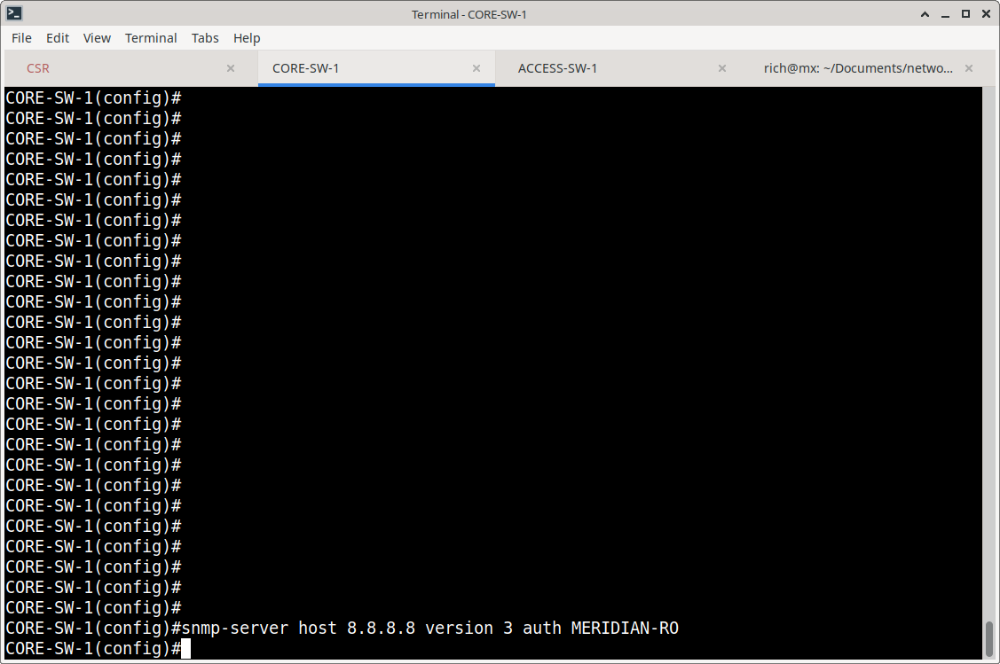

```cisco
CORE-SW-1(config)# snmp-server host 8.8.8.8 version 3 auth MERIDIAN-RO
```

#### B. Total SNMP Trap Disablement
All global trap notifications were disabled on the switch:

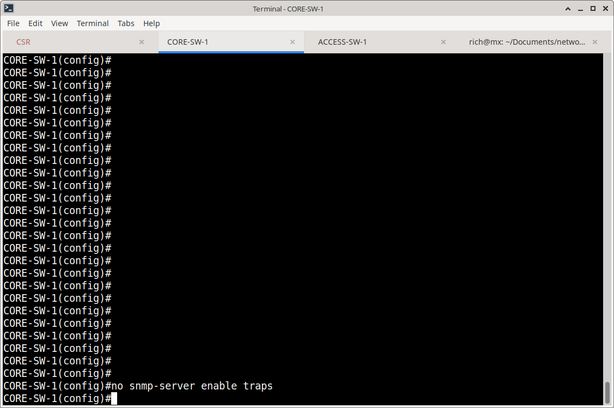

```cisco
CORE-SW-1(config)# no snmp-server enable traps
```

---

### 4. Compliance Engine Detection & Runtime Terminal Proof

When the compliance engine audited `CORE-SW-1`, `check_snmp()` evaluated the live running configuration against the NetBox Source of Truth and caught every discrepancy across communities, MIB contacts, rogue hosts, and disabled traps:

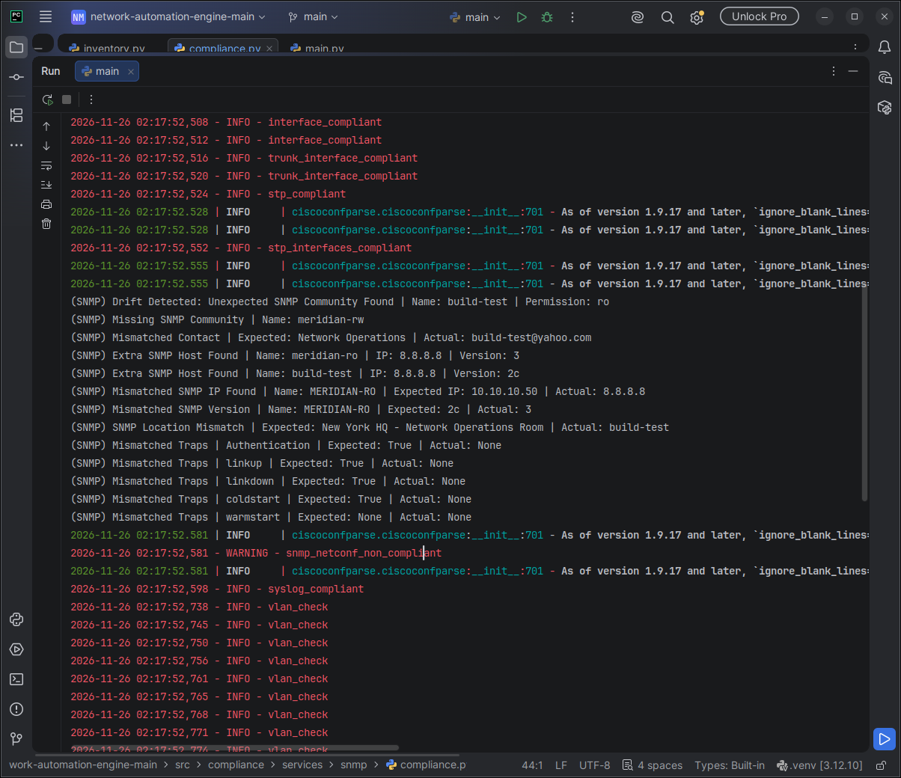

```text
(SNMP) Drift Detected: Unexpected SNMP Community Found | Name: build-test | Permission: ro
(SNMP) Missing SNMP Community | Name: meridian-rw
(SNMP) Mismatched Contact | Expected: Network Operations | Actual: build-test@yahoo.com
(SNMP) Extra SNMP Host Found | Name: meridian-ro | IP: 8.8.8.8 | Version: 3
(SNMP) Extra SNMP Host Found | Name: build-test | IP: 8.8.8.8 | Version: 2c
(SNMP) Mismatched SNMP IP Found | Name: MERIDIAN-RO | Expected IP: 10.10.10.50 | Actual: 8.8.8.8
(SNMP) Mismatched SNMP Version | Name: MERIDIAN-RO | Expected: 2c | Actual: 3
(SNMP) SNMP Location Mismatch | Expected: New York HQ - Network Operations Room | Actual: build-test
(SNMP) Mismatched Traps | Authentication | Expected: True | Actual: None
(SNMP) Mismatched Traps | linkup | Expected: True | Actual: None
(SNMP) Mismatched Traps | linkdown | Expected: True | Actual: None
(SNMP) Mismatched Traps | coldstart | Expected: True | Actual: None
(SNMP) Mismatched Traps | warmstart | Expected: None | Actual: None
2026-11-26 02:17:52,581 - WARNING - snmp_netconf_non_compliant
```

---

### 5. SNMP Compliance Evaluation Matrix

| Category | Policy Checked | NetBox Intended Baseline | Observed Switch State | Compliance Evaluation | Operational Remediation |
| :--- | :--- | :--- | :--- | :---: | :--- |
| **Communities** | Unauthorized Strings | Whitelist: `MERIDIAN-RO`, `MERIDIAN-RW` | `build-test` (`ro`) present | **FAIL (`Unexpected Community Found`)** | Push `no snmp-server community build-test`. |
| **Communities** | Read-Write Access | `MERIDIAN-RW` (`rw`) declared | Missing from device | **FAIL (`Missing SNMP Community`)** | Deploy `snmp-server community MERIDIAN-RW RW`. |
| **Trap Hosts** | Rogue Destinations | Authorized: `10.10.10.50:162` | `8.8.8.8` (v3 and v2c) present | **FAIL (`Extra SNMP Host Found`)** | Remove `8.8.8.8`; deploy authorized host. |
| **Trap Hosts** | Version & IP Parity | IP: `10.10.10.50`, Version: `2c` | IP: `8.8.8.8`, Version: `3` | **FAIL (`Mismatched SNMP Version/IP`)** | Re-bind collector with correct version and IP. |
| **System MIB** | `sysContact` | `Network Operations` | `build-test@yahoo.com` | **FAIL (`Mismatched Contact`)** | Deploy `snmp-server contact Network Operations`. |
| **System MIB** | `sysLocation` | `New York HQ - Network Operations Room` | `build-test` | **FAIL (`SNMP Location Mismatch`)** | Deploy `snmp-server location ...`. |
| **Trap Flags** | Link, Auth & Boot Alarms | `authentication`, `linkup`, `linkdown`, `coldstart`, `warmstart`: `True` | All disabled (`None`) | **FAIL (`Mismatched Traps`)** | Push `snmp-server enable traps snmp authentication linkdown linkup coldstart warmstart`. |

---

## 4. Configuration Remediation

When SNMP drift is detected, the engine routes remediation through the transport-matched handler in `src/remediation/services/snmp.py`:

1. **`configure_snmp_netmiko`** purges all existing `^snmp-server` lines, then renders and pushes `templates/snmp_netmiko.j2`, persisting to NVRAM via `conn.save_config()`.
2. **`configure_snmp_nc`** renders `templates/SNMP_NC.j2` and applies the change via `session.edit_config(target="running")`.

To prevent orphaned community strings, rogue SNMPv3 groups, or legacy trap hosts from remaining on the switch, the Netmiko handler implements an **active purge strategy** before pushing the declarative template:
1. **Dynamic Purge:** Queries the running switch for existing `^snmp-server` lines, reverses the list, and executes `no <command>` for every existing line.
2. **Declarative Enforcement:** Renders the authorized NetBox configuration from `templates/snmp_netmiko.j2`, pushes it via Netmiko, and persists changes to startup memory (`conn.save_config()`).

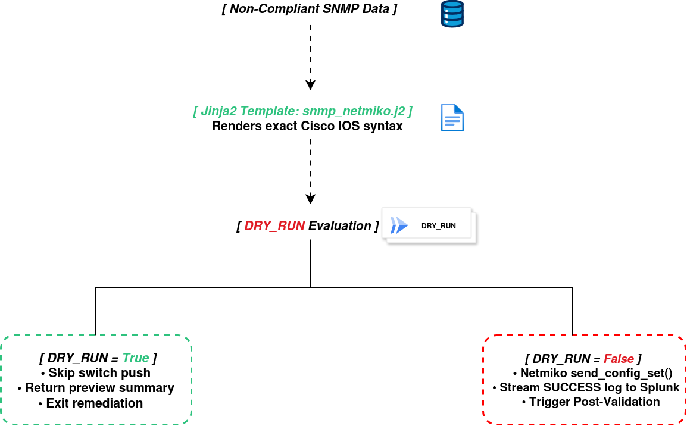

---

### 1. Declarative SNMP Template (`templates/snmp_netmiko.j2`)

The Jinja2 template iterates over authorized communities, trap destinations, MIB location/contact info, and enabled trap categories:

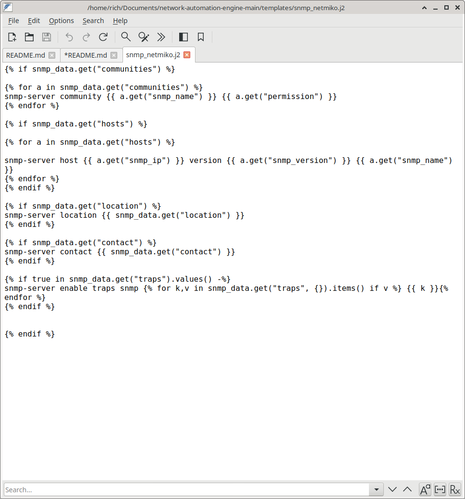

```jinja2



snmp-server community {{ a.get("snmp_name") }} {{ a.get("permission") }}






snmp-server host {{ a.get("snmp_ip") }} version {{ a.get("snmp_version") }} {{ a.get("snmp_name") }}




snmp-server location {{ snmp_data.get("location") }}



snmp-server contact {{ snmp_data.get("contact") }}



snmp-server enable traps snmp {{ k }}



```

---

### 2. Netmiko Remediation Handler (`src/remediation/services/snmp.py`)

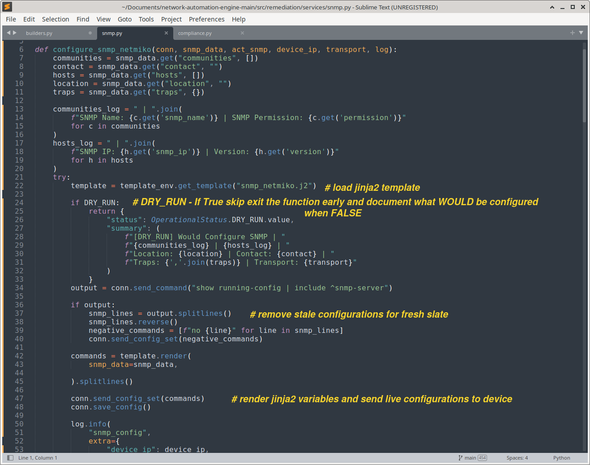

```python
# src/remediation/services/snmp.py

def configure_snmp_netmiko(conn, snmp_data, act_snmp, device_ip, transport, log):
    communities = snmp_data.get("communities", [])
    contact = snmp_data.get("contact", "")
    hosts = snmp_data.get("hosts", [])
    location = snmp_data.get("location", "")
    traps = snmp_data.get("traps", {})

    communities_log = " | ".join(
        f"SNMP Name: {c.get('snmp_name')} | SNMP Permission: {c.get('permission')}"
        for c in communities
    )
    hosts_log = " | ".join(
        f"SNMP IP: {h.get('snmp_ip')} | Version: {h.get('version')}"
        for h in hosts
    )
    try:
        template = template_env.get_template("snmp_netmiko.j2")

        if DRY_RUN:
            return {
                "status": OperationalStatus.DRY_RUN.value,
                "summary": (
                    f"[DRY_RUN] Would Configure SNMP | "
                    f"{communities_log} | {hosts_log} | "
                    f"Location: {location} | Contact: {contact} | "
                    f"Traps: {', '.join(traps)} | Transport: {transport}"
                )
            }
        output = conn.send_command("show running-config | include ^snmp-server")

        if output:
            snmp_lines = output.splitlines()
            snmp_lines.reverse()
            negative_commands = [f"no {line}" for line in snmp_lines]
            conn.send_config_set(negative_commands)

        commands = template.render(
            snmp_data=snmp_data,

        ).splitlines()

        conn.send_config_set(commands)
        conn.save_config()

        log.info(
            "snmp_config",
            extra={
                "device_ip": device_ip,
                "component": "snmp_automation",
                "event_type": "snmp_config",
                "transport": transport,
                "status": StepStatus.SUCCESS.value,
                "contact": contact,
                "location": location,
                "hosts": hosts_log,
                "communities": communities_log,
                "traps": traps,
                "detail": (
                    f"SNMP (Switch) Configuration Successful | "
                    f"{communities_log} | {hosts_log} | "
                    f"Location: {location} | Contact: {contact} | "
                    f"Traps: {traps}"
                )
            }

        )
        return {
            "status": OperationalStatus.SUCCESS.value,
            "summary": (
                f"SNMP (Switch) Configuration Successful | "
                f"{communities_log} | {hosts_log} | "
                f"Location: {location} | Contact: {contact} | "
                f"Traps: {traps} | Transport: {transport}"
            )
        }

    except Exception as e:
        log.info(
            "snmp_config",
            extra={
                "device_ip": device_ip,
                "component": "snmp_automation",
                "event_type": "snmp_config",
                "transport": transport,
                "status": StepStatus.ERROR.value,
                "contact": contact,
                "location": location,
                "hosts": hosts_log,
                "communities": communities_log,
                "traps": traps,
                "error": str(e),
                "detail": (f"Try/Exception Error | SNMP (Switch) Configuration | "
                           f"{communities_log} | {hosts_log} | "
                           f"Location: {location} | Contact: {contact} | "
                           f"Traps: {traps} | "
                           )
            }

        )
        return {
            "status": OperationalStatus.ERROR.value,
            "summary": (
                f"Try/Exception Error | SNMP (Switch) Configuration | "
                f"{communities_log} | {hosts_log} | "
                f"Location: {location} | Contact: {contact} | "
                f"Traps: {traps} | Transport: {transport} | "
                f"Error: {str(e)}"
            ),
            "error": str(e)
        }
```
---

## 5. Safe Change Management: Dry-Run Mode

To support production Change Advisory Board (CAB) review windows, the engine supports a global `DRY_RUN` setting (`src/core/settings.py`).

When `DRY_RUN = True`:
* All compliance audits run against live operational data.
* Configuration drift is detected, reported, and logged to Splunk.
* Planned remediation commands are evaluated and compiled into `final_compliance_report.json` under `actions_taken`.
* **Socket transmissions (`conn.send_config_set()` and `conn.save_config()`) are bypassed entirely.**


### Machine-Readable Dry-Run Audit: `final_compliance_report.json`

During dry-run execution on `CORE-SW-1`, the engine catalogs all verified baseline states alongside the planned SNMP remediation preview:

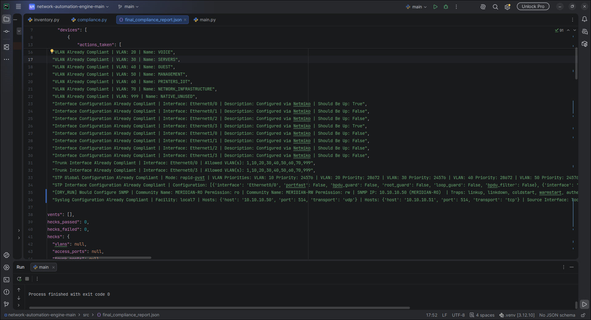

```json
{
  "device_name": "CORE-SW-1",
  "device_ip": "10.10.10.10",
  "hostname": null,
  "status": "COMPLIANT",
  "actions_taken": [
    "VLAN Already Compliant | VLAN: 10 | Name: USERS",
    "VLAN Already Compliant | VLAN: 20 | Name: VOICE",
    "VLAN Already Compliant | VLAN: 30 | Name: SERVERS",
    "VLAN Already Compliant | VLAN: 40 | Name: GUEST",
    "VLAN Already Compliant | VLAN: 50 | Name: MANAGEMENT",
    "VLAN Already Compliant | VLAN: 60 | Name: PRINTERS_IOT",
    "VLAN Already Compliant | VLAN: 70 | Name: NETWORK_INFRASTRUCTURE",
    "VLAN Already Compliant | VLAN: 999 | Name: NATIVE_UNUSED",
    "Interface Configuration Already Compliant | Interface: Ethernet0/0 | Description: Configured via Netmiko | Should Be Up: True",
    "Interface Configuration Already Compliant | Interface: Ethernet0/1 | Description: Configured via Netmiko | Should Be Up: False",
    "Interface Configuration Already Compliant | Interface: Ethernet0/2 | Description: Configured via Netmiko | Should Be Up: False",
    "Interface Configuration Already Compliant | Interface: Ethernet0/3 | Description: Configured via Netmiko | Should Be Up: True",
    "Interface Configuration Already Compliant | Interface: Ethernet1/0 | Description: Configured via Netmiko | Should Be Up: False",
    "Interface Configuration Already Compliant | Interface: Ethernet1/1 | Description: Configured via Netmiko | Should Be Up: False",
    "Interface Configuration Already Compliant | Interface: Ethernet1/2 | Description: Configured via Netmiko | Should Be Up: False",
    "Interface Configuration Already Compliant | Interface: Ethernet1/3 | Description: Configured via Netmiko | Should Be Up: False",
    "Trunk Interface Already Compliant | Interface: Ethernet0/0 | Allowed VLAN(s): 1,10,20,30,40,50,60,70,999",
    "Trunk Interface Already Compliant | Interface: Ethernet0/3 | Allowed VLAN(s): 1,10,20,30,40,50,60,70,999",
    "STP Global Configuration Already Compliant | Mode: rapid-pvst | VLAN Priorities: VLAN: 10 Priority: 24576 | VLAN: 20 Priority: 28672 | VLAN: 30 Priority: 24576 | VLAN: 40 Priority: 28672 | VLAN: 50 Priority: 24576 …",
    "STP Interface Configuration Already Compliant | Configuration: [{'interface': 'Ethernet0/0', 'portfast': False, 'bpdu_guard': False, 'root_guard': False, 'loop_guard': False, 'bpdu_filter': False}, {'interface': …",
    "[DRY_RUN] Would Configure SNMP | Community Name: MERIDIAN-RO Permission: ro | Community Name: MERIDIAN-RW Permission: rw | SNMP IP: 10.10.10.50 (MERIDIAN-RO) | Traps: linkup, linkdown, coldstart, warmstart, authe …",
    "Syslog Configuration Already Compliant | Facility: local7 | Hosts: {'host': '10.10.10.50', 'port': 514, 'transport': 'udp'} | Hosts: {'host': '10.10.10.51', 'port': 514, 'transport': 'tcp'} | Source Interfac …"
  ]
}
```

---

## 6. Post-Remediation Validation & Physical Device Proof

After remediation commands are applied, the engine re-collects live device operational state (`collect_device_state(sesh)`), re-parses SNMP configurations through `build_snmp_netmiko(new_state)`, and re-runs `check_snmp()` to confirm full compliance.

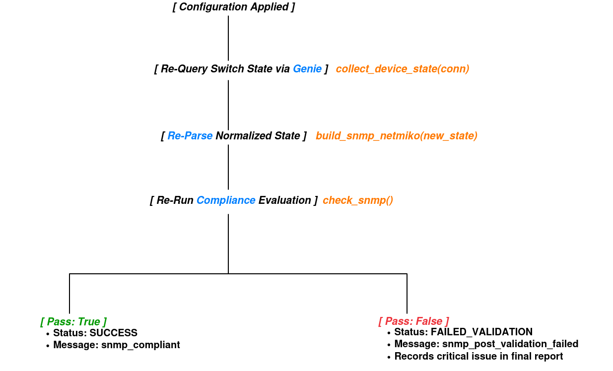

---

### Physical Device Verification: Before vs. After Execution

#### 1. Out-of-Band Syslog Execution Audit (`vty0`)
The switch console on `CORE-SW-1` confirms that incoming configuration changes were pushed over `vty0` by the automation service account (`sysadmin`), followed by the restart of logging host services:

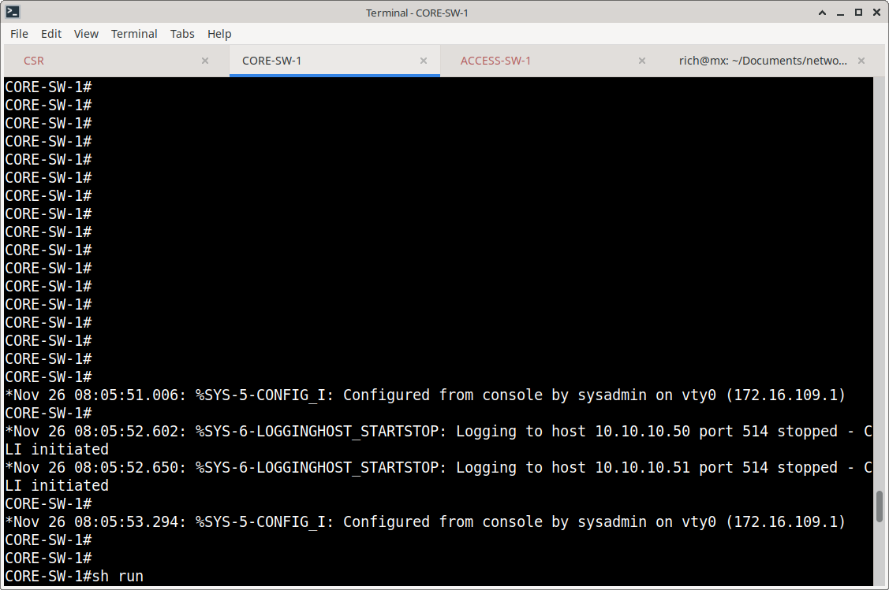

```text
*Nov 26 08:05:51.006: %SYS-5-CONFIG_I: Configured from console by sysadmin on vty0 (172.16.109.1)
*Nov 26 08:05:52.602: %SYS-6-LOGGINGHOST_STARTSTOP: Logging to host 10.10.10.50 port 514 stopped - CLI initiated
*Nov 26 08:05:52.650: %SYS-6-LOGGINGHOST_STARTSTOP: Logging to host 10.10.10.51 port 514 stopped - CLI initiated
*Nov 26 08:05:53.294: %SYS-5-CONFIG_I: Configured from console by sysadmin on vty0 (172.16.109.1)
```

---

#### 2. Device State: BEFORE Remediation (`CORE-SW-1`)
Prior to remediation, `CORE-SW-1` contained multiple unauthorized SNMP configurations:
* An unauthorized SNMPv3 group and rogue v3 host pointing to `8.8.8.8`.
* Rogue community strings `BUILD-TEST` and `build-test`.
* Incorrect contact (`build-test@yahoo.com`) and location (`build-test`):

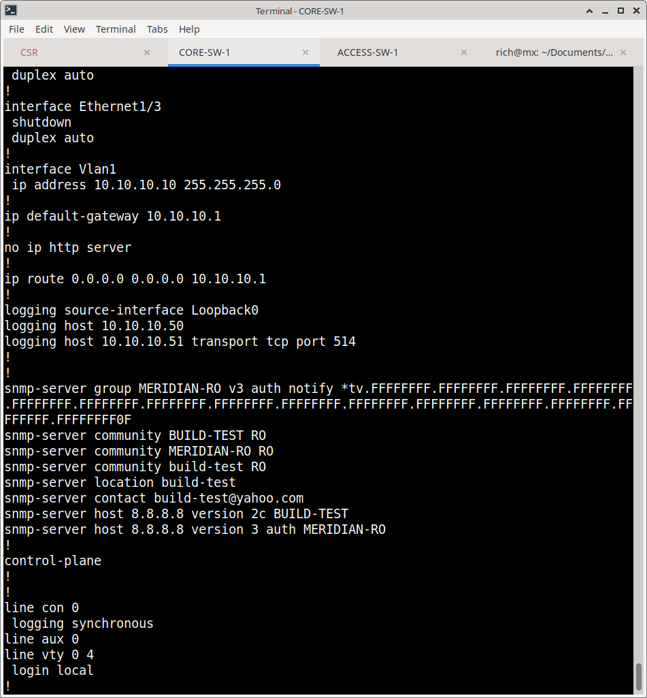

```cisco
! --- CORE-SW-1: Running Configuration BEFORE Remediation ---
snmp-server group MERIDIAN-RO v3 auth notify *tv.FFFFFFFF.FFFFFFFF.FFFFFFFF.FFFFFFFF.FFFFFFFF.FFFFFFFF.FFFFFFFF.FFFFFFFF.FFFFFFFF.FFFFFFFF.FFFFFFFF.FFFFFFFF.FFFFFFFF0F
snmp-server community BUILD-TEST RO
snmp-server community MERIDIAN-RO RO
snmp-server community build-test RO
snmp-server location build-test
snmp-server contact build-test@yahoo.com
snmp-server host 8.8.8.8 version 2c BUILD-TEST
snmp-server host 8.8.8.8 version 3 auth MERIDIAN-RO
```

---

#### 3. Device State: AFTER Automated Remediation (`CORE-SW-1`)
Following automated purge and template execution:
* All rogue communities (`BUILD-TEST`, `build-test`) and unauthorized hosts (`8.8.8.8`) were completely removed.
* Authorized communities `MERIDIAN-RO` (`ro`) and `MERIDIAN-RW` (`rw`) were configured.
* Correct trap receiver (`10.10.10.50`), location, contact, and trap flags were applied:

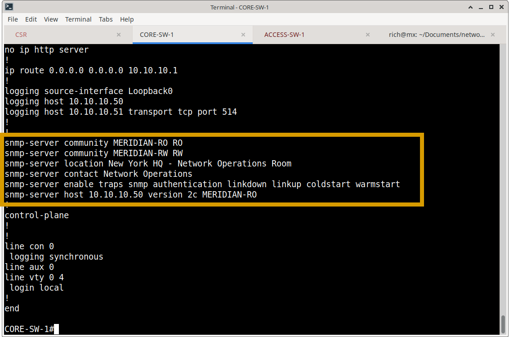

```cisco
! --- CORE-SW-1: Running Configuration AFTER Remediation ---
snmp-server community MERIDIAN-RO RO
snmp-server community MERIDIAN-RW RW
snmp-server location New York HQ - Network Operations Room
snmp-server contact Network Operations
snmp-server enable traps snmp authentication linkdown linkup coldstart warmstart
snmp-server host 10.10.10.50 version 2c MERIDIAN-RO
```

---

#### 4. Visual Configuration Diff

```diff
- snmp-server group MERIDIAN-RO v3 auth notify *tv.FFFFFFFF...
- snmp-server community BUILD-TEST RO
- snmp-server community build-test RO
- snmp-server location build-test
- snmp-server contact build-test@yahoo.com
- snmp-server host 8.8.8.8 version 2c BUILD-TEST
- snmp-server host 8.8.8.8 version 3 auth MERIDIAN-RO
+ snmp-server community MERIDIAN-RO RO
+ snmp-server community MERIDIAN-RW RW
+ snmp-server location New York HQ - Network Operations Room
+ snmp-server contact Network Operations
+ snmp-server enable traps snmp authentication linkdown linkup coldstart warmstart
+ snmp-server host 10.10.10.50 version 2c MERIDIAN-RO
```

> **Takeaway:**
> The active purge mechanism ensures true idempotency. Rather than simply appending authorized commands alongside existing drift, the engine actively strips all unauthorized communities and rogue hosts, leaving the switch in an exact mirror of the NetBox Source of Truth.

## 7. Audit Logging & Splunk Telemetry Pipeline (SNMP Services)

To guarantee that network monitoring, security access strings, and trap alerting parameters comply with enterprise governance, the SNMP module streams structured JSON telemetry directly to **Splunk via the HTTP Event Collector (HEC)** (`index="network_automation"`, `sourcetype="_json"`).

Every state transition maps directly to Cisco syslog severity levels (`cisco_sev`), providing immediate visibility into rogue community strings, missing trap hosts, or failed configuration remediations.

```spl
index="network_automation" sourcetype="_json" (protocol="snmp" OR event_type="snmp_config")
| table asctime cisco_sev event_type message status compliant detail
```

---

### Telemetry Lifecycle Matrix

The telemetry pipeline records five distinct operational events across `CORE-SW-1` (`10.10.10.10`) and `ACCESS-SW-1` (`10.10.10.20`):

| Lifecycle Phase | Event Type (`event_type`) | Splunk Message (`message`) | Cisco Severity | Status | Operational Significance |
| :--- | :--- | :--- | :---: | :---: | :--- |
| **1. Pre-Check Pass** | `snmp_compliance` | `snmp_compliant` | `6 (INFO)` | `SUCCESS` | Baseline matches NetBox intent; bypassed without device changes. |
| **2. Drift Detected** | `snmp_compliance` | `snmp_non_compliant` | `4 (WARN)` | `FAILED` | Missing community strings, disabled traps, or rogue hosts detected. |
| **3. Remediation Push** | `snmp_config` | `snmp_config` | `6 (INFO)` | `SUCCESS` | Purge executed and declarative SNMP template applied via Netmiko. |
| **4. Post-Validation Pass** | `snmp_compliance` | `snmp_post_validation_success` | `6 (INFO)` | `SUCCESS` | Re-queried live operational state confirms all SNMP parameters match NetBox. |
| **5. Exception Capture** | `snmp_config` | `snmp_config` | `6 (INFO)`* | `ERROR` | Catches Jinja2 nesting errors (`unknown tag 'endif'`) without crashing. |

> \* Indexed at INFO/`cisco_sev: 6` because the remediation handler's `except` block calls `log.info(...)` with `status: ERROR` rather than `log.error(...)` see Notes.

---

### Splunk Event Evidence & Payload Breakdown

#### 1. Baseline Compliant Pass (`snmp_compliant`)
When an access switch (such as `ACCESS-SW-1` / `10.10.10.20`) already matches NetBox specifications on initial scan, an informational pass is indexed with zero failures:

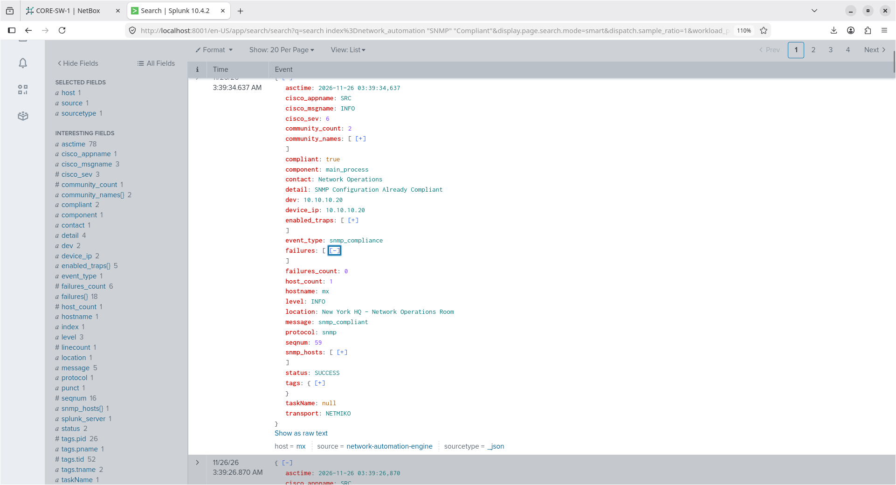

```json
{
  "asctime": "2026-11-26 03:39:34,637",
  "cisco_appname": "SRC",
  "cisco_msgname": "INFO",
  "cisco_sev": 6,
  "community_count": 2,
  "community_names": ["MERIDIAN-RO", "MERIDIAN-RW"],
  "compliant": true,
  "component": "main_process",
  "contact": "Network Operations",
  "detail": "SNMP Configuration Already Compliant",
  "dev": "10.10.10.20",
  "device_ip": "10.10.10.20",
  "enabled_traps": ["linkup", "linkdown", "coldstart", "warmstart", "authentication"],
  "event_type": "snmp_compliance",
  "failures": [],
  "failures_count": 0,
  "host_count": 1,
  "hostname": "mx",
  "level": "INFO",
  "location": "New York HQ - Network Operations Room",
  "message": "snmp_compliant",
  "protocol": "snmp",
  "seqnum": 59,
  "snmp_hosts": ["10.10.10.50"],
  "status": "SUCCESS",
  "taskName": null,
  "transport": "NETMIKO"
}
```

---

#### 2. Configuration Drift Alert (`snmp_non_compliant`)
When unauthorized settings are detected on `CORE-SW-1` (e.g., missing authorized community string and completely disabled traps), a `WARNING` (severity 4) alert is indexed with the detailed failure array:

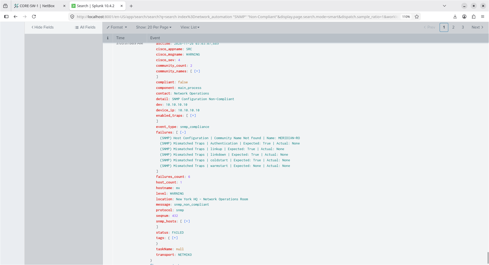

```json
{
  "asctime": "2026-11-26 03:03:07,689",
  "cisco_appname": "SRC",
  "cisco_msgname": "WARNING",
  "cisco_sev": 4,
  "community_count": 2,
  "community_names": ["MERIDIAN-RO", "MERIDIAN-RW"],
  "compliant": false,
  "component": "main_process",
  "contact": "Network Operations",
  "detail": "SNMP Configuration Non-Compliant",
  "dev": "10.10.10.10",
  "device_ip": "10.10.10.10",
  "enabled_traps": ["linkup", "linkdown", "coldstart", "warmstart", "authentication"],
  "event_type": "snmp_compliance",
  "failures": [
    "(SNMP) Host Configuration | Community Name Not Found | Name: MERIDIAN-RO",
    "(SNMP) Mismatched Traps | Authentication | Expected: True | Actual: None",
    "(SNMP) Mismatched Traps | linkup | Expected: True | Actual: None",
    "(SNMP) Mismatched Traps | linkdown | Expected: True | Actual: None",
    "(SNMP) Mismatched Traps | coldstart | Expected: True | Actual: None",
    "(SNMP) Mismatched Traps | warmstart | Expected: None | Actual: None"
  ],
  "failures_count": 6,
  "host_count": 1,
  "hostname": "mx",
  "level": "WARNING",
  "location": "New York HQ - Network Operations Room",
  "message": "snmp_non_compliant",
  "protocol": "snmp",
  "seqnum": 432,
  "snmp_hosts": ["10.10.10.50"],
  "status": "FAILED",
  "taskName": null,
  "transport": "NETMIKO"
}
```

---

#### 3. Targeted Remediation Applied (`snmp_config`)
Emitted immediately after Netmiko purges rogue commands and applies the rendered `snmp_netmiko.j2` configuration commands to enforce authorized communities and trap targets. Note this event originates from the **remediation handler** (`snmp_automation`), so its schema differs from the orchestrator events (no `protocol`, no `compliant`, `hosts`/`communities` are strings, `traps` is a dict):

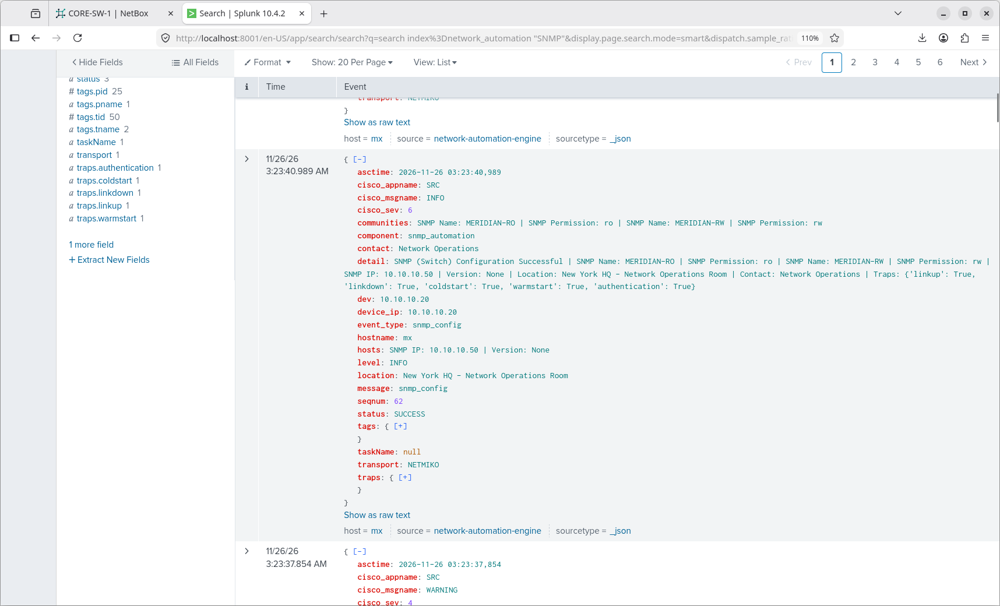

```json
{
  "asctime": "2026-11-26 03:23:40,989",
  "cisco_appname": "SRC",
  "cisco_msgname": "INFO",
  "cisco_sev": 6,
  "communities": "SNMP Name: MERIDIAN-RO | SNMP Permission: ro | SNMP Name: MERIDIAN-RW | SNMP Permission: rw",
  "component": "snmp_automation",
  "contact": "Network Operations",
  "detail": "SNMP (Switch) Configuration Successful | SNMP Name: MERIDIAN-RO | SNMP Permission: ro | SNMP Name: MERIDIAN-RW | SNMP Permission: rw | SNMP IP: 10.10.10.50 | Version: None | Location: New York HQ - Network Operations Room | Contact: Network Operations | Traps: {'linkup': True, 'linkdown': True, 'coldstart': True, 'warmstart': True, 'authentication': True}",
  "dev": "10.10.10.20",
  "device_ip": "10.10.10.20",
  "event_type": "snmp_config",
  "hostname": "mx",
  "hosts": "SNMP IP: 10.10.10.50 | Version: None",
  "level": "INFO",
  "location": "New York HQ - Network Operations Room",
  "message": "snmp_config",
  "seqnum": 62,
  "status": "SUCCESS",
  "taskName": null,
  "transport": "NETMIKO",
  "traps": {"linkup": true, "linkdown": true, "coldstart": true, "warmstart": true, "authentication": true}
}
```

---

#### 4. Closed-Loop Post-Validation Success (`snmp_post_validation_success`)
Following remediation, the engine re-queries the device state over SSH. When all communities, trap receivers, and MIB metadata match the NetBox Source of Truth, a post-validation confirmation is indexed:

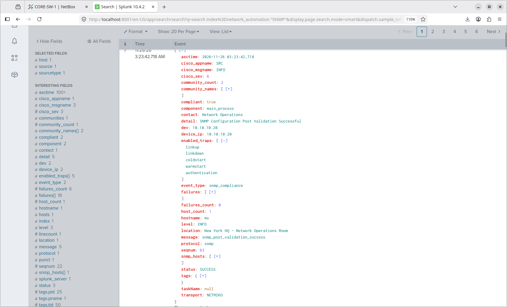

```json
{
  "asctime": "2026-11-26 03:23:42,718",
  "cisco_appname": "SRC",
  "cisco_msgname": "INFO",
  "cisco_sev": 6,
  "community_count": 2,
  "community_names": ["MERIDIAN-RO", "MERIDIAN-RW"],
  "compliant": true,
  "component": "main_process",
  "contact": "Network Operations",
  "detail": "SNMP Configuration Post Validation Successful",
  "dev": "10.10.10.20",
  "device_ip": "10.10.10.20",
  "enabled_traps": ["linkup", "linkdown", "coldstart", "warmstart", "authentication"],
  "event_type": "snmp_compliance",
  "failures": [],
  "failures_count": 0,
  "host_count": 1,
  "hostname": "mx",
  "level": "INFO",
  "location": "New York HQ - Network Operations Room",
  "message": "snmp_post_validation_success",
  "protocol": "snmp",
  "seqnum": 63,
  "snmp_hosts": ["10.10.10.50"],
  "status": "SUCCESS",
  "taskName": null,
  "transport": "NETMIKO"
}
```

---

#### 5. Exception & Template Fault Observability (`status: ERROR`)
If a template rendering error occurs (such as a nesting syntax mistake like `Encountered unknown tag 'endif'`), the engine's `try...except` boundary catches the error and streams it with full context. **Note the severity:** the event is indexed at `cisco_sev: 6` / `level: INFO` (not Severity 3) because the remediation handler's `except` block invokes `log.info(...)` with `status: ERROR` instead of `log.error(...)` see Notes:

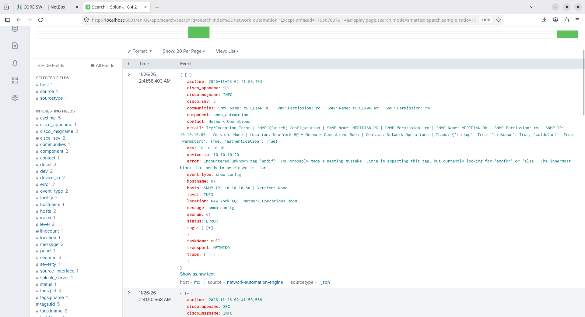

```json
{
  "asctime": "2026-11-26 02:41:58,403",
  "cisco_appname": "SRC",
  "cisco_msgname": "INFO",
  "cisco_sev": 6,
  "communities": "SNMP Name: MERIDIAN-RO | SNMP Permission: ro | SNMP Name: MERIDIAN-RW | SNMP Permission: rw",
  "component": "snmp_automation",
  "contact": "Network Operations",
  "detail": "Try/Exception Error | SNMP (Switch) Configuration | SNMP Name: MERIDIAN-RO | SNMP Permission: ro | SNMP Name: MERIDIAN-RW | SNMP Permission: rw | SNMP IP: 10.10.10.50 | Version: None | Location: New York HQ - Network Operations Room | Contact: Network Operations | Traps: {'linkup': True, 'linkdown': True, 'coldstart': True, 'warmstart': True, 'authentication': True} | Error: Encountered unknown tag 'endif'. You probably made a nesting mistake. Jinja is expecting this tag, but currently looking for 'endfor' or 'else'. The innermost block that needs to be closed is 'for'.",
  "dev": "10.10.10.20",
  "device_ip": "10.10.10.20",
  "error": "Encountered unknown tag 'endif'. You probably made a nesting mistake. Jinja is expecting this tag, but currently looking for 'endfor' or 'else'. The innermost block that needs to be closed is 'for'.",
  "event_type": "snmp_config",
  "hostname": "mx",
  "hosts": "SNMP IP: 10.10.10.50 | Version: None",
  "level": "INFO",
  "location": "New York HQ - Network Operations Room",
  "message": "snmp_config",
  "seqnum": 61,
  "status": "ERROR",
  "taskName": null,
  "transport": "NETMIKO",
  "traps": {"linkup": true, "linkdown": true, "coldstart": true, "warmstart": true, "authentication": true}
}
```

---

### Internal Execution Tracking

Throughout execution, the engine updates the device result context used to generate `final_compliance_report.json` and `network_compliance_report.txt`:

| Result Collection Field | Operational Purpose & Behavior |
| :--- | :--- |
| **`device_result["initial_issues"]`** | Catalogs all configuration drift detected during initial audit passes before remediation runs (used to calculate drift rates). |
| **`device_result["actions_taken"]`** | Records verified compliant configurations, executed remediations, and `[DRY_RUN]` change previews for audit compliance. |
| **`device_result["critical_issues"]`** | Populated exclusively when remediation commands fail over SSH or if post-validation fails after changes were pushed. |
| **`device_result["status"]`** | Reflects overall device health: `COMPLIANT`, `FAILED_CONFIG`, or `FAILED_VALIDATION`. |

## 8. Automated Unit Testing & CI/CD Validation (SNMP Services)

To guarantee that network monitoring, security access strings, and trap alerting parameters comply with enterprise standards without requiring live switch connectivity, the SNMP module includes a comprehensive **100% offline unit-testing suite** powered by **Pytest** and **unittest.mock**.

The test suite validates data parsing, boundary guards, and the complete closed-loop compliance state machine across both **NETCONF** and **NETMIKO**, executing all **21 test cases in just 1.40 seconds** (0.69s builder + 0.71s compliance).

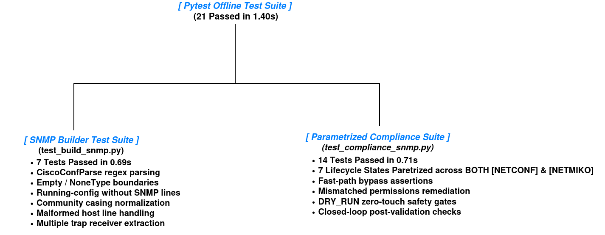

---

### Layer 1: SNMP Builder Tests (`test_build_snmp.py`)

This suite validates that `build_snmp_netmiko()` accurately parses running configurations using `CiscoConfParse`, extracting communities, permissions, MIB metadata, enabled traps, and trap receiver hosts:

#### Test Scenarios Covered (7 Tests):
1. **`test_build_snmp_valid`**: Evaluates real running configuration fixture data (`snmp_running_config`). Confirms both read-only (`network_ro`) and read-write (`network_rw`) communities are extracted, verifies MIB location (`NYC Data Center Rack 12`) and contact (`Network Team admin@example.com`), asserts SNMP trap flags are active, and extracts trap receiver host `192.168.100.50` (v2c).
2. **`test_build_snmp_empty`**: Boundary test confirming `build_snmp_netmiko({})`, `build_snmp_netmiko(None)`, and `build_snmp_netmiko({"not_run": None})` safely return `{}` without raising exceptions.
3. **`test_build_snmp_no_config`**: Ingests a running configuration containing only interface switchport lines without any `snmp-server` directives. Asserts that the builder returns clean empty collections (`communities == []`, `hosts == []`, `traps == {}`, `location == ""`, `contact == ""`).
4. **`test_build_snmp_lowercase`**: Validates that community names are normalized to lowercase strings for case-insensitive set diffing.
5. **`test_build_snmp_invalid_host`**: Tests malformed host configuration lines (missing required parameters), confirming the builder bypasses them safely.
6. **`test_build_snmp_multiple_hosts`**: Verifies that multiple trap receivers configured across different versions and communities are all extracted.
7. **`test_build_snmp_partial_config`**: Confirms that partial configurations (such as defined communities without location or contact strings) populate available fields while safely defaulting missing attributes.

#### Code Excerpt (`test_build_snmp.py`):

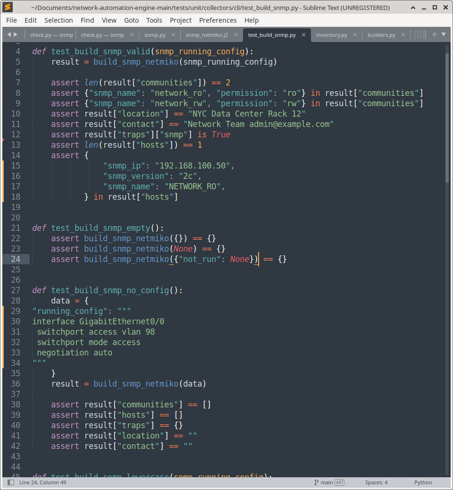

```python
def test_build_snmp_valid(snmp_running_config):
    result = build_snmp_netmiko(snmp_running_config)

    assert len(result["communities"]) == 2
    assert {"snmp_name": "network_ro", "permission": "ro"} in result["communities"]
    assert {"snmp_name": "network_rw", "permission": "rw"} in result["communities"]
    assert result["location"] == "NYC Data Center Rack 12"
    assert result["contact"] == "Network Team admin@example.com"
    assert result["traps"]["snmp"] is True
    assert len(result["hosts"]) == 1
    assert {
        "snmp_ip": "192.168.100.50",
        "snmp_version": "2c",
        "snmp_name": "NETWORK_RO",
    } in result["hosts"]

def test_build_snmp_empty():
    assert build_snmp_netmiko({}) == {}
    assert build_snmp_netmiko(None) == {}
    assert build_snmp_netmiko({"not_run": None}) == {}

def test_build_snmp_no_config():
    data = {
        "running_config": """
interface GigabitEthernet0/0
 switchport access vlan 98
 switchport mode access
 negotiation auto
"""
    }
    result = build_snmp_netmiko(data)

    assert result["communities"] == []
    assert result["hosts"] == []
    assert result["traps"] == {}
    assert result["location"] == ""
    assert result["contact"] == ""
```

#### Terminal Execution:

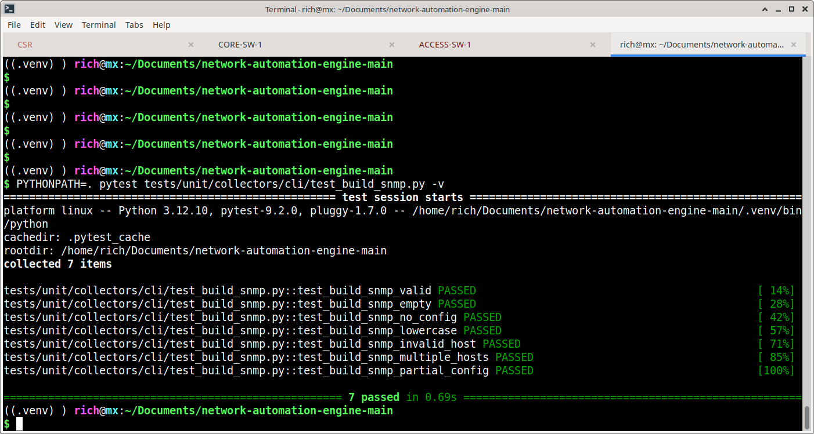

```bash
$ PYTHONPATH=. pytest tests/unit/collectors/cli/test_build_snmp.py -v
============================= test session starts ==============================
platform linux -- Python 3.12.10, pytest-9.2.0, pluggy-1.7.0 -- /home/rich/Documents/network-automation-engine-main/.venv/bin/python
cachedir: .pytest_cache
rootdir: /home/rich/Documents/network-automation-engine-main
collected 7 items

tests/unit/collectors/cli/test_build_snmp.py::test_build_snmp_valid PASSED            [ 14%]
tests/unit/collectors/cli/test_build_snmp.py::test_build_snmp_empty PASSED            [ 28%]
tests/unit/collectors/cli/test_build_snmp.py::test_build_snmp_no_config PASSED        [ 42%]
tests/unit/collectors/cli/test_build_snmp.py::test_build_snmp_lowercase PASSED        [ 57%]
tests/unit/collectors/cli/test_build_snmp.py::test_build_snmp_invalid_host PASSED     [ 71%]
tests/unit/collectors/cli/test_build_snmp.py::test_build_snmp_multiple_hosts PASSED   [ 85%]
tests/unit/collectors/cli/test_build_snmp.py::test_build_snmp_partial_config PASSED   [100%]

============================== 7 passed in 0.69s ===============================
```

---

### Layer 2: Parametrized Multi-Transport Compliance Tests (`test_compliance_snmp.py`)

Using `@pytest.mark.parametrize("transport", TRANSPORT)`, every single compliance state machine scenario is executed against **both NETCONF and NETMIKO**. The helper `patch_transports(transport)` dynamically redirects patch targets to validate protocol parity:

#### Test Scenarios Covered (14 Tests):
* **`test_compliance_snmp_already_compliant[NETCONF & NETMIKO]`**: Confirms that when a device matches NetBox specifications, `mock_log.info` is called once, `mock_log.warning` is not called, and `initial_issues` remains empty.
* **`test_compliance_snmp_non_compliant_config_successful[NETCONF & NETMIKO]`**: Simulates community permission drift (`(SNMP) Mismatched Community Permission`), verifies remediation executes, and status resolves to `OperationalStatus.SUCCESS`.
* **`test_compliance_snmp_non_compliant_config_failed[NETCONF & NETMIKO]`**: Simulates command or RPC rejection, verifying the failure is captured in `critical_issues` and device status is flagged as `FAILED_CONFIG`.
* **`test_compliance_snmp_dry_run[NETCONF & NETMIKO]`**: Verifies that when `DRY_RUN = True`, drift is recorded, but neither NETCONF RPCs nor Netmiko CLI commands are sent to physical hardware.
* **`test_compliance_snmp_post_validation_successful[NETCONF & NETMIKO]`**: Tests the full closed-loop cycle: initial check fails → remediation executes → re-collected operational state passes post-validation.
* **`test_compliance_snmp_post_validation_failed[NETCONF & NETMIKO]`**: Tests failure handling when an unauthorized host or community persists after remediation, setting status to `FAILED_VALIDATION`.
* **`test_compliance_snmp_empty[NETCONF & NETMIKO]`**: Verifies that an empty NetBox context completes gracefully with zero actions and zero errors.

#### Code Excerpt (`test_compliance_snmp.py`):

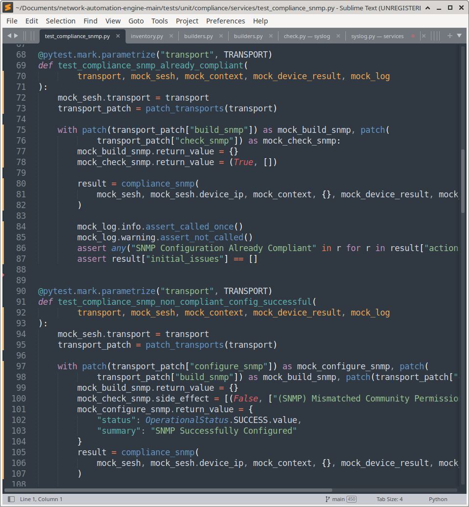

```python
@pytest.mark.parametrize("transport", TRANSPORT)
def test_compliance_snmp_already_compliant(
    transport, mock_sesh, mock_context, mock_device_result, mock_log
):
    mock_sesh.transport = transport
    transport_patch = patch_transports(transport)

    with patch(transport_patch["build_snmp"]) as mock_build_snmp, patch(
        transport_patch["check_snmp"]
    ) as mock_check_snmp:
        mock_build_snmp.return_value = {}
        mock_check_snmp.return_value = (True, [])

        result = compliance_snmp(
            mock_sesh, mock_sesh.device_ip, mock_context, {}, mock_device_result, mock_log, transport
        )

        mock_log.info.assert_called_once()
        mock_log.warning.assert_not_called()
        assert any("SNMP Configuration Already Compliant" in r for r in result["actions_taken"])
        assert result["initial_issues"] == []

@pytest.mark.parametrize("transport", TRANSPORT)
def test_compliance_snmp_non_compliant_config_successful(
    transport, mock_sesh, mock_context, mock_device_result, mock_log
):
    mock_sesh.transport = transport
    transport_patch = patch_transports(transport)

    with patch(transport_patch["configure_snmp"]) as mock_configure_snmp, patch(
        transport_patch["build_snmp"]
    ) as mock_build_snmp, patch(transport_patch["check_snmp"]) as mock_check_snmp:
        mock_build_snmp.return_value = {}
        mock_check_snmp.side_effect = [(False, ["(SNMP) Mismatched Community Permission"]), (True, [])]
        mock_configure_snmp.return_value = {
            "status": OperationalStatus.SUCCESS.value,
            "summary": "SNMP Successfully Configured"
        }
        result = compliance_snmp(
            mock_sesh, mock_sesh.device_ip, mock_context, {}, mock_device_result, mock_log, transport
        )
```

#### Terminal Execution:

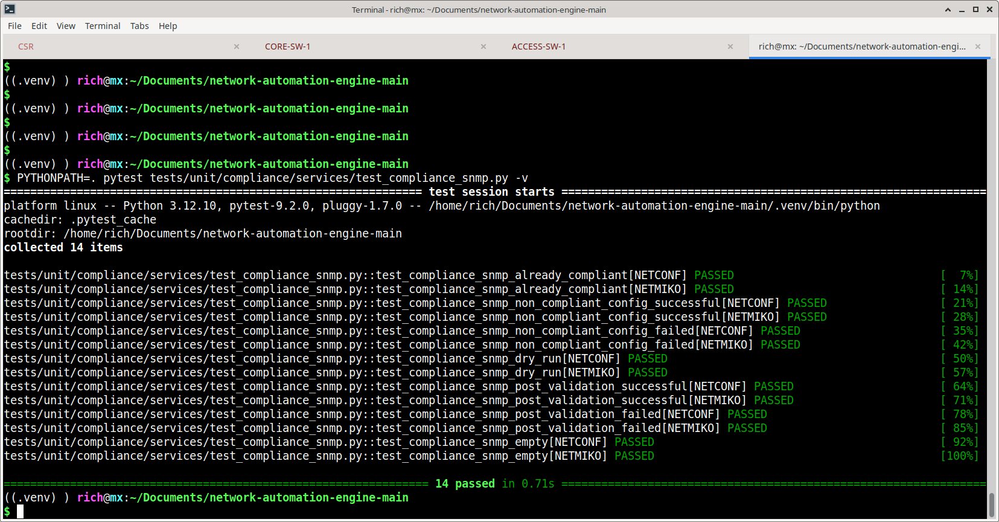

```bash
$ PYTHONPATH=. pytest tests/unit/compliance/services/test_compliance_snmp.py -v
============================= test session starts ==============================
platform linux -- Python 3.12.10, pytest-9.2.0, pluggy-1.7.0 -- /home/rich/Documents/network-automation-engine-main/.venv/bin/python
cachedir: .pytest_cache
rootdir: /home/rich/Documents/network-automation-engine-main
collected 14 items

tests/unit/compliance/services/test_compliance_snmp.py::test_compliance_snmp_already_compliant[NETCONF] PASSED                 [  7%]
tests/unit/compliance/services/test_compliance_snmp.py::test_compliance_snmp_already_compliant[NETMIKO] PASSED                 [ 14%]
tests/unit/compliance/services/test_compliance_snmp.py::test_compliance_snmp_non_compliant_config_successful[NETCONF] PASSED   [ 21%]
tests/unit/compliance/services/test_compliance_snmp.py::test_compliance_snmp_non_compliant_config_successful[NETMIKO] PASSED   [ 28%]
tests/unit/compliance/services/test_compliance_snmp.py::test_compliance_snmp_non_compliant_config_failed[NETCONF] PASSED       [ 35%]
tests/unit/compliance/services/test_compliance_snmp.py::test_compliance_snmp_non_compliant_config_failed[NETMIKO] PASSED       [ 42%]
tests/unit/compliance/services/test_compliance_snmp.py::test_compliance_snmp_dry_run[NETCONF] PASSED                          [ 50%]
tests/unit/compliance/services/test_compliance_snmp.py::test_compliance_snmp_dry_run[NETMIKO] PASSED                          [ 57%]
tests/unit/compliance/services/test_compliance_snmp.py::test_compliance_snmp_post_validation_successful[NETCONF] PASSED        [ 64%]
tests/unit/compliance/services/test_compliance_snmp.py::test_compliance_snmp_post_validation_successful[NETMIKO] PASSED        [ 71%]
tests/unit/compliance/services/test_compliance_snmp.py::test_compliance_snmp_post_validation_failed[NETCONF] PASSED            [ 78%]
tests/unit/compliance/services/test_compliance_snmp.py::test_compliance_snmp_post_validation_failed[NETMIKO] PASSED            [ 85%]
tests/unit/compliance/services/test_compliance_snmp.py::test_compliance_snmp_empty[NETCONF] PASSED                            [ 92%]
tests/unit/compliance/services/test_compliance_snmp.py::test_compliance_snmp_empty[NETMIKO] PASSED                            [100%]

============================== 14 passed in 0.71s ===============================
```
### Continuous Integration Ready

The test framework is designed for CI/CD pipeline integration:

```yaml
# .github/workflows/test.yml (GitHub Actions Example)
name: Run Unit Tests

on: [push, pull_request]

jobs:
  test:
    runs-on: ubuntu-latest
    steps:
      - uses: actions/checkout@v3
      - name: Set up Python
        uses: actions/setup-python@v4
        with:
          python-version: '3.12'
      - name: Install dependencies
        run: pip install -r requirements.txt
      - name: Run tests with coverage                            <--------- Pytests 
        run: pytest tests/unit/ --cov=src --cov-report=xml
      - name: Upload coverage to Codecov
        uses: codecov/codecov-action@v3
```

---

### Test Suite Execution Summary

| Test Suite | File Path | Scope & Boundary Scenarios Covered | Status | Execution Time |
| :--- | :--- | :--- | :---: | :---: |
| **SNMP Builder Tests** | `tests/unit/collectors/cli/test_build_snmp.py` | Operational `CiscoConfParse` parsing, empty/NoneType boundaries, non-SNMP configs, multiple hosts | **PASSED (7/7)** | 0.69s |
| **Parametrized Compliance Tests** | `tests/unit/compliance/services/test_compliance_snmp.py` | Full closed-loop state machine validated across **both NETCONF & NETMIKO** transports | **PASSED (14/14)** | 0.71s |
| **Total** | | **Comprehensive Dual-Transport SNMP Test Coverage** | **21 / 21** | **1.40s** |

---

## Conclusion & Engineering Takeaways

This module demonstrates that SNMP infrastructure assurance is not just about running a `show run | include snmp-server` and eyeballing the output. By decoupling data collection, normalization, decisioning, and remediation, this engine transforms SNMP hygiene from a manual, error-prone chore into a **deterministic, observable, and reversible software pipeline**.

Key architectural wins validated in this project include:
1. **Two-Phase Active Purge:** Unlike simple automation that only appends configuration, this engine actively purges all existing `snmp-server` lines (reversed for safe deletion order) before applying the authorized baseline, ensuring true idempotency and preventing orphaned communities or rogue trap destinations.
2. **Set-Based Host Diffing:** By converting trap host arrays into order-independent tuples `(snmp_name, snmp_ip, snmp_version)`, the engine accurately detects added, removed, or modified collectors regardless of the order they appear in the running configuration.
3. **Case-Insensitive Community Matching:** The builder lowercases community names in the communities loop, and the diff engine normalizes both sides to lowercase, preventing false-positive drift on case variations (e.g., `MERIDIAN-RO` vs `meridian-ro`).
4. **Multi-Transport Parity:** The parametrized test suite and dynamic routing prove that the compliance logic remains identical whether pushing via NETCONF YANG models or Netmiko CLI, future-proofing the architecture for heterogeneous environments.
5. **Resilient Exception Handling:** A broken Jinja2 template (such as the stray `endif` nesting error) doesn't crash the pipeline. The `try/except` boundary catches the error, streams it to Splunk as an `ERROR` event for immediate triage, and allows the audit of remaining devices to continue uninterrupted.

### Next Steps & Future Enhancements
To further evolve this automation engine, the following enhancements are planned:
- **SNMPv3 Support:** Extend the compliance engine to validate SNMPv3 user-based security models (USM) with authentication and privacy protocols, replacing cleartext community strings.
- **CI/CD Pipeline Integration:** Embed the existing 21-case Pytest suite into GitHub Actions to automatically block Pull Requests that introduce regressions to the compliance logic or Jinja2 templates.

---

### Return to Main Repository

This module is part of a broader Network Automation Engine portfolio.

**Explore other modules:**
- [Syslog Compliance & Remediation](../syslog-compliance/)
- [Spanning Tree Protocol (STP) Compliance](../stp-compliance/)
- [Interface Compliance & Remediation](../interface-compliance/)
- [Trunk Port Compliance & Remediation](../trunk-ports/)
- [Access Port Compliance & Remediation](../access-ports/)
- [F5 BIG-IP LTM Cloud Load Balancing](../f5-big-ip-ltm-lab/)

**[Return to Main Repository README](../README.md)**
