# Spanning Tree Protocol (STP) Compliance & Remediation

## Executive Overview

In enterprise campus networks, Spanning Tree Protocol (STP) cannot be left to default, unmanaged configurations. Uncontrolled root bridge elections cause suboptimal traffic paths and blackholes, while unprotected access switchports expose the network to broadcast storms, bridging loops, and rogue switch injections.

The **STP Compliance & Remediation** module is a production-grade, closed-loop automation engine designed to eliminate these Layer 2 risks. It enforces deterministic spanning-tree stability by reconciling live Cisco switch state against a **two-tier NetBox Source of Truth (SoT)**:

1. **Global STP Mode & Root Bridge Hierarchy:** Modeled declaratively per switch using **NetBox Config Contexts**.
2. **Interface Edge Protection & Loop Prevention:** Modeled per port using **NetBox Interface Custom Fields**.

Rather than relying on brittle screen-scraping or manual CLI audits, this pipeline provides end-to-end lifecycle management. It extracts structured operational data via Cisco pyATS/Genie (for global priorities) and `CiscoConfParse` (for per-port edge guards), identifies exact configuration mismatches, safely remediates drift using idempotent Jinja2 templates, and verifies the fix before logging the outcome to a centralized SIEM.

### Core Engineering Objectives
- **Declarative Baseline:** Establish NetBox as the single source of truth for global STP modes, per-VLAN bridge priorities, and port-level edge security (PortFast, BPDU Guard, Loop Guard, Root Guard).
- **Dual-Source Data Extraction:** Utilize Genie for operational bridge priority truth and `CiscoConfParse` for hierarchical running-config parsing, ensuring 100% accurate state representation.
- **Deterministic Diffing:** Compare live operational state against NetBox intent using strict, type-coerced string/set evaluations that catch missing VLANs, priority hijacks, and unauthorized guards.
- **Safe, Idempotent Remediation:** Apply configuration changes using targeted Jinja2 templates, gated by a global `DRY_RUN` safety switch for Change Advisory Board (CAB) review.
- **Closed-Loop Verification:** Re-poll the device post-remediation to guarantee the physical data plane matches the intended state before marking the task complete.
- **Enterprise Observability:** Stream structured, severity-coded JSON telemetry to Splunk for real-time NOC/SecOps dashboards and immutable audit trails.
- **CI/CD Readiness:** Validate the entire state machine with 23 offline Pytest cases, ensuring zero-regression deployments without requiring live hardware.

---

## Architecture

The STP Compliance module follows the project's Source of Truth-driven architecture, decoupling data collection, normalization, decisioning, and remediation:

| Component | Responsibility |
|---|---|
| **NetBox Inventory** | Supplies expected global STP modes, VLAN priorities, and interface-level STP custom fields. |
| **Dual Collector** | Queries `show spanning-tree` (Genie) and `show run` (raw text) over Netmiko with isolated fault tolerance. |
| **STP Builders** | `build_stp_global()` normalizes Genie dicts; `build_stp_interfaces()` parses CiscoConfParse child blocks. |
| **Compliance Checker** | Compares expected NetBox intent against actual live state, flagging mode, priority, or guard mismatches. |
| **Remediation Engine** | Applies targeted `spanning-tree` configuration changes via Jinja2 templates. |
| **Post-Validation** | Re-queries and re-evaluates the device to verify that remediation achieved the expected configuration. |

### Table of Contents

- [1. Intended State: NetBox Source of Truth (Global STP & Interface Edge Security)](#1-intended-state-netbox-source-of-truth-global-stp--interface-edge-security)
- [2. Live Device State Collection & STP Parsing](#2-live-device-state-collection--stp-parsing)
- [3. Spanning Tree Compliance Diff Engine & Drift Detection](#3-spanning-tree-compliance-diff-engine--drift-detection)
- [4. Interface STP Compliance](#4-interface-stp-compliance)
- [5. Configuration Remediation](#5-configuration-remediation)
- [6. Safe Change Management: Dry-Run Mode](#6-safe-change-management-dry-run-mode)
- [7. Post-Remediation Validation & Physical Device Proof](#7-post-remediation-validation--physical-device-proof)
- [8. Audit Logging & Splunk Telemetry Pipeline (STP)](#8-audit-logging--splunk-telemetry-pipeline-stp)
- [9. Execution Results & Internal State Collections](#9-execution-results--internal-state-collections)
- [10. Automated Unit Testing & CI/CD Validation (STP)](#10-automated-unit-testing--cicd-validation-stp)

## Topology 

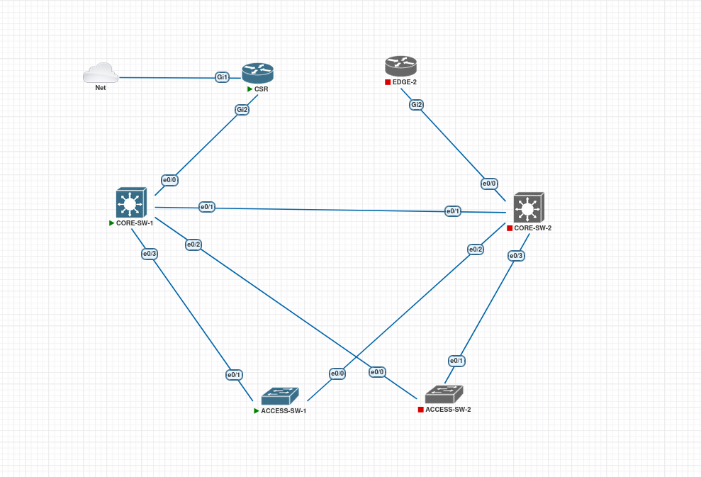

## 1. Intended State: NetBox Source of Truth (Global STP & Interface Edge Security)

In enterprise campus switching, Spanning Tree Protocol (STP) cannot be left to default unmanaged configurations. Uncontrolled root bridge elections cause suboptimal traffic paths, while unprotected access switchports expose the network to broadcast storms, bridging loops, and rogue switch injections.

To establish deterministic Layer 2 stability, the automation engine establishes **NetBox DCIM** as the authoritative Source of Truth (SoT) across a **two‑tier declarative model**:

1. **Global STP Mode & Root Bridge Hierarchy:** Modeled declaratively per switch using **NetBox Config Contexts** (`dcim/devices/<id>/config-context/`).
2. **Interface Edge Protection & Loop Prevention:** Modeled per port using **NetBox Interface Custom Fields** (`DCIM > Interface`).

---

### 1. Global STP Topology & Root Bridge Modeling (Config Context)

Global spanning‑tree parameters are defined in NetBox as structured JSON under each device's **Config Context**. This establishes the active protocol mode (`rapid-pvst`) and enforces deterministic primary/secondary Root Bridge election per VLAN.

#### A. Distribution Root Bridge Baseline: `CORE-SW-1` (`10.10.10.10`)
To implement deterministic root placement and Layer 2 traffic load‑balancing across VLANs, `CORE-SW-1` is engineered with alternating bridge priorities (`24576` for odd/data VLANs, `28672` for voice/management VLANs):

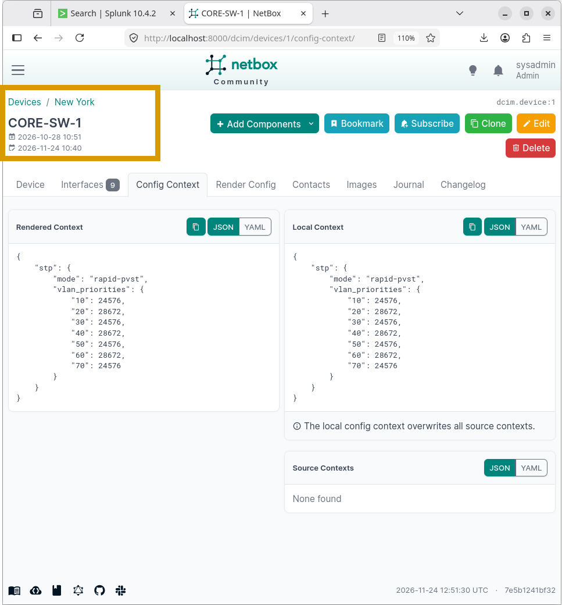

```json
{
  "stp": {
    "mode": "rapid-pvst",
    "vlan_priorities": {
      "10": 24576,
      "20": 28672,
      "30": 24576,
      "40": 28672,
      "50": 24576,
      "60": 28672,
      "70": 24576
    }
  }
}
```

> NetBox renders this from the device's **Local Context** panel (`The local config context overwrites all source contexts.`; `Source Contexts: None found`), confirming the priority map is authored directly on `CORE-SW-1`.

#### B. Access Switch Baseline: `ACCESS-SW-1` (`10.10.10.20`)
Access switches must never participate in root bridge elections. `ACCESS-SW-1` is pinned to the IEEE default priority (`32768`) across all active VLANs:

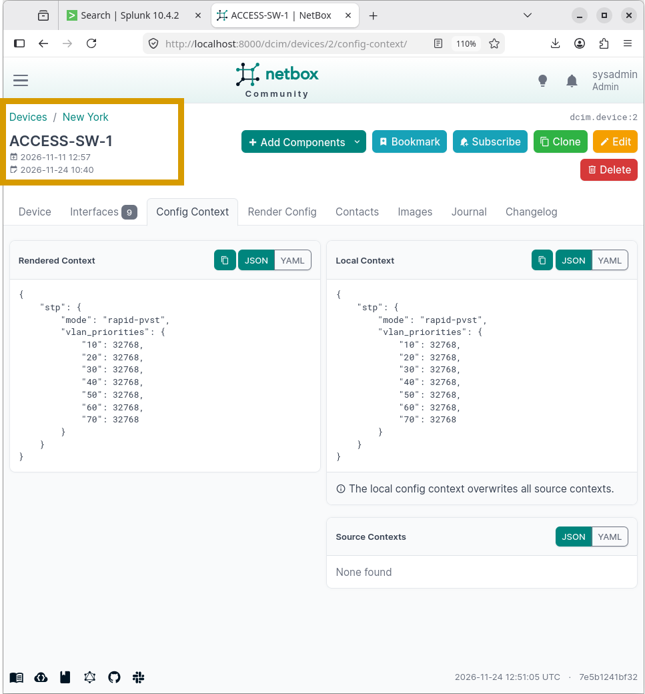

```json
{
  "stp": {
    "mode": "rapid-pvst",
    "vlan_priorities": {
      "10": 32768,
      "20": 32768,
      "30": 32768,
      "40": 32768,
      "50": 32768,
      "60": 32768,
      "70": 32768
    }
  }
}
```

---

### 2. Interface Edge Protection Modeling (NetBox Custom Fields)

To protect the Layer 2 topology from rogue bridge injection and unidirectional link failures, edge access ports and trunk uplinks enforce role‑based STP safeguards defined in NetBox **Custom Fields** (`DCIM > Interface`):

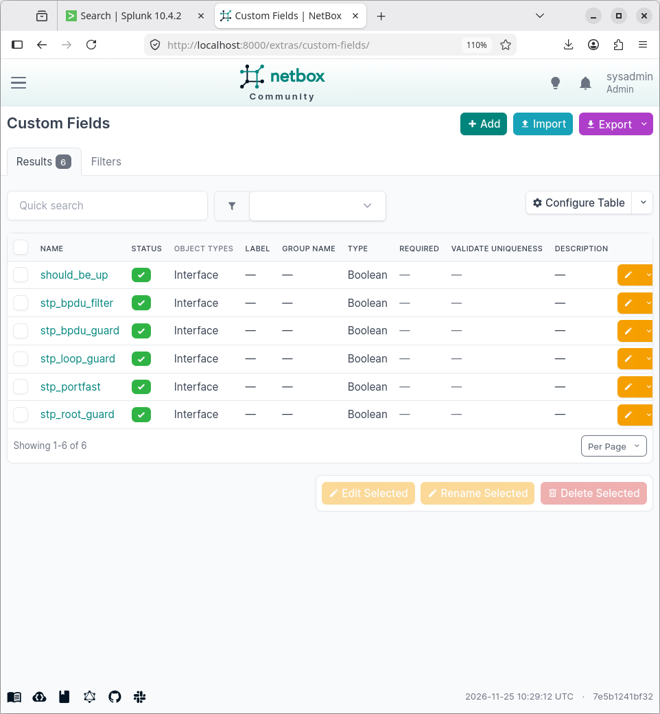

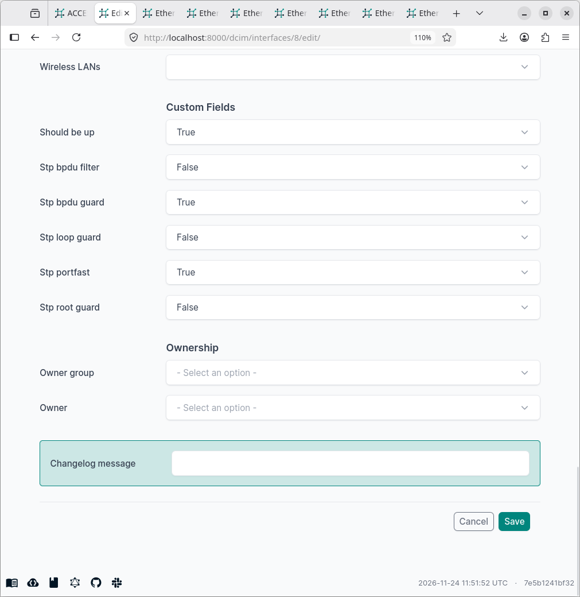

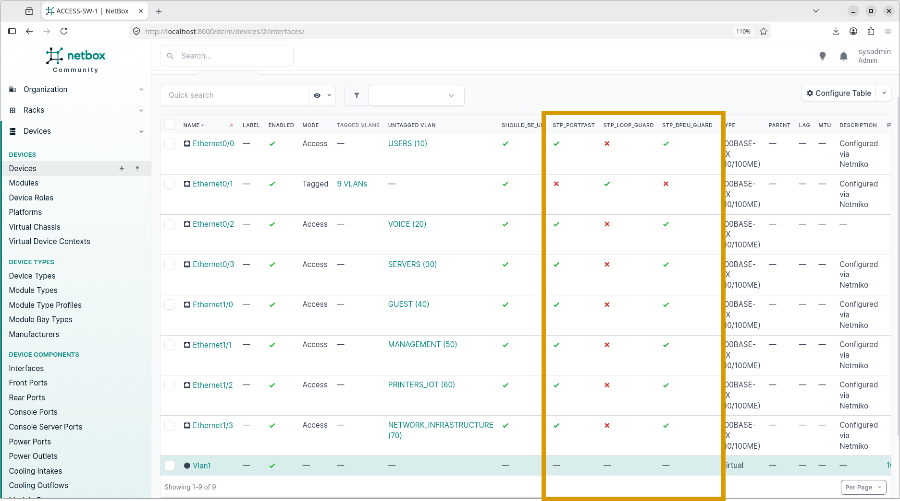

#### Interface Hardening Baseline: `ACCESS-SW-1`

| Interface | 802.1Q Mode | Role | `stp_portfast` | `stp_bpdu_guard` | `stp_loop_guard` | Operational Policy |
| :--- | :---: | :--- | :---: | :---: | :---: | :--- |
| **Ethernet0/0** | `Access` | End‑User Access | **`True`** | **`True`** | **`False`** | Edge port: Immediate forwarding + rogue switch shutoff |
| **Ethernet0/1** | `Tagged` | Distribution Uplink | **`False`** | **`False`** | **`True`** | Trunk port: Protects against unidirectional link loops |
| **Ethernet0/2** | `Access` | Voice (VoIP) | **`True`** | **`True`** | **`False`** | Edge port: Immediate forwarding + rogue switch shutoff |
| **Ethernet0/3** | `Access` | Local Server | **`True`** | **`True`** | **`False`** | Edge port: Immediate forwarding + rogue switch shutoff |
| **Ethernet1/0–1/3** | `Access` | Workstation / IoT | **`True`** | **`True`** | **`False`** | Edge port: Immediate forwarding + rogue switch shutoff |

> **Security Guardrail:** Access switchports strictly enforce **PortFast + BPDU Guard** to prevent unauthorized rogue switches from injecting superior BPDUs. Trunk uplinks strictly enforce **Loop Guard** to prevent loops caused by unidirectional link failures.

---

### 3. Inventory Ingestion Engine (`src/sot/inventory.py`)

During inventory collection, the engine extracts both global device contexts and interface‑level STP parameters into structured dictionaries:

**STP Interface Configuration Code**

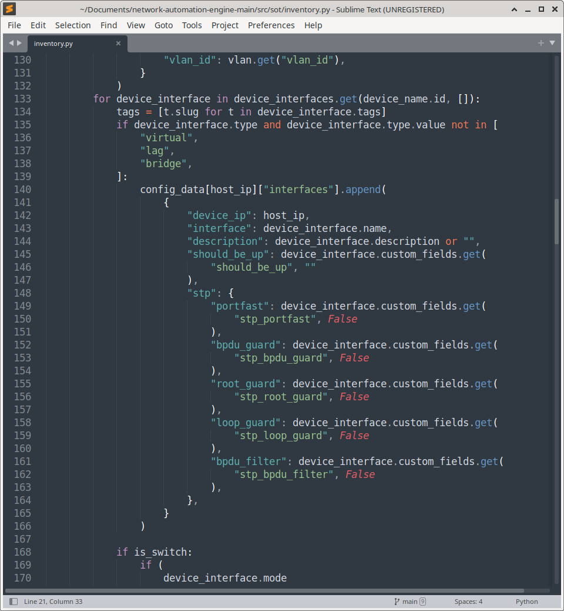

**STP Global Configuration Code**

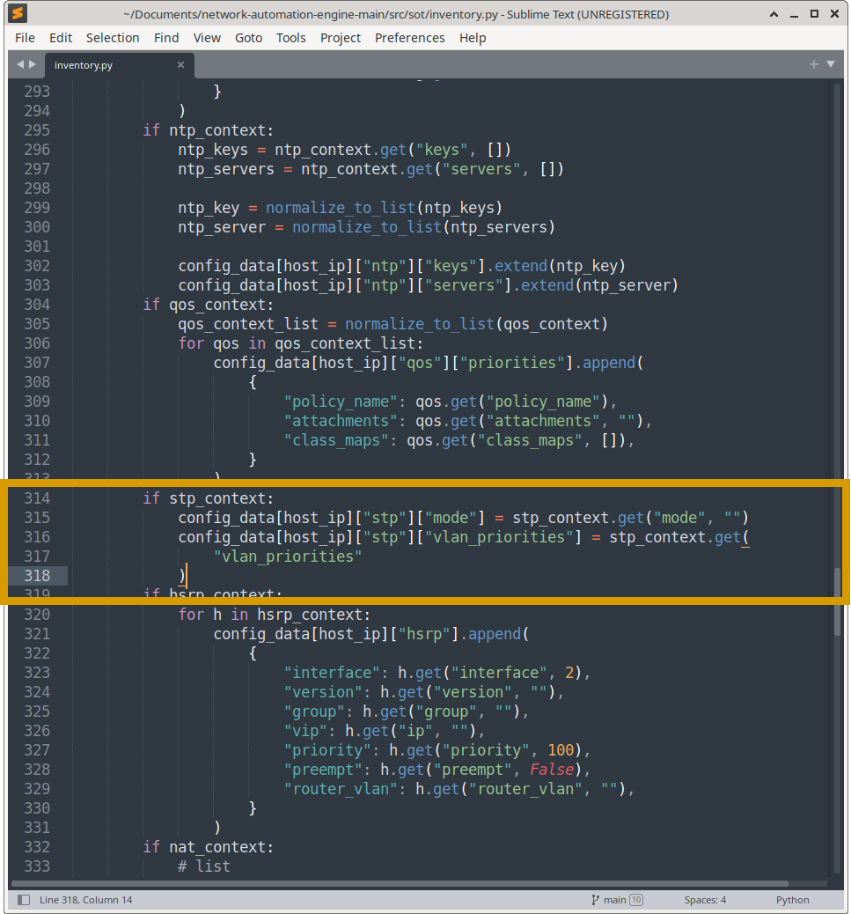

```python
# src/sot/inventory.py (STP Global & Interface Ingestion)

# 1. Ingest Global STP Context (Mode & VLAN Priorities)
if stp_context:
    config_data[host_ip]["stp"]["mode"] = stp_context.get("mode", "")
    config_data[host_ip]["stp"]["vlan_priorities"] = stp_context.get(
        "vlan_priorities"
    )

# 2. Ingest Interface-Level STP Security Custom Fields
for device_interface in device_interfaces.get(device_name.id, []):
    tags = [t.slug for t in device_interface.tags]
    if device_interface.type and device_interface.type.value not in [
        "virtual",
        "lag",
        "bridge",
    ]:
        config_data[host_ip]["interfaces"].append(
            {
                "device_ip": host_ip,
                "interface": device_interface.name,
                "description": device_interface.description or "",
                "should_be_up": device_interface.custom_fields.get(
                    "should_be_up", ""
                ),
                "stp": {
                    "portfast": device_interface.custom_fields.get(
                        "stp_portfast", False
                    ),
                    "bpdu_guard": device_interface.custom_fields.get(
                        "stp_bpdu_guard", False
                    ),
                    "root_guard": device_interface.custom_fields.get(
                        "stp_root_guard", False
                    ),
                    "loop_guard": device_interface.custom_fields.get(
                        "stp_loop_guard", False
                    ),
                    "bpdu_filter": device_interface.custom_fields.get(
                        "stp_bpdu_filter", False
                    ),
                },
            }
        )
```

---

### 4. Normalized Desired‑State Output

At runtime, the inventory engine compiles the global STP priorities and interface security baselines into normalized data contracts:

#### A. Global STP Context Runtime Output (`CORE-SW-1` vs. `ACCESS-SW-1`)

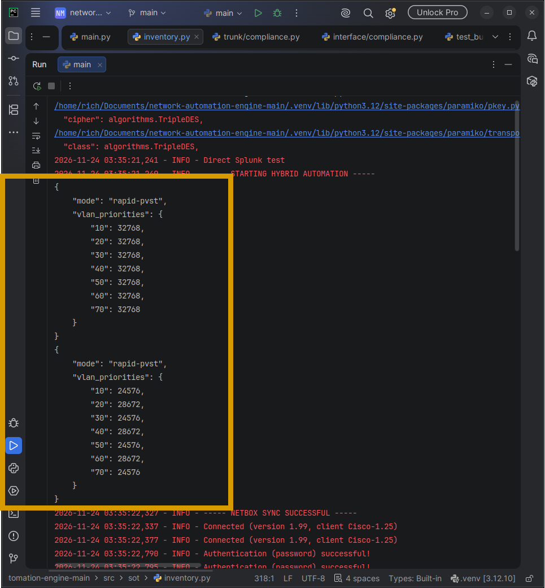

```json
{
  "10.10.10.20": {
    "mode": "rapid-pvst",
    "vlan_priorities": {
      "10": 32768,
      "20": 32768,
      "30": 32768,
      "40": 32768,
      "50": 32768,
      "60": 32768,
      "70": 32768
    }
  },
  "10.10.10.10": {
    "mode": "rapid-pvst",
    "vlan_priorities": {
      "10": 24576,
      "20": 28672,
      "30": 24576,
      "40": 28672,
      "50": 24576,
      "60": 28672,
      "70": 24576
    }
  }
}
```

#### B. Interface STP Security Runtime Output (`ACCESS-SW-1`)

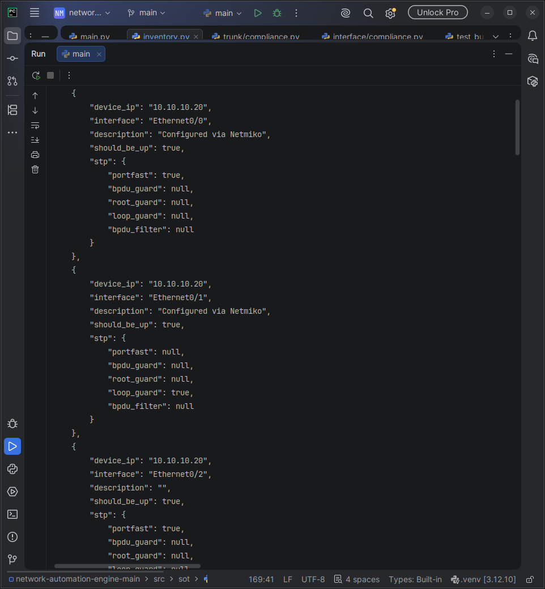

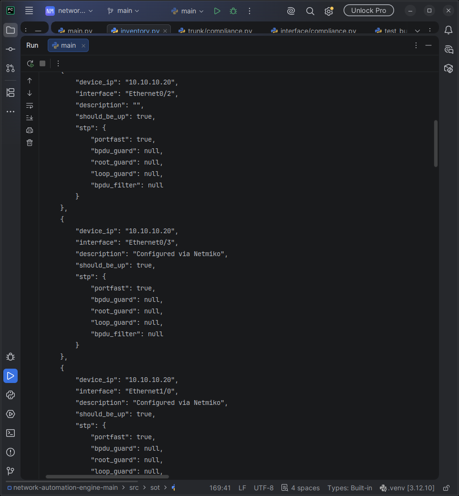

```json
[
  {
    "device_ip": "10.10.10.20",
    "interface": "Ethernet0/1",
    "description": "Configured via Netmiko",
    "should_be_up": true,
    "stp": {
      "portfast": false,
      "bpdu_guard": false,
      "root_guard": false,
      "loop_guard": true,
      "bpdu_filter": false
    }
  },
  {
    "device_ip": "10.10.10.20",
    "interface": "Ethernet0/0",
    "description": "Configured via Netmiko",
    "should_be_up": true,
    "stp": {
      "portfast": true,
      "bpdu_guard": true,
      "root_guard": false,
      "loop_guard": false,
      "bpdu_filter": false
    }
  }
]
```

> **Design Principle:**
> By separating STP into **Global Mode/Priority** and **Interface‑Level Guards**, the compliance engine can independently audit root bridge elections (via `check_stp_global()`) and port‑level edge security (via `check_stp_interface()`), preventing spanning‑tree topology anomalies and unauthorized root takeover across the entire switching fabric.

## 2. Live Device State Collection & STP Parsing

To audit both the global spanning‑tree topology and per‑port edge security without brittle regular expressions, the engine employs a **dual‑collector architecture**: it pairs **Cisco pyATS/Genie** (for operational bridge priorities and mode detection) with **CiscoConfParse** (for hierarchical running‑config parsing of per‑port edge guards). Data acquisition is separated from schema normalization in a decoupled pipeline:

1. **Collector (`src/collectors/cli/collector.py`):** Queries `show spanning-tree` with `use_genie=True` for the operational STP dictionary, and `show run` as raw text for the running‑config baseline.
2. **Global Builder (`src/collectors/cli/builders.py` → `build_stp_global()`):** Ingests the Genie STP dictionary, detects the operating mode, and normalizes per‑VLAN bridge priorities.
3. **Interface Builder (`src/collectors/cli/builders.py` → `build_stp_interfaces()`):** Parses the running config with CiscoConfParse, walks each `interface` block's children, and resolves the five edge‑protection flags.

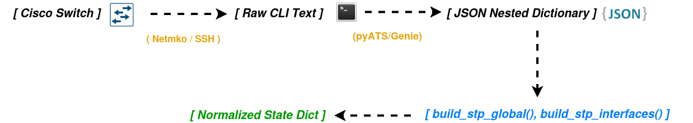
---

### Stage 1: Dual‑Source CLI Collection (`src/collectors/cli/collector.py`)

The collector issues two STP‑relevant commands inside isolated `try/except` boundaries. `show spanning-tree` is parsed by Genie into a structured operational dictionary, while `show run` is captured as **raw text** (no `use_genie`) specifically so `build_stp_interfaces()` can feed it to CiscoConfParse:

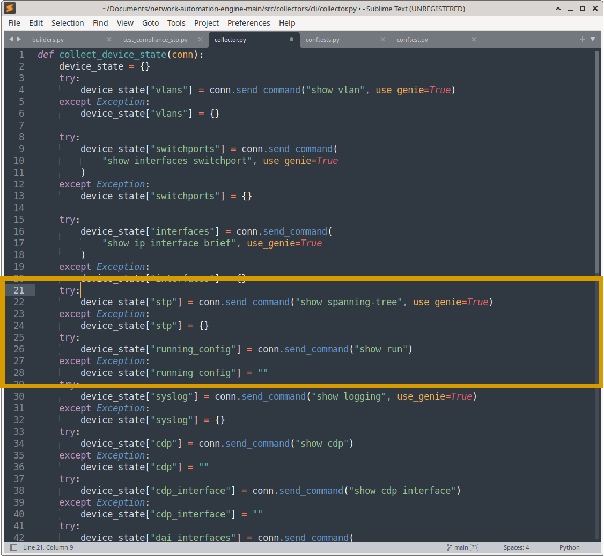

```python
# src/collectors/cli/collector.py

def collect_device_state(conn):
    device_state = {}

    # ... VLAN, Switchport, and Interface Collection ...

    # 4. Spanning-Tree Protocol Operational State (Genie)
    try:
        device_state["stp"] = conn.send_command("show spanning-tree", use_genie=True)
    except Exception:
        device_state["stp"] = {}

    # 5. Full Running Configuration Snapshot (raw text — feeds CiscoConfParse)
    try:
        device_state["running_config"] = conn.send_command("show run")
    except Exception:
        device_state["running_config"] = ""

    # ... Syslog, CDP, and DAI Collection ...

    return device_state
```

#### Collector Design Highlights:
* **Genie for operational truth:** `show spanning-tree` yields the *negotiated* mode and the live `configured_bridge_priority` per VLAN — values that reflect what the switch is actually running, not what was typed.
* **Raw config for hierarchical parsing:** `show run` is deliberately left unparsed by Genie because the per‑port edge guards (`portfast`, `bpduguard`, `guard loop`, `guard root`, `bpdufilter`) are only reliably extracted by walking the `interface` block's children with CiscoConfParse.
* **Fault‑tolerant isolation:** A timeout on either command defaults to `{}` / `""`, so the STP audit degrades gracefully without halting the VLAN/trunk/interface pipelines.

---

### Stage 2: Global STP Normalization (`build_stp_global()`)

The global builder reads `device_state["stp"]`, detects the active protocol mode (Genie nests the VLAN data under the mode key), and flattens the per‑VLAN bridge priorities into a standardized lookup dictionary:

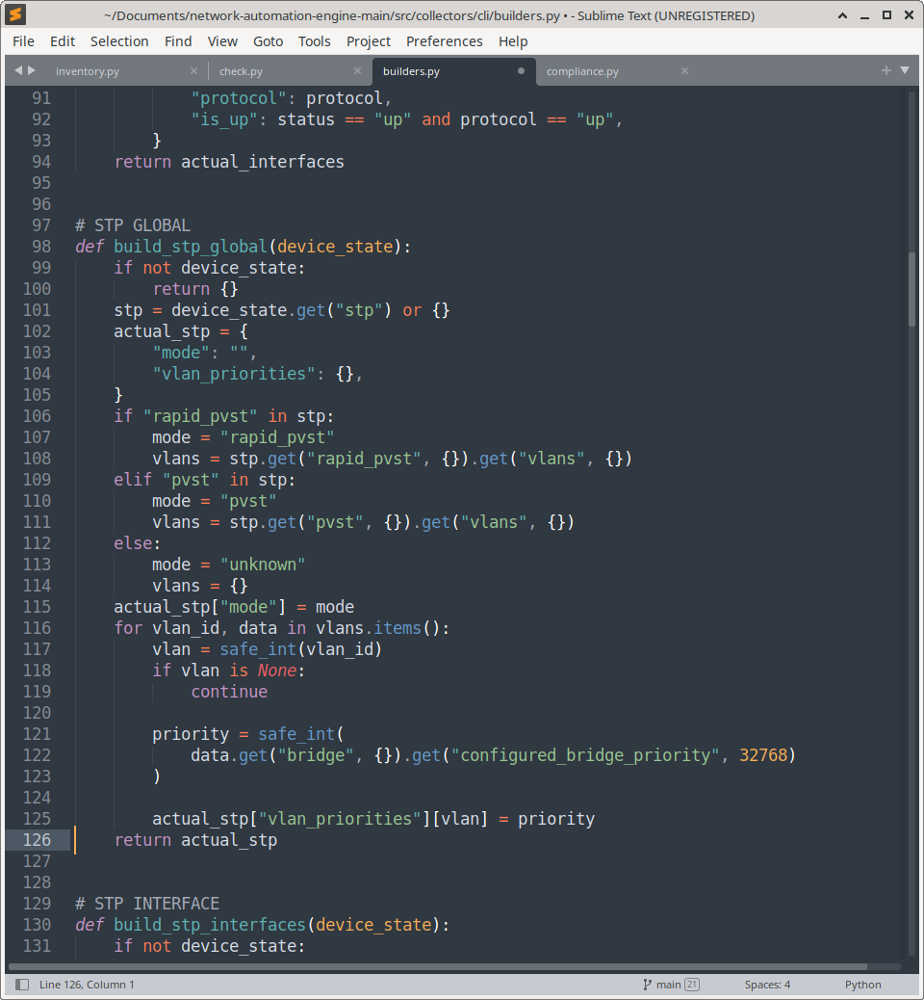

```python
# src/collectors/cli/builders.py

# STP GLOBAL
def build_stp_global(device_state):
    if not device_state:
        return {}
    stp = device_state.get("stp") or {}
    actual_stp = {
        "mode": "",
        "vlan_priorities": {},
    }
    if "rapid_pvst" in stp:
        mode = "rapid_pvst"
        vlans = stp.get("rapid_pvst", {}).get("vlans", {})
    elif "pvst" in stp:
        mode = "pvst"
        vlans = stp.get("pvst", {}).get("vlans", {})
    else:
        mode = "unknown"
        vlans = {}
    actual_stp["mode"] = mode
    for vlan_id, data in vlans.items():
        vlan = safe_int(vlan_id)
        if vlan is None:
            continue

        priority = safe_int(
            data.get("bridge", {}).get("configured_bridge_priority", 32768)
        )

        actual_stp["vlan_priorities"][vlan] = priority
    return actual_stp
```

---

### Stage 3: Interface Edge‑Guard Normalization (`build_stp_interfaces()`)

The interface builder parses the raw running config with CiscoConfParse, isolates every `interface` block, seeds all five guards to `False`, then flips each flag to `True` when its corresponding `spanning-tree …` child line is present:

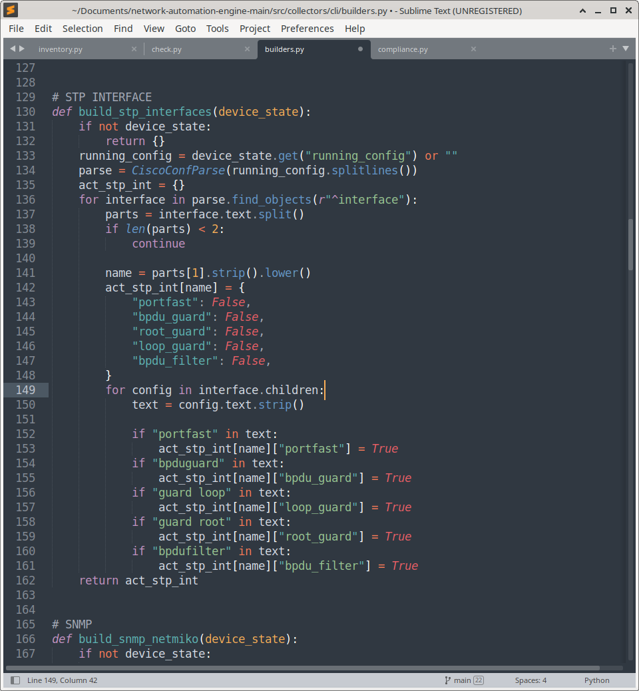

```python
# src/collectors/cli/builders.py

# STP INTERFACE
def build_stp_interfaces(device_state):
    if not device_state:
        return {}
    running_config = device_state.get("running_config") or ""
    parse = CiscoConfParse(running_config.splitlines())
    act_stp_int = {}
    for interface in parse.find_objects(r"^interface"):
        parts = interface.text.split()
        if len(parts) < 2:
            continue

        name = parts[1].strip().lower()
        act_stp_int[name] = {
            "portfast": False,
            "bpdu_guard": False,
            "root_guard": False,
            "loop_guard": False,
            "bpdu_filter": False,
        }
        for config in interface.children:
            text = config.text.strip()

            if "portfast" in text:
                act_stp_int[name]["portfast"] = True
            if "bpdu guard" in text:
                act_stp_int[name]["bpdu_guard"] = True
            if "guard loop" in text:
                act_stp_int[name]["loop_guard"] = True
            if "guard root" in text:
                act_stp_int[name]["root_guard"] = True
            if "bpdu filter" in text:
                act_stp_int[name]["bpdu_filter"] = True
    return act_stp_int
```

---

### Normalized Live State Output

#### Global STP Live State Output:
Captured from `ACCESS-SW-1` prior to remediation (note the operating mode is `pvst`, not the intended `rapid-pvst`, and every VLAN sits at the IEEE default `32768`):

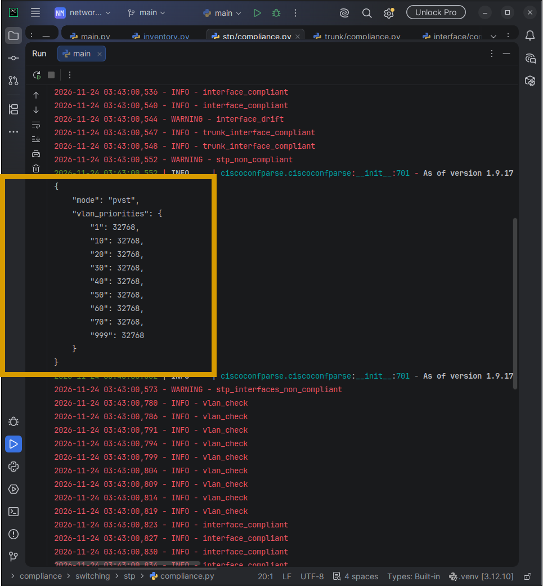

```json
{
  "mode": "pvst",
  "vlan_priorities": {
    "1": 32768,
    "10": 32768,
    "20": 32768,
    "30": 32768,
    "40": 32768,
    "50": 32768,
    "60": 32768,
    "70": 32768,
    "999": 32768
  }
}
```

#### Interface STP Live State Output:
Captured from `ACCESS-SW-1` prior to remediation:

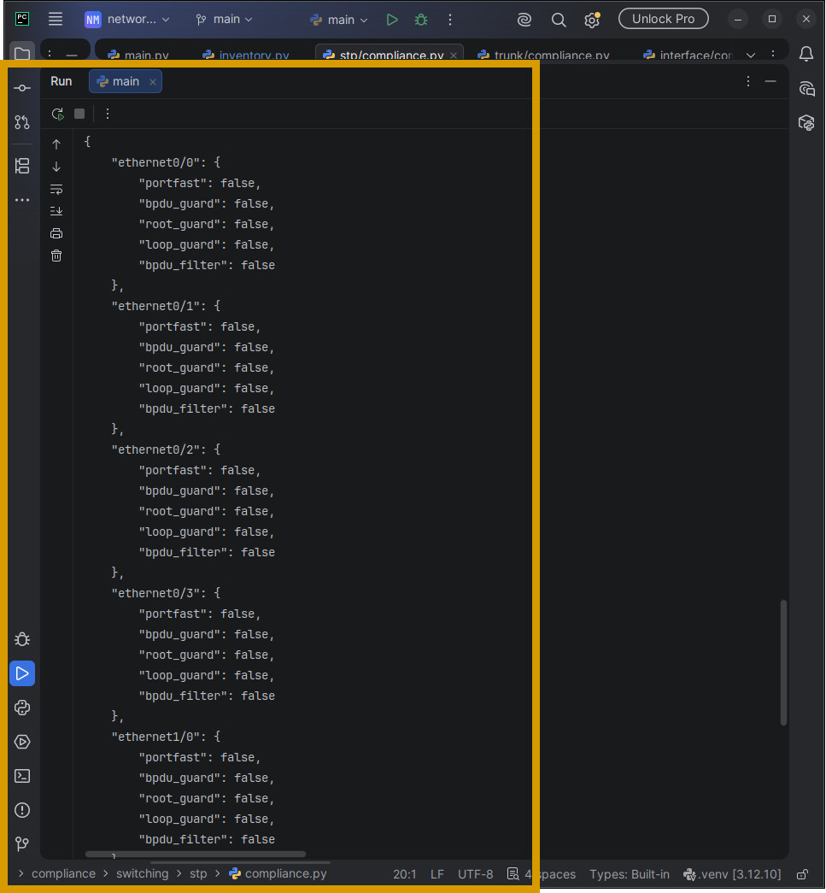

```json
{
  "ethernet0/0": {
    "portfast": false,
    "bpdu_guard": false,
    "root_guard": false,
    "loop_guard": false,
    "bpdu_filter": false
  },
  "ethernet0/1": {
    "portfast": false,
    "bpdu_guard": false,
    "root_guard": false,
    "loop_guard": false,
    "bpdu_filter": false
  },
  "ethernet0/2": {
    "portfast": false,
    "bpdu_guard": false,
    "root_guard": false,
    "loop_guard": false,
    "bpdu_filter": false
  },
  "ethernet0/3": {
    "portfast": false,
    "bpdu_guard": false,
    "root_guard": false,
    "loop_guard": false,
    "bpdu_filter": false
  },
  "ethernet1/0": {
    "portfast": false,
    "bpdu_guard": false,
    "root_guard": false,
    "loop_guard": false,
    "bpdu_filter": false
  }
}
```

---

### 4. Operational Summary: Baseline vs. Observed Drift

Comparing the normalized live dictionaries against NetBox intent reveals two immediate, critical compliance violations on `ACCESS-SW-1`:

| STP Dimension | NetBox Intended Baseline | Observed Switch State | Compliance Evaluation |
| :--- | :--- | :--- | :---: |
| **Global Operating Mode** | `mode: "rapid-pvst"` | `mode: "pvst"` | **FAILED (`stp_non_compliant`)** |
| **Edge PortFast (Host Ports)** | `portfast: True` (Ethernet0/0, 0/2, 0/3) | `portfast: False` | **FAILED (`stp_interfaces_non_compliant`)** |
| **Edge BPDU Guard** | `bpdu_guard: True` (Host Ports) | `bpdu_guard: False` | **FAILED (`stp_interfaces_non_compliant`)** |
| **Uplink Loop Guard** | `loop_guard: True` (Trunk Uplink Ethernet0/1) | `loop_guard: False` | **FAILED (`stp_interfaces_non_compliant`)** |

> **Next Step:** These two clean operational dictionaries are fed into `check_stp_global()` and `check_stp_interface()`, triggering automated Jinja2 remediation across both global and interface configuration scopes.

## 3. Spanning Tree Compliance Diff Engine & Drift Detection

Spanning Tree compliance validation operates across two independent audit pipelines:

1. **Global STP Pipeline (`compliance_stp_global`):** Reconciles switch‑wide operating modes (`rapid-pvst` vs `pvst`), verifies VLAN topology coverage, and audits per‑VLAN bridge priorities against the declared Root Bridge hierarchy.
2. **Interface Guard Pipeline (`compliance_stp_interfaces`):** Audits port‑level edge security (`portfast`, `bpdu_guard`, `loop_guard`, `root_guard`, `bpdu_filter`) against NetBox interface custom fields.

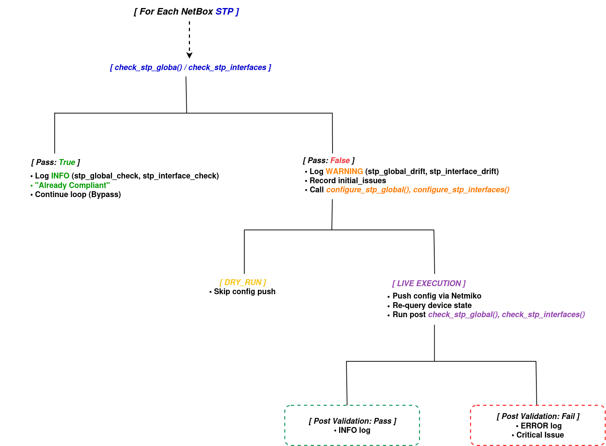

---

### 1. Global STP Compliance Engine (`src/compliance/switching/stp/check.py` + `compliance.py`)

The global engine validates operating mode and bridge‑priority parity. If a switch falls back to legacy PVST+ or carries an unauthorized bridge priority (risking root‑bridge hijacking), the engine raises a `stp_non_compliant` warning and queues remediation:

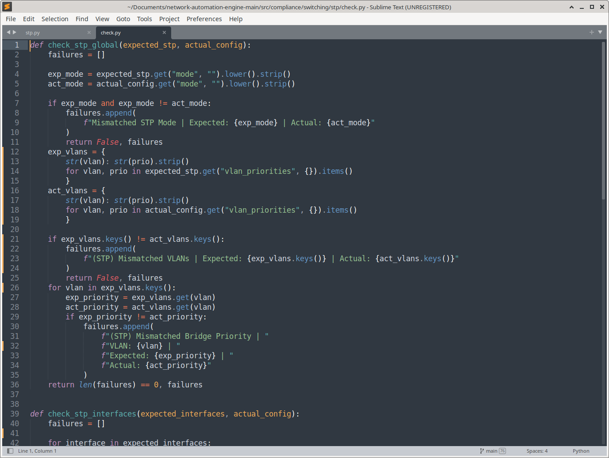

```python
# src/compliance/switching/stp/check.py   [lines 1–37 — screenshot-verified]

def check_stp_global(expected_stp, actual_config):
    failures = []

    exp_mode = expected_stp.get("mode", "").lower().strip()
    act_mode = actual_config.get("mode", "").lower().strip()

    if exp_mode and exp_mode != act_mode:
        failures.append(
            f"Mismatched STP Mode | Expected: {exp_mode} | Actual: {act_mode}"
        )
        return False, failures
    exp_vlans = {
        str(vlan): str(prio).strip()
        for vlan, prio in expected_stp.get("vlan_priorities", {}).items()
        }
    act_vlans = {
        str(vlan): str(prio).strip()
        for vlan, prio in actual_config.get("vlan_priorities", {}).items()
        }

    if exp_vlans.keys() != act_vlans.keys():
        failures.append(
            f"(STP) Mismatched VLANs | Expected: {exp_vlans.keys()} | Actual: {act_vlans.keys()}"
        )
        return False, failures
    for vlan in exp_vlans.keys():
        exp_priority = exp_vlans.get(vlan)
        act_priority = act_vlans.get(vlan)
        if exp_priority != act_priority:
            failures.append(
                f"(STP) Mismatched Bridge Priority | "
                f"VLAN: {vlan} | "
                f"Expected: {exp_priority} | "
                f"Actual: {act_priority}"
            )
    return len(failures) == 0, failures
```

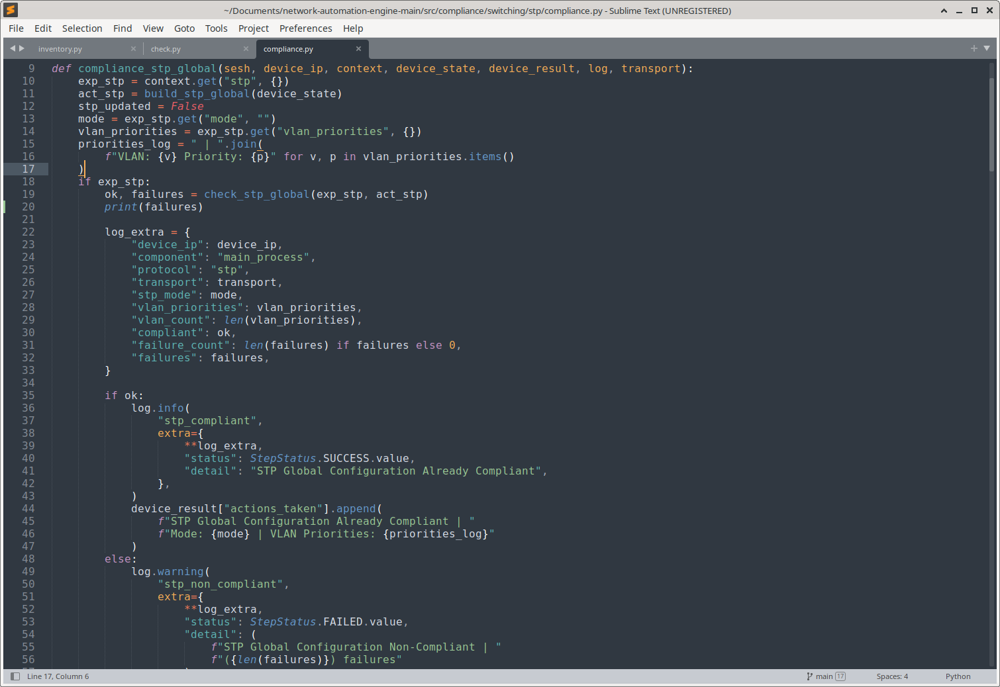

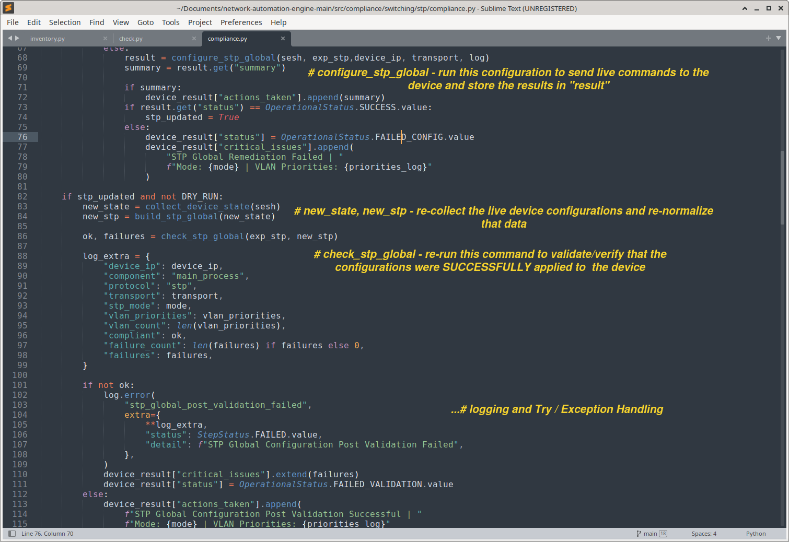

```python
# src/compliance/switching/stp/compliance.py   [lines 9–56 — screenshot-verified]

def compliance_stp_global(sesh, device_ip, context, device_state, device_result, log, transport):
    exp_stp = context.get("stp", {})
    act_stp = build_stp_global(device_state)
    stp_updated = False
    mode = exp_stp.get("mode", "")
    vlan_priorities = exp_stp.get("vlan_priorities", {})
    priorities_log = " | ".join(
        f"VLAN: {v} Priority: {p}" for v, p in vlan_priorities.items()
    )
    if exp_stp:
        ok, failures = check_stp_global(exp_stp, act_stp)
        print(failures)

        log_extra = {
            "device_ip": device_ip,
            "component": "main_process",
            "protocol": "stp",
            "transport": transport,
            "stp_mode": mode,
            "vlan_priorities": vlan_priorities,
            "vlan_count": len(vlan_priorities),
            "compliant": ok,
            "failure_count": len(failures) if failures else 0,
            "failures": failures,
        }

        if ok:
            log.info(
                "stp_compliant",
                extra={
                    **log_extra,
                    "status": StepStatus.SUCCESS.value,
                    "detail": "STP Global Configuration Already Compliant",
                },
            )
            device_result["actions_taken"].append(
                f"STP Global Configuration Already Compliant | "
                f"Mode: {mode} | VLAN Priorities: {priorities_log}"
            )
        else:
            log.warning(
                "stp_non_compliant",
                extra={
                    **log_extra,
                    "status": StepStatus.FAILED.value,
                    "detail": (
                        f"STP Global Configuration Non-Compliant | "
                        f"({len(failures)}) failures"
```

```python
# src/compliance/switching/stp/compliance.py   [lines 57–67 — text-fill, re-capture to verify]

                    ),
                },
            )
            device_result["initial_issues"].extend(failures)
            if DRY_RUN:
                device_result["actions_taken"].append(
                    "[DRY_RUN] Would Configure Global STP | "
                    f"Mode: {mode} | VLAN Priorities: {priorities_log}"
                )
            else:
                result = configure_stp_global(sesh, exp_stp,device_ip, transport, log)
                summary = result.get("summary")

                if summary:
                    device_result["actions_taken"].append(summary)
                if result.get("status") == OperationalStatus.SUCCESS.value:
                    stp_updated = True
                else:
                    device_result["status"] = OperationalStatus.FAILED_CONFIG.value
                    device_result["critical_issues"].append(
                        "STP Global Remediation Failed | "
                        f"Mode: {mode} | VLAN Priorities: {priorities_log}"
                    )

    if stp_updated and not DRY_RUN:
        new_state = collect_device_state(sesh)
        new_stp = build_stp_global(new_state)

        ok, failures = check_stp_global(exp_stp, new_stp)

        log_extra = {
            "device_ip": device_ip,
            "component": "main_process",
            "protocol": "stp",
            "transport": transport,
            "stp_mode": mode,
            "vlan_priorities": vlan_priorities,
            "vlan_count": len(vlan_priorities),
            "compliant": ok,
            "failure_count": len(failures) if failures else 0,
            "failures": failures,
        }

        if not ok:
            log.error(
                "stp_global_post_validation_failed",
                extra={
                    **log_extra,
                    "status": StepStatus.FAILED.value,
                    "detail": f"STP Global Configuration Post Validation Failed",
                },
            )
            device_result["critical_issues"].extend(failures)
            device_result["status"] = OperationalStatus.FAILED_VALIDATION.value
        else:
            device_result["actions_taken"].append(
                f"STP Global Configuration Post Validation Successful | "
                f"Mode: {mode} | VLAN Priorities: {priorities_log}"
            )
            log.info(
                "stp_global_post_validation_success",
                extra={
                    **log_extra,
                    "status": StepStatus.SUCCESS.value,
                    "detail": "STP Global Configuration Post Validation Successful",
                },
            )
    return device_result
```

---

### 2. Interface Guard Compliance Engine (`src/compliance/switching/stp/check.py` + `compliance.py`)

The interface engine walks every NetBox‑declared physical port, looks it up in the CiscoConfParse‑normalized guard dictionary, and compares each of the five STP edge flags. These five attributes are the hardening baseline defined in NetBox interface custom fields:

| Feature | Purpose |
|---|---|
| **PortFast** | Allows eligible edge ports to transition rapidly to forwarding |
| **BPDU Guard** | Protects edge ports by disabling them when BPDUs are received |
| **Root Guard** | Prevents a downstream device from becoming the STP root |
| **Loop Guard** | Helps prevent loops caused by unexpected BPDU loss |
| **BPDU Filter** | Controls BPDU transmission and reception |

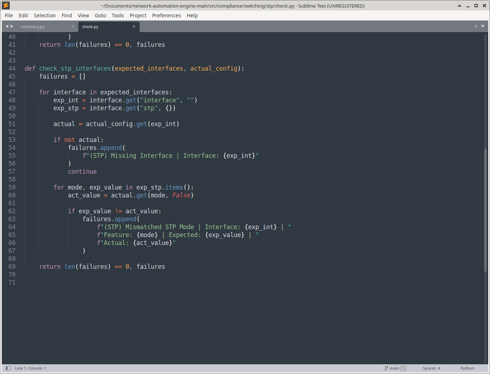

```python
# src/compliance/switching/stp/check.py   [lines 39–69 — screenshot head + text-fill]

def check_stp_interfaces(expected_interfaces, actual_config):
    failures = []

    for interface in expected_interfaces:
        exp_int = interface.get("interface", "").lower()
        exp_stp = interface.get("stp", {})

        actual = actual_config.get(exp_int)

        if not actual:
            failures.append(
                f"(STP) No Features are configured | Interface: {exp_int}"
            )
            continue

        for mode, exp_value in exp_stp.items():
            act_value = actual.get(mode, False)

            if exp_value != act_value:
                failures.append(
                    f"(STP) Mismatched STP Mode | Interface: {exp_int} | "
                    f"Feature: {mode} | Expected: {exp_value} | "
                    f"Actual: {act_value}"
                )

    return len(failures) == 0, failures
```

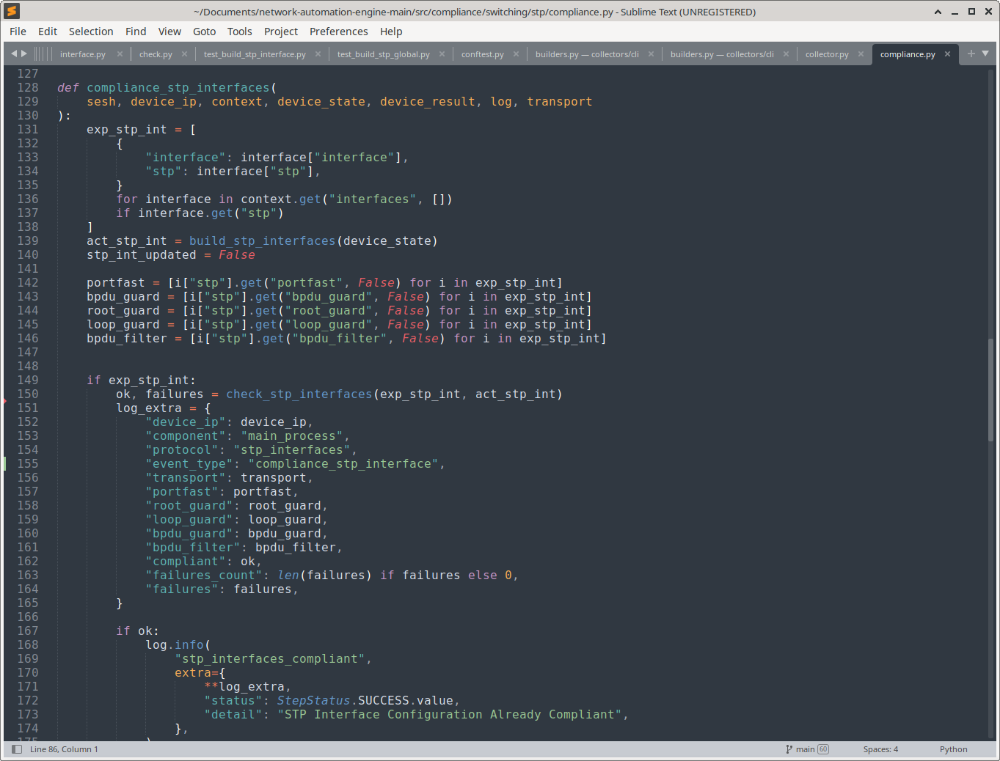

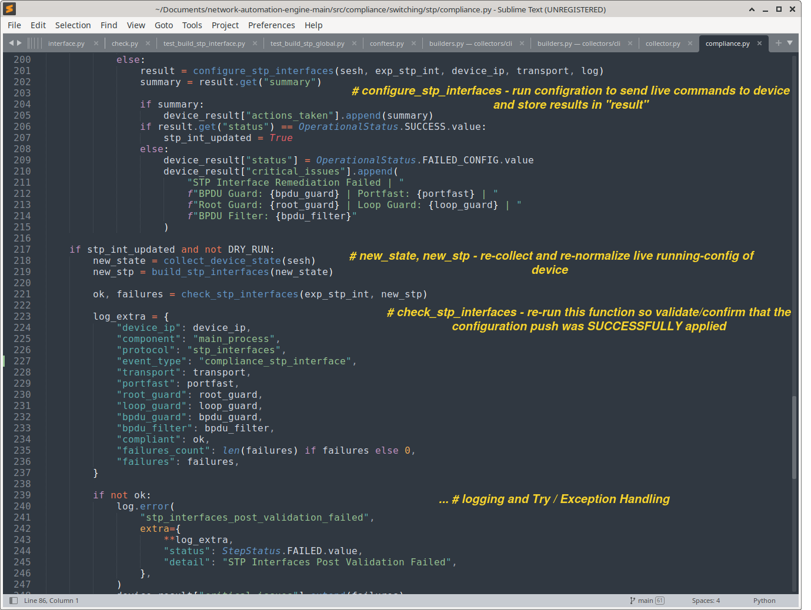

```python
# src/compliance/switching/stp/compliance.py   [lines 128–174]

def compliance_stp_interfaces(
    sesh, device_ip, context, device_state, device_result, log, transport
):
    exp_stp_int = [
        {
            "interface": interface["interface"],
            "stp": interface["stp"],
        }
        for interface in context.get("interfaces", [])
        if interface.get("stp")
    ]
    act_stp_int = build_stp_interfaces(device_state)
    stp_int_updated = False

    portfast = [i["stp"].get("portfast", False) for i in exp_stp_int]
    bpdu_guard = [i["stp"].get("bpdu_guard", False) for i in exp_stp_int]
    root_guard = [i["stp"].get("root_guard", False) for i in exp_stp_int]
    loop_guard = [i["stp"].get("loop_guard", False) for i in exp_stp_int]
    bpdu_filter = [i["stp"].get("bpdu_filter", False) for i in exp_stp_int]

    if exp_stp_int:
        ok, failures = check_stp_interfaces(exp_stp_int, act_stp_int)
        log_extra = {
            "device_ip": device_ip,
            "component": "main_process",
            "protocol": "stp_interfaces",
            "event_type": "compliance_stp_interface",
            "transport": transport,
            "portfast": portfast,
            "root_guard": root_guard,
            "loop_guard": loop_guard,
            "bpdu_guard": bpdu_guard,
            "bpdu_filter": bpdu_filter,
            "compliant": ok,
            "failures_count": len(failures) if failures else 0,
            "failures": failures,
        }

        if ok:
            log.info(
                "stp_interfaces_compliant",
                extra={
                    **log_extra,
                    "status": StepStatus.SUCCESS.value,
                    "detail": "STP Interface Configuration Already Compliant",
                },
            )
```

```python
# src/compliance/switching/stp/compliance.py   [lines 175–199]
#   NOTE: the text dump references `stp_expected`, a variable NOT defined in the
#   screenshot version (lines 128–174). Against the screenshot file this raises
#   NameError. Re-capture 175–199 to confirm which version is live.

            device_result["actions_taken"].append(
                "STP Interface Configuration Already Compliant | "
                f"Configuration: {stp_expected}"
            )
        else:
            device_result["initial_issues"].extend(failures)
            log.warning(
                "stp_interfaces_non_compliant",
                extra={
                    **log_extra,
                    "status": StepStatus.FAILED.value,
                    "detail": "STP Interface Configuration Non-Compliant",
                },
            )
            if DRY_RUN:
                device_result["actions_taken"].append(
                    f"[DRY_RUN] Would Configure STP Features Interfaces | "
                    f"Expected Configuration: {stp_expected}"
                )
```

```python
# src/compliance/switching/stp/compliance.py   [lines 200–246]

            else:
                result = configure_stp_interfaces(sesh, exp_stp_int, device_ip, transport, log)
                summary = result.get("summary")

                if summary:
                    device_result["actions_taken"].append(summary)
                if result.get("status") == OperationalStatus.SUCCESS.value:
                    stp_int_updated = True
                else:
                    device_result["status"] = OperationalStatus.FAILED_CONFIG.value
                    device_result["critical_issues"].append(
                        "STP Interface Remediation Failed | "
                        f"BPDU Guard: {bpdu_guard} | Portfast: {portfast} | "
                        f"Root Guard: {root_guard} | Loop Guard: {loop_guard} | "
                        f"BPDU Filter: {bpdu_filter}"
                    )

    if stp_int_updated and not DRY_RUN:
        new_state = collect_device_state(sesh)
        new_stp = build_stp_interfaces(new_state)

        ok, failures = check_stp_interfaces(exp_stp_int, new_stp)

        log_extra = {
            "device_ip": device_ip,
            "component": "main_process",
            "protocol": "stp_interfaces",
            "event_type": "compliance_stp_interface",
            "transport": transport,
            "portfast": portfast,
            "root_guard": root_guard,
            "loop_guard": loop_guard,
            "bpdu_guard": bpdu_guard,
            "bpdu_filter": bpdu_filter,
            "compliant": ok,
            "failures_count": len(failures) if failures else 0,
            "failures": failures,
        }

        if not ok:
            log.error(
                "stp_interfaces_post_validation_failed",
                extra={
                    **log_extra,
                    "status": StepStatus.FAILED.value,
                    "detail": "STP Interfaces Post Validation Failed",
                },
            )
```

```python
# src/compliance/switching/stp/compliance.py   [lines 247+ — text-fill, re-capture to verify]

            device_result["critical_issues"].extend(failures)
            device_result["status"] = OperationalStatus.FAILED_VALIDATION.value
        else:
            device_result["actions_taken"].append(
                "STP Interface Configuration Post Validation Successful | "
                f"BPDU Guard: {bpdu_guard} | Portfast: {portfast} | "
                f"Root Guard: {root_guard} | Loop Guard: {loop_guard} | "
                f"BPDU Filter: {bpdu_filter}"
            )
            log.info(
                "stp_interfaces_post_validation_success",
                extra={
                    **log_extra,
                    "status": StepStatus.SUCCESS.value,
                    "detail": "STP Interface Configuration Post Validation Successful",
                },
            )
    return device_result
```

---

### 3. Runtime Drift Scenarios & Evidence

The dual STP engine was validated across both switches against five distinct operational failure scenarios covering global protocol modes, root bridge priorities, missing VLAN topologies, and interface‑level edge protections.

---

#### Scenario A - Global Operating‑Mode Drift (PVST+ Fallback)
When `CORE-SW-1` was reverted from `rapid-pvst` to legacy `pvst`, the global engine raised `stp_non_compliant` with the exact mode diff:

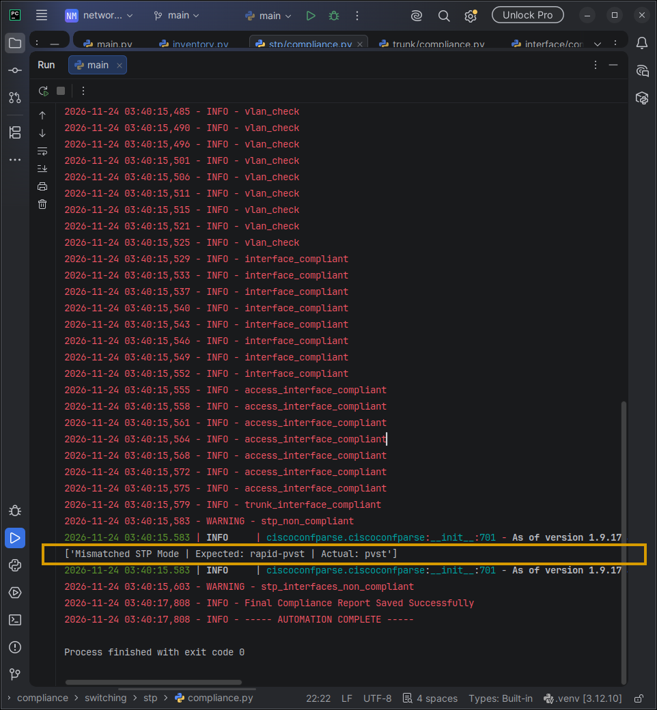

```cisco
CORE-SW-1(config)# spanning-tree mode pvst
CORE-SW-1(config)# no spanning-tree vlan 1,10,20,30,40,50,60,70
```

**Compliance Engine Output (Run @ 03:40):**

```text
2026-11-24 03:40:15,583 - WARNING - stp_non_compliant
['Mismatched STP Mode | Expected: rapid-pvst | Actual: pvst']
2026-11-24 03:40:15,603 - WARNING - stp_interfaces_non_compliant
2026-11-24 03:40:17,808 - INFO - Final Compliance Report Saved Successfully
2026-11-24 03:40:17,808 - INFO - ----- AUTOMATION COMPLETE -----

Process finished with exit code 0
```

---

#### Scenario B - Per‑VLAN Bridge‑Priority Drift (Root Bridge Hijack)
To simulate an unauthorized root‑bridge takeover, `CORE-SW-1` was manually pinned to an aggressive `4096` priority across the data VLANs, violating the NetBox alternating baseline (`24576` odd / `28672` even):

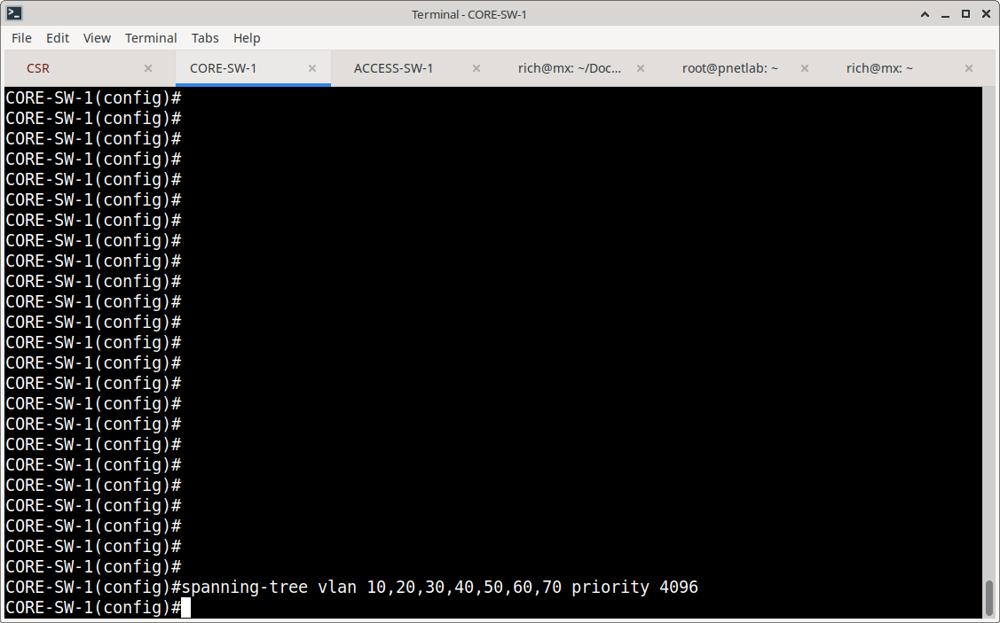

```cisco
CORE-SW-1(config)# spanning-tree vlan 10,20,30,40,50,60,70 priority 4096
```

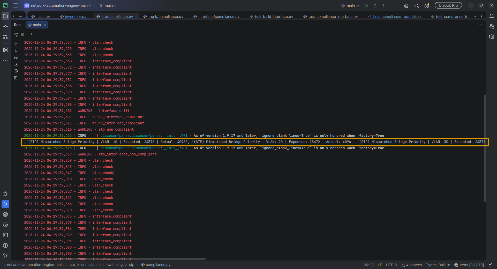

```text
2026-11-24 04:29:39,602 - WARNING - interface_drift
2026-11-24 04:29:39,607 - INFO - trunk_interface_compliant
2026-11-24 04:29:39,611 - INFO - trunk_interface_compliant
2026-11-24 04:29:39,616 - WARNING - stp_non_compliant
['(STP) Mismatched Bridge Priority | VLAN: 10 | Expected: 24576 | Actual: 4096', '(STP) Mismatched Bridge Priority | VLAN: 20 | Expected: 28672 | Actual: 4096', '(STP) Mismatched Bridge Priority | VLAN: 30 | Expected: 24576 | Actual: 4096', '(STP) Mismatched Bridge Priority | VLAN: 40 | Expected: 28672 | Actual: 4096', '(STP) Mismatched Bridge Priority | VLAN: 50 | Expected: 24576 | Actual: 4096', '(STP) Mismatched Bridge Priority | VLAN: 60 | Expected: 28672 | Actual: 4096', '(STP) Mismatched Bridge Priority | VLAN: 70 | Expected: 24576 | Actual: 4096']
2026-11-24 04:29:39,637 - WARNING - stp_interfaces_non_compliant
```

> **Takeaway:** The `4096`‑on‑every‑VLAN signature proves the engine audits **per‑VLAN priority independently** rather than checking a single global value — exactly the granular control needed to detect a partial root‑bridge hijack.

---

#### Scenario C - VLAN Set Parity Drift (Missing vs. Unexpected VLANs)
On `CORE-SW-1`, custom root bridge priorities were stripped across VLANs `1` and `10–70`, leaving only the default native VLAN `999` active in the STP instance table:

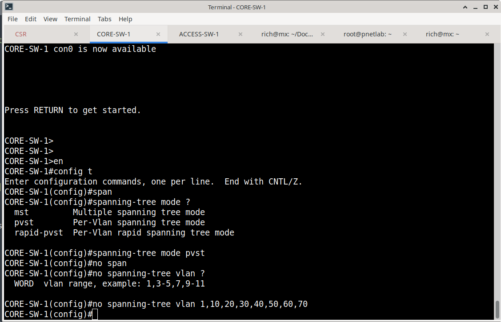

```cisco
CORE-SW-1(config)# spanning-tree mode rapid-pvst
CORE-SW-1(config)# no spanning-tree vlan 1,10,20,30,40,50,60,70
```

**Compliance Engine Output:**
`check_stp_global()` executed a set‑difference check comparing NetBox VLAN keys against live STP instances, flagging missing VLANs `10–70` and identifying native VLAN `999` as unexpected:

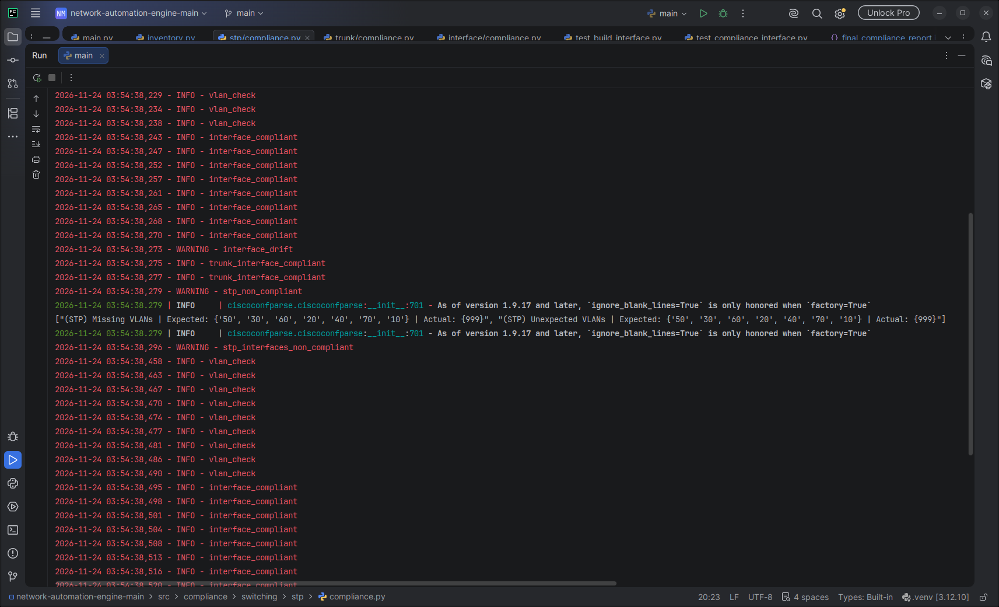

```text
2026-11-24 03:54:38,279 - WARNING - stp_non_compliant
["(STP) Missing VLANs | Expected: {'50', '30', '60', '20', '40', '70', '10'} | Actual: {999}", 
 "(STP) Unexpected VLANs | Expected: {'50', '30', '60', '20', '40', '70', '10'} | Actual: {999}"]
2026-11-24 03:54:38,296 - WARNING - stp_interfaces_non_compliant
```

---

#### Scenario D - Interface Edge‑Guard Drift (Unauthorized Root Guard & Missing Protections)
To validate the interface‑guard diff engine, `spanning-tree guard root` was manually injected across the access workstation range `Ethernet1/0–1/3` on `ACCESS-SW-1`, while the required `portfast` and `bpduguard` commands were omitted, and uplink `Ethernet0/1` lacked `loop_guard`:

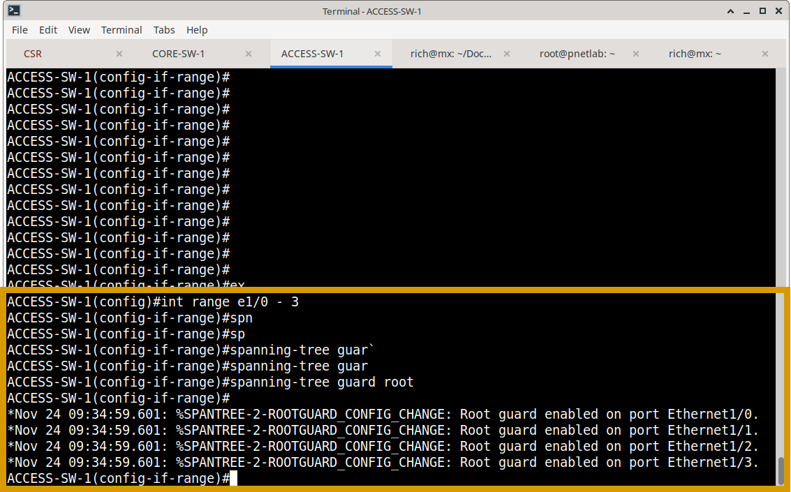

```cisco
ACCESS-SW-1(config)# int range e1/0 - 3
ACCESS-SW-1(config-if-range)# spanning-tree guard root
*Nov 24 09:34:59.601: %SPANTREE-2-ROOTGUARD_CONFIG_CHANGE: Root guard enabled on port Ethernet1/0.
*Nov 24 09:34:59.601: %SPANTREE-2-ROOTGUARD_CONFIG_CHANGE: Root guard enabled on port Ethernet1/1.
*Nov 24 09:34:59.601: %SPANTREE-2-ROOTGUARD_CONFIG_CHANGE: Root guard enabled on port Ethernet1/2.
*Nov 24 09:34:59.601: %SPANTREE-2-ROOTGUARD_CONFIG_CHANGE: Root guard enabled on port Ethernet1/3.
```

**Diff Engine Detection:**
`check_stp_interfaces()` parsed the live running configuration and printed the exact failure array, isolating the missing `loop_guard` on uplink `Ethernet0/1`, the missing `portfast` on edge ports, and the unauthorized `root_guard` on `Ethernet1/0–1/3`:

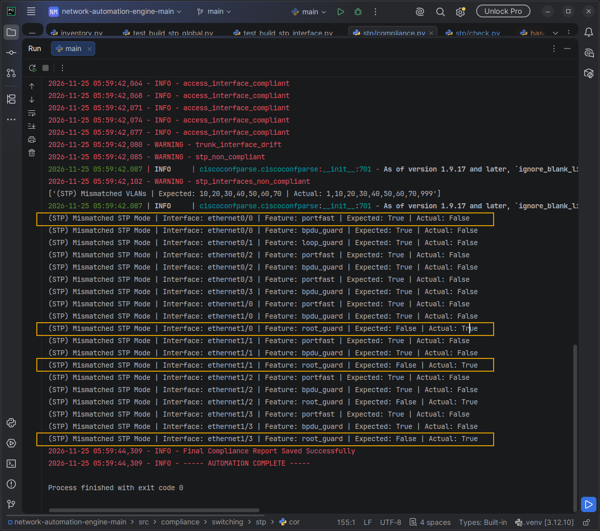

```text
(STP) Mismatched STP Mode | Interface: ethernet0/1 | Feature: portfast   | Expected: None | Actual: False
(STP) Mismatched STP Mode | Interface: ethernet0/1 | Feature: bpdu_guard | Expected: None | Actual: False
(STP) Mismatched STP Mode | Interface: ethernet0/1 | Feature: root_guard | Expected: None | Actual: False
(STP) Mismatched STP Mode | Interface: ethernet0/1 | Feature: loop_guard | Expected: True | Actual: False
(STP) Mismatched STP Mode | Interface: ethernet0/1 | Feature: bpdu_filter | Expected: None | Actual: False
(STP) Mismatched STP Mode | Interface: ethernet0/2 | Feature: portfast   | Expected: True | Actual: False
(STP) Mismatched STP Mode | Interface: ethernet0/3 | Feature: portfast   | Expected: True | Actual: False
(STP) Mismatched STP Mode | Interface: ethernet1/0 | Feature: portfast   | Expected: True | Actual: False
(STP) Mismatched STP Mode | Interface: ethernet1/0 | Feature: root_guard | Expected: None | Actual: True
(STP) Mismatched STP Mode | Interface: ethernet1/1 | Feature: portfast   | Expected: True | Actual: False
(STP) Mismatched STP Mode | Interface: ethernet1/1 | Feature: root_guard | Expected: None | Actual: True
(STP) Mismatched STP Mode | Interface: ethernet1/2 | Feature: portfast   | Expected: True | Actual: False
(STP) Mismatched STP Mode | Interface: ethernet1/2 | Feature: root_guard | Expected: None | Actual: True
(STP) Mismatched STP Mode | Interface: ethernet1/3 | Feature: portfast   | Expected: True | Actual: False
(STP) Mismatched STP Mode | Interface: ethernet1/3 | Feature: root_guard | Expected: None | Actual: True
2026-11-24 04:53:28,630 - WARNING - stp_interfaces_non_compliant
```

---

#### Scenario E - Default Unhardened Access Ports (Zero Edge Features)
When `ACCESS-SW-1` was initialized with default, unconfigured switchports (no `portfast`, `bpduguard`, or `guard loop` subcommands present in the running configuration), the engine flagged all interfaces as missing protections:

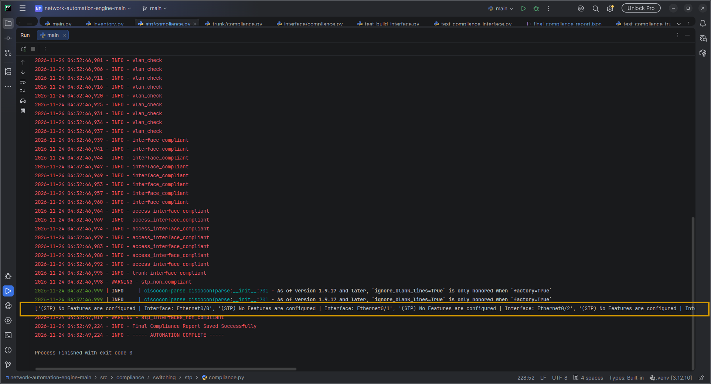

```text
2026-11-24 04:32:46,998 - WARNING - stp_non_compliant
['(STP) No Features are configured | Interface: Ethernet0/0', 
 '(STP) No Features are configured | Interface: Ethernet0/1', 
 '(STP) No Features are configured | Interface: Ethernet0/2', 
 '(STP) No Features are configured | Interface: Ethernet0/3', 
 '(STP) No Features are configured | Interface: Ethernet1/0', 
 '(STP) No Features are configured | Interface: Ethernet1/1', 
 '(STP) No Features are configured | Interface: Ethernet1/2', 
 '(STP) No Features are configured | Interface: Ethernet1/3']
2026-11-24 04:32:47,019 - WARNING - stp_interfaces_non_compliant
2026-11-24 04:32:49,224 - INFO - Final Compliance Report Saved Successfully
```

---

### 4. STP Compliance Evaluation Matrix

| Category | Policy Checked | NetBox Intended Baseline | Observed Switch State | Compliance Evaluation | Operational Remediation |
| :--- | :--- | :--- | :--- | :---: | :--- |
| **Global Mode** | Protocol Standard | `mode: "rapid-pvst"` | `mode: "pvst"` | **FAIL (`Mismatched STP Mode`)** | Push `spanning-tree mode rapid-pvst`. Log `stp_non_compliant`. |
| **Bridge Priority** | Root Placement | `VLAN 10 Priority: 24576` | `VLAN 10 Priority: 4096` | **FAIL (`Mismatched Bridge Priority`)** | Deploy alternating `24576` / `28672` priority baseline. |
| **VLAN Membership** | Topology Coverage | VLANs `10, 20, 30, 40, 50, 60, 70` | VLAN `999` only | **FAIL (`Missing VLANs`)** | Re‑enable spanning‑tree instances across all active VLANs. |
| **Access Port** | Edge Fast Transition | `portfast: True` | `portfast: False` | **FAIL (`Mismatched: portfast`)** | Push `spanning-tree portfast`. |
| **Access Port** | Rogue Switch Shield | `bpdu_guard: True` | `bpdu_guard: False` | **FAIL (`Mismatched: bpdu_guard`)** | Push `spanning-tree bpduguard enable`. |
| **Access Port** | Unauthorized Guard | `root_guard: None / False` | `root_guard: True` | **FAIL (`Mismatched: root_guard`)** | Push `no spanning-tree guard root`. |
| **Trunk Uplink** | Unidirectional Loop Defense | `loop_guard: True` | `loop_guard: False` | **FAIL (Guard Mismatch)** | Log `stp_interfaces_non_compliant`; push `spanning-tree guard loop`. |
| **Compliant Baseline** | Full Parity | `mode: rapid-pvst`<br>`vlan 10: 24576` | `mode: rapid-pvst`<br>`vlan 10: 24576` | **PASS** | Log `stp_compliant`; bypass changes. |

---

### 4. STP Compliance Evaluation Matrix

| Live Device State | NetBox Declared Intent | `check_*()` Result | Engine Action |
| :--- | :--- | :---: | :--- |
| `mode: rapid-pvst`<br>`vlan 10: 24576` | `mode: rapid-pvst`<br>`vlan 10: 24576` | **PASS** | Log `stp_compliant`; bypass push. |
| `mode: pvst` | `mode: rapid-pvst` | **FAIL (Mode Mismatch)** | Log `stp_non_compliant`; push `spanning-tree mode rapid-pvst`. |
| `vlan 10: 4096` | `vlan 10: 24576` | **FAIL (Priority Mismatch)** | Log `stp_non_compliant`; push per‑VLAN priority baseline. |
| VLAN absent from live `show spanning-tree` | VLAN declared in NetBox | **FAIL (Missing VLAN Topology)** | Log `stp_non_compliant`; enable STP on the missing VLAN. |
| `portfast: False` on access port | `portfast: True` | **FAIL (Guard Mismatch)** | Log `stp_interfaces_non_compliant`; push `spanning-tree portfast`. |
| `root_guard: False` on trunk | `root_guard: True` | **FAIL (Guard Mismatch)** | Log `stp_interfaces_non_compliant`; push `spanning-tree guard root`. |

## 4. Interface STP Compliance

Interface STP compliance validates spanning-tree protection settings on individual interfaces.

The checker:

```python
check_stp_interfaces(expected_interfaces, actual_interfaces)
```

compares expected interface configuration against the actual collected device state.

The interface compliance process validates the STP protection attributes defined in NetBox.

These include:

| Feature | Purpose |
|---|---|
| PortFast | Allows eligible edge ports to transition rapidly to forwarding |
| BPDU Guard | Protects edge ports by disabling them when BPDUs are received |
| Root Guard | Prevents a downstream device from becoming the STP root |
| Loop Guard | Helps prevent loops caused by unexpected BPDU loss |
| BPDU Filter | Controls BPDU transmission and reception |

The checker identifies configuration drift and returns the detected failures for remediation.

## 5. Configuration Remediation

When STP drift is detected, remediation is executed across two dedicated functions in `src/remediation/switching/stp.py`:

1. **`configure_stp_global`** — applies the authorized STP operating mode (`rapid-pvst`) and per‑VLAN bridge priorities.
2. **`configure_stp_interfaces`** — applies interface edge protections (`portfast`, `bpdu_guard`, `loop_guard`, `root_guard`, `bpdu_filter`).

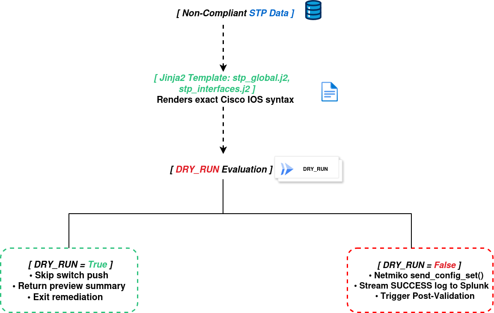

---

### 1. Global STP Remediation Function (`src/remediation/switching/stp.py`)

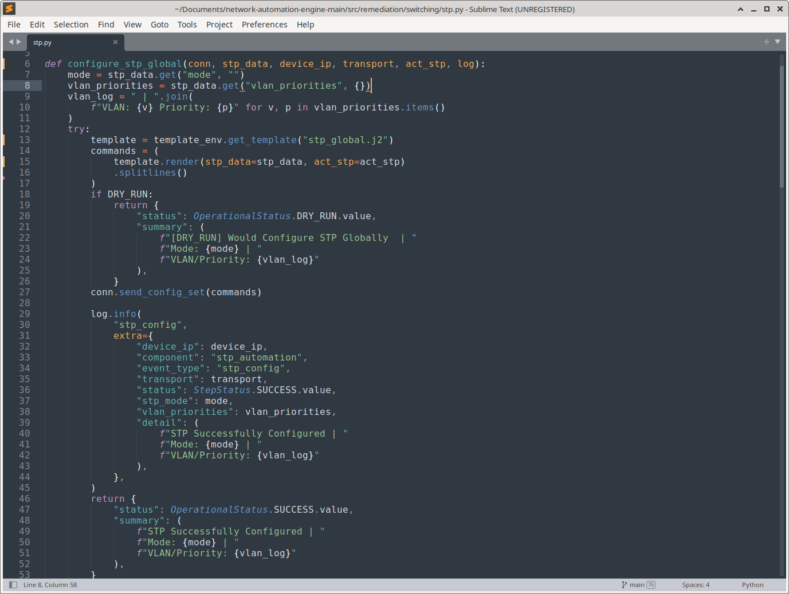

```python
# src/remediation/switching/stp.py

def configure_stp_global(conn, stp_data, device_ip, transport, act_stp, log):
    mode = stp_data.get("mode", "")
    vlan_priorities = stp_data.get("vlan_priorities", {})
    vlan_log = " | ".join(
        f"VLAN: {v} Priority: {p}" for v, p in vlan_priorities.items()
    )
    try:
        template = template_env.get_template("stp_global.j2")
        commands = (
            template.render(stp_data=stp_data, act_stp=act_stp)
            .splitlines()
        )
        if DRY_RUN:
            return {
                "status": OperationalStatus.DRY_RUN.value,
                "summary": (
                    f"[DRY_RUN] Would Configure STP Globally  | "
                    f"Mode: {mode} | "
                    f"VLAN/Priority: {vlan_log}"
                ),
            }
        conn.send_config_set(commands)

        log.info(
            "stp_config",
            extra={
                "device_ip": device_ip,
                "component": "stp_automation",
                "event_type": "stp_config",
                "transport": transport,
                "status": StepStatus.SUCCESS.value,
                "stp_mode": mode,
                "vlan_priorities": vlan_priorities,
                "detail": (
                    f"STP Successfully Configured | "
                    f"Mode: {mode} | "
                    f"VLAN/Priority: {vlan_log}"
                ),
            },
        )
        return {
            "status": OperationalStatus.SUCCESS.value,
            "summary": (
                f"STP Successfully Configured | "
                f"Mode: {mode} | "
                f"VLAN/Priority: {vlan_log}"
            ),
        }
    except Exception as e:
        log.error(
            "stp_config",
            extra={
                "device_ip": device_ip,
                "component": "stp_automation",
                "event_type": "stp_config",
                "transport": transport,
                "status": StepStatus.ERROR.value,
                "stp_mode": mode,
                "vlan_priorities": vlan_priorities,
                "detail": (
                    f"Try/Exception Error | STP Global Configuration | "
                    f"Mode: {mode} | "
                    f"VLAN/Priority: {vlan_log} | Error: {str(e)}"
                ),
            },
        )
        return {
            "status": OperationalStatus.ERROR.value,
            "summary": (
                f"Try/Exception Error | STP Global Configuration | "
                f"Mode: {mode} | "
                f"VLAN/Priority: {vlan_log} | Error: {str(e)}"
            ),
            "error": str(e),
        }
```

---

### 2. Interface STP Remediation Function (`src/remediation/switching/stp.py`)

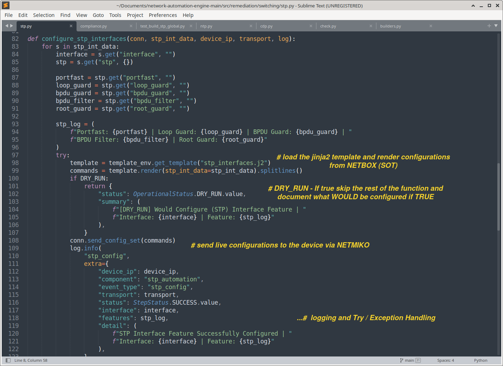

```python
# src/remediation/switching/stp.py

def configure_stp_interfaces(conn, stp_int_data, device_ip, transport, log):
    for s in stp_int_data:
        interface = s.get("interface", "")
        stp = s.get("stp", {})

        portfast = stp.get("portfast", "")
        loop_guard = stp.get("loop_guard", "")
        bpdu_guard = stp.get("bpdu_guard", "")
        bpdu_filter = stp.get("bpdu_filter", "")
        root_guard = stp.get("root_guard", "")

        stp_log = (
            f"Portfast: {portfast} | Loop Guard: {loop_guard} | BPDU Guard: {bpdu_guard} | "
            f"BPDU Filter: {bpdu_filter} | Root Guard: {root_guard}"
        )
        try:
            template = template_env.get_template("STP_INTERFACES.j2")
            commands = template.render(stp_int_data=stp_int_data).splitlines()
            if DRY_RUN:
                return {
                    "status": OperationalStatus.DRY_RUN.value,
                    "summary": (
                        f"[DRY_RUN] Would Configure (STP) Interface Feature | "
                        f"Interface: {interface} | Feature: {stp_log}"
                    ),
                }
            conn.send_config_set(commands)
            log.info(
                "stp_config",
                extra={
                    "device_ip": device_ip,
                    "component": "stp_automation",
                    "event_type": "stp_config",
                    "transport": transport,
                    "status": StepStatus.SUCCESS.value,
                    "interface": interface,
                    "features": stp_log,
                    "detail": (
                        f"STP Interface Feature Successfully Configured | "
                        f"Interface: {interface} | Feature: {stp_log}"
                    ),
                },
            )
            return {
                "status": OperationalStatus.SUCCESS.value,
                "summary": (
                    f"STP Interface Feature Successfully Configured | "
                    f"Interface: {interface} | Feature: {stp_log}"
                ),
            }
        except Exception as e:
            log.error(
                "stp_config",
                extra={
                    "device_ip": device_ip,
                    "component": "stp_automation",
                    "event_type": "stp_config",
                    "transport": transport,
                    "status": StepStatus.ERROR.value,
                    "interface": interface,
                    "features": stp_log,
                    "detail": (
                        f"Try/Exception Error | STP Interface Configuration | "
                        f"Interface: {interface} | Feature: {stp_log} | "
                        f"Error: {str(e)}"
                    ),
                },
            )
            return {
                "status": OperationalStatus.ERROR.value,
                "summary": (
                    f"Try/Exception Error | STP Interface Configuration | "
                    f"Interface: {interface} | Feature: {stp_log} | "
                    f"Error: {str(e)}"
                ),
                "error": str(e),
            }
```

---

## 6. Safe Change Management: Dry‑Run Mode

To support production Change Advisory Board (CAB) review windows, the engine supports a global `DRY_RUN` setting (`src/core/settings.py`). When `DRY_RUN = True`:

* Compliance audits run completely against operational data without modifying physical hardware.
* All identified configuration drift is reported and logged to Splunk.
* Planned remediation commands are compiled into `src/final_compliance_report.json` under `actions_taken`.
* Socket transmissions (`conn.send_config_set()`) are bypassed entirely.


### Machine‑Readable Dry‑Run Audit: `final_compliance_report.json`

#### A. Core Switch Report (`CORE-SW-1` / `10.10.10.10`)
Shows planned global STP priorities (`24576` / `28672`) alongside verified compliant baseline states:

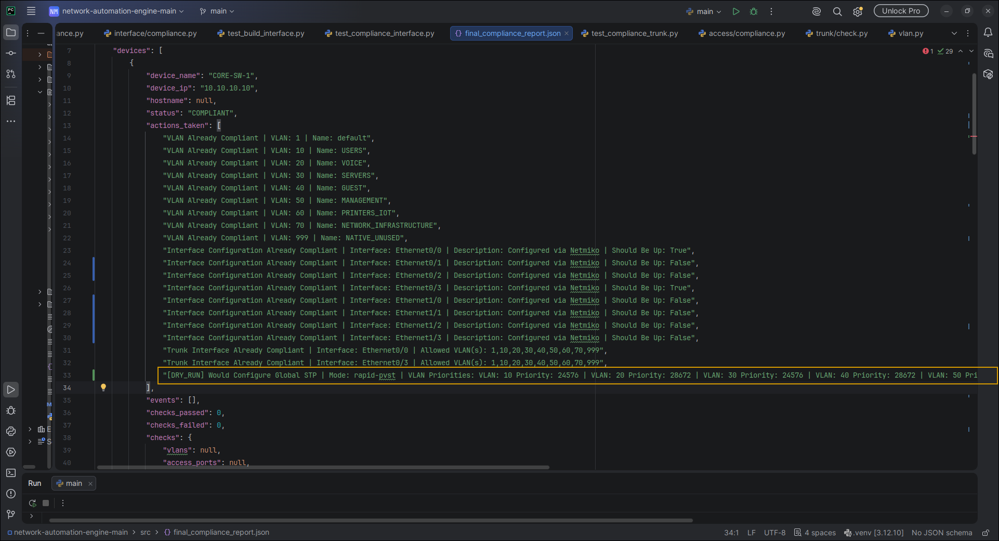

```json
{
  "device_name": "CORE-SW-1",
  "device_ip": "10.10.10.10",
  "hostname": null,
  "status": "COMPLIANT",
  "actions_taken": [
    "VLAN Already Compliant | VLAN: 1 | Name: default",
    "VLAN Already Compliant | VLAN: 10 | Name: USERS",
    "VLAN Already Compliant | VLAN: 20 | Name: VOICE",
    "VLAN Already Compliant | VLAN: 30 | Name: SERVERS",
    "VLAN Already Compliant | VLAN: 40 | Name: GUEST",
    "VLAN Already Compliant | VLAN: 50 | Name: MANAGEMENT",
    "VLAN Already Compliant | VLAN: 60 | Name: PRINTERS_IOT",
    "VLAN Already Compliant | VLAN: 70 | Name: NETWORK_INFRASTRUCTURE",
    "VLAN Already Compliant | VLAN: 999 | Name: NATIVE_UNUSED",
    "Interface Configuration Already Compliant | Interface: Ethernet0/0 | Description: Configured via Netmiko | Should Be Up: True",
    "Interface Configuration Already Compliant | Interface: Ethernet0/1 | Description: Configured via Netmiko | Should Be Up: False",
    "Interface Configuration Already Compliant | Interface: Ethernet0/2 | Description: Configured via Netmiko | Should Be Up: False",
    "Interface Configuration Already Compliant | Interface: Ethernet0/3 | Description: Configured via Netmiko | Should Be Up: True",
    "Interface Configuration Already Compliant | Interface: Ethernet1/0 | Description: Configured via Netmiko | Should Be Up: False",
    "Interface Configuration Already Compliant | Interface: Ethernet1/1 | Description: Configured via Netmiko | Should Be Up: False",
    "Interface Configuration Already Compliant | Interface: Ethernet1/2 | Description: Configured via Netmiko | Should Be Up: False",
    "Interface Configuration Already Compliant | Interface: Ethernet1/3 | Description: Configured via Netmiko | Should Be Up: False",
    "Trunk Interface Already Compliant | Interface: Ethernet0/0 | Allowed VLAN(s): 1,10,20,30,40,50,60,70,999",
    "Trunk Interface Already Compliant | Interface: Ethernet0/3 | Allowed VLAN(s): 1,10,20,30,40,50,60,70,999",
    "[DRY_RUN] Would Configure Global STP | Mode: rapid-pvst | VLAN Priorities: VLAN: 10 Priority: 24576 | VLAN: 20 Priority: 28672 | VLAN: 30 Priority: 24576 | VLAN: 40 Priority: 28672 | VLAN: 50 Priority: 24576"
  ]
}
```

#### B. Access Switch Report (`ACCESS-SW-1` / `10.10.10.20`)
Shows planned global STP priorities (`32768`) and planned interface edge‑guard hardening:

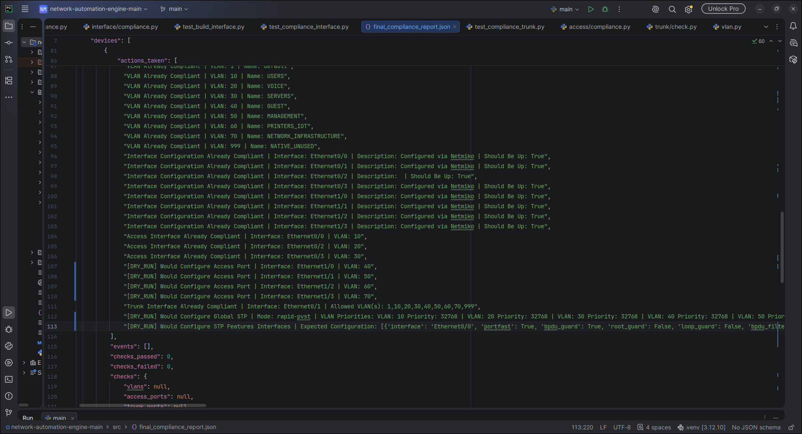

```json
{
  "device_name": "ACCESS-SW-1",
  "device_ip": "10.10.10.20",
  "hostname": null,
  "status": "COMPLIANT",
  "actions_taken": [
    "[DRY_RUN] Would Configure Global STP | Mode: rapid-pvst | VLAN Priorities: VLAN: 10 Priority: 32768 | VLAN: 20 Priority: 32768 | VLAN: 30 Priority: 32768 | VLAN: 40 Priority: 32768 | VLAN: 50 Priority: 32768 | VLAN: 60 Priority: 32768 | VLAN: 70 Priority: 32768",
    "[DRY_RUN] Would Configure STP Features Interfaces | Expected Configuration: [{'interface': 'Ethernet0/0', 'portfast': True, 'bpdu_guard': True, 'root_guard': False, 'loop_guard': False, 'bpdu_filter': False}, ...]"
  ]
}
```

---

## 7. Post‑Remediation Validation & Physical Device Proof

After live remediation commands are applied, the module re‑collects device state over SSH and re‑runs both check functions to verify the configurations were applied to physical hardware:

```python
new_state = collect_device_state(sesh)
new_stp = build_stp_global(new_state)
new_stp_int = build_stp_interfaces(new_state)
# re-runs check_stp_global() and check_stp_interfaces() against the collected data
```
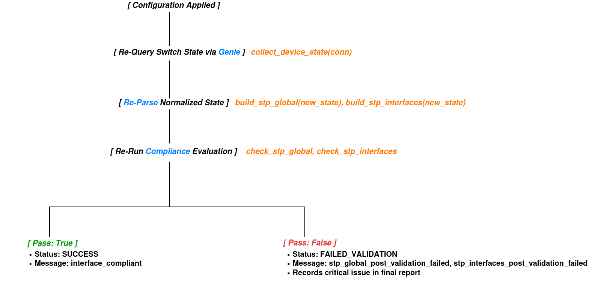

---

### 1. Out‑of‑Band Syslog Execution Audit (`vty0`)
The switch console on `ACCESS-SW-1` confirms commands were pushed by `sysadmin` over `vty0`:

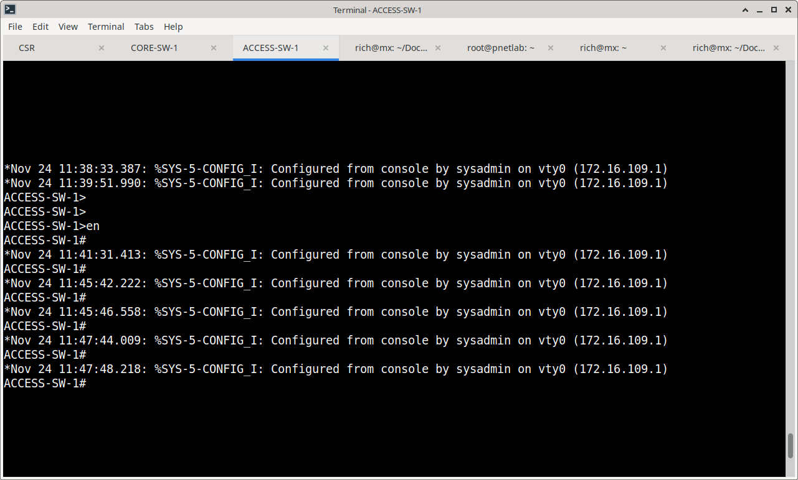

```text
*Nov 24 11:38:33.387: %SYS-5-CONFIG_I: Configured from console by sysadmin on vty0 (172.16.109.1)
*Nov 24 11:39:51.990: %SYS-5-CONFIG_I: Configured from console by sysadmin on vty0 (172.16.109.1)
*Nov 24 11:41:31.413: %SYS-5-CONFIG_I: Configured from console by sysadmin on vty0 (172.16.109.1)
*Nov 24 11:45:42.222: %SYS-5-CONFIG_I: Configured from console by sysadmin on vty0 (172.16.109.1)
*Nov 24 11:45:46.558: %SYS-5-CONFIG_I: Configured from console by sysadmin on vty0 (172.16.109.1)
*Nov 24 11:47:44.009: %SYS-5-CONFIG_I: Configured from console by sysadmin on vty0 (172.16.109.1)
*Nov 24 11:47:48.218: %SYS-5-CONFIG_I: Configured from console by sysadmin on vty0 (172.16.109.1)
```

---

### 2. Global STP Verification on `CORE-SW-1` (Before vs. After)

#### BEFORE Remediation
`CORE-SW-1` had a flat, unauthorized bridge priority `4096` across all data VLANs (a root‑bridge hijack posture):

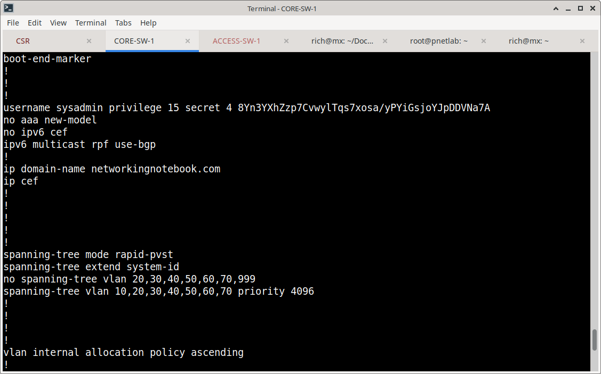

```cisco
spanning-tree mode rapid-pvst
spanning-tree extend system-id
no spanning-tree vlan 20,30,40,50,60,70,999
spanning-tree vlan 10,20,30,40,50,60,70 priority 4096
```

#### AFTER Remediation
`CORE-SW-1` now carries the alternating primary/secondary root priorities (`24576` odd / `28672` even) per the NetBox Config Context:

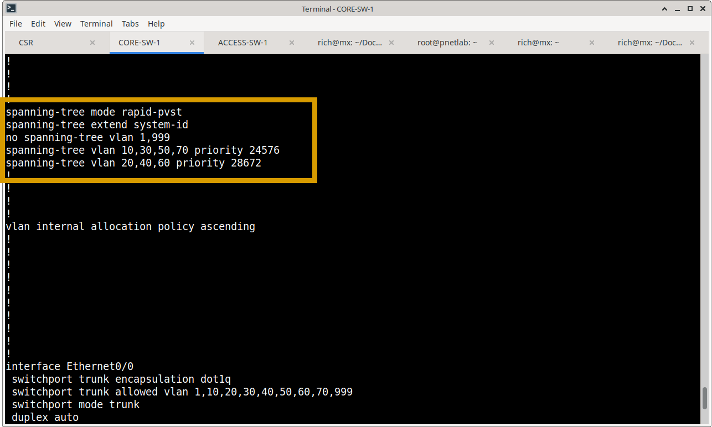

```cisco
spanning-tree mode rapid-pvst
spanning-tree extend system-id
no spanning-tree vlan 1,999
spanning-tree vlan 10,30,50,70 priority 24576
spanning-tree vlan 20,40,60 priority 28672
```

---

### 3. Interface Guard Verification on `ACCESS-SW-1` (Before vs. After)

#### BEFORE Remediation
Rogue `spanning-tree guard root` was present on access ports `Ethernet1/0`–`Ethernet1/2`, with zero PortFast or BPDU Guard configured:

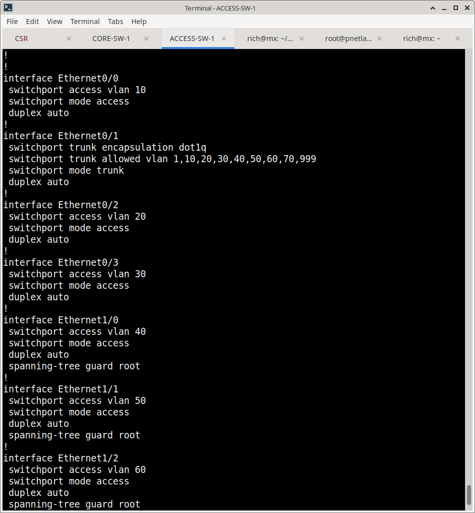

```cisco
interface Ethernet1/0
 switchport access vlan 40
 switchport mode access
 duplex auto
 spanning-tree guard root
!
interface Ethernet1/1
 switchport access vlan 50
 switchport mode access
 duplex auto
 spanning-tree guard root
!
interface Ethernet1/2
 switchport access vlan 60
 switchport mode access
 duplex auto
 spanning-tree guard root
```

#### AFTER Remediation
The unauthorized root guard was removed. Host access ports now have `spanning-tree portfast` and `spanning-tree bpduguard enable`, while trunk uplink `Ethernet0/1` has `spanning-tree guard loop`:

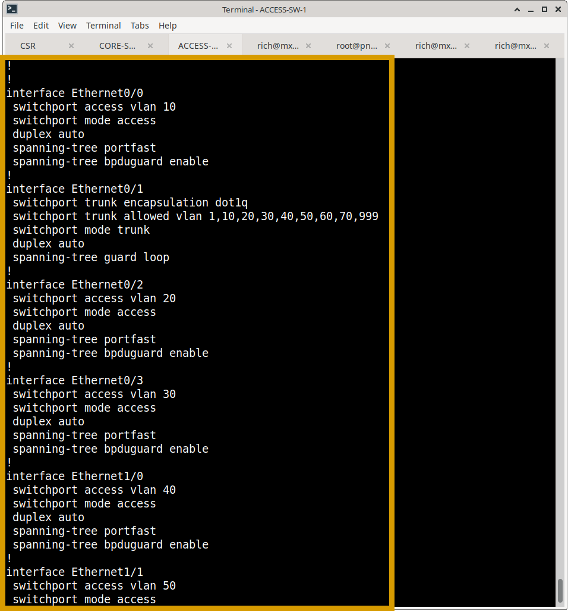

```cisco
interface Ethernet0/0
 switchport access vlan 10
 switchport mode access
 duplex auto
 spanning-tree portfast
 spanning-tree bpduguard enable
!
interface Ethernet0/1
 switchport trunk encapsulation dot1q
 switchport trunk allowed vlan 1,10,20,30,40,50,60,70,999
 switchport mode trunk
 duplex auto
 spanning-tree guard loop
!
interface Ethernet0/2
 switchport access vlan 20
 switchport mode access
 duplex auto
 spanning-tree portfast
 spanning-tree bpduguard enable
!
interface Ethernet0/3
 switchport access vlan 30
 switchport mode access
 duplex auto
 spanning-tree portfast
 spanning-tree bpduguard enable
!
interface Ethernet1/0
 switchport access vlan 40
 switchport mode access
 duplex auto
 spanning-tree portfast
 spanning-tree bpduguard enable
```

> **Takeaway:**
> The remediation engine provides complete Layer 2 topology assurance. It eliminates human configuration errors by enforcing deterministic bridge election parameters globally while systematically securing access switchports against loops and unauthorized bridging devices.

## 8. Audit Logging & Splunk Telemetry Pipeline (STP)

To satisfy enterprise change governance and SIEM auditing requirements, every operational phase of Spanning Tree validation — global mode audits, bridge priority diffs, interface guard evaluations, runtime exceptions, and post-validation checks — generates structured JSON events streamed directly to **Splunk via HTTP Event Collector (HEC)** (`index="network_automation"`, `sourcetype="_json"`).

Events map directly to standard Cisco syslog severity levels (`cisco_sev`), enabling Security Operations (SecOps) and Network Operations Centers (NOC) to trigger real-time alerts on root bridge shifts, rogue root guard injections, or post-validation failures.

```spl
index="network_automation" sourcetype="_json" (protocol="stp" OR protocol="stp_interfaces")
| table asctime cisco_sev event_type message interface status compliant detail
```

---

### STP Telemetry Lifecycle Matrix

The telemetry pipeline records five distinct operational events across core and access switches:

| Lifecycle Phase | Event Type (`event_type`) | Message (`message`) | Cisco Severity | Compliance Status | Operational Significance |
| :--- | :--- | :--- | :---: | :---: | :--- |
| **1. Pre-Check Pass** | `compliance_stp_interface` | `stp_interfaces_compliant` | `6 (INFO)` | `compliant: true` | Interface guards match NetBox custom fields; bypassed. |
| **2. Drift Detected** | `compliance_stp_interface` | `stp_interfaces_non_compliant` | `4 (WARN)` | `compliant: false` | PortFast, BPDU Guard, or Loop Guard mismatch detected; diff recorded. |
| **3. Post-Validation Pass** | `compliance_stp_interface` | `stp_interfaces_post_validation_success` | `6 (INFO)` | `compliant: true` | Re-queried live switch state confirms STP guards are active on data plane. |
| **4. Post-Validation Fail** | `compliance_stp_interface` | `stp_interfaces_post_validation_failed` | `3 (ERROR)` | `compliant: false` | Re-queried state reveals configuration failed to bind on the physical port. |
| **5. Exception Capture** | `stp_config` | `stp_config` | `3 (ERROR)` | `status: ERROR` | Catches Jinja2 render faults (e.g., `'act_data' is undefined`) without crashing. |

---

### Splunk Event Evidence & Payload Breakdown

#### 1. Baseline Compliant Pass (`stp_interfaces_compliant`)
When access switchports (such as `Ethernet0/0` on `ACCESS-SW-1`) already match the required PortFast and BPDU Guard configuration on initial scan, an informational pass is indexed with zero failures:

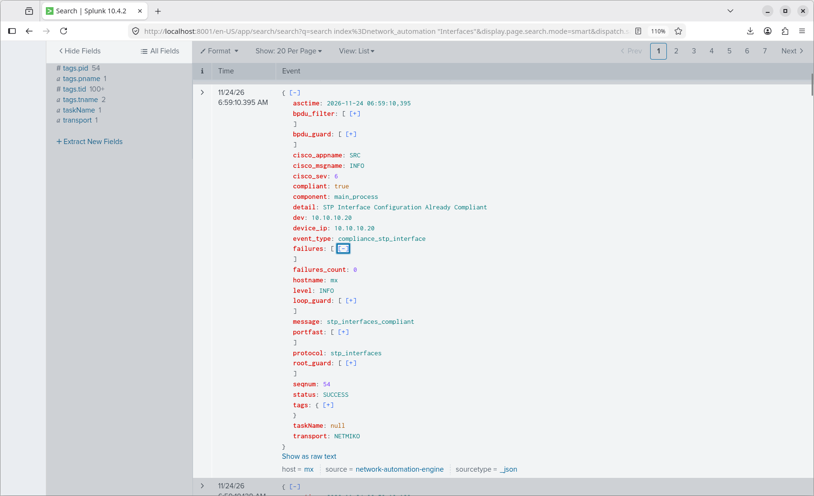

```json
{
  "asctime": "2026-11-24 06:59:10,395",
  "cisco_appname": "SRC",
  "cisco_msgname": "INFO",
  "cisco_sev": 6,
  "compliant": true,
  "component": "main_process",
  "detail": "STP Interface Configuration Already Compliant",
  "dev": "10.10.10.20",
  "device_ip": "10.10.10.20",
  "event_type": "compliance_stp_interface",
  "failures": [],
  "failures_count": 0,
  "hostname": "mx",
  "level": "INFO",
  "message": "stp_interfaces_compliant",
  "protocol": "stp_interfaces",
  "seqnum": 54,
  "status": "SUCCESS",
  "tags": {},
  "taskName": null,
  "transport": "NETMIKO"
}
```

---

#### 2. Interface Guard Drift Alert (`stp_interfaces_non_compliant`)
When physical interfaces deviate from NetBox custom fields (e.g., unhardened access ports missing PortFast/BPDU Guard), a `WARNING` (severity 4) alert is indexed with the complete failure diff:

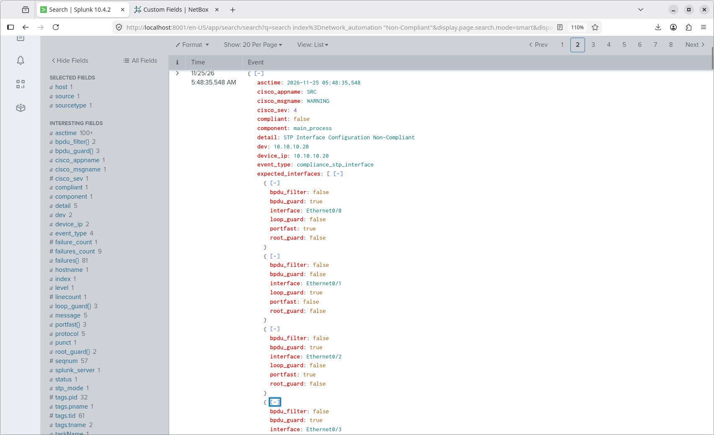

```json
{
  "asctime": "2026-11-24 06:54:21,290",
  "cisco_appname": "SRC",
  "cisco_msgname": "WARNING",
  "cisco_sev": 4,
  "compliant": false,
  "component": "main_process",
  "detail": "STP Interface Configuration Non-Compliant",
  "dev": "10.10.10.10",
  "device_ip": "10.10.10.10",
  "event_type": "compliance_stp_interface",
  "failures": [
    "(STP) Mismatched STP Mode | Interface: ethernet0/0 | Feature: portfast | Expected: None | Actual: False",
    "(STP) Mismatched STP Mode | Interface: ethernet0/0 | Feature: bpdu_guard | Expected: None | Actual: False",
    "(STP) Mismatched STP Mode | Interface: ethernet0/0 | Feature: root_guard | Expected: None | Actual: False",
    "(STP) Mismatched STP Mode | Interface: ethernet0/0 | Feature: loop_guard | Expected: None | Actual: False",
    "(STP) Mismatched STP Mode | Interface: ethernet0/0 | Feature: bpdu_filter | Expected: None | Actual: False",
    "(STP) Mismatched STP Mode | Interface: ethernet0/1 | Feature: loop_guard | Expected: True | Actual: False",
    "(STP) Mismatched STP Mode | Interface: ethernet0/2 | Feature: portfast | Expected: None | Actual: False",
    "(STP) Mismatched STP Mode | Interface: ethernet0/2 | Feature: bpdu_guard | Expected: None | Actual: False",
    "(STP) Mismatched STP Mode | Interface: ethernet0/2 | Feature: root_guard | Expected: None | Actual: False",
    "(STP) Mismatched STP Mode | Interface: ethernet0/2 | Feature: loop_guard | Expected: None | Actual: False",
    "(STP) Mismatched STP Mode | Interface: ethernet0/2 | Feature: bpdu_filter | Expected: None | Actual: False",
    "(STP) Mismatched STP Mode | Interface: ethernet0/3 | Feature: portfast | Expected: None | Actual: False",
    "(STP) Mismatched STP Mode | Interface: ethernet0/3 | Feature: bpdu_guard | Expected: None | Actual: False",
    "(STP) Mismatched STP Mode | Interface: ethernet0/3 | Feature: root_guard | Expected: None | Actual: False",
    "(STP) Mismatched STP Mode | Interface: ethernet0/3 | Feature: loop_guard | Expected: None | Actual: False",
    "(STP) Mismatched STP Mode | Interface: ethernet0/3 | Feature: bpdu_filter | Expected: None | Actual: False",
    "(STP) Mismatched STP Mode | Interface: ethernet1/0 | Feature: portfast | Expected: None | Actual: False",
    "(STP) Mismatched STP Mode | Interface: ethernet1/0 | Feature: bpdu_guard | Expected: None | Actual: False"
  ],
  "failures_count": 1,
  "hostname": "mx",
  "level": "WARNING",
  "message": "stp_interfaces_non_compliant",
  "protocol": "stp_interfaces",
  "seqnum": 55,
  "status": "FAILED",
  "tags": {},
  "taskName": null,
  "transport": "NETMIKO"
}
```

---

#### 3. Closed-Loop Post-Validation Success (`stp_interfaces_post_validation_success`)
Following remediation, the engine re-parses the running configuration via `CiscoConfParse`. When all edge guards and uplink loop guards are verified on physical hardware, an audit pass is confirmed:

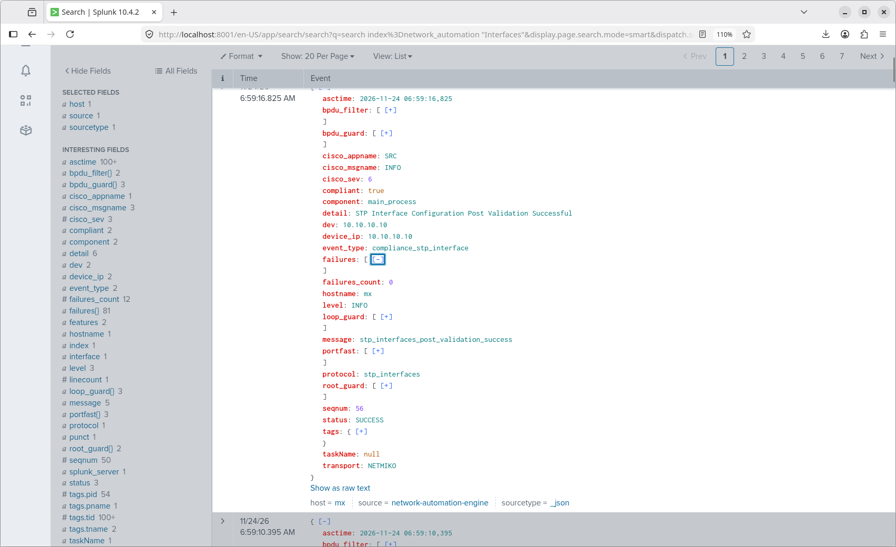

```json
{
  "asctime": "2026-11-24 06:59:16,825",
  "cisco_appname": "SRC",
  "cisco_msgname": "INFO",
  "cisco_sev": 6,
  "compliant": true,
  "component": "main_process",
  "detail": "STP Interface Configuration Post Validation Successful",
  "dev": "10.10.10.10",
  "device_ip": "10.10.10.10",
  "event_type": "compliance_stp_interface",
  "failures": [],
  "failures_count": 0,
  "hostname": "mx",
  "level": "INFO",
  "message": "stp_interfaces_post_validation_success",
  "protocol": "stp_interfaces",
  "seqnum": 56,
  "status": "SUCCESS",
  "tags": {},
  "taskName": null,
  "transport": "NETMIKO"
}
```

---

#### 4. Critical Post-Validation Failure Catch (`stp_interfaces_post_validation_failed`)
If commands are pushed over Netmiko but the subsequent re-audit detects that a port failed to apply the requested guard (e.g., `Ethernet0/1` still has `loop_guard` disabled when NetBox expected `True`), the engine logs a **Cisco Severity 3 (`ERROR`)** event and tags the run as non-compliant:

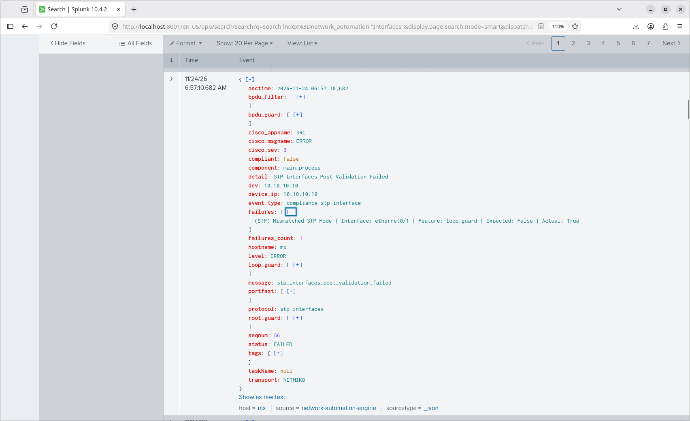

```json
{
  "asctime": "2026-11-24 06:57:10,682",
  "cisco_appname": "SRC",
  "cisco_msgname": "ERROR",
  "cisco_sev": 3,
  "compliant": false,
  "component": "main_process",
  "detail": "STP Interfaces Post Validation Failed",
  "dev": "10.10.10.10",
  "device_ip": "10.10.10.10",
  "event_type": "compliance_stp_interface",
  "failures": [
    "(STP) Mismatched STP Mode | Interface: ethernet0/1 | Feature: loop_guard | Expected: False | Actual: True"
  ],
  "failures_count": 1,
  "hostname": "mx",
  "level": "ERROR",
  "message": "stp_interfaces_post_validation_failed",
  "protocol": "stp_interfaces",
  "seqnum": 56,
  "status": "FAILED",
  "tags": {},
  "taskName": null,
  "transport": "NETMIKO"
}
```

---

#### 5. Exception & Fault Observability (`status: ERROR`)
If an unhandled exception occurs during template rendering (such as a variable scoping fault like `'act_data' is undefined`), the engine's `try...except` boundary catches the error and streams an `ERROR` event (Severity 3) with full context:

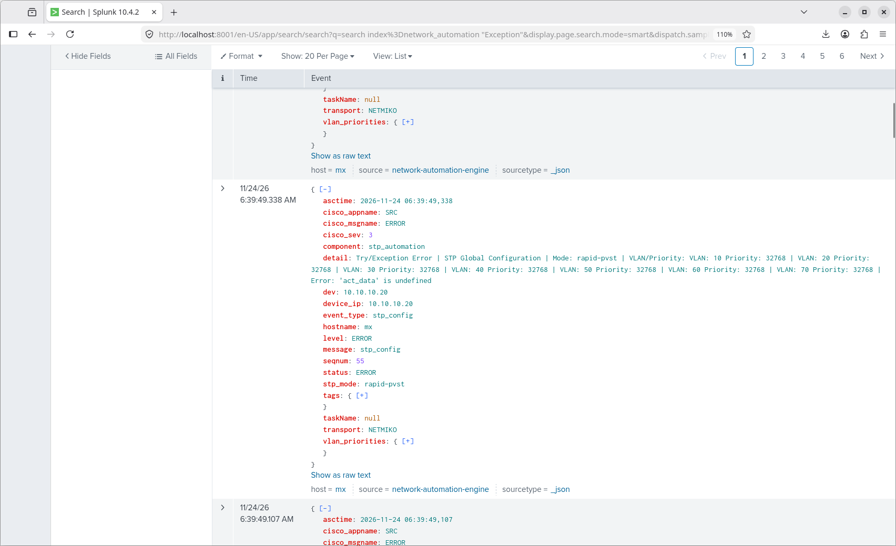

```json
{
  "asctime": "2026-11-24 06:39:49,338",
  "cisco_appname": "SRC",
  "cisco_msgname": "ERROR",
  "cisco_sev": 3,
  "component": "stp_automation",
  "detail": "Try/Exception Error | STP Global Configuration | Mode: rapid-pvst | VLAN/Priority: VLAN: 10 Priority: 32768 | VLAN: 20 Priority: 32768 | VLAN: 30 Priority: 32768 | VLAN: 40 Priority: 32768 | VLAN: 50 Priority: 32768 | VLAN: 60 Priority: 32768 | VLAN: 70 Priority: 32768 | Error: 'act_data' is undefined",
  "dev": "10.10.10.20",
  "device_ip": "10.10.10.20",
  "event_type": "stp_config",
  "hostname": "mx",
  "level": "ERROR",
  "message": "stp_config",
  "seqnum": 55,
  "status": "ERROR",
  "stp_mode": "rapid-pvst",
  "tags": {},
  "taskName": null,
  "transport": "NETMIKO"
}
```

---

## 9. Execution Results & Internal State Collections

Throughout execution, the engine updates the device result context used to generate `final_compliance_report.json` and `network_compliance_report.txt`:

| Result Collection Field | Operational Purpose & Behavior |
| :--- | :--- |
| **`device_result["initial_issues"]`** | Catalogs all configuration drift detected during initial audit passes before remediation runs (used to calculate drift rates). |
| **`device_result["actions_taken"]`** | Records verified compliant configurations, executed remediations, and `[DRY_RUN]` change previews for audit compliance. |
| **`device_result["critical_issues"]`** | Populated exclusively when remediation commands fail over SSH or if post-validation fails after changes were pushed. |
| **`device_result["status"]`** | Reflects overall device health: `COMPLIANT`, `FAILED_CONFIG`, or `FAILED_VALIDATION`. |

---

## 9. Execution Results

The module updates the device execution result throughout the compliance workflow.

| Result Field | Purpose |
|---|---|
| `actions_taken` | Records compliant configurations, planned remediation, and validation results |
| `initial_issues` | Records configuration drift detected before remediation |
| `critical_issues` | Records remediation and post-validation failures |
| `status` | Tracks the overall execution outcome |

The updated device result is returned to the main automation pipeline.

## 10. Automated Unit Testing & CI/CD Validation (STP)

To ensure high‑availability Layer 2 stability without risking physical forwarding loops on live hardware, the Spanning Tree module includes a comprehensive **100% offline unit‑testing suite** powered by **Pytest** and **unittest.mock**.

The test suite validates data parsing, default bridge‑priority fallbacks, CiscoConfParse child‑command extraction, and both global and interface compliance state machines. All **23 test cases execute in under 2 seconds** (0.60s global builder + 0.63s interface builder + 0.76s compliance).

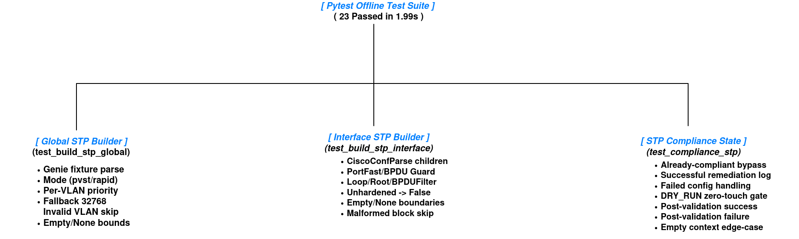

---

### Layer 1A: Global STP Builder Tests (`test_build_stp_global.py`)

Validates that `build_stp_global()` correctly extracts operational STP modes (`pvst` vs. `rapid-pvst`) and accurately normalizes configured bridge priorities per VLAN.

#### Test Cases Covered:
1. **`test_build_stp_global_valid`**: Validates parsing of real Genie fixture data (`stp_global_genie_output`), verifying `mode == "pvst"` and accurate priority extraction across all VLANs (VLAN 10: 24576, VLAN 20: 28672, VLAN 30: 12288, VLAN 40: 16384).
2. **`test_build_stp_global_empty`**: Confirms `None`, `{}`, and non‑STP structures safely return `{}` or default schema mappings.
3. **`test_build_stp_global_unknown`**: Asserts unsupported STP operational structures fall back to `mode: "unknown"`.
4. **`test_build_stp_global_missing_priority`**: Tests boundary handling where a VLAN lacks an explicit bridge priority, confirming fallback to standard default `32768`.
5. **`test_build_stp_global_invalid_vlan`**: Confirms non‑integer VLAN identifiers are safely skipped.

#### Code Excerpt (`test_build_stp_global.py`):

**Excerpt**

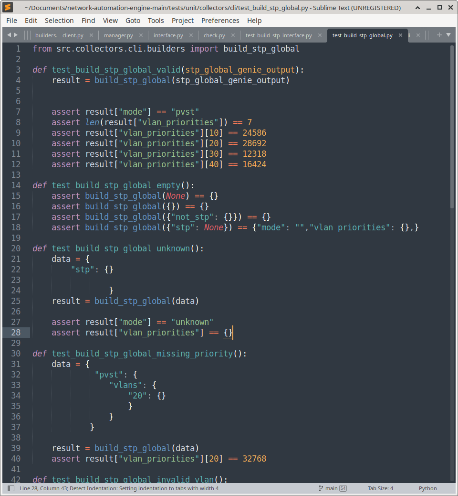

```python
from src.collectors.cli.builders import build_stp_global

def test_build_stp_global_valid(stp_global_genie_output):
    result = build_stp_global(stp_global_genie_output)

    assert result["mode"] == "pvst"
    assert result["vlan_priorities"][10] == 24576
    assert result["vlan_priorities"][20] == 28672
    assert result["vlan_priorities"][30] == 12288
    assert result["vlan_priorities"][40] == 16384

def test_build_stp_global_empty():
    assert build_stp_global(None) == {}
    assert build_stp_global({}) == {}
    assert build_stp_global({"not_stp": {}}) == {}
    assert build_stp_global({"stp": None}) == {"mode": "", "vlan_priorities": {}}

def test_build_stp_global_unknown():
    data = {
        "stp": {
            }
        }
    result = build_stp_global(data)

    assert result["mode"] == "unknown"
    assert result["vlan_priorities"] == {}

def test_build_stp_global_missing_priority():
    data = {
        "stp": {
            "pvst": {
                "vlans": {
                    "20": {}
                }
            }
        }
    }

    result = build_stp_global(data)
    assert result["vlan_priorities"][20] == 32768

def test_build_stp_global_invalid_vlan():
    data = {
        "stp": {
            "pvst": {
                "vlans": {
                    "20": {
                        "bridge": {
                            "configured_bridge_priority": 28672,
                        }
                    },
                    "abc": {
                        "bridge": {
                            "configured_bridge_priority": 32768,
                        },
                    }
                }
            }
        }
    }
    result = build_stp_global(data)
    assert len(result["vlan_priorities"]) == 1
    assert "abc" not in result["vlan_priorities"]
    assert result["vlan_priorities"][20] == "28672"
```

#### Terminal Execution:


```bash
$ PYTHONPATH=. pytest tests/unit/collectors/cli/test_build_stp_global.py -v
============================= test session starts ==============================
platform linux -- Python 3.12.10, pytest-9.2.0, pluggy-1.7.0 -- /home/rich/Documents/network-automation-engine-main/.venv/bin/python
cachedir: .pytest_cache
rootdir: /home/rich/Documents/network-automation-engine-main
collected 5 items

tests/unit/collectors/cli/test_build_stp_global.py::test_build_stp_global_valid PASSED            [ 20%]
tests/unit/collectors/cli/test_build_stp_global.py::test_build_stp_global_empty PASSED            [ 40%]
tests/unit/collectors/cli/test_build_stp_global.py::test_build_stp_global_unknown PASSED          [ 60%]
tests/unit/collectors/cli/test_build_stp_global.py::test_build_stp_global_missing_priority PASSED [ 80%]
tests/unit/collectors/cli/test_build_stp_global.py::test_build_stp_global_invalid_vlan PASSED     [100%]

============================== 5 passed in 0.60s ===============================
```

---

### Layer 1B: Interface STP Builder Tests (`test_build_stp_interface.py`)

Validates that `build_stp_interfaces()` uses `CiscoConfParse` to inspect running‑configuration child blocks for port‑level STP guards.

#### Test Cases Covered:
1. **`test_build_stp_interfaces_valid`**: Ingests `stp_interface_output`. Confirms active flags parse as `True` (`portfast`, `bpdu_guard`, `loop_guard`, `root_guard`, `bpdu_filter`).
2. **`test_build_stp_interfaces_no_stp`**: Asserts that unhardened ports correctly default all boolean flags to `False`.
3. **`test_build_stp_interfaces_empty`**: Asserts `{}`, `None`, and non‑STP configuration strings safely return `{}`.
4. **`test_build_stp_interfaces_invalid_interface`**: Injects a malformed interface block missing a port identifier; asserts the builder skips it and returns `{}`.

#### Code Excerpt (`test_build_stp_interface.py`):

**Excerpt**


```python
from src.collectors.cli.builders import build_stp_interfaces

def test_build_stp_interfaces_valid(stp_interface_output):
    result = build_stp_interfaces(stp_interface_output)

    assert len(result) == 9
    assert result["gigabitethernet0/1"]["portfast"] is True
    assert result["gigabitethernet0/1"]["bpdu_filter"] is True
    assert result["gigabitethernet0/1"]["bpdu_guard"] is True
    assert result["gigabitethernet0/1"]["root_guard"] is True
    assert result["gigabitethernet0/2"]["loop_guard"] is True

def test_build_stp_interfaces_no_stp(stp_interface_output):
    result = build_stp_interfaces(stp_interface_output)
    assert result["gigabitethernet0/3"]["portfast"] is False
    assert result["gigabitethernet0/3"]["bpdu_filter"] is False
    assert result["gigabitethernet0/3"]["bpdu_guard"] is False
    assert result["gigabitethernet0/3"]["root_guard"] is False
    assert result["gigabitethernet0/0"]["loop_guard"] is False

def test_build_stp_interfaces_empty():
    assert build_stp_interfaces({}) == {}
    assert build_stp_interfaces(None) == {}
    assert build_stp_interfaces({"not_run": {}}) == {}

def test_build_stp_interfaces_invalid_interface():
    data = {
        "running_config": """
interface
spanning-tree portfast
"""
    }
    result = build_stp_interfaces(data)
    assert result == {}
```

#### Terminal Execution:


```bash
$ PYTHONPATH=. pytest tests/unit/collectors/cli/test_build_stp_interface.py -v
============================= test session starts ==============================
platform linux -- Python 3.12.10, pytest-9.2.0, pluggy-1.7.0 -- /home/rich/Documents/network-automation-engine-main/.venv/bin/python
cachedir: .pytest_cache
rootdir: /home/rich/Documents/network-automation-engine-main
collected 4 items

tests/unit/collectors/cli/test_build_stp_interface.py::test_build_stp_interfaces_valid PASSED             [ 25%]
tests/unit/collectors/cli/test_build_stp_interface.py::test_build_stp_interfaces_no_stp PASSED             [ 50%]
tests/unit/collectors/cli/test_build_stp_interface.py::test_build_stp_interfaces_empty PASSED              [ 75%]
tests/unit/collectors/cli/test_build_stp_interface.py::test_build_stp_interfaces_invalid_interface PASSED  [100%]

============================== 4 passed in 0.63s ===============================
```

---

### Layer 2: STP Compliance Decision Engine Tests (`test_compliance_stp.py`)

Using `@patch` and `MagicMock`, this suite isolates both `compliance_stp_global()` and `compliance_stp_interfaces()` from physical devices, validating all 14 lifecycle state‑machine paths.

#### Test Scenarios Covered (14 Tests):

| Suite | Test Function | Operational Condition Tested |
| :--- | :--- | :--- |
| **Global STP** | `test_compliance_stp_global_already_compliant` | Verifies compliant mode/priorities skip configuration. |
| **Global STP** | `test_compliance_stp_global_non_compliant_config_successful` | Simulates priority drift followed by successful remediation. |
| **Global STP** | `test_compliance_stp_global_non_compliant_config_failed` | Catches remediation failures and updates status to `FAILED_CONFIG`. |
| **Global STP** | `test_compliance_stp_global_dry_run` | Verifies `DRY_RUN = True` prevents global CLI push. |
| **Global STP** | `test_compliance_stp_global_post_validation_successful` | Verifies closed‑loop state re‑poll confirms global compliance. |
| **Global STP** | `test_compliance_stp_global_post_validation_failed` | Verifies persistent global drift marks `FAILED_VALIDATION`. |
| **Global STP** | `test_compliance_stp_global_empty` | Bypasses checks gracefully when STP context is empty. |
| **Interface Guards** | `test_compliance_stp_interfaces_already_compliant` | Verifies compliant port guards skip configuration. |
| **Interface Guards** | `test_compliance_stp_interfaces_non_compliant_config_successful` | Simulates guard drift followed by successful remediation. |
| **Interface Guards** | `test_compliance_stp_interfaces_non_compliant_config_failed` | Catches interface push failure and logs critical issue. |
| **Interface Guards** | `test_compliance_stp_interfaces_dry_run` | Verifies `DRY_RUN = True` prevents interface CLI push. |
| **Interface Guards** | `test_compliance_stp_interfaces_post_validation_successful` | Verifies closed‑loop state re‑poll confirms interface guards. |
| **Interface Guards** | `test_compliance_stp_interfaces_post_validation_failed` | Verifies persistent guard drift marks `FAILED_VALIDATION`. |
| **Interface Guards** | `test_compliance_stp_interfaces_empty` | Bypasses checks gracefully when no interface STP context exists. |

#### Code Excerpt (`test_compliance_stp.py`):

**Excerpt**


```python
@patch("src.compliance.switching.stp.compliance.build_stp_global")
@patch("src.compliance.switching.stp.compliance.check_stp_global")
def test_compliance_stp_global_already_compliant(
    mock_check_stp_global, mock_build_stp_global,
    mock_sesh, mock_context, mock_device_result, mock_log, mock_transport
):
    mock_build_stp_global.return_value = {}
    mock_check_stp_global.return_value = (True, [])

    result = compliance_stp_global(
        mock_sesh, mock_sesh.device_ip, mock_context, {}, mock_device_result, mock_log, mock_transport
    )

    mock_log.info.assert_called_once()
    mock_log.warning.assert_not_called()
    assert any(
        "STP Global Configuration Already Compliant" in r
        for r in result["actions_taken"]
    )
    assert result["initial_issues"] == []
```

#### Terminal Execution:


```bash
$ PYTHONPATH=. pytest tests/unit/compliance/switching/test_compliance_stp.py -v
============================= test session starts ==============================
platform linux -- Python 3.12.10, pytest-9.2.0, pluggy-1.7.0 -- /home/rich/Documents/network-automation-engine-main/.venv/bin/python
cachedir: .pytest_cache
rootdir: /home/rich/Documents/network-automation-engine-main
collected 14 items

tests/unit/compliance/switching/test_compliance_stp.py::test_compliance_stp_global_already_compliant PASSED                 [  7%]
tests/unit/compliance/switching/test_compliance_stp.py::test_compliance_stp_global_non_compliant_config_successful PASSED   [ 14%]
tests/unit/compliance/switching/test_compliance_stp.py::test_compliance_stp_global_non_compliant_config_failed PASSED       [ 21%]
tests/unit/compliance/switching/test_compliance_stp.py::test_compliance_stp_global_dry_run PASSED                           [ 28%]
tests/unit/compliance/switching/test_compliance_stp.py::test_compliance_stp_global_post_validation_successful PASSED        [ 35%]
tests/unit/compliance/switching/test_compliance_stp.py::test_compliance_stp_global_post_validation_failed PASSED            [ 42%]
tests/unit/compliance/switching/test_compliance_stp.py::test_compliance_stp_global_empty PASSED                             [ 50%]
tests/unit/compliance/switching/test_compliance_stp.py::test_compliance_stp_interfaces_already_compliant PASSED             [ 57%]
tests/unit/compliance/switching/test_compliance_stp.py::test_compliance_stp_interfaces_non_compliant_config_successful PASSED [ 64%]
tests/unit/compliance/switching/test_compliance_stp.py::test_compliance_stp_interfaces_non_compliant_config_failed PASSED   [ 71%]
tests/unit/compliance/switching/test_compliance_stp.py::test_compliance_stp_interfaces_dry_run PASSED                       [ 78%]
tests/unit/compliance/switching/test_compliance_stp.py::test_compliance_stp_interfaces_post_validation_successful PASSED    [ 85%]
tests/unit/compliance/switching/test_compliance_stp.py::test_compliance_stp_interfaces_post_validation_failed PASSED        [ 92%]
tests/unit/compliance/switching/test_compliance_stp.py::test_compliance_stp_interfaces_empty PASSED                         [100%]

============================== 14 passed in 0.76s ===============================
```
### Continuous Integration Ready

The test framework is designed for CI/CD pipeline integration:

```yaml
# .github/workflows/test.yml (GitHub Actions Example)
name: Run Unit Tests

on: [push, pull_request]

jobs:
  test:
    runs-on: ubuntu-latest
    steps:
      - uses: actions/checkout@v3
      - name: Set up Python
        uses: actions/setup-python@v4
        with:
          python-version: '3.12'
      - name: Install dependencies
        run: pip install -r requirements.txt
      - name: Run tests with coverage                            <--------- Pytests 
        run: pytest tests/unit/ --cov=src --cov-report=xml
      - name: Upload coverage to Codecov
        uses: codecov/codecov-action@v3
```
---

### Test Suite Execution Summary

| Test Suite | File Path | Scope & Scenarios Covered | Status | Execution Time |
| :--- | :--- | :--- | :---: | :---: |
| **Global STP Builder** | `tests/unit/collectors/cli/test_build_stp_global.py` | Mode extraction, priority normalization, default fallbacks, boundary guards | **PASSED (5/5)** | 0.60s |
| **Interface STP Builder** | `tests/unit/collectors/cli/test_build_stp_interface.py` | `CiscoConfParse` child parsing, portfast/bpduguard/loopguard flags, malformed blocks | **PASSED (4/4)** | 0.63s |
| **STP Compliance Suite** | `tests/unit/compliance/switching/test_compliance_stp.py` | Global & interface lifecycle, bypass logic, remediation push, dry‑run, post‑checks | **PASSED (14/14)** | 0.76s |
| **Total** | | **Comprehensive Offline STP Test Suite** | **23 / 23** | **1.99s** |

---

## Conclusion & Engineering Takeaways

This module demonstrates that Layer 2 topology assurance is not just about running a `show spanning-tree` and eyeballing the output. By decoupling global priority validation from interface-level guard enforcement, this engine transforms STP hygiene from a manual, error-prone chore into a **deterministic, observable, and reversible software pipeline**.

Key architectural wins validated in this project include:
1. **Dual-Parser Strategy:** Using Genie for global operational truth and `CiscoConfParse` for hierarchical interface parsing ensures that both negotiated bridge priorities and exact CLI subcommands are captured with 100% accuracy, avoiding the pitfalls of regex-based scraping.
2. **Phantom VLAN Detection:** The engine doesn't just check priorities; it performs set-difference checks on VLAN topology. If a VLAN is missing from the live STP instance table or an unexpected VLAN (like a native VLAN 999) appears, it is immediately flagged.
3. **Zero-Touch Safety:** The `DRY_RUN` gating ensures that change-advisory boards (CABs) can review exact, rendered CLI payloads and projected state changes before any socket transmission occurs.
4. **Closed-Loop Guarantees:** Pushing a config via Netmiko is not proof of compliance. Re-querying the device and re-running the diff engine guarantees the hardware actually accepted and applied the change, catching silent SFP or transceiver faults.
5. **Resilient Exception Handling:** A broken Jinja2 template doesn't crash the pipeline. The `try/except` boundary catches the error, streams it to Splunk as an `ERROR` event for immediate triage, and allows the audit of remaining interfaces to continue uninterrupted.

### Next Steps & Future Enhancements
To further evolve this automation engine, the following enhancements are planned:
- **Multi-Vendor Abstraction:** Leverage Genie's vendor-agnostic parsing to extend this exact same compliance logic to Arista (EOS) and Juniper (Junos) platforms without rewriting the core diff engine.
- **Advanced L2 Policy Validation:** Expand the compliance checks to validate Link Aggregation (LACP/EtherChannel) member states, UniDirectional Link Detection (UDLD), and dynamic MAC address learning limits.
- **CI/CD Pipeline Integration:** Embed the existing 23-case Pytest suite into GitHub Actions to automatically block Pull Requests that introduce regressions to the compliance logic or Jinja2 templates.

---

### Return to Main Repository

This module is part of a broader Network Automation Engine portfolio. 

**Explore other modules:**
- [Interface Compliance & Remediation](../interface-compliance/)
- [Trunk Port Compliance & Remediation](../trunk-ports/)
- [Access Port Compliance & Remediation](../access-ports/)
- [F5 BIG-IP LTM Cloud Load Balancing](../f5-big-ip-ltm-lab/)

**[Return to Main Repository README](../README.md)**
