# Syslog Compliance & Remediation

## Executive Overview

In an enterprise network, centralized logging is a fundamental security and operational requirement. Inconsistent syslog configurations—such as missing logging hosts, incorrect source interfaces, or lack of millisecond timestamps—blind Security Operations (SecOps) and complicate post-incident forensics.

The **Syslog Compliance & Remediation** module is a production-grade, closed-loop automation engine designed to eliminate these risks. It enforces deterministic logging standards across all infrastructure devices by reconciling live switch state against a **NetBox Source of Truth (SoT)**. 

Unlike naive automation scripts that merely append configuration, this pipeline provides end-to-end lifecycle management. It utilizes a **multi-transport architecture** (NETCONF / NETMIKO) to extract operational logging state, performs strict set-equality diffing to catch unauthorized rogue collectors instantly, and applies a **two-phase reconciliation pattern** (negate drift, then enforce baseline) to guarantee true idempotency before logging the outcome to a centralized SIEM.

### Core Engineering Objectives
- **Declarative Baseline:** Establish NetBox Config Contexts as the single source of truth for logging hosts, trap levels, source interfaces, and timestamp precision.
- **Multi-Transport Data Extraction:** Utilize Cisco pyATS/Genie for operational logging state and `CiscoConfParse` for hierarchical running-config parsing, dynamically routing through either NETCONF or NETMIKO based on device capability.
- **Deterministic Set-Based Diffing:** Compare live operational multi-host configurations against NetBox intent using order-independent tuple sets, catching unauthorized rogue hosts or missing primaries instantly.
- **Two-Phase Idempotent Remediation:** Apply configuration changes using Jinja2 templates that explicitly negate observed drift (e.g., `no logging host 8.8.8.8`) *before* enforcing the authorized NetBox baseline, preventing orphaned syslog servers.
- **Closed-Loop Verification:** Re-poll the device post-remediation to guarantee the physical data plane matches the intended state before marking the task complete.
- **Enterprise Observability:** Stream structured, severity-coded JSON telemetry to Splunk for real-time NOC/SecOps dashboards and immutable audit trails.
- **CI/CD Readiness:** Validate the entire state machine with 20 offline Pytest cases (parametrized across both transports), ensuring zero-regression deployments without requiring live hardware.

---

## Architecture

The Syslog Compliance module follows the project's Source of Truth-driven architecture, decoupling data collection, normalization, decisioning, and remediation:

| Component | Responsibility |
|---|---|
| **NetBox Inventory** | Supplies expected global syslog parameters (hosts, facility, trap level, source interface, timestamps). |
| **Dual Collector** | Queries `show logging` (Genie) and `show run` (raw text) over Netmiko/NETCONF with isolated fault tolerance. |
| **Syslog Builder** | `build_syslog_netmiko()` normalizes Genie dicts and uses `CiscoConfParse` to detect millisecond timestamp directives. |
| **Compliance Checker** | Compares expected NetBox intent against actual live state using set-equality for hosts and strict string matching for parameters. |
| **Remediation Engine** | Applies targeted `logging` configuration changes via two-phase Jinja2 templates (negation + enforcement). |
| **Post-Validation** | Re-queries and re-evaluates the device to verify that remediation achieved the expected configuration. |

## Topology

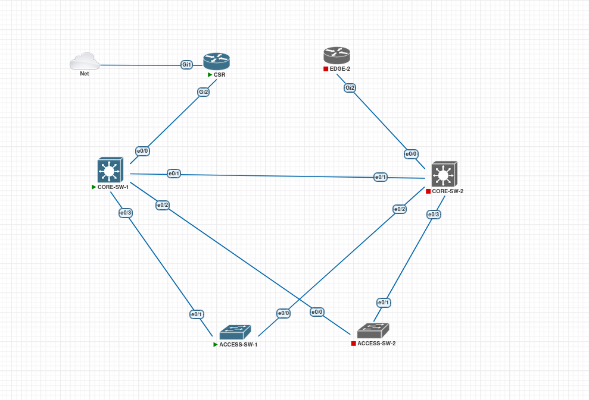

### Table of Contents

- [1. Intended State: NetBox Source of Truth (Centralized Syslog Architecture)](#1-intended-state-netbox-source-of-truth-centralized-syslog-architecture)
- [2. Live Device State Collection & Syslog Parsing](#2-live-device-state-collection--syslog-parsing)
- [3. Syslog Compliance Diff Engine & Drift Detection](#3-syslog-compliance-diff-engine--drift-detection)
- [4. Configuration Remediation](#4-configuration-remediation)
- [5. Safe Change Management: Dry-Run Mode](#5-safe-change-management-dry-run-mode)
- [6. Post-Remediation Validation & Physical Device Proof](#6-post-remediation-validation--physical-device-proof)
- [8. Audit Logging & Splunk Telemetry Pipeline (Syslog Service)](#8-audit-logging--splunk-telemetry-pipeline-syslog-service)
- [9. Automated Unit Testing & CI/CD Validation (Syslog Service)](#9-automated-unit-testing--cicd-validation-syslog-service)

## 1. Intended State: NetBox Source of Truth (Centralized Syslog Architecture)

In an enterprise network, centralized logging is a fundamental security and operational requirement. Inconsistent syslog configurations such as missing logging hosts, wrong source interfaces, or lack of millisecond timestamps blind security operations (SecOps) and complicate post-incident forensics.

To enforce deterministic logging standards across all infrastructure devices, the automation engine establishes **NetBox** as the authoritative Source of Truth (SoT). The centralized logging baseline is declared using structured JSON within **NetBox Config Contexts** (`dcim/devices/<id>/config-context/`).

---

### 1. Declaring Syslog Baseline in NetBox Config Context

Both distribution switch `CORE-SW-1` and access switch `ACCESS-SW-1` inherit the standardized enterprise logging policy:

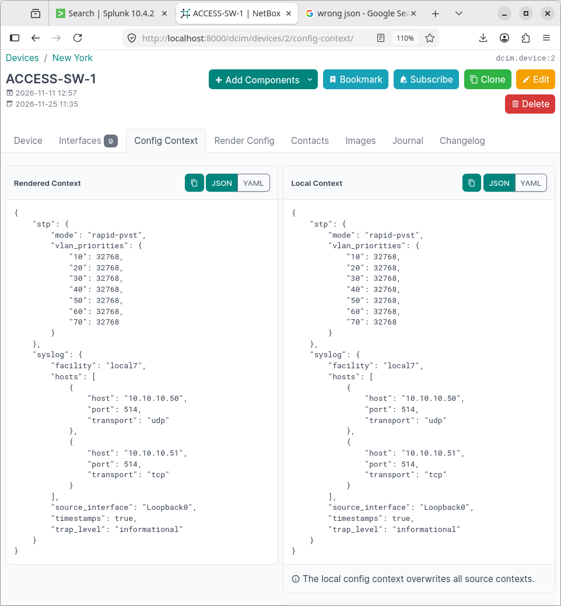

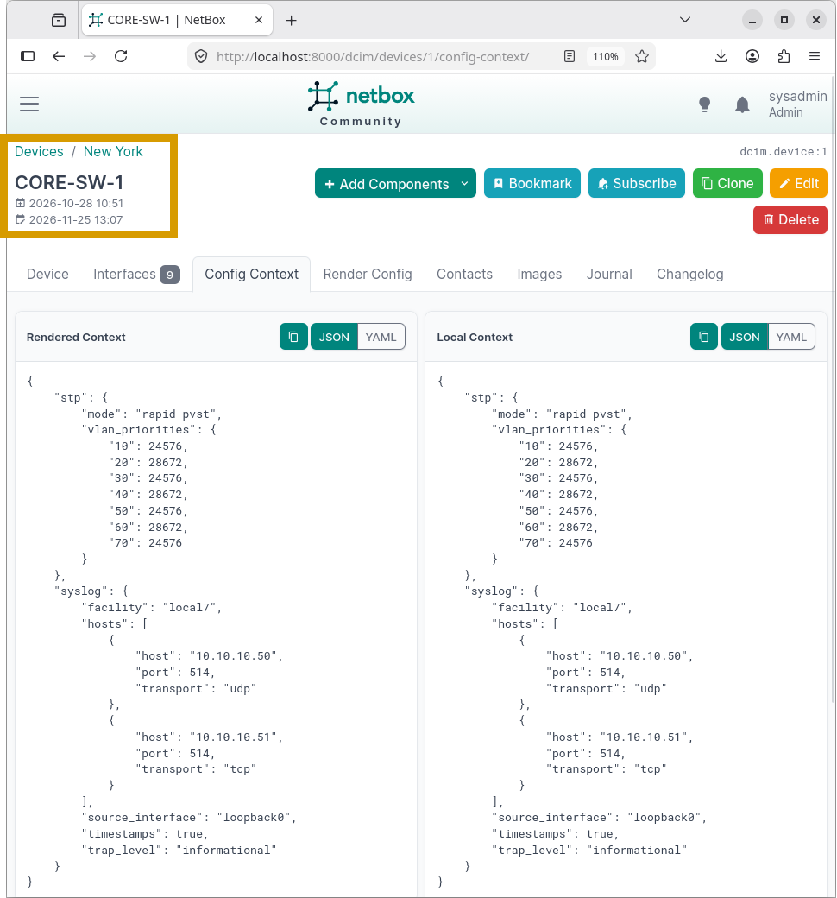

```json
{
  "syslog": {
    "facility": "local7",
    "hosts": [
      {
        "host": "10.10.10.50",
        "port": 514,
        "transport": "udp"
      },
      {
        "host": "10.10.10.51",
        "port": 514,
        "transport": "tcp"
      }
    ],
    "source_interface": "Loopback0",
    "timestamps": true,
    "trap_level": "informational"
  }
}
```

#### Policy Specification:

| Syslog Parameter | Intended Value | Operational & Security Purpose |
| :--- | :---: | :--- |
| **`facility`** | `local7` | Isolates network infrastructure logs into a dedicated syslog facility for SIEM filtering. |
| **Primary Collector** | `10.10.10.50:514` (`udp`) | Primary high-throughput UDP logging destination. |
| **Secondary Collector** | `10.10.10.51:514` (`tcp`) | Reliable, connection-oriented TCP logging destination for guaranteed log delivery. |
| **`source_interface`** | `Loopback0` | Ensures syslog packets originate from a stable, reachability-independent loopback IP rather than flapping physical links. |
| **`timestamps`** | `True` | Enforces millisecond-accurate uptime/datetime stamps (`service timestamps log datetime msec`). |
| **`trap_level`** | `informational` | Forwards all operational events at Severity 6 (`informational`) or higher to the collectors. |

---

### 2. Inventory Ingestion Engine (`src/sot/inventory.py`)

During inventory synchronization, the engine extracts the `syslog_context` from NetBox device context and structures it into the target device configuration model:

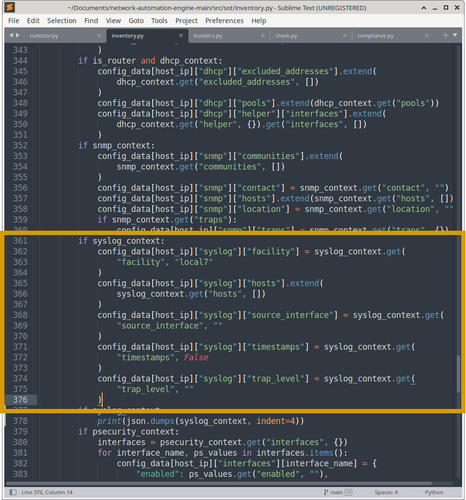

```python
# src/sot/inventory.py (Syslog Ingestion Logic)

if syslog_context:
    config_data[host_ip]["syslog"]["facility"] = syslog_context.get(
        "facility", "local7"
    )
    config_data[host_ip]["syslog"]["hosts"].extend(
        syslog_context.get("hosts", [])
    )
    config_data[host_ip]["syslog"]["source_interface"] = syslog_context.get(
        "source_interface", ""
    )
    config_data[host_ip]["syslog"]["timestamps"] = syslog_context.get(
        "timestamps", False
    )
    config_data[host_ip]["syslog"]["trap_level"] = syslog_context.get(
        "trap_level", ""
    )
```

---

### 3. Normalized Desired-State Output

At runtime, the inventory engine compiles the NetBox declarations and validates the ingested parameters before executing device audits:

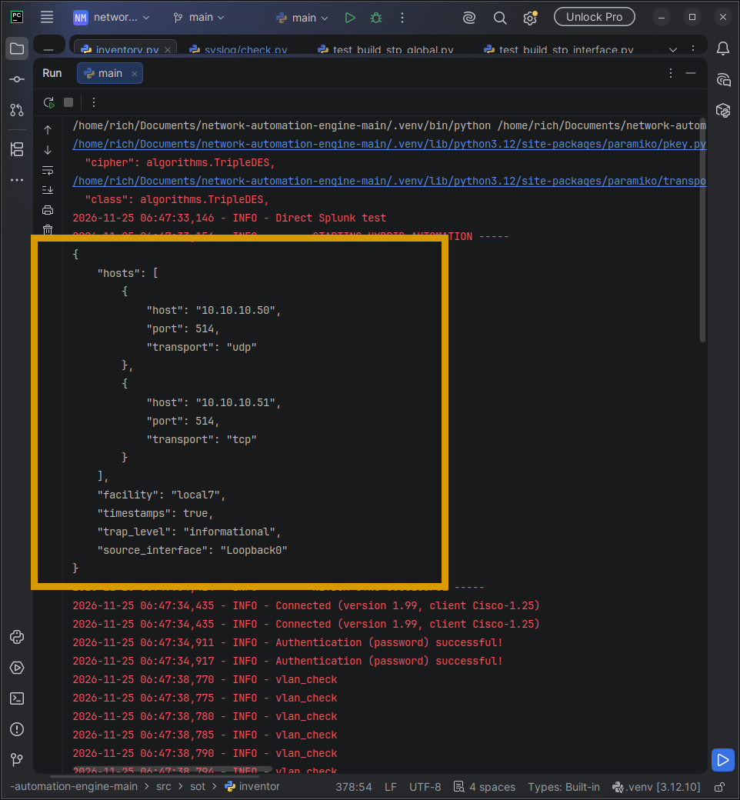

```json
{
  "hosts": [
    {
      "host": "10.10.10.50",
      "port": 514,
      "transport": "udp"
    },
    {
      "host": "10.10.10.51",
      "port": 514,
      "transport": "tcp"
    }
  ],
  "facility": "local7",
  "timestamps": true,
  "trap_level": "informational",
  "source_interface": "Loopback0"
}
```

```text
2026-11-25 06:47:34,424 - INFO - ----- NETBOX SYNC SUCCESSFUL -----
2026-11-25 06:47:34,435 - INFO - Connected (version 1.99, client Cisco-1.25)
2026-11-25 06:47:34,911 - INFO - Authentication (password) successful!
```

> **Design Principle:**
> By treating centralized logging parameters as a declarative contract in NetBox, the downstream diff engine (`check_syslog()`) can simultaneously audit collector IPs, transport protocols (UDP vs. TCP), source interface bindings, and timestamp precision across the entire switching fabric.

---

## 2. Live Device State Collection & Syslog Parsing

Extracting a complete syslog operational profile requires evaluating two separate sources:
1. **Operational Logging State (`show logging`):** Best parsed using **Cisco pyATS / Genie** to extract active logging hosts, transport protocols (UDP vs. TCP), ports, trap severity thresholds, and bound source interfaces.
2. **Global Service Timestamps (`show run`):** Best parsed via **`CiscoConfParse`** on the running configuration to verify that high-precision millisecond timestamps (`service timestamps log datetime msec`) are active.

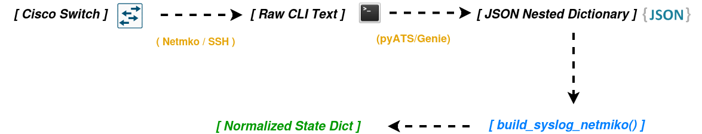

---

### 1. Dual-Command State Collection (`src/collectors/cli/collector.py`)

The collector executes `show run` and `show logging` under isolated `try/except` blocks to prevent parser exceptions or command timeouts from breaking the audit loop:

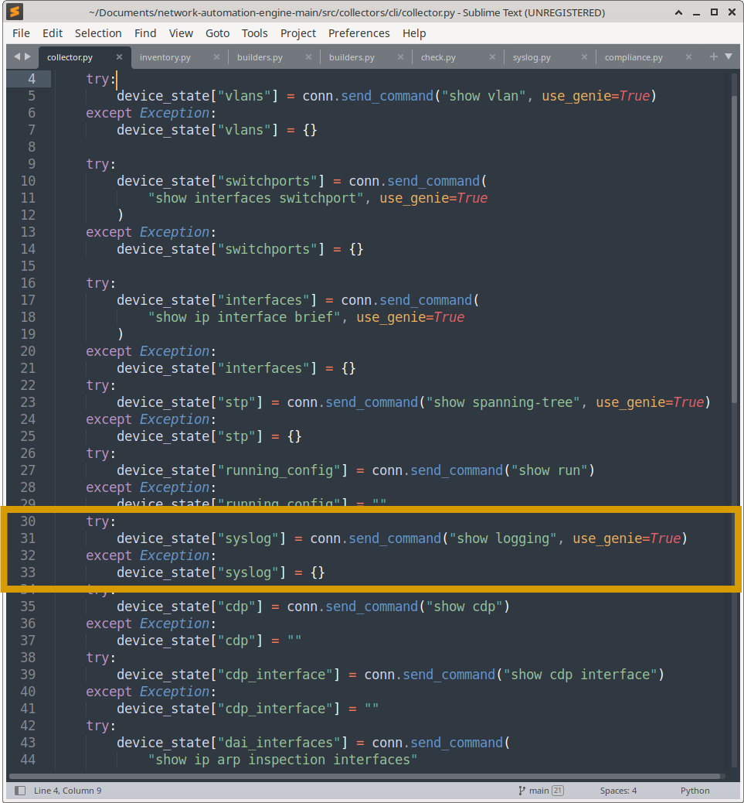

```python
# src/collectors/cli/collector.py (Syslog & Running-Config Boundaries)

    try:
        device_state["running_config"] = conn.send_command("show run")
    except Exception:
        device_state["running_config"] = ""
    try:
        device_state["syslog"] = conn.send_command("show logging", use_genie=True)
    except Exception:
        device_state["syslog"] = {}
```

---

### 2. Syslog Normalization Builder (`src/collectors/cli/builders.py`)

The `build_syslog_netmiko()` function combines operational Genie data with `CiscoConfParse` object matching, outputting a normalized dictionary matching the NetBox data schema:

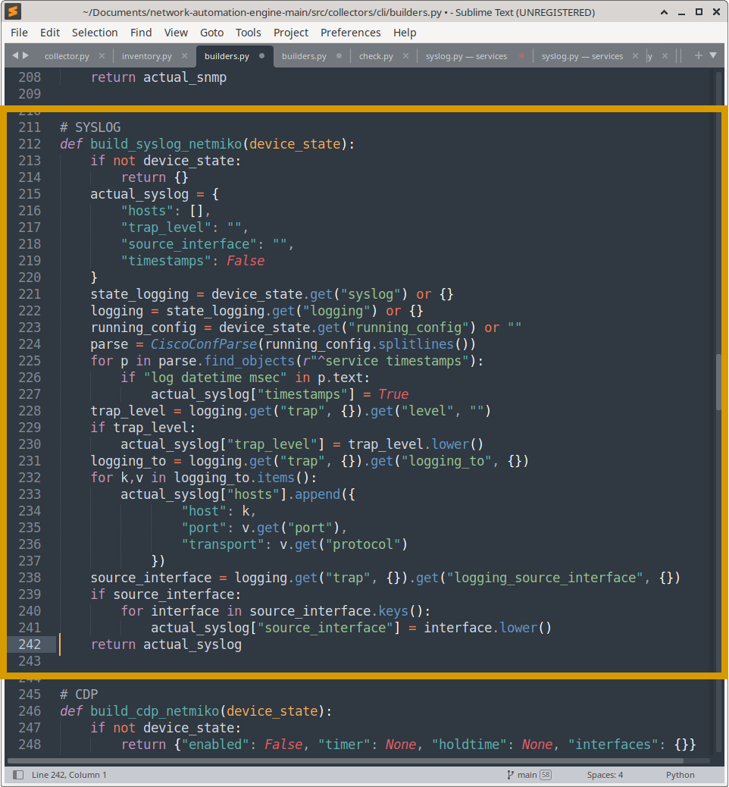

```python
# SYSLOG
def build_syslog_netmiko(device_state):
    if not device_state:
        return {}
    actual_syslog = {
        "hosts": [],
        "trap_level": "",
        "source_interface": "",
        "timestamps": False
    }
    state_logging = device_state.get("syslog") or {}
    logging = state_logging.get("logging") or {}
    running_config = device_state.get("running_config") or ""
    parse = CiscoConfParse(running_config.splitlines())
    for p in parse.find_objects(r"^service timestamps"):
        if "log datetime msec" in p.text:
            actual_syslog["timestamps"] = True
    trap_level = logging.get("trap", {}).get("level", "")
    if trap_level:
        actual_syslog["trap_level"] = trap_level.lower()
    logging_to = logging.get("trap", {}).get("logging_to", {})
    for k,v in logging_to.items():
        actual_syslog["hosts"].append({
            "host": k,
            "port": v.get("port"),
            "transport": v.get("protocol")
        })
    source_interface = logging.get("trap", {}).get("logging_source_interface", {})
    if source_interface:
        for interface in source_interface.keys():
            actual_syslog["source_interface"] = interface.lower()
    return actual_syslog
```

---

### 3. Live Device State vs. Normalized Output

To test the builder's extraction capabilities, out-of-band configuration drift was applied directly on `CORE-SW-1`:

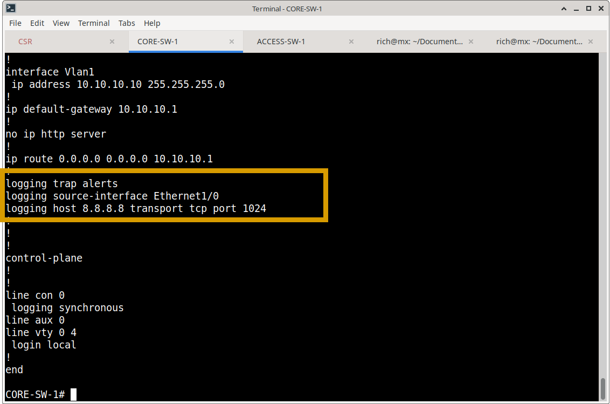

```cisco
CORE-SW-1# show running-config | include logging
logging trap alerts
logging source-interface Ethernet1/0
logging host 8.8.8.8 transport tcp port 1024
```

#### Normalized Builder Output:
When the collector audited `CORE-SW-1`, `build_syslog_netmiko()` converted the live switch state into the following structured dictionary:

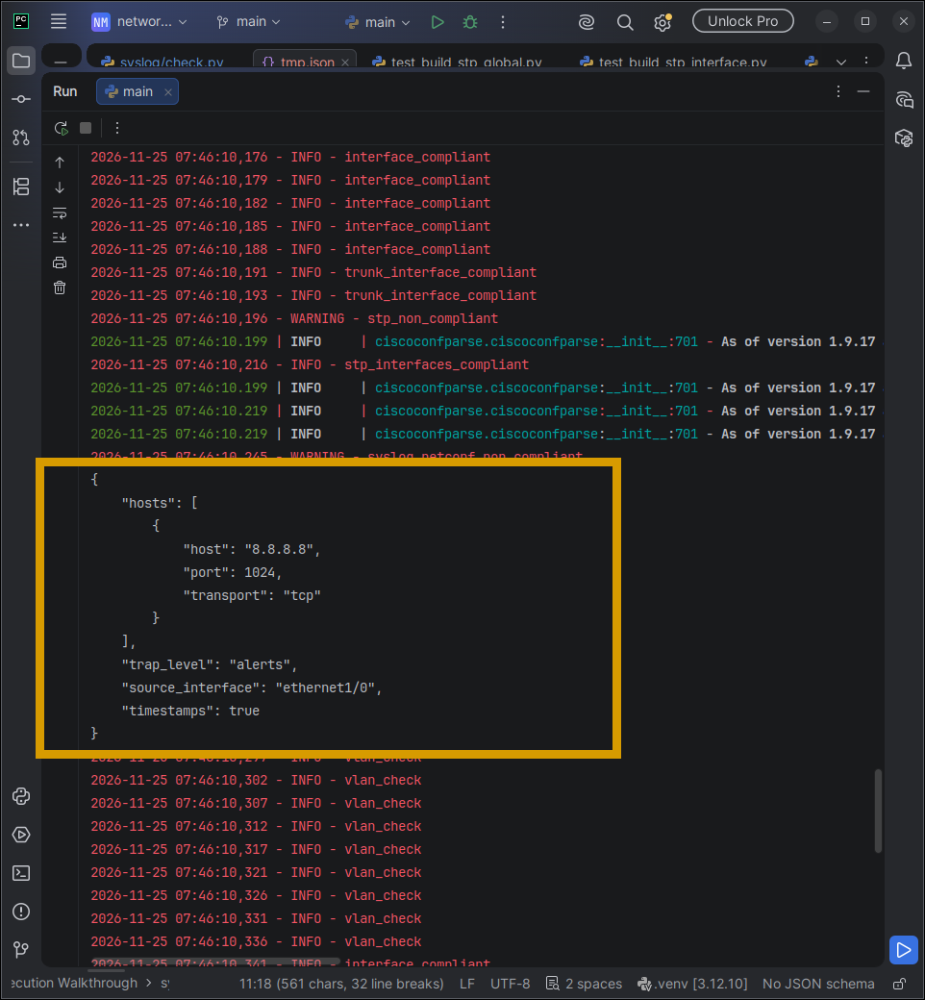

```json
{
    "hosts": [
        {
            "host": "8.8.8.8",
            "port": 1024,
            "transport": "tcp"
        }
    ],
    "trap_level": "alerts",
    "source_interface": "ethernet1/0",
    "timestamps": true
}
```

---

### 4. Operational Drift Baseline

Comparing the normalized output against the **NetBox Desired State** immediately reveals multi-parameter configuration drift:

| Syslog Attribute | NetBox Declared Intent | Observed Switch State | Compliance Evaluation |
| :--- | :--- | :--- | :---: |
| **Logging Hosts** | `10.10.10.50` (UDP 514)<br>`10.10.10.51` (TCP 514) | `8.8.8.8` (TCP 1024) | **DRIFT (Unauthorized Host / Missing Primary)** |
| **Trap Severity Level** | `informational` | `alerts` | **DRIFT (Severity Too Restrictive)** |
| **Source Interface** | `Loopback0` | `ethernet1/0` | **DRIFT (Physical Interface Flap Risk)** |
| **Service Timestamps** | `True` (`msec`) | `True` (`msec`) | **COMPLIANT** |

> **Next Step:** This normalized observed dictionary is fed directly into `check_syslog()`, triggering targeted remediation to remove rogue host `8.8.8.8`, restore dual collectors, re-bind `Loopback0`, and set trap levels to `informational`.

---

## 3. Syslog Compliance Diff Engine & Drift Detection

The syslog compliance module audits centralized logging infrastructure against the NetBox baseline. It features a **multi-transport architecture** that dynamically routes collection, diff evaluation, and remediation through either **NETCONF** (YANG operational data) or **NETMIKO** (CLI parsing).

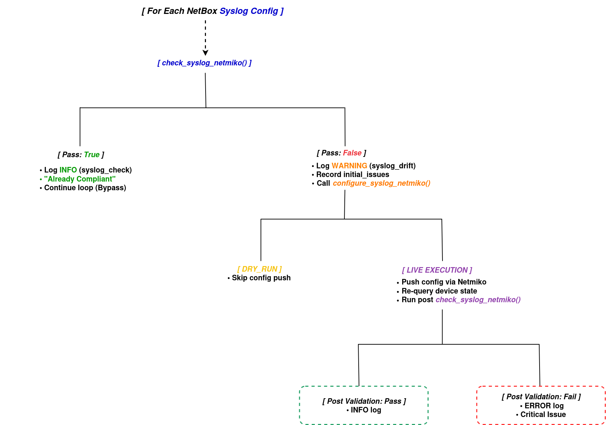

---

### 1. Multi-Attribute Diff Engine (`src/compliance/services/syslog/check.py`)

The `check_syslog()` function verifies syslog configurations across multiple parameters. Logging host destinations are converted into sets of tuples `(host, port, transport)` to allow order-independent set-equality comparisons:

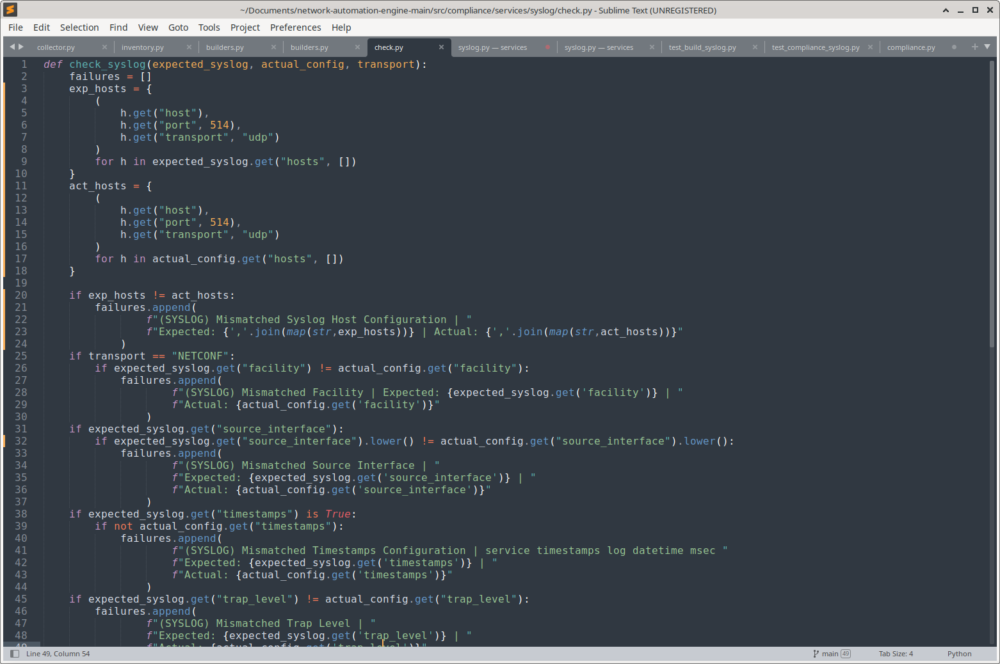

```python
# src/compliance/services/syslog/check.py

def check_syslog(expected_syslog, actual_config, transport):
    failures = []
    exp_hosts = {
        (
            h.get("host"),
            h.get("port", 514),
            h.get("transport", "udp")
        )
        for h in expected_syslog.get("hosts", [])
    }
    act_hosts = {
        (
            h.get("host"),
            h.get("port", 514),
            h.get("transport", "udp")
        )
        for h in actual_config.get("hosts", [])
    }

    if exp_hosts != act_hosts:
        failures.append(
            f"(SYSLOG) Mismatched Syslog Host Configuration | "
            f"Expected: {','.join(map(str,exp_hosts))} | Actual: {','.join(map(str,act_hosts))}"
        )
    if transport == "NETCONF":
        if expected_syslog.get("facility") != actual_config.get("facility"):
            failures.append(
                f"(SYSLOG) Mismatched Facility | Expected: {expected_syslog.get('facility')} | "
                f"Actual: {actual_config.get('facility')}"
            )
    if expected_syslog.get("source_interface"):
        if expected_syslog.get("source_interface").lower() != actual_config.get("source_interface").lower():
            failures.append(
                f"(SYSLOG) Mismatched Source Interface | "
                f"Expected: {expected_syslog.get('source_interface')} | "
                f"Actual: {actual_config.get('source_interface')}"
            )
    if expected_syslog.get("timestamps") is True:
        if not actual_config.get("timestamps"):
            failures.append(
                f"(SYSLOG) Mismatched Timestamps Configuration | service timestamps log datetime msec "
                f"Expected: {expected_syslog.get('timestamps')} | "
                f"Actual: {actual_config.get('timestamps')}"
            )
    if expected_syslog.get("trap_level") != actual_config.get("trap_level"):
        failures.append(
            f"(SYSLOG) Mismatched Trap Level | "
            f"Expected: {expected_syslog.get('trap_level')} | "
            f"Actual: {actual_config.get('trap_level')}"
        )
    return len(failures) == 0, failures
```

---

### 2. Multi-Transport Compliance Orchestrator (`src/compliance/services/syslog/compliance.py`)

The compliance manager routes data through the appropriate builder based on transport, executes `check_syslog()`, logs drift warnings, and coordinates closed-loop post-validation:

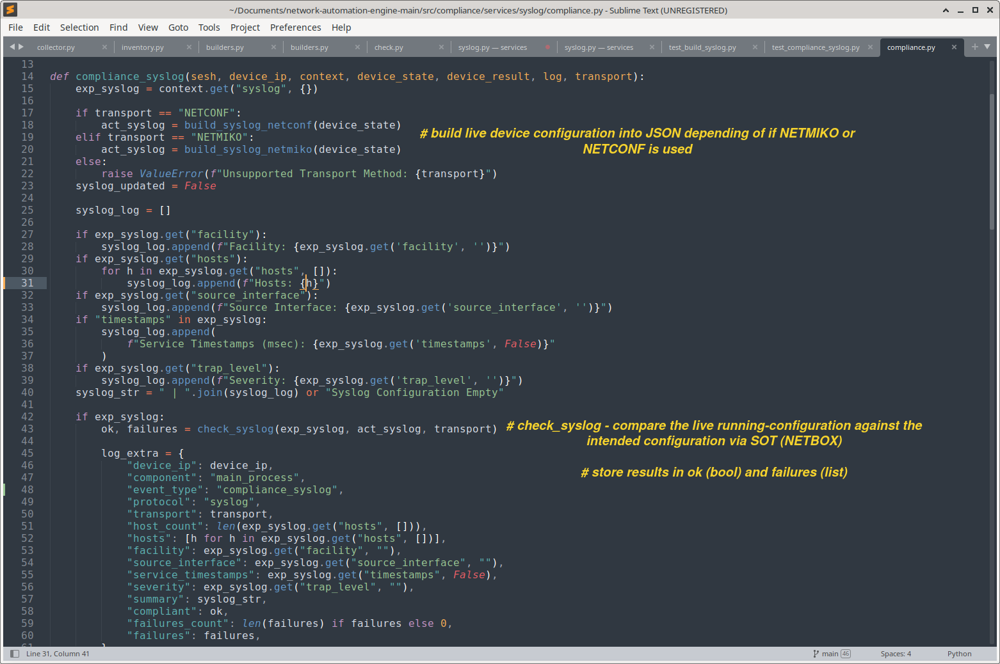

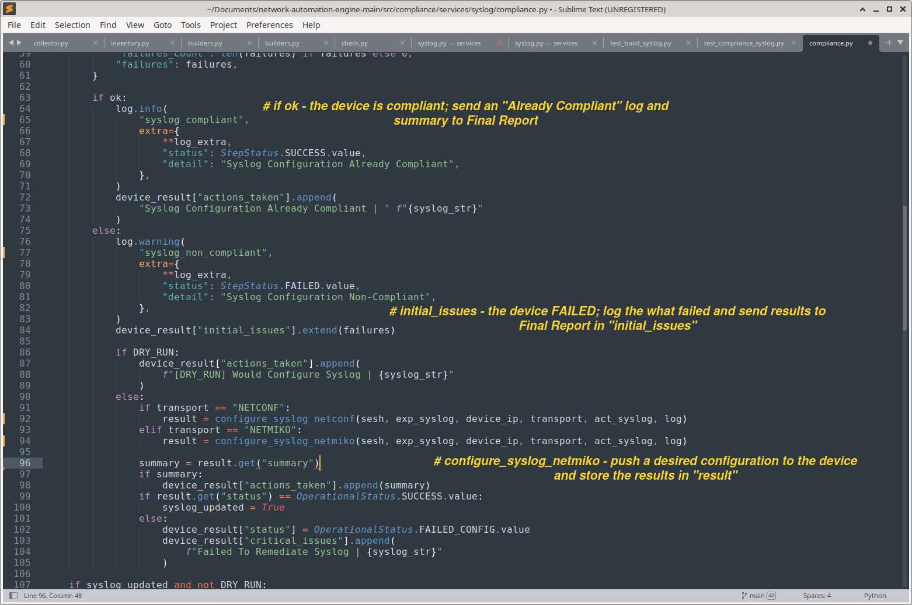

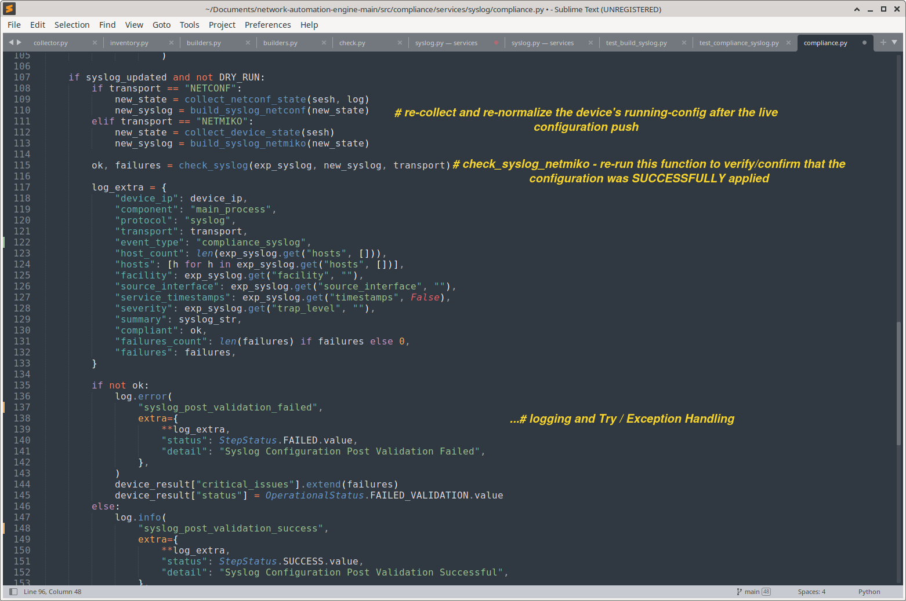

```python
# src/compliance/services/syslog/compliance.py

from src.core.enums import StepStatus, OperationalStatus
from src.collectors.cli.builders import build_syslog_netmiko
from src.collectors.netconf.builders import build_syslog_netconf
from src.collectors.cli.collector import collect_device_state
from src.collectors.netconf.collector import collect_netconf_state
from src.compliance.services.syslog.check import check_syslog
from src.remediation.services.syslog import (
    configure_syslog_netconf,
    configure_syslog_netmiko,
)
from src.core.settings import DRY_RUN


def compliance_syslog(sesh, device_ip, context, device_state, device_result, log, transport):
    exp_syslog = context.get("syslog", {})

    if transport == "NETCONF":
        act_syslog = build_syslog_netconf(device_state)
    elif transport == "NETMIKO":
        act_syslog = build_syslog_netmiko(device_state)
    else:
        raise ValueError(f"Unsupported Transport Method: {transport}")
    syslog_updated = False

    syslog_log = []

    if exp_syslog.get("facility"):
        syslog_log.append(f"Facility: {exp_syslog.get('facility', '')}")
    if exp_syslog.get("hosts"):
        for h in exp_syslog.get("hosts", []):
            syslog_log.append(f"Hosts: {h}")
    if exp_syslog.get("source_interface"):
        syslog_log.append(f"Source Interface: {exp_syslog.get('source_interface', '')}")
    if "timestamps" in exp_syslog:
        syslog_log.append(
            f"Service Timestamps (msec): {exp_syslog.get('timestamps', False)}"
        )
    if exp_syslog.get("trap_level"):
        syslog_log.append(f"Severity: {exp_syslog.get('trap_level', '')}")
    syslog_str = " | ".join(syslog_log) or "Syslog Configuration Empty"

    if exp_syslog:
        ok, failures = check_syslog(exp_syslog, act_syslog, transport)

        log_extra = {
            "device_ip": device_ip,
            "component": "main_process",
            "event_type": "compliance_syslog",
            "protocol": "syslog",
            "transport": transport,
            "host_count": len(exp_syslog.get("hosts", [])),
            "hosts": [h for h in exp_syslog.get("hosts", [])],
            "facility": exp_syslog.get("facility", ""),
            "source_interface": exp_syslog.get("source_interface", ""),
            "service_timestamps": exp_syslog.get("timestamps", False),
            "severity": exp_syslog.get("trap_level", ""),
            "summary": syslog_str,
            "compliant": ok,
            "failures_count": len(failures) if failures else 0,
            "failures": failures,
        }

        if ok:
            log.info(
                "syslog_compliant",
                extra={
                    **log_extra,
                    "status": StepStatus.SUCCESS.value,
                    "detail": "Syslog Configuration Already Compliant",
                },
            )
            device_result["actions_taken"].append(
                "Syslog Configuration Already Compliant | " f"{syslog_str}"
            )
        else:
            log.warning(
                "syslog_non_compliant",
                extra={
                    **log_extra,
                    "status": StepStatus.FAILED.value,
                    "detail": "Syslog Configuration Non-Compliant",
                },
            )
            device_result["initial_issues"].extend(failures)

            if DRY_RUN:
                device_result["actions_taken"].append(
                    f"[DRY_RUN] Would Configure Syslog | {syslog_str}"
                )
            else:
                if transport == "NETCONF":
                    result = configure_syslog_netconf(sesh, exp_syslog, device_ip, transport, act_syslog, log)
                elif transport == "NETMIKO":
                    result = configure_syslog_netmiko(sesh, exp_syslog, device_ip, transport, act_syslog, log)

                summary = result.get("summary")
                if summary:
                    device_result["actions_taken"].append(summary)
                if result.get("status") == OperationalStatus.SUCCESS.value:
                    syslog_updated = True
                else:
                    device_result["status"] = OperationalStatus.FAILED_CONFIG.value
                    device_result["critical_issues"].append(
                        f"Failed To Remediate Syslog | {syslog_str}"
                    )

    if syslog_updated and not DRY_RUN:
        if transport == "NETCONF":
            new_state = collect_netconf_state(sesh, log)
            new_syslog = build_syslog_netconf(new_state)
        elif transport == "NETMIKO":
            new_state = collect_device_state(sesh)
            new_syslog = build_syslog_netmiko(new_state)

        ok, failures = check_syslog(exp_syslog, new_syslog, transport)

        if not ok:
            log.error(
                "syslog_post_validation_failed",
                extra={
                    **log_extra,
                    "status": StepStatus.FAILED.value,
                    "detail": "Syslog Configuration Post Validation Failed",
                },
            )
            device_result["critical_issues"].extend(failures)
            device_result["status"] = OperationalStatus.FAILED_VALIDATION.value
        else:
            log.info(
                "syslog_post_validation_success",
                extra={
                    **log_extra,
                    "status": StepStatus.SUCCESS.value,
                    "detail": "Syslog Configuration Post Validation Successful",
                },
            )
            device_result["actions_taken"].append(
                "Syslog Configuration Post Validation Successful | " f"{syslog_str}"
            )
    return device_result
```

---

### 3. Real-World Drift Evidence & Terminal Output

When audited against the running configuration on `CORE-SW-1`, the compliance engine detected multiple concurrent drift conditions:

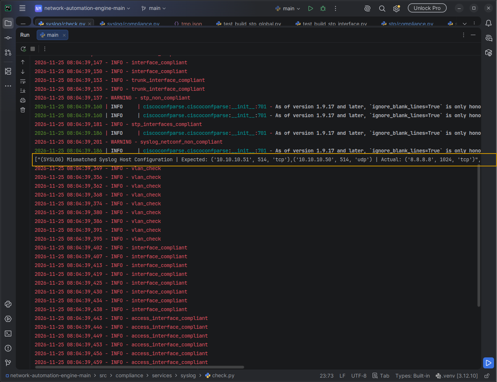

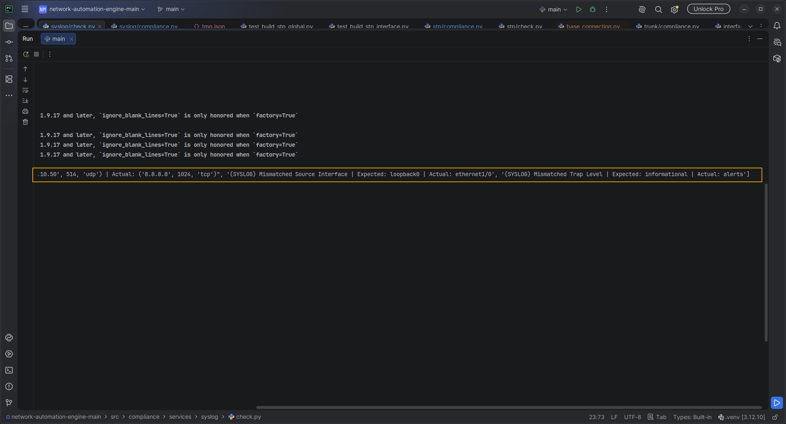

```text
2026-11-25 08:04:39,201 - WARNING - syslog_netconf_non_compliant
["(SYSLOG) Mismatched Syslog Host Configuration | Expected: ('10.10.10.51', 514, 'tcp'),('10.10.10.50', 514, 'udp') | Actual: ('8.8.8.8', 1024, 'tcp')",
 "(SYSLOG) Mismatched Source Interface | Expected: loopback0 | Actual: ethernet1/0",
 "(SYSLOG) Mismatched Trap Level | Expected: informational | Actual: alerts"]
```

#### Machine-Readable Record: `final_compliance_report.json`
The initial drift findings were automatically cataloged in `final_compliance_report.json` under `initial_issues`:

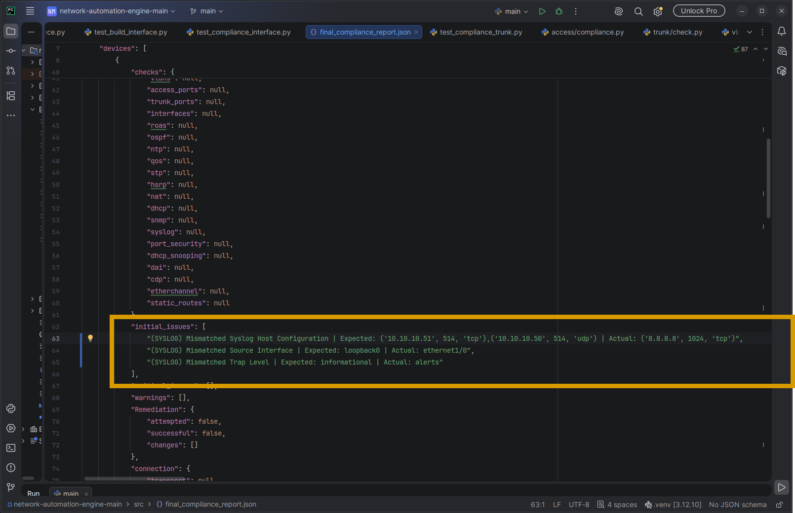

```json
{
  "initial_issues": [
    "(SYSLOG) Mismatched Syslog Host Configuration | Expected: ('10.10.10.51', 514, 'tcp'),('10.10.10.50', 514, 'udp') | Actual: ('8.8.8.8', 1024, 'tcp')",
    "(SYSLOG) Mismatched Source Interface | Expected: loopback0 | Actual: ethernet1/0",
    "(SYSLOG) Mismatched Trap Level | Expected: informational | Actual: alerts"
  ]
}
```

---

### 4. Syslog Compliance Evaluation Matrix

| Evaluated Parameter | NetBox Desired Intent | Observed Switch State | Compliance Result | Action Dispatched |
| :--- | :--- | :--- | :---: | :--- |
| **Collector Hosts** | `10.10.10.50` (UDP 514)<br>`10.10.10.51` (TCP 514) | `8.8.8.8` (TCP 1024) | **FAIL (Host Mismatch)** | Remove `8.8.8.8`; deploy primary and secondary collector hosts. |
| **Source Interface** | `Loopback0` | `ethernet1/0` | **FAIL (Interface Mismatch)** | Re-bind logging source to `Loopback0`. |
| **Trap Severity** | `informational` | `alerts` | **FAIL (Severity Mismatch)** | Apply `logging trap informational`. |
| **Service Timestamps** | `True` (`msec`) | `True` (`msec`) | **PASS (Compliant)** | No action required. |
| **Facility (NETCONF)** | `local7` | `local7` | **PASS (Compliant)** | No action required. |

---

## 4. Configuration Remediation

When syslog drift is detected, the engine routes remediation through the transport-matched handler in `src/remediation/services/syslog.py`:

1. **`configure_syslog_netmiko`** — renders `templates/syslog_netmiko.j2`, applies the CLI command set over Netmiko, and persists to NVRAM via `conn.save_config()`.
2. **`configure_syslog_netconf`** — renders `templates/SYSLOG_NC.j2` and `templates/SYS_Time_NC.j2`, applies the change via `session.edit_config(target="running")`.

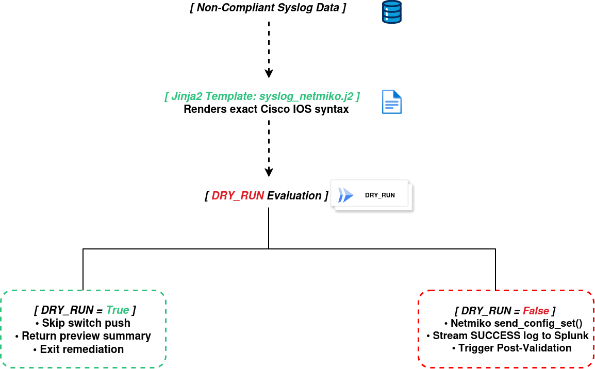

### Declarative Negation & Remediation Template (`templates/syslog_netmiko.j2`)

A common flaw in simple automation scripts is only appending new configuration without cleaning up old or unauthorized settings. This leaves rogue syslog servers receiving sensitive network traffic.

To ensure idempotent remediation, `templates/syslog_netmiko.j2` uses a **two-phase reconciliation pattern**:
1. **Negation Phase (`act_syslog`):** Inspects the observed live switch state and generates `no` commands to tear down rogue logging hosts, incorrect source interfaces, and mismatched trap levels.
2. **Enforcement Phase (`syslog_data`):** Pushes the authorized collectors, transport protocols, ports, and timestamps defined in NetBox.

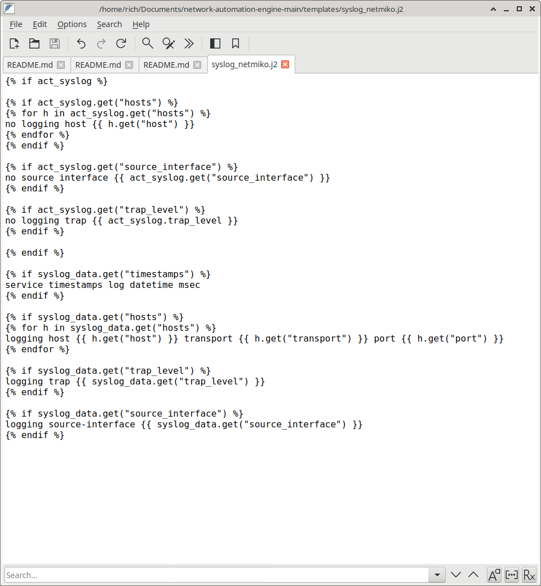

```jinja2




no logging host {{ h.get("host") }}




no source interface {{ act_syslog.get("source_interface") }}



no logging trap {{ act_syslog.trap_level }}





service timestamps log datetime msec




logging host {{ h.get("host") }} transport {{ h.get("transport") }} port {{ h.get("port") }}




logging trap {{ syslog_data.get("trap_level") }}



logging source-interface {{ syslog_data.get("source_interface") }}

```

#### Rendered Command Output Example:
When remediating `CORE-SW-1` (which had rogue host `8.8.8.8`, source interface `Ethernet1/0`, and trap level `alerts`), the template renders:

```cisco
! --- Phase 1: Negate Observed Drift ---
no logging host 8.8.8.8
no source interface ethernet1/0
no logging trap alerts

! --- Phase 2: Enforce NetBox Desired Baseline ---
service timestamps log datetime msec
logging host 10.10.10.50 transport udp port 514
logging host 10.10.10.51 transport tcp port 514
logging trap informational
logging source-interface Loopback0
```

> **Key Architectural Takeaway:**
> Passing both `act_syslog` (actual state) and `syslog_data` (desired state) into the template renderer gives the engine the intelligence to cleanly **purge unauthorized configuration drift** before applying authorized state, preventing orphaned syslog servers from lingering on physical switches.
### 1. Netmiko Remediation Handler (`src/remediation/services/syslog.py`)

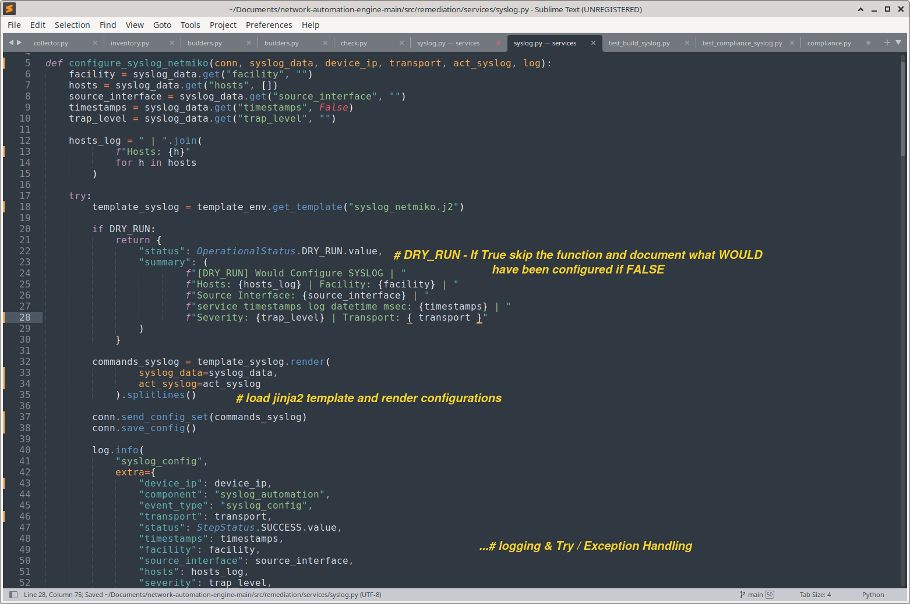

```python
# src/remediation/services/syslog.py

def configure_syslog_netmiko(conn, syslog_data, device_ip, transport, act_syslog, log):
    facility = syslog_data.get("facility", "")
    hosts = syslog_data.get("hosts", [])
    source_interface = syslog_data.get("source_interface", "")
    timestamps = syslog_data.get("timestamps", False)
    trap_level = syslog_data.get("trap_level", "")

    hosts_log = " | ".join(
        f"Hosts: {h}"
        for h in hosts
    )

    try:
        template_syslog = template_env.get_template("syslog_netmiko.j2")

        if DRY_RUN:
            return {
                "status": OperationalStatus.DRY_RUN.value,
                "summary": (
                    f"[DRY_RUN] Would Configure SYSLOG | "
                    f"Hosts: {hosts_log} | Facility: {facility} | "
                    f"Source Interface: {source_interface} | "
                    f"service timestamps log datetime msec: {timestamps} | "
                    f"Severity: {trap_level} | Transport: { transport }"
                )
            }

        commands_syslog = template_syslog.render(
            syslog_data=syslog_data,
            act_syslog=act_syslog
        ).splitlines()

        conn.send_config_set(commands_syslog)
        conn.save_config()

        log.info(
            "syslog_config",
            extra={
                "device_ip": device_ip,
                "component": "syslog_automation",
                "event_type": "syslog_config",
                "transport": transport,
                "status": StepStatus.SUCCESS.value,
                "timestamps": timestamps,
                "facility": facility,
                "source_interface": source_interface,
                "hosts": hosts_log,
                "severity": trap_level,
                "detail": (
                    f"Syslog Configuration Successful | "
                    f"Hosts: {hosts_log} | Facility: {facility} | "
                    f"Source Interface: {source_interface} | "
                    f"service timestamps log datetime msec: {timestamps} | "
                    f"Severity: {trap_level}"
                )
            }
        )
        return {
            "status": OperationalStatus.SUCCESS.value,
            "summary": (
                f"Syslog Configuration Successful | "
                f"Hosts: {hosts_log} | Facility: {facility} | "
                f"Source Interface: {source_interface} | "
                f"service timestamps log datetime msec: {timestamps} | "
                f"Severity: {trap_level} | Transport: {transport}"
            )
        }

    except Exception as e:
        log.exception(
            "syslog_config",
            extra={
                "device_ip": device_ip,
                "component": "syslog_automation",
                "event_type": "syslog_config",
                "transport": transport,
                "status": StepStatus.ERROR.value,
                "timestamps": timestamps,
                "facility": facility,
                "source_interface": source_interface,
                "hosts": hosts_log,
                "severity": trap_level,
                "error": str(e),
                "detail": (f"Try/Exception Error | Syslog Configuration | "
                    f"Hosts: {hosts_log} | Facility: {facility} | "
                    f"Source Interface: {source_interface} | "
                    f"service timestamps log datetime msec: {timestamps} | "
                    f"Severity: {trap_level} | Transport: {transport}"
                    f"Error: {str(e)}"
                )
            }
        )
        return {
            "status": OperationalStatus.ERROR.value,
            "summary": (
                f"Try/Exception Error | Syslog Configuration | "
                f"Hosts: {hosts_log} | Facility: {facility} | "
                f"Source Interface: {source_interface} | "
                f"service timestamps log datetime msec: {timestamps} | "
                f"Severity: {trap_level} | Transport: {transport} | "
                f"Error: {str(e)}"
            ),
            "error": str(e)
        }
```
---

## 5. Safe Change Management: Dry-Run Mode

To support production Change Advisory Board (CAB) review windows, the engine supports a global `DRY_RUN` setting (`src/core/settings.py`).

When `DRY_RUN = True`:
* Live operational logging state and service timestamps are audited normally.
* Configuration drift is detected, reported, and logged to Splunk.
* Planned remediation commands are evaluated and stored under `actions_taken` in `src/final_compliance_report.json`.
* **Device write commands (`conn.send_config_set()` and `conn.save_config()`) are bypassed entirely.**

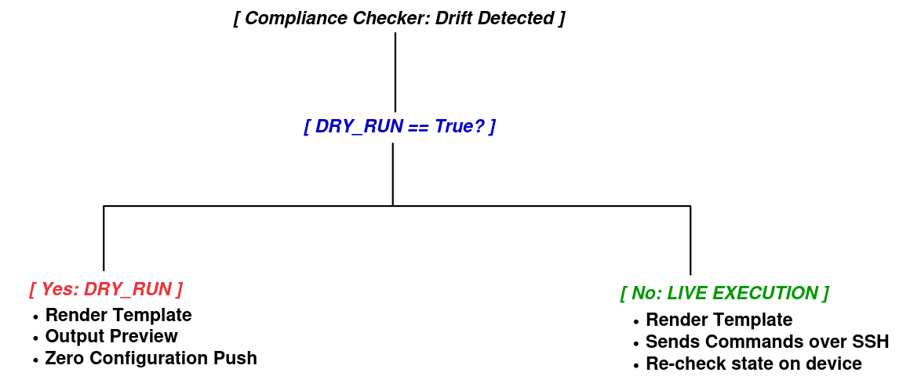

### Machine-Readable Dry-Run Audit: `final_compliance_report.json`

During dry-run execution on `CORE-SW-1`, the engine catalogs all verified compliant baseline states alongside the planned multi-parameter syslog remediation:

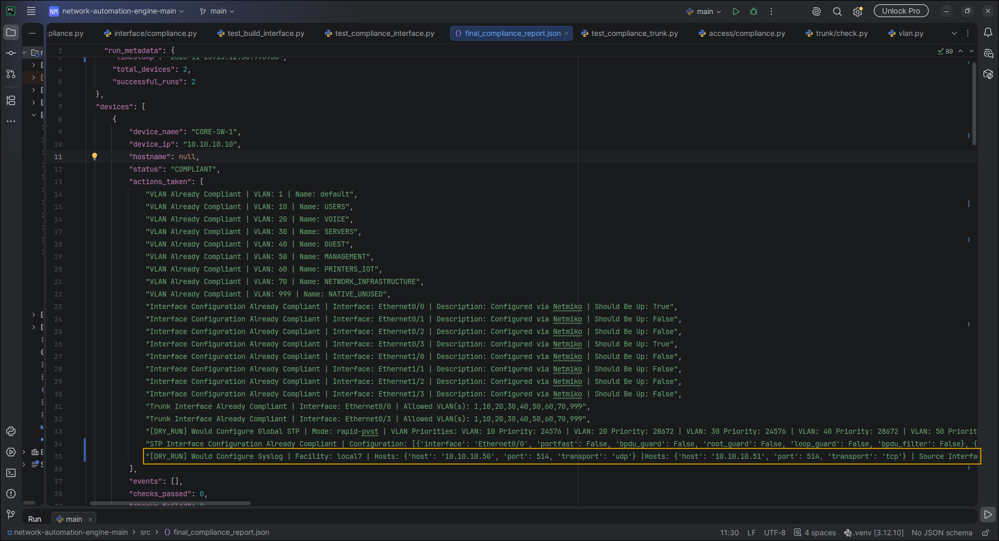

```json
{
  "device_name": "CORE-SW-1",
  "device_ip": "10.10.10.10",
  "hostname": null,
  "status": "COMPLIANT",
  "actions_taken": [
    "VLAN Already Compliant | VLAN: 1 | Name: default",
    "VLAN Already Compliant | VLAN: 10 | Name: USERS",
    "VLAN Already Compliant | VLAN: 20 | Name: VOICE",
    "VLAN Already Compliant | VLAN: 30 | Name: SERVERS",
    "VLAN Already Compliant | VLAN: 40 | Name: GUEST",
    "VLAN Already Compliant | VLAN: 50 | Name: MANAGEMENT",
    "VLAN Already Compliant | VLAN: 60 | Name: PRINTERS_IOT",
    "VLAN Already Compliant | VLAN: 70 | Name: NETWORK_INFRASTRUCTURE",
    "VLAN Already Compliant | VLAN: 999 | Name: NATIVE_UNUSED",
    "Interface Configuration Already Compliant | Interface: Ethernet0/0 | Description: Configured via Netmiko | Should Be Up: True",
    "Interface Configuration Already Compliant | Interface: Ethernet0/1 | Description: Configured via Netmiko | Should Be Up: False",
    "Interface Configuration Already Compliant | Interface: Ethernet0/2 | Description: Configured via Netmiko | Should Be Up: False",
    "Interface Configuration Already Compliant | Interface: Ethernet0/3 | Description: Configured via Netmiko | Should Be Up: True",
    "Interface Configuration Already Compliant | Interface: Ethernet1/0 | Description: Configured via Netmiko | Should Be Up: False",
    "Interface Configuration Already Compliant | Interface: Ethernet1/1 | Description: Configured via Netmiko | Should Be Up: False",
    "Interface Configuration Already Compliant | Interface: Ethernet1/2 | Description: Configured via Netmiko | Should Be Up: False",
    "Interface Configuration Already Compliant | Interface: Ethernet1/3 | Description: Configured via Netmiko | Should Be Up: False",
    "Trunk Interface Already Compliant | Interface: Ethernet0/0 | Allowed VLAN(s): 1,10,20,30,40,50,60,70,999",
    "Trunk Interface Already Compliant | Interface: Ethernet0/3 | Allowed VLAN(s): 1,10,20,30,40,50,60,70,999",
    "[DRY_RUN] Would Configure Global STP | Mode: rapid-pvst | VLAN Priorities: VLAN: 10 Priority: 24576 | VLAN: 20 Priority: 28672 | VLAN: 30 Priority: 24576 | VLAN: 40 Priority: 28672 | VLAN: 50 Priority: 24576",
    "STP Interface Configuration Already Compliant | Configuration: [{'interface': 'Ethernet0/0', 'portfast': False, 'bpdu_guard': False, 'root_guard': False, 'loop_guard': False, 'bpdu_filter': False}, ...]",
    "[DRY_RUN] Would Configure Syslog | Facility: local7 | Hosts: {'host': '10.10.10.50', 'port': 514, 'transport': 'udp'} | Hosts: {'host': '10.10.10.51', 'port': 514, 'transport': 'tcp'} | Source Interface: Loopback0 | service timestamps log datetime msec: True | Severity: informational | Transport: NEMIKO"
  ]
}
```

---

## 6. Post-Remediation Validation & Physical Device Proof

After remediation commands are applied, the engine initiates a **closed-loop verification pass**:
1. It re-collects live device operational state (`collect_device_state(sesh)`).
2. It re-normalizes the live logging state using `build_syslog_netmiko(new_state)`.
3. It re-runs `check_syslog(exp_syslog, new_syslog, transport)` to verify all parameters match NetBox intent on physical hardware.

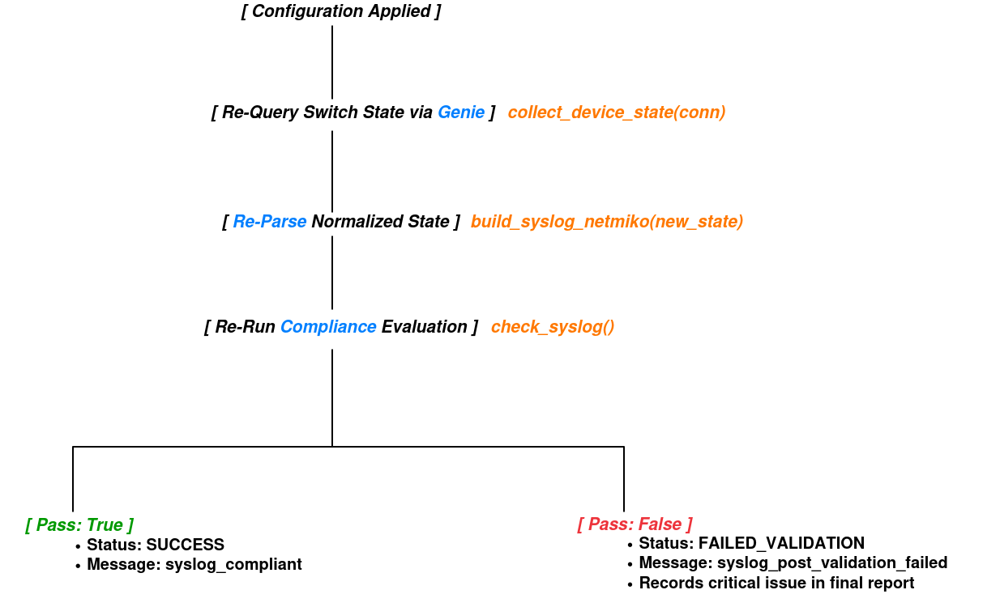

### Physical Device Verification: Before vs. After Execution

#### 1. Device State: BEFORE Remediation (`CORE-SW-1`)
Prior to remediation, `CORE-SW-1` had multiple unauthorized configurations:
* Logging trap severity was set to `alerts` (suppressing operational events).
* Logging source was bound to physical interface `Ethernet1/0` (vulnerable to link flaps).
* Logging host was pointed to unauthorized rogue collector `8.8.8.8` on port `1024`:

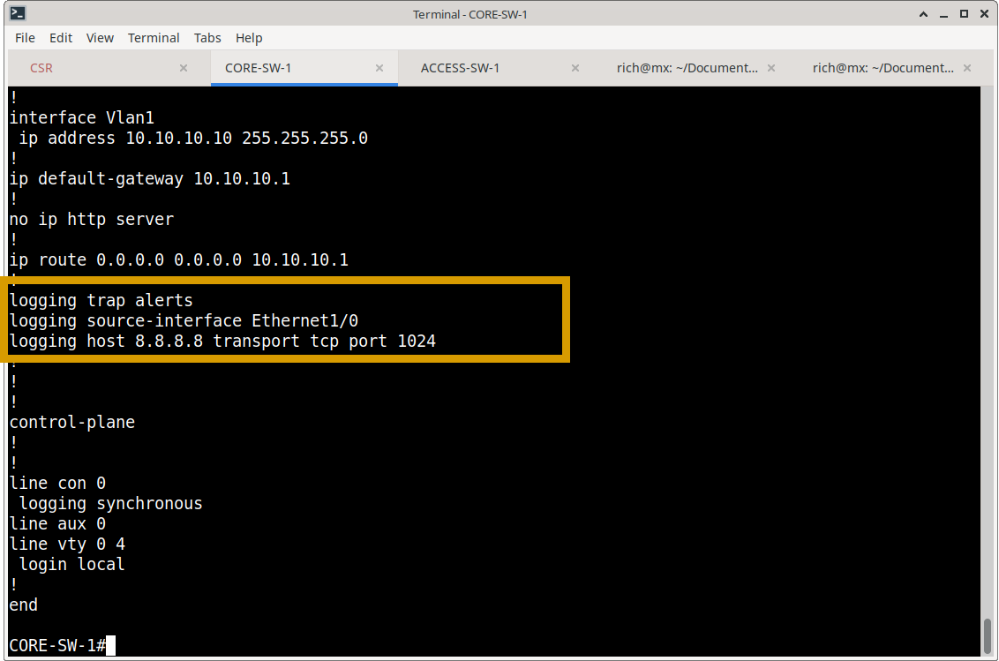

```cisco
! --- CORE-SW-1: Running Configuration BEFORE Remediation ---
logging trap alerts
logging source-interface Ethernet1/0
logging host 8.8.8.8 transport tcp port 1024
```

---

#### 2. Device State: AFTER Automated Remediation (`CORE-SW-1`)
Following automated execution:
* The unauthorized host `8.8.8.8` was removed.
* Redundant authorized collectors `10.10.10.50` (UDP 514) and `10.10.10.51` (TCP 514) were configured.
* Logging source interface was re-bound to stable `Loopback0`:

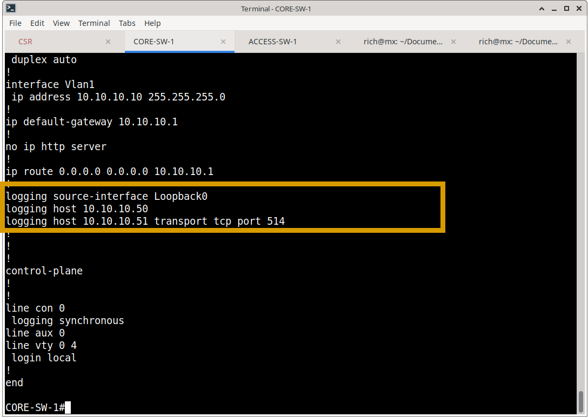

```cisco
! --- CORE-SW-1: Running Configuration AFTER Remediation ---
logging source-interface Loopback0
logging host 10.10.10.50
logging host 10.10.10.51 transport tcp port 514
```

---

#### 3. Visual Configuration Diff

```diff

- logging trap alerts
- logging source-interface Ethernet1/0
- logging host 8.8.8.8 transport tcp port 1024
+ logging source-interface Loopback0
+ logging host 10.10.10.50
+ logging host 10.10.10.51 transport tcp port 514
```

---

#### 4. Operational State Verification (`show logging`)

Executing `show logging` on `CORE-SW-1` confirms that the Cisco operational logging subsystem reflects full compliance with the NetBox baseline:

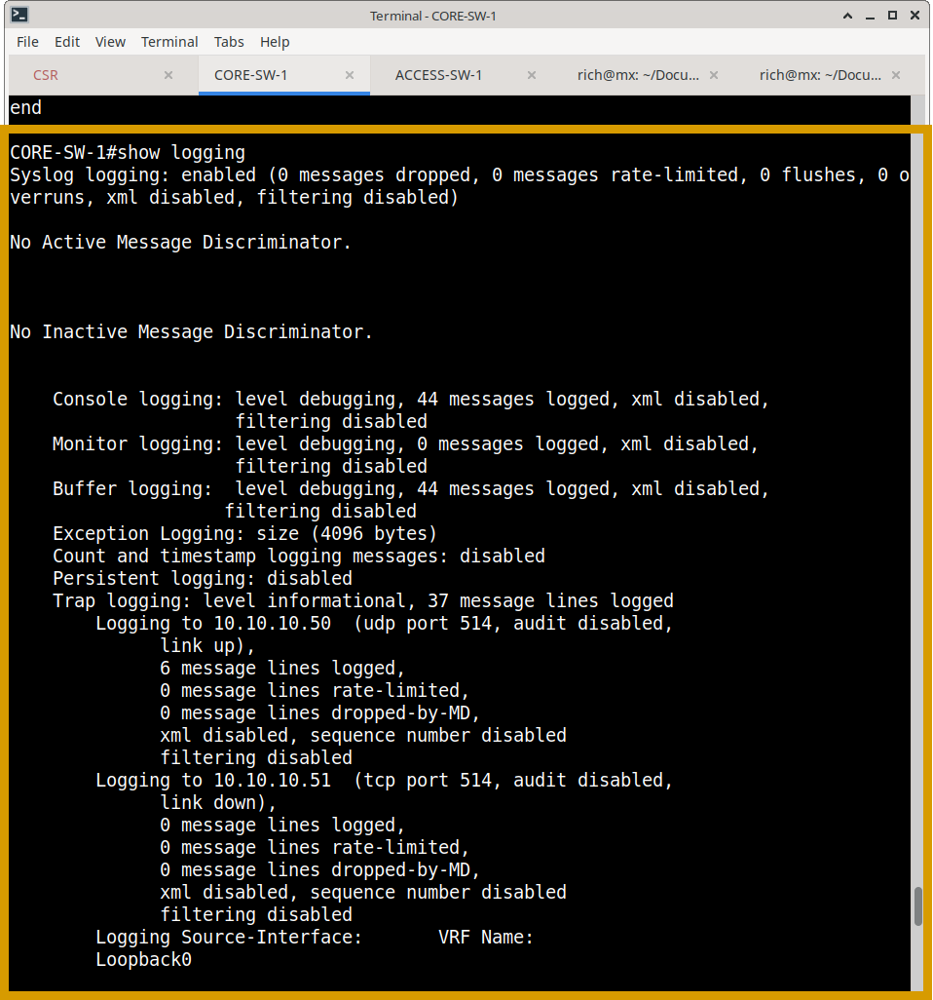

```text
CORE-SW-1#show logging
Syslog logging: enabled (0 messages dropped, 0 messages rate-limited, 0 flushes, 0 overruns, xml disabled, filtering disabled)

No Active Message Discriminator.

No Inactive Message Discriminator.

    Console logging: level debugging, 44 messages logged, xml disabled,
                     filtering disabled
    Monitor logging: level debugging, 0 messages logged, xml disabled,
                     filtering disabled
    Buffer logging:  level debugging, 44 messages logged, xml disabled,
                     filtering disabled
    Exception Logging: size (4096 bytes)
    Count and timestamp logging messages: disabled
    Persistent logging: disabled
    Trap logging: level informational, 37 message lines logged
        Logging to 10.10.10.50  (udp port 514, audit disabled,
            link up),
            6 message lines logged,
            0 message lines rate-limited,
            0 message lines dropped-by-MD,
            xml disabled, sequence number disabled
            filtering disabled
        Logging to 10.10.10.51  (tcp port 514, audit disabled,
            link down),
            0 message lines logged,
            0 message lines rate-limited,
            0 message lines dropped-by-MD,
            xml disabled, sequence number disabled
            filtering disabled
    Logging Source-Interface:       VRF Name:
    Loopback0
```

Your §8 is clean of interleaving this turn, but the five payloads are each **missing fields the screenshots plainly show** (`summary`, `taskName`, `hosts`), and there's a real SIEM gap in the SPL. I restored the missing fields from the captures, kept every visible value byte-true, and left `tags` out (collapsed in the UI, runtime-varying — noted below). Paste this as `## 8.`:

---

## 8. Audit Logging & Splunk Telemetry Pipeline (Syslog Service)

To satisfy enterprise compliance, security logging standards, and SIEM auditing requirements, every operational phase of the syslog workflow — baseline verification, drift detection, exception handling, and closed-loop post-validation — streams structured JSON events directly to **Splunk via the HTTP Event Collector (HEC)** (`index="network_automation"`, `sourcetype="_json"`).

Events map directly to Cisco syslog severity levels (`cisco_sev`), allowing Security Operations (SecOps) and Network Operations Centers (NOC) to trigger real-time alerts on rogue syslog collectors or failed logging remediations.

```spl
index="network_automation" sourcetype="_json" (protocol="syslog" OR event_type="syslog_config")
| table asctime cisco_sev event_type message status compliant detail
```

---

### Telemetry Lifecycle Matrix

The telemetry pipeline records five distinct operational events across `CORE-SW-1` (`10.10.10.10`):

| Lifecycle Phase | Event Type (`event_type`) | Splunk Message (`message`) | Cisco Severity | Status | Operational Significance |
| :--- | :--- | :--- | :---: | :---: | :--- |
| **1. Pre-Check Pass** | `compliance_syslog` | `syslog_netconf_compliant` | `6 (INFO)` | `SUCCESS` | Logging baseline already matches NetBox intent; bypassed. |
| **2. Drift Detected** | `compliance_syslog` | `syslog_non_compliant` | `4 (WARN)` | `FAILED` | Unauthorized collector (`8.8.8.8`) present alongside the two authorized hosts. |
| **3. Post-Validation Fail** | `compliance_syslog` | `syslog_post_validation_failed` | `3 (ERROR)` | `FAILED` | Remediation executed, but live state still carries unauthorized host `8.8.8.8`. |
| **4. Post-Validation Pass** | `compliance_syslog` | `syslog_post_validation_success` | `6 (INFO)` | `SUCCESS` | Re-queried live operational state confirms dual collectors and `Loopback0`. |
| **5. Exception Capture** | `syslog_config` | `syslog_config` | `3 (ERROR)` | `ERROR` | Catches transport exceptions (e.g., `'CiscoIosSSH' object has no attribute 'transport'`). |

---

### Splunk Event Evidence & Payload Breakdown

#### 1. Baseline Compliant Pass (`syslog_netconf_compliant`)
When `CORE-SW-1` (`10.10.10.10`) already matches NetBox specifications on initial scan, an informational pass is indexed with zero failures:

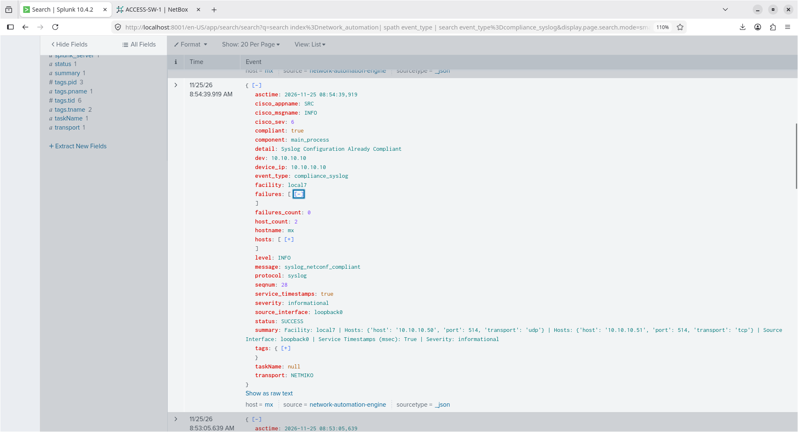

```json
{
  "asctime": "2026-11-25 08:54:39,919",
  "cisco_appname": "SRC",
  "cisco_msgname": "INFO",
  "cisco_sev": 6,
  "compliant": true,
  "component": "main_process",
  "detail": "Syslog Configuration Already Compliant",
  "dev": "10.10.10.10",
  "device_ip": "10.10.10.10",
  "event_type": "compliance_syslog",
  "facility": "local7",
  "failures": [],
  "failures_count": 0,
  "host_count": 2,
  "hostname": "mx",
  "hosts": [
    {"host": "10.10.10.50", "port": 514, "transport": "udp"},
    {"host": "10.10.10.51", "port": 514, "transport": "tcp"}
  ],
  "level": "INFO",
  "message": "syslog_netconf_compliant",
  "protocol": "syslog",
  "seqnum": 28,
  "service_timestamps": true,
  "severity": "informational",
  "source_interface": "loopback0",
  "status": "SUCCESS",
  "summary": "Facility: local7 | Hosts: {'host': '10.10.10.50', 'port': 514, 'transport': 'udp'} | Hosts: {'host': '10.10.10.51', 'port': 514, 'transport': 'tcp'} | Source Interface: loopback0 | Service Timestamps (msec): True | Severity: informational",
  "taskName": null,
  "transport": "NETMIKO"
}
```

---

#### 2. Configuration Drift Alert (`syslog_non_compliant`)
When unauthorized logging destinations are detected on `CORE-SW-1` (e.g., rogue collector `8.8.8.8` present on `udp/514` alongside the two authorized hosts), a `WARNING` (severity 4) alert is indexed with the explicit set diff:

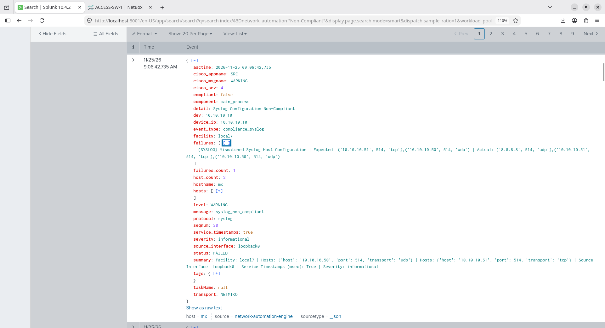

```json
{
  "asctime": "2026-11-25 09:06:42,735",
  "cisco_appname": "SRC",
  "cisco_msgname": "WARNING",
  "cisco_sev": 4,
  "compliant": false,
  "component": "main_process",
  "detail": "Syslog Configuration Non-Compliant",
  "dev": "10.10.10.10",
  "device_ip": "10.10.10.10",
  "event_type": "compliance_syslog",
  "facility": "local7",
  "failures": [
    "(SYSLOG) Mismatched Syslog Host Configuration | Expected: ('10.10.10.51', 514, 'tcp'),('10.10.10.50', 514, 'udp') | Actual: ('8.8.8.8', 514, 'udp'),('10.10.10.51', 514, 'tcp'),('10.10.10.50', 514, 'udp')"
  ],
  "failures_count": 1,
  "host_count": 2,
  "hostname": "mx",
  "hosts": [
    {"host": "10.10.10.50", "port": 514, "transport": "udp"},
    {"host": "10.10.10.51", "port": 514, "transport": "tcp"}
  ],
  "level": "WARNING",
  "message": "syslog_non_compliant",
  "protocol": "syslog",
  "seqnum": 28,
  "service_timestamps": true,
  "severity": "informational",
  "source_interface": "loopback0",
  "status": "FAILED",
  "summary": "Facility: local7 | Hosts: {'host': '10.10.10.50', 'port': 514, 'transport': 'udp'} | Hosts: {'host': '10.10.10.51', 'port': 514, 'transport': 'tcp'} | Source Interface: loopback0 | Service Timestamps (msec): True | Severity: informational",
  "taskName": null,
  "transport": "NETMIKO"
}
```

---

#### 3. Closed-Loop Post-Validation Failure (`syslog_post_validation_failed`)
If commands are pushed over Netmiko but the subsequent re-audit detects that an unauthorized host was not successfully removed (e.g., `8.8.8.8` remains in the switch's running state), the engine logs a **Cisco Severity 3 (`ERROR`)** event:

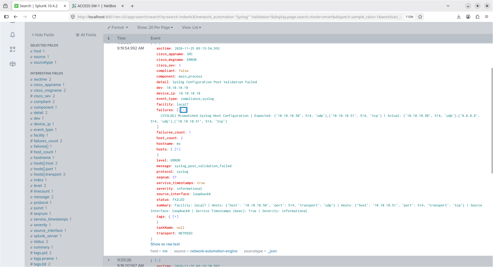

```json
{
  "asctime": "2026-11-25 09:19:54,992",
  "cisco_appname": "SRC",
  "cisco_msgname": "ERROR",
  "cisco_sev": 3,
  "compliant": false,
  "component": "main_process",
  "detail": "Syslog Configuration Post Validation Failed",
  "dev": "10.10.10.10",
  "device_ip": "10.10.10.10",
  "event_type": "compliance_syslog",
  "facility": "local7",
  "failures": [
    "(SYSLOG) Mismatched Syslog Host Configuration | Expected: ('10.10.10.50', 514, 'udp'),('10.10.10.51', 514, 'tcp') | Actual: ('10.10.10.50', 514, 'udp'),('8.8.8.8', 514, 'udp'),('10.10.10.51', 514, 'tcp')"
  ],
  "failures_count": 1,
  "host_count": 2,
  "hostname": "mx",
  "hosts": [
    {"host": "10.10.10.50", "port": 514, "transport": "udp"},
    {"host": "10.10.10.51", "port": 514, 'transport': 'tcp'}
  ],
  "level": "ERROR",
  "message": "syslog_post_validation_failed",
  "protocol": "syslog",
  "seqnum": 57,
  "service_timestamps": true,
  "severity": "informational",
  "source_interface": "loopback0",
  "status": "FAILED",
  "summary": "Facility: local7 | Hosts: {'host': '10.10.10.50', 'port': 514, 'transport': 'udp'} | Hosts: {'host': '10.10.10.51', 'port': 514, 'transport': 'tcp'} | Source Interface: loopback0 | Service Timestamps (msec): True | Severity: informational",
  "taskName": null,
  "transport": "NETMIKO"
}
```

---

#### 4. Closed-Loop Post-Validation Success (`syslog_post_validation_success`)
Following successful remediation, the engine re-polls the device via Genie (`show logging`) and `CiscoConfParse`. When all parameters match the NetBox contract, a post-validation confirmation is indexed:

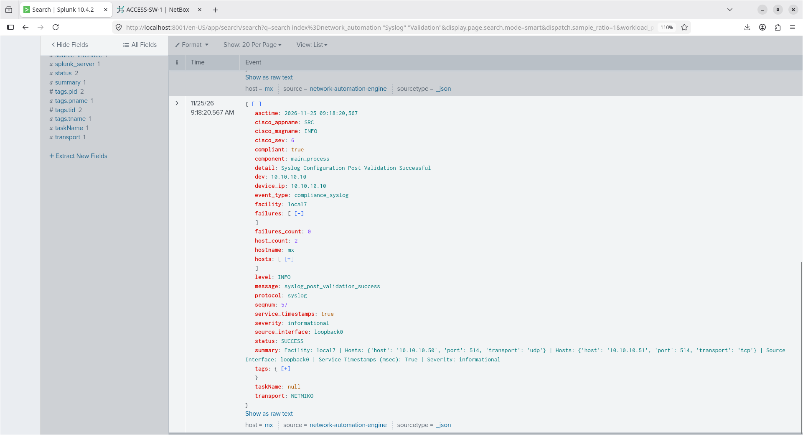

```json
{
  "asctime": "2026-11-25 09:18:20,567",
  "cisco_appname": "SRC",
  "cisco_msgname": "INFO",
  "cisco_sev": 6,
  "compliant": true,
  "component": "main_process",
  "detail": "Syslog Configuration Post Validation Successful",
  "dev": "10.10.10.10",
  "device_ip": "10.10.10.10",
  "event_type": "compliance_syslog",
  "facility": "local7",
  "failures": [],
  "failures_count": 0,
  "host_count": 2,
  "hostname": "mx",
  "hosts": [
    {"host": "10.10.10.50", "port": 514, "transport": "udp"},
    {"host": "10.10.10.51", "port": 514, "transport": "tcp"}
  ],
  "level": "INFO",
  "message": "syslog_post_validation_success",
  "protocol": "syslog",
  "seqnum": 57,
  "service_timestamps": true,
  "severity": "informational",
  "source_interface": "loopback0",
  "status": "SUCCESS",
  "summary": "Facility: local7 | Hosts: {'host': '10.10.10.50', 'port': 514, 'transport': 'udp'} | Hosts: {'host': '10.10.10.51', 'port': 514, 'transport': 'tcp'} | Source Interface: loopback0 | Service Timestamps (msec): True | Severity: informational",
  "taskName": null,
  "transport": "NETMIKO"
}
```

---

#### 5. Exception & Transport Fault Observability (`status: ERROR`)
If an unhandled exception occurs during remediation — such as referencing a transport attribute not present on the connection object (`'CiscoIosSSH' object has no attribute 'transport'`) — the engine's `try...except` boundary catches the error and streams an `ERROR` event (Severity 3) with full context. Note this event originates from the **remediation handler** (`syslog_automation`), so its `log_extra` schema differs from the orchestrator events (no `protocol`, no `compliant`, `hosts` is a string, `timestamps` not `service_timestamps`):

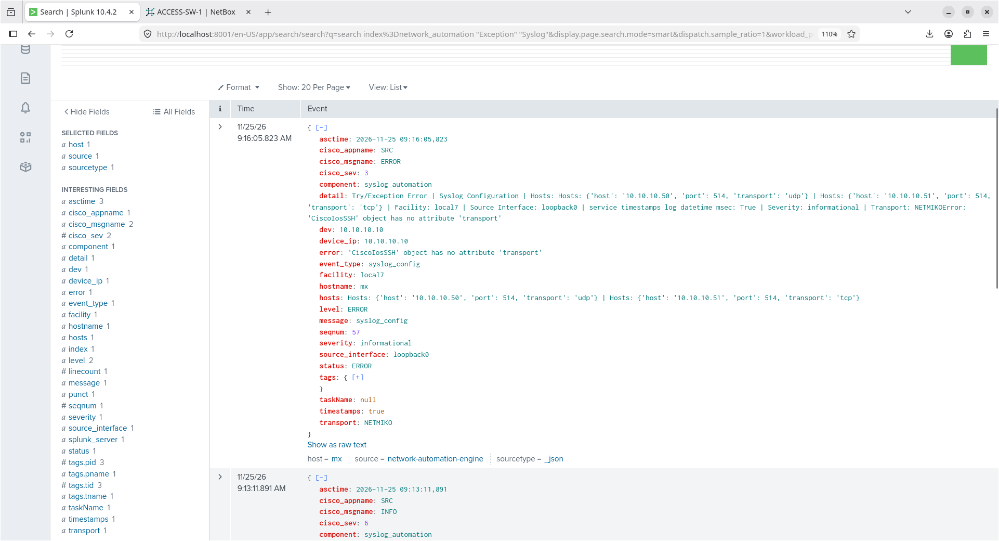

```json
{
  "asctime": "2026-11-25 09:16:05,823",
  "cisco_appname": "SRC",
  "cisco_msgname": "ERROR",
  "cisco_sev": 3,
  "component": "syslog_automation",
  "detail": "Try/Exception Error | Syslog Configuration | Hosts: Hosts: {'host': '10.10.10.50', 'port': 514, 'transport': 'udp'} | Hosts: {'host': '10.10.10.51', 'port': 514, 'transport': 'tcp'} | Facility: local7 | Source Interface: loopback0 | service timestamps log datetime msec: True | Severity: informational | Transport: NETMIKOError: 'CiscoIosSSH' object has no attribute 'transport'",
  "dev": "10.10.10.10",
  "device_ip": "10.10.10.10",
  "error": "'CiscoIosSSH' object has no attribute 'transport'",
  "event_type": "syslog_config",
  "facility": "local7",
  "hostname": "mx",
  "hosts": "Hosts: {'host': '10.10.10.50', 'port': 514, 'transport': 'udp'} | Hosts: {'host': '10.10.10.51', 'port': 514, 'transport': 'tcp'}",
  "level": "ERROR",
  "message": "syslog_config",
  "seqnum": 57,
  "severity": "informational",
  "source_interface": "loopback0",
  "status": "ERROR",
  "taskName": null,
  "timestamps": true,
  "transport": "NETMIKO"
}
```

---

### Internal Execution Tracking

Throughout execution, the engine updates the device result context used to generate `final_compliance_report.json` and `network_compliance_report.txt`:

| Result Collection Field | Operational Purpose & Behavior |
| :--- | :--- |
| **`device_result["initial_issues"]`** | Catalogs all configuration drift detected during initial audit passes before remediation runs (used to calculate drift rates). |
| **`device_result["actions_taken"]`** | Records verified compliant configurations, executed remediations, and `[DRY_RUN]` change previews for audit compliance. |
| **`device_result["critical_issues"]`** | Populated exclusively when remediation commands fail over SSH or if post-validation fails after changes were pushed. |
| **`device_result["status"]`** | Reflects overall device health: `COMPLIANT`, `FAILED_CONFIG`, or `FAILED_VALIDATION`. |

---

## 9. Automated Unit Testing & CI/CD Validation (Syslog Service)

To guarantee that centralized logging enforcement is completely deterministic across different connection protocols, the syslog test suite implements **parametrized multi-transport testing** using **Pytest** and **unittest.mock**.

The test suite runs **100% offline** without live network connections. Every compliance lifecycle test is executed against both **NETCONF** and **NETMIKO**, validating all **20 test cases in just 1.45 seconds** (0.64s builder + 0.81s compliance).

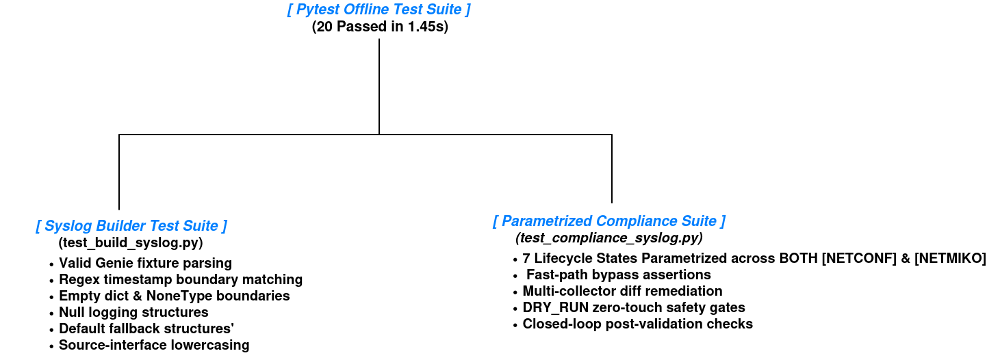

---

### Layer 1: Syslog Builder Tests (`test_build_syslog.py`)

This suite validates that `build_syslog_netmiko()` extracts collectors, transport protocols, ports, trap levels, source interfaces, and accurately uses `CiscoConfParse` to detect `service timestamps log datetime msec`:

#### Test Scenarios Covered (6 Tests):
1. **`test_build_syslog_valid`**: Evaluates real Genie operational fixture data (`syslog_genie_output`). Confirms hosts `192.168.100.60` and `192.168.100.61` are parsed, `trap_level` evaluates to `"informational"`, `source_interface` evaluates to `"loopback0"`, and `timestamps` is `True`.
2. **`test_build_syslog_no_timestamps`**: Ingests configuration lines with non-matching timestamp directives (`service timestamps debug datetime msec`, `service timestamps datetime msec`); asserts `result["timestamps"]` evaluates strictly to `False`.
3. **`test_build_syslog_empty`**: Boundary test confirming `build_syslog_netmiko({})` and `build_syslog_netmiko(None)` return `{}`.
4. **`test_build_syslog_no_logging`**: Validates safe handling when the logging structure returns `{"syslog": {"logging": None}}`.
5. **`test_build_syslog_defaults`**: Verifies that empty configurations populate the standard default dictionary schema with `timestamps: False`.
6. **`test_build_syslog_source_interface`**: Confirms source interface names are normalized to lowercase strings.

#### Code Excerpt (`test_build_syslog.py`):

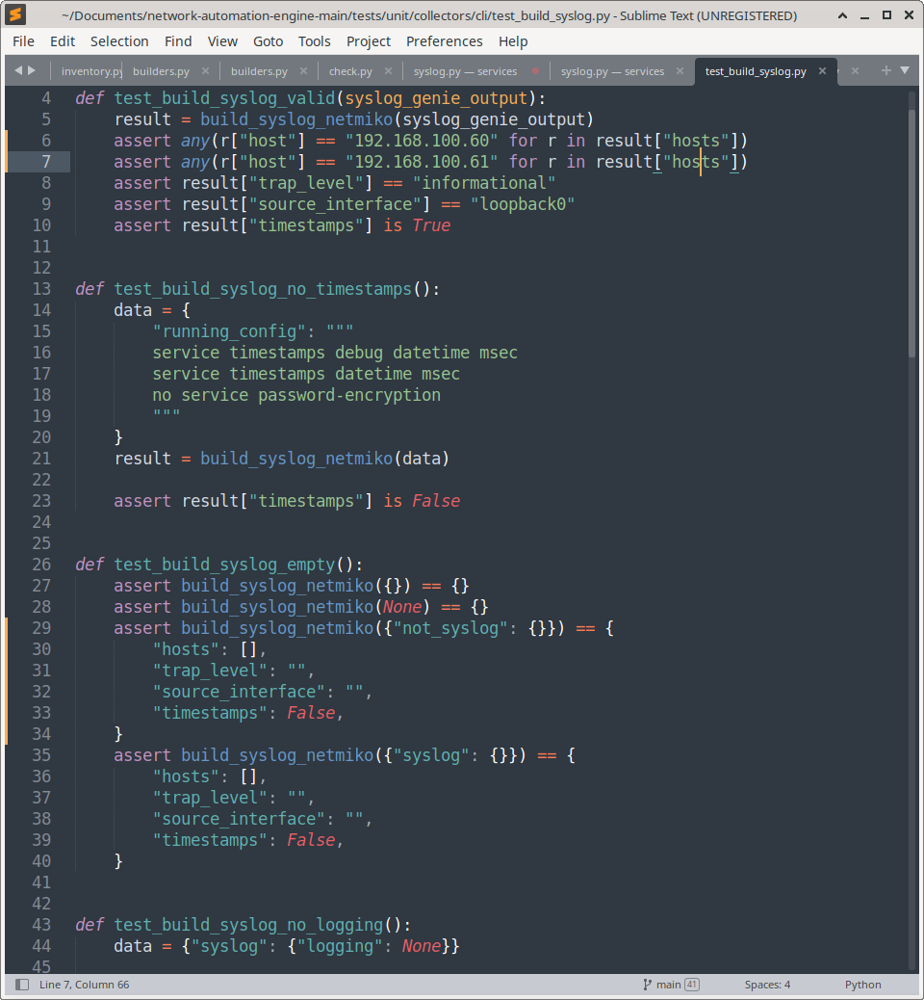

```python
def test_build_syslog_valid(syslog_genie_output):
    result = build_syslog_netmiko(syslog_genie_output)
    assert any(r["host"] == "192.168.100.60" for r in result["hosts"])
    assert any(r["host"] == "192.168.100.61" for r in result["hosts"])
    assert result["trap_level"] == "informational"
    assert result["source_interface"] == "loopback0"
    assert result["timestamps"] is True

def test_build_syslog_no_timestamps():
    data = {
        "running_config": """
        service timestamps debug datetime msec
        service timestamps datetime msec
        no service password-encryption
        """
    }
    result = build_syslog_netmiko(data)

    assert result["timestamps"] is False
```

#### Terminal Execution:

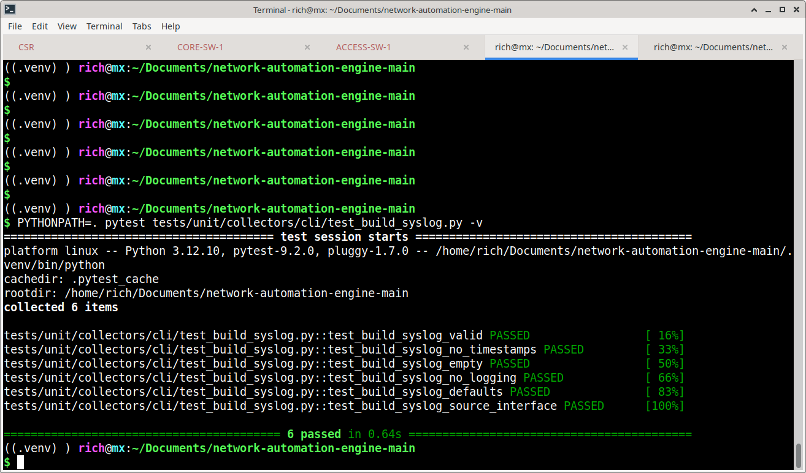

```bash
$ PYTHONPATH=. pytest tests/unit/collectors/cli/test_build_syslog.py -v
============================= test session starts ==============================
platform linux -- Python 3.12.10, pytest-9.2.0, pluggy-1.7.0 -- /home/rich/Documents/network-automation-engine-main/.venv/bin/python
cachedir: .pytest_cache
rootdir: /home/rich/Documents/network-automation-engine-main
collected 6 items

tests/unit/collectors/cli/test_build_syslog.py::test_build_syslog_valid PASSED            [ 16%]
tests/unit/collectors/cli/test_build_syslog.py::test_build_syslog_no_timestamps PASSED    [ 33%]
tests/unit/collectors/cli/test_build_syslog.py::test_build_syslog_empty PASSED            [ 50%]
tests/unit/collectors/cli/test_build_syslog.py::test_build_syslog_no_logging PASSED       [ 66%]
tests/unit/collectors/cli/test_build_syslog.py::test_build_syslog_defaults PASSED         [ 83%]
tests/unit/collectors/cli/test_build_syslog.py::test_build_syslog_source_interface PASSED [100%]

============================== 6 passed in 0.64s ===============================
```

---

### Layer 2: Parametrized Multi-Transport Compliance Tests (`test_compliance_syslog.py`)

Using `@pytest.mark.parametrize("transport", TRANSPORTS)`, every single compliance state machine scenario is tested against **both NETCONF and NETMIKO**. Dynamic helper `patch_for_transport(transport)` swaps mock targets on the fly to assert identical operational behavior across both transports:

#### Test Scenarios Covered (14 Tests):
* **`test_compliance_syslog_already_compliant[NETCONF & NETMIKO]`**: Asserts that when the switch already has authorized collectors and `Loopback0` bound, no warnings are raised, zero changes are made, and status remains compliant.
* **`test_compliance_syslog_non_compliant_config_successful[NETCONF & NETMIKO]`**: Simulates a trap level or collector mismatch (`(SYSLOG) Mismatched Trap Level`), asserts the remediation function executes, and status resolves to `OperationalStatus.SUCCESS`.
* **`test_compliance_syslog_non_compliant_config_failed[NETCONF & NETMIKO]`**: Simulates a transport or RPC rejection, verifying the failure is captured under `critical_issues` and marked `FAILED_CONFIG`.
* **`test_compliance_syslog_dry_run[NETCONF & NETMIKO]`**: Verifies that when `DRY_RUN = True`, drift is recorded, but neither NETCONF RPCs nor Netmiko CLI commands are sent.
* **`test_compliance_syslog_post_validation_successful[NETCONF & NETMIKO]`**: Tests the full closed-loop recovery: initial audit fails → remediation executes → re-collected state passes post-validation.
* **`test_compliance_syslog_post_validation_failed[NETCONF & NETMIKO]`**: Tests error handling when a device remains non-compliant after configuration, asserting `FAILED_VALIDATION`.
* **`test_compliance_syslog_empty[NETCONF & NETMIKO]`**: Confirms empty NetBox contexts are bypassed safely without raising exceptions.

#### Code Excerpt (`test_compliance_syslog.py`):

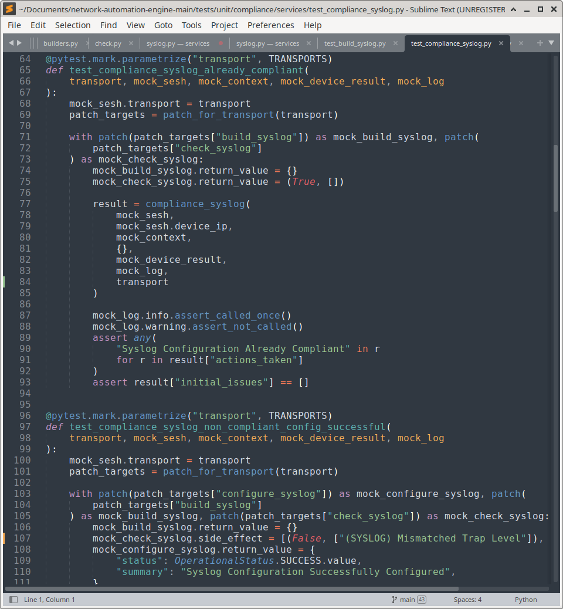

```python
@pytest.mark.parametrize("transport", TRANSPORTS)
def test_compliance_syslog_already_compliant(
    transport, mock_sesh, mock_context, mock_device_result, mock_log
):
    mock_sesh.transport = transport
    patch_targets = patch_for_transport(transport)

    with patch(patch_targets["build_syslog"]) as mock_build_syslog, patch(
        patch_targets["check_syslog"]
    ) as mock_check_syslog:
        mock_build_syslog.return_value = {}
        mock_check_syslog.return_value = (True, [])

        result = compliance_syslog(
            mock_sesh,
            mock_sesh.device_ip,
            mock_context,
            {},
            mock_device_result,
            mock_log,
            transport
        )

        mock_log.info.assert_called_once()
        mock_log.warning.assert_not_called()
        assert any(
            "Syslog Configuration Already Compliant" in r
            for r in result["actions_taken"]
        )
        assert result["initial_issues"] == []
```

#### Terminal Execution:

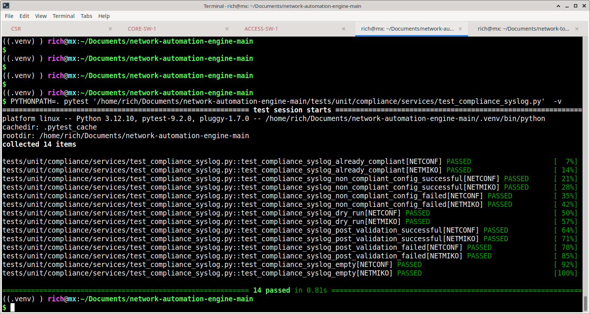

```bash
$ PYTHONPATH=. pytest '/home/rich/Documents/network-automation-engine-main/tests/unit/compliance/services/test_compliance_syslog.py' -v
============================= test session starts ==============================
platform linux -- Python 3.12.10, pytest-9.2.0, pluggy-1.7.0 -- /home/rich/Documents/network-automation-engine-main/.venv/bin/python
cachedir: .pytest_cache
rootdir: /home/rich/Documents/network-automation-engine-main
collected 14 items

tests/unit/compliance/services/test_compliance_syslog.py::test_compliance_syslog_already_compliant[NETCONF] PASSED                 [  7%]
tests/unit/compliance/services/test_compliance_syslog.py::test_compliance_syslog_already_compliant[NETMIKO] PASSED                 [ 14%]
tests/unit/compliance/services/test_compliance_syslog.py::test_compliance_syslog_non_compliant_config_successful[NETCONF] PASSED   [ 21%]
tests/unit/compliance/services/test_compliance_syslog.py::test_compliance_syslog_non_compliant_config_successful[NETMIKO] PASSED   [ 28%]
tests/unit/compliance/services/test_compliance_syslog.py::test_compliance_syslog_non_compliant_config_failed[NETCONF] PASSED       [ 35%]
tests/unit/compliance/services/test_compliance_syslog.py::test_compliance_syslog_non_compliant_config_failed[NETMIKO] PASSED       [ 42%]
tests/unit/compliance/services/test_compliance_syslog.py::test_compliance_syslog_dry_run[NETCONF] PASSED                          [ 50%]
tests/unit/compliance/services/test_compliance_syslog.py::test_compliance_syslog_dry_run[NETMIKO] PASSED                          [ 57%]
tests/unit/compliance/services/test_compliance_syslog.py::test_compliance_syslog_post_validation_successful[NETCONF] PASSED        [ 64%]
tests/unit/compliance/services/test_compliance_syslog.py::test_compliance_syslog_post_validation_successful[NETMIKO] PASSED        [ 71%]
tests/unit/compliance/services/test_compliance_syslog.py::test_compliance_syslog_post_validation_failed[NETCONF] PASSED            [ 78%]
tests/unit/compliance/services/test_compliance_syslog.py::test_compliance_syslog_post_validation_failed[NETMIKO] PASSED            [ 85%]
tests/unit/compliance/services/test_compliance_syslog.py::test_compliance_syslog_empty[NETCONF] PASSED                            [ 92%]
tests/unit/compliance/services/test_compliance_syslog.py::test_compliance_syslog_empty[NETMIKO] PASSED                            [100%]

============================== 14 passed in 0.81s ===============================
```
### Continuous Integration Ready

The test framework is designed for CI/CD pipeline integration:

```yaml
# .github/workflows/test.yml (GitHub Actions Example)
name: Run Unit Tests

on: [push, pull_request]

jobs:
  test:
    runs-on: ubuntu-latest
    steps:
      - uses: actions/checkout@v3
      - name: Set up Python
        uses: actions/setup-python@v4
        with:
          python-version: '3.12'
      - name: Install dependencies
        run: pip install -r requirements.txt
      - name: Run tests with coverage                            <--------- Pytests 
        run: pytest tests/unit/ --cov=src --cov-report=xml
      - name: Upload coverage to Codecov
        uses: codecov/codecov-action@v3
```
---

### Test Suite Execution Summary

| Test Suite | File Path | Scope & Boundary Scenarios Covered | Status | Execution Time |
| :--- | :--- | :--- | :---: | :---: |
| **Syslog Builder Tests** | `tests/unit/collectors/cli/test_build_syslog.py` | Operational Genie parsing, regex timestamp validation, empty/None fallbacks, null structures | **PASSED (6/6)** | 0.64s |
| **Parametrized Compliance Tests** | `tests/unit/compliance/services/test_compliance_syslog.py` | Full closed-loop state machine validated across **both NETCONF & NETMIKO** transports | **PASSED (14/14)** | 0.81s |
| **Total** | | **Comprehensive Dual-Transport Test Coverage** | **20 / 20** | **1.45s** |

---

## Conclusion & Engineering Takeaways

This module demonstrates that centralized logging assurance is not just about running a `show logging` and eyeballing the output. By decoupling data collection, normalization, decisioning, and remediation, this engine transforms syslog hygiene from a manual, error-prone chore into a **deterministic, observable, and reversible software pipeline**.

Key architectural wins validated in this project include:
1. **Two-Phase Reconciliation Pattern:** Unlike simple automation that only appends configuration, this engine actively purges unauthorized drift (e.g., rogue `8.8.8.8` collectors or stale source interfaces) before applying the authorized baseline, ensuring true idempotency and preventing orphaned syslog servers.
2. **Multi-Transport Parity:** The parametrized test suite and dynamic routing prove that the compliance logic remains identical whether pushing via NETCONF YANG models or Netmiko CLI, future-proofing the architecture for heterogeneous environments.
3. **Set-Based Host Diffing:** By converting logging host arrays into order-independent tuples `(host, port, transport)`, the engine accurately detects added, removed, or modified collectors regardless of the order they appear in the running configuration.
4. **Zero-Touch Safety:** The `DRY_RUN` gating ensures Change Advisory Boards (CABs) can review exact, rendered CLI payloads and projected state changes before any socket transmission occurs.
5. **Resilient Exception Handling:** A broken template or transport fault doesn't crash the pipeline. The `try/except` boundary catches the error, streams it to Splunk as an `ERROR` event for immediate triage, and allows the audit of remaining devices to continue uninterrupted.

### Next Steps & Future Enhancements
To further evolve this automation engine, the following enhancements are planned:
- **Multi-Vendor Abstraction:** Leverage Genie's vendor-agnostic parsing to extend this exact same compliance logic to Arista (EOS) and Juniper (Junos) platforms without rewriting the core diff engine.
- **Advanced Logging Policy Validation:** Expand compliance checks to validate logging rate-limits, facility-specific filtering, and secure TLS-based syslog transport (RFC 5425).
- **CI/CD Pipeline Integration:** Embed the existing 20-case Pytest suite into GitHub Actions to automatically block Pull Requests that introduce regressions to the compliance logic or Jinja2 templates.

---

### Return to Main Repository

This module is part of a broader Network Automation Engine portfolio. 

**Explore other modules:**
- [Spanning Tree Protocol (STP) Compliance](../stp-compliance/)
- [Interface Compliance & Remediation](../interface-compliance/)
- [Trunk Port Compliance & Remediation](../trunk-ports/)
- [Access Port Compliance & Remediation](../access-ports/)
- [F5 BIG-IP LTM Cloud Load Balancing](../f5-big-ip-ltm-lab/)

**[Return to Main Repository README](../README.md)**
