# Trunk Port Compliance & Remediation

## Executive Overview

In enterprise network architectures, unrestricted 802.1Q trunk configurations (e.g., `switchport trunk allowed vlan all`) represent a critical security and stability risk. They unnecessarily expand broadcast domains, enable VLAN hopping attacks, and violate strict network segmentation baselines. Managing these allowed-VLAN whitelists manually via CLI does not scale and inevitably leads to configuration drift.

The **Trunk Port Compliance & Remediation** module is a production-grade, closed-loop automation engine designed to eliminate this risk. It enforces strict, declarative trunk policies by reconciling live Cisco switch state against a **NetBox Source of Truth (SoT)**. 

Rather than relying on brittle screen-scraping or manual audits, this pipeline provides end-to-end lifecycle management: it extracts structured operational data via Cisco pyATS/Genie, identifies exact VLAN mismatches or unauthorized mode changes, safely remediates drift using idempotent Jinja2 templates, and verifies the fix before logging the outcome to a centralized SIEM.

### Core Engineering Objectives
- **Declarative Baseline:** Establish NetBox as the single source of truth for trunk encapsulation, port modes, and allowed VLAN memberships.
- **Resilient Data Extraction:** Utilize Netmiko and Cisco pyATS/Genie to parse live switch state with isolated, fault-tolerant error handling.
- **Deterministic Diffing:** Compare live operational state against NetBox intent using strict, case-normalized string/set evaluations.
- **Safe, Idempotent Remediation:** Apply configuration changes using a `default interface` reset strategy to prevent Cisco "Auto" encapsulation traps, gated by a global `DRY_RUN` safety switch.
- **Closed-Loop Verification:** Re-poll the device post-remediation to guarantee the physical data plane matches the intended state before marking the task complete.
- **Enterprise Observability:** Stream structured, severity-coded JSON telemetry to Splunk for real-time NOC/SecOps dashboards and immutable audit trails.
- **CI/CD Readiness:** Validate the entire state machine with 13 offline Pytest cases, ensuring zero-regression deployments without requiring live hardware.

## Architecture

| Component | Responsibility |
|---|---|
| NetBox Inventory | Supplies expected trunk interfaces and allowed VLAN assignments. |
| Genie Collector | Collects and parses actual switchport configurations. |
| Trunk Builder | Normalizes collected trunk-port information. |
| Compliance Checker | Compares expected and actual trunk configurations. |
| Remediation Engine | Applies trunk configuration changes. |
| Post-Validation | Verifies that remediation achieved the expected configuration. |

### Table of Contents

- [1. Intended State: NetBox Source of Truth (802.1Q Trunk Ports)](#1-intended-state-netbox-source-of-truth-8021q-trunk-ports)
- [2. Live Device State Collection & Trunk Parsing](#2-live-device-state-collection--trunk-parsing)
- [3. Trunk Compliance Diff Engine & Drift Detection](#3-trunk-compliance-diff-engine--drift-detection)
- [4. Automated 802.1Q Trunk Remediation & Encapsulation Enforcement](#4-automated-8021q-trunk-remediation--encapsulation-enforcement)
- [5. Safe Change Management: Dry-Run Mode](#5-safe-change-management-dry-run-mode)
- [6. Closed-Loop Post-Remediation Validation](#6-closed-loop-post-remediation-validation)
- [7. Logging and Reporting](#7-logging-and-reporting)
- [7. Splunk Observability & Incident Audit Trail](#7-splunk-observability--incident-audit-trail)
- [8. Automated Unit Testing & CI/CD Validation (Trunk Ports)](#8-automated-unit-testing--cicd-validation-trunk-ports)

---

## 1. Intended State: NetBox Source of Truth (802.1Q Trunk Ports)

In modern enterprise switching, **802.1Q trunk configurations must never default to allowing all VLANs (`1-4094`)**. Unrestricted trunking expands broadcast domains unnecessarily and violates security segmentation baselines.

The automation engine establishes **NetBox DCIM** as the authoritative Source of Truth (SoT) for inter‑switch uplinks and distribution trunks. Rather than allowing engineers to configure manual trunk allowed lists via the CLI, the engine treats NetBox as the authoritative baseline for trunk encapsulation, port modes, and allowed VLAN memberships. Network engineers define operational intent within NetBox by configuring interfaces in **Tagged** mode and explicitly binding the permitted VLAN whitelist. The engine queries NetBox via its REST API (`/api/dcim/interfaces/`) to extract that intent.

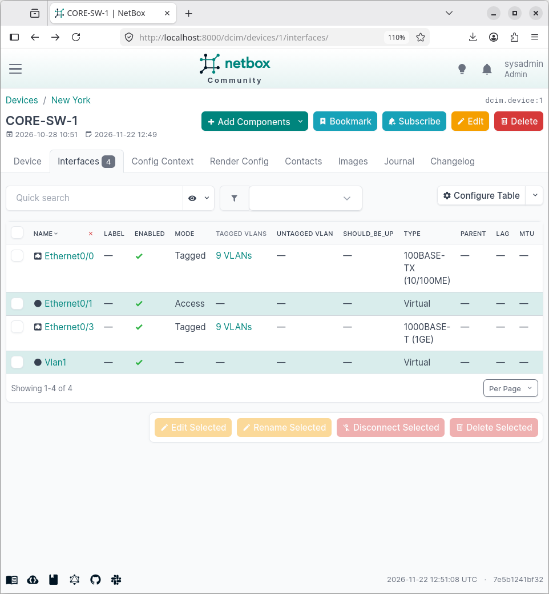

---

### Interface Specification: `CORE-SW-1` (`10.10.10.10`)

The interface baseline for distribution switch `CORE-SW-1` models physical infrastructure uplinks alongside routed/virtual endpoints. The inventory engine ingests only interfaces in `tagged` mode:

| Interface | 802.1Q Mode | Tagged VLANs | Allowed Count | Interface Type | Description | Evaluation Decision |
| :--- | :---: | :--- | :---: | :--- | :--- | :--- |
| **Ethernet0/0** | `Tagged` | `1, 10, 20, 30, 40, 50, 60, 70, 999` | **9 VLANs** | 100BASE-TX | Distribution Uplink | **Ingested** into `trunk_ports` |
| **Ethernet0/3** | `Tagged` | `1, 10, 20, 30, 40, 50, 60, 70, 999` | **9 VLANs** | 1000BASE-T (1GE) | Core Cross-Connect | **Ingested** into `trunk_ports` |
| *Ethernet0/1* | *Access* | *—* | *—* | *Virtual* | *Routed/Access Port* | *Bypassed (non‑trunk)* |
| *Vlan1* | *—* | *—* | *—* | *Virtual* | *Internal SVI* | *Bypassed (SVI)* |

---

### 802.1Q Whitelist Definition in NetBox

Inside the NetBox interface configuration, each trunk port is set to **Tagged** mode with an explicit list of 9 active broadcast domains. This binding defines the exact `switchport trunk allowed vlan` scope enforced by the compliance engine:

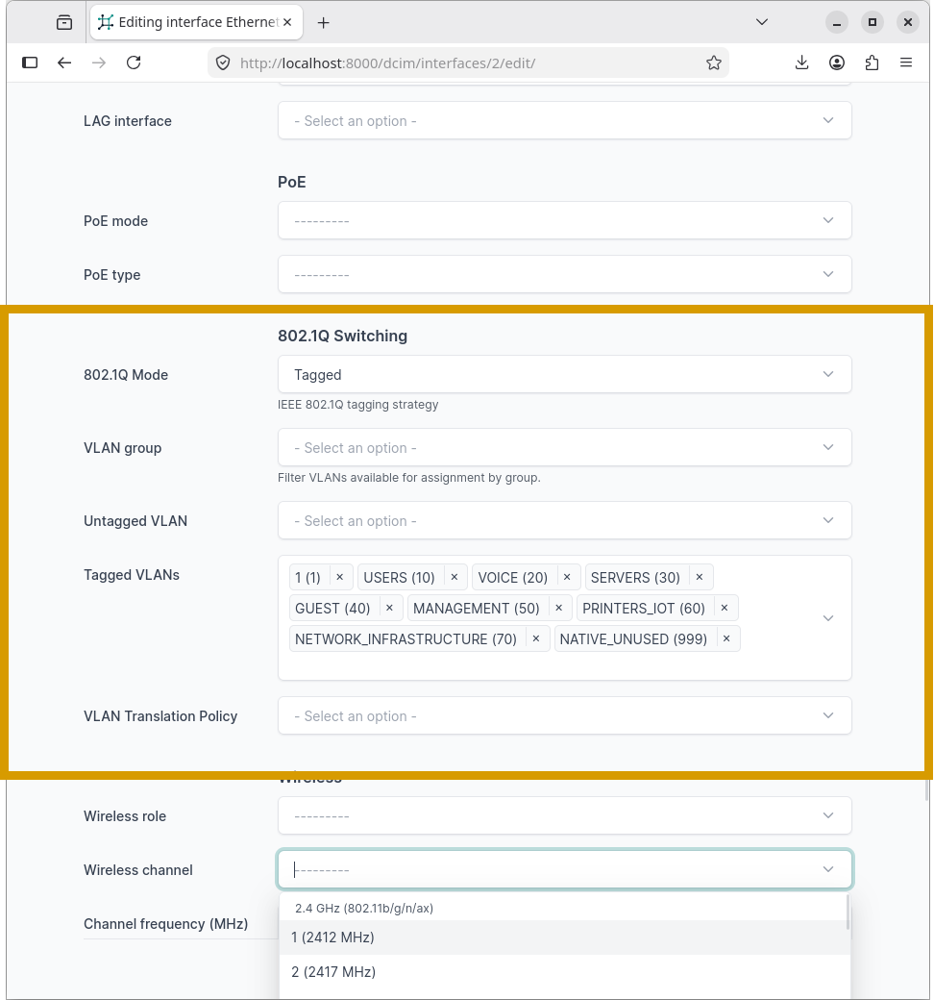

Configured Tagged VLAN Pool (9 VLANs), grouped by operational role:

* **Management & Core Services:** `1` (Default), `50` (MANAGEMENT), `70` (NETWORK_INFRASTRUCTURE)
* **Access Subnets:** `10` (USERS), `20` (VOICE), `30` (SERVERS), `40` (GUEST), `60` (PRINTERS_IOT)
* **Security Blackhole:** `999` (NATIVE_UNUSED — Native VLAN quarantine)

---

### Ingestion & Normalization (`src/sot/inventory.py`)

When synchronizing with NetBox, the inventory engine filters out access switchports and SVIs, isolating only interfaces with `mode.value == "tagged"`. The engine extracts the list of NetBox VLAN objects and serializes their numeric IDs (`vid`) into a standardized, comma‑delimited string matching Cisco IOS‑XE syntax:

```python
# src/sot/inventory.py (Trunk Ingestion Logic)

if is_switch:
    # Filter dedicated 802.1Q Trunk Switchports
    if (
        device_interface.mode
        and device_interface.mode.value == "tagged"
        and device_interface.tagged_vlans
    ):
        config_data[host_ip]["trunk_ports"].append(
            {
                "device_ip": host_ip,
                "trunk_interface": device_interface.name,
                "mode": "trunk",
                "allowed_vlans": ",".join(
                    str(v["vid"]) for v in device_interface.tagged_vlans
                ),
            }
        )
```
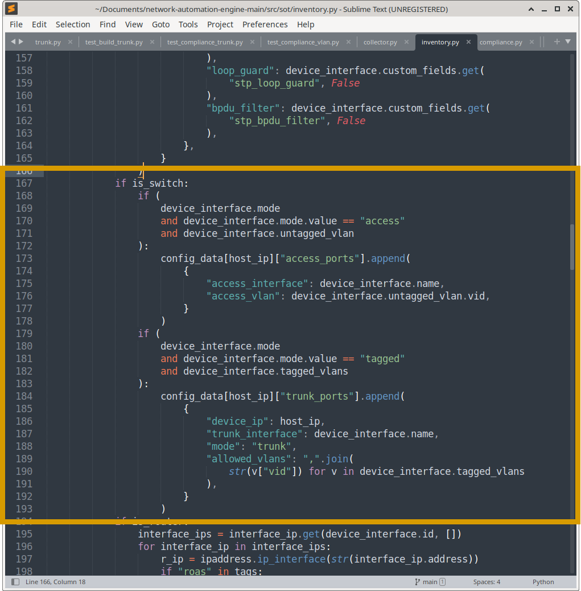

> **Design Choice (Comma-Separated String):**
> NetBox presents tagged VLANs as a collection of nested dictionaries (`[{"vid": 10}, {"vid": 20}]`). Converting this collection into an ordered string (`"1,10,20,30,40,50,60,70,999"`) creates a clean contract that aligns directly with Cisco CLI command structures (`switchport trunk allowed vlan ...`) and simplifies downstream string/set diffing.

---

### Normalized Desired State Payloads

During runtime execution, the inventory builder synchronizes with NetBox and loads the intended trunk configurations for all managed distribution and access devices. Non‑trunk interfaces (such as `Ethernet0/1` on `CORE-SW-1`) and virtual SVIs (such as `Vlan1`) are filtered out automatically:

Ingested Trunk Context — `ACCESS-SW-1` (`10.10.10.20`):

```json
[
  {
    "device_ip": "10.10.10.20",
    "trunk_interface": "Ethernet0/1",
    "mode": "trunk",
    "allowed_vlans": "1,10,20,30,40,50,60,70,999"
  }
]
```

Ingested Trunk Context — `CORE-SW-1` (`10.10.10.10`):

```json
[
  {
    "device_ip": "10.10.10.10",
    "trunk_interface": "Ethernet0/0",
    "mode": "trunk",
    "allowed_vlans": "1,10,20,30,40,50,60,70,999"
  },
  {
    "device_ip": "10.10.10.10",
    "trunk_interface": "Ethernet0/3",
    "mode": "trunk",
    "allowed_vlans": "1,10,20,30,40,50,60,70,999"
  }
]
```

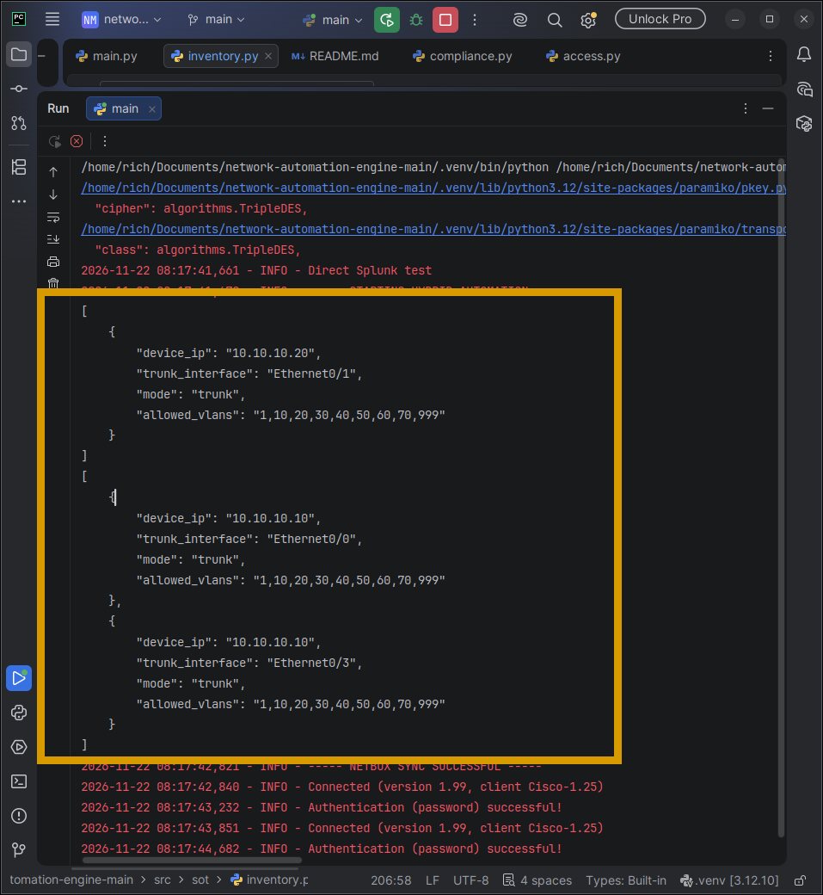

> **Compliance Impact:**
> This normalized payload gives the diff engine (`check_trunk()`) the exact list of interfaces that must operate as trunks, along with their mandatory allowed VLAN whitelist. Any live trunk missing an allowed VLAN, carrying unauthorized VLANs, or operating in dynamic/access mode will immediately trigger an audit failure.

## 2. Live Device State Collection & Trunk Parsing

To audit 802.1Q trunks without relying on brittle regular expressions, the engine employs a decoupled extraction pipeline:

1. **Collector (`src/collectors/cli/collector.py`):** Queries `show interfaces switchport` over Netmiko using Cisco pyATS/Genie to produce structured operational dictionaries.
2. **Builder (`src/collectors/cli/builders.py`):** Ingests the raw switchport data, ignores access ports, and normalizes operational trunks and their allowed VLAN lists into an evaluation-ready dictionary.

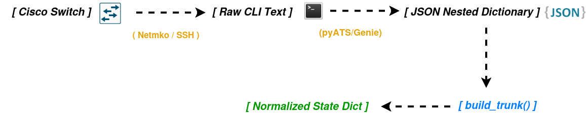

---

### 1. Fault-Tolerant CLI Collection (`src/collectors/cli/collector.py`)

The collector executes `show interfaces switchport` with `use_genie=True` to immediately obtain structured data. The call is encapsulated in an isolated `try/except` boundary to prevent timeouts or parser errors from terminating the pipeline:

```python
# src/collectors/cli/collector.py (Switchport Collection Boundary)

try:
    device_state["switchports"] = conn.send_command(
        "show interfaces switchport", use_genie=True
    )
except Exception:
    device_state["switchports"] = {}
```
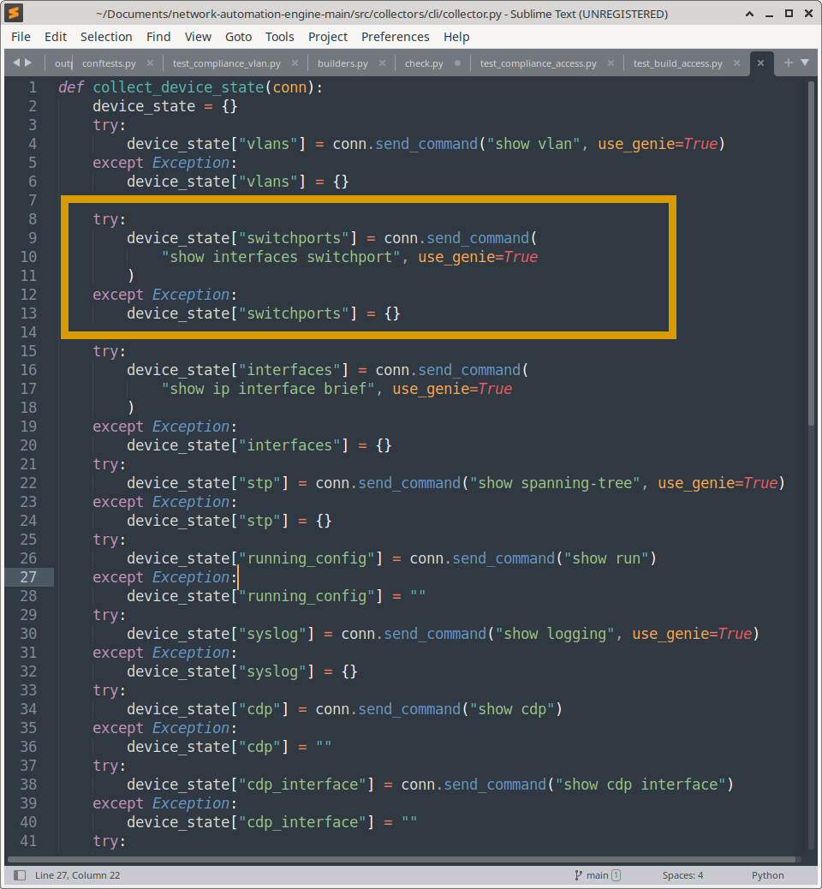

---

### 2. Trunk State Normalization (`src/collectors/cli/builders.py`)

The `build_trunk()` builder isolates active trunk links. It filters out physical access ports, unconfigured interfaces, and SVIs by asserting that `"trunk"` is explicitly present in the operational mode string:

```python
# src/collectors/cli/builders.py

# TRUNK PORT
def build_trunk(device_state):
    if not device_state:
        return {}

    device_state_trunk = device_state.get("switchports") or {}
    actual_trunk = {}

    for trunk_int, trunk_values in device_state_trunk.items():
        # Defensive check: ensure interface data is a structured dictionary
        if not isinstance(trunk_values, dict):
            continue

        operational_mode = trunk_values.get("operational_mode", "").lower()

        # Strict Filter: Ignore access switchports and non-trunking interfaces
        if "trunk" not in operational_mode:
            continue

        allowed_vlans = trunk_values.get("trunk_vlans", "")

        actual_trunk[trunk_int] = {
            "trunk_interface": trunk_int,
            "allowed_vlans": allowed_vlans,
            "operational_mode": operational_mode,
        }

    return actual_trunk
```
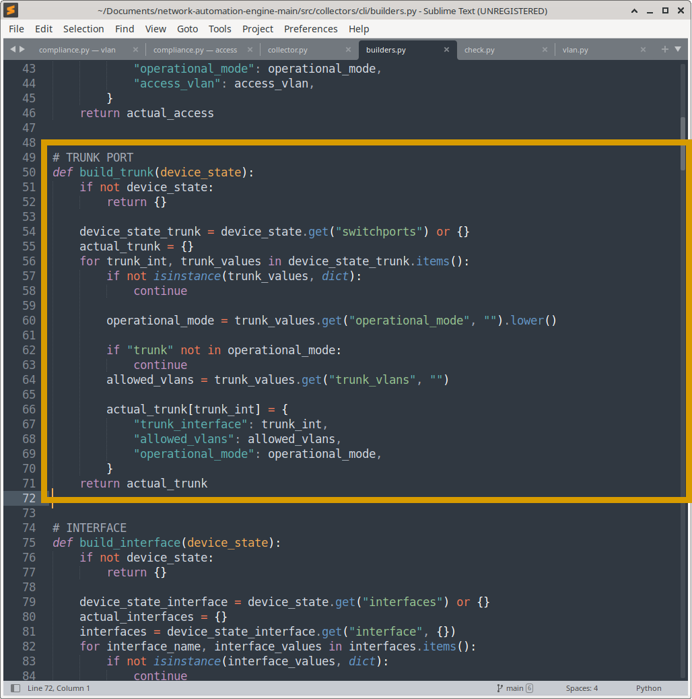

---

### 3. Runtime Verification: Baseline vs. Configured State

To verify that the builder correctly handles varying switch states, the engine was tested against two distinct operational conditions on `CORE-SW-1`:

#### Condition 1: Baseline Switch (No Trunks Configured)

When `CORE-SW-1` had no interfaces operating in trunk mode, `build_trunk()` gracefully filtered out all access switchports and returned an **empty dictionary (`{}`)**:

```text
2026-11-22 08:24:59,948 - WARNING - trunk_interface_drift
2026-11-22 08:24:59,949 - WARNING - trunk_interface_drift
{}
```

The engine handled this gracefully without throwing `KeyError` or crashing, issuing warnings that expected trunks were absent.

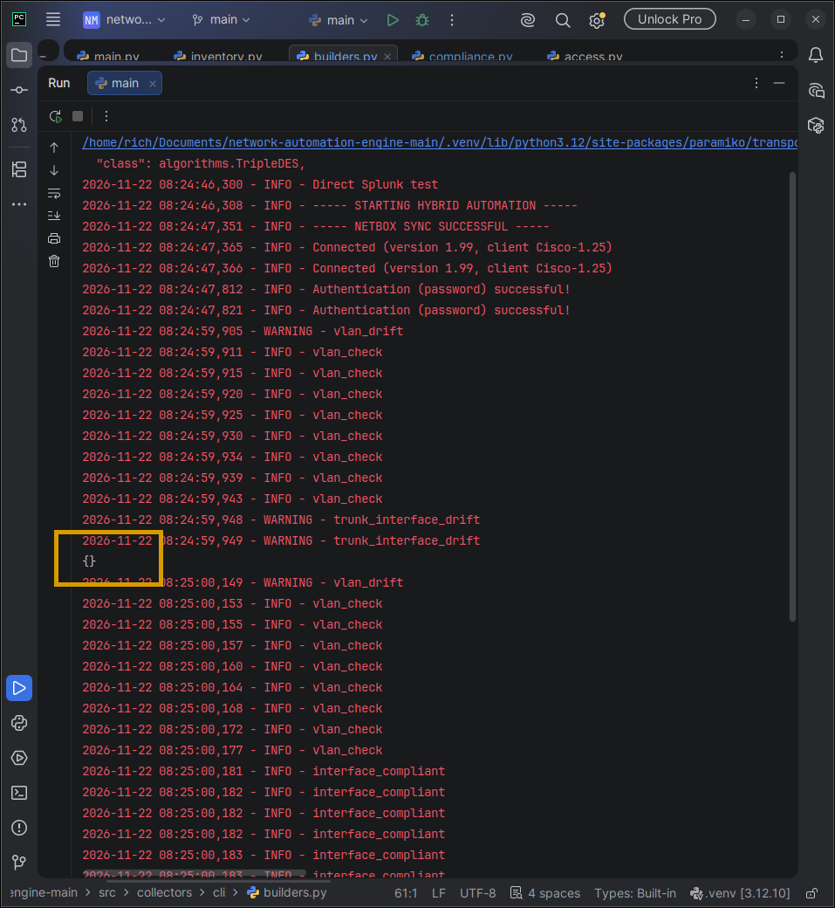

---

#### Condition 2: Active Trunk Configured on `CORE-SW-1`

To validate the builder's attribute extraction, `Ethernet0/0` was configured as an 802.1Q trunk directly on the switch console, but restricted to an incomplete allowed list (`1,10,20` instead of all 9 NetBox VLANs):

```cisco
CORE-SW-1# show running-config interface Ethernet0/0
interface Ethernet0/0
 switchport trunk encapsulation dot1q
 switchport trunk allowed vlan 1,10,20
 switchport mode trunk
 duplex auto
```

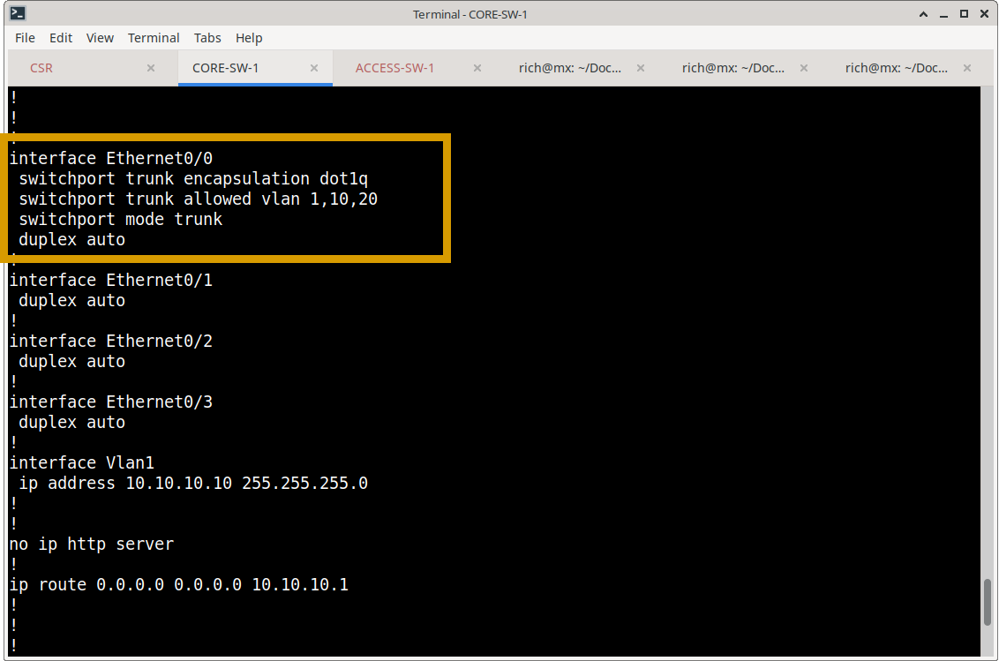

#### Normalized Builder Output

Upon re-polling `CORE-SW-1`, `build_trunk()` automatically detected the new operational trunk and produced a normalized dictionary containing the active allowed VLAN string:

```json
{
  "ethernet0/0": {
    "trunk_interface": "Ethernet0/0",
    "allowed_vlans": "1,10,20",
    "operational_mode": "trunk"
  }
}
```

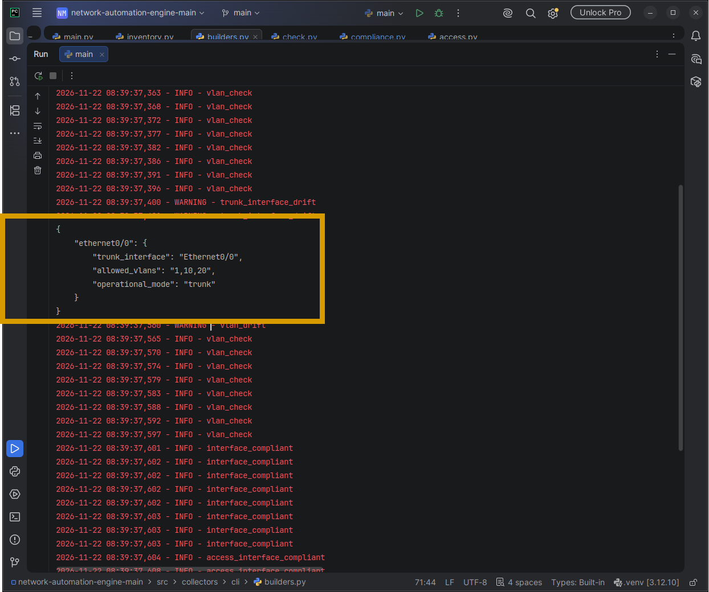

> **Engineering Design Takeaway:**
> The `build_trunk()` builder extracts the exact allowed VLAN whitelist (`"1,10,20"`) directly from operational state. This normalized schema is passed to the diff engine (`check_trunk()`), which compares the live whitelist against NetBox without coupling the audit logic to vendor-specific CLI syntax.

## 3. Trunk Compliance Diff Engine & Drift Detection

The 802.1Q trunk compliance module reconciles operational switchport links against the NetBox Source of Truth. Operating as a closed-loop state machine, it verifies that physical uplinks are explicitly operating in trunk mode and enforcing the authorized 802.1Q allowed VLAN whitelist, filtering compliant downlinks, flagging configuration drift, and executing closed-loop post-validation.

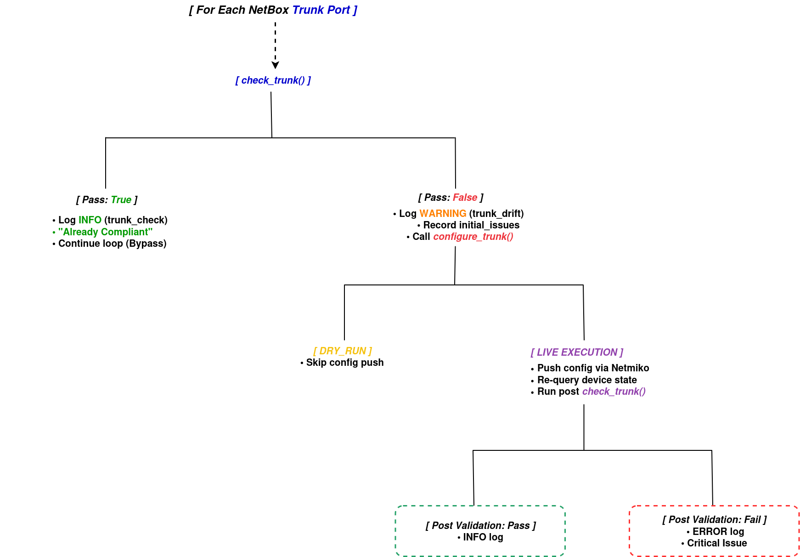

---

### 1. Two-Tier Diff Engine (`src/compliance/switching/trunk/check.py`)

The `check_trunk()` function evaluates every interface against two deterministic validation gates:

1. **Interface Existence & Mode Gate:** Queries `actual_config` for the normalized interface identifier. Because `build_trunk()` explicitly discards access switchports, an interface missing from the dictionary indicates that the link is either absent or operating in unauthorized access mode.
2. **Allowed VLAN Whitelist Scope Gate:** Verifies that the live trunk's active permitted VLANs (`actual_vlans`) strictly match the NetBox intended whitelist (`exp_allowed_vlans`).

```python
# src/compliance/switching/trunk/check.py

def check_trunk(expected_trunk, actual_config):
    failures = []
    exp_interface = expected_trunk.get("trunk_interface", "").lower().strip()
    exp_allowed_vlans = str(expected_trunk.get("allowed_vlans", "")).strip()
    exp_mode = expected_trunk.get("operational_mode", "").lower().strip()

    actual = actual_config.get(exp_interface)
    if not actual:
        failures.append(
            f"Missing (Unconfigured) Trunk Interface | Interface: {exp_interface} | "
            f"Expected Allowed VLANs: {exp_allowed_vlans}"
        )
        return False, failures
    actual_vlans = str(actual.get("allowed_vlans", "")).strip()
    actual_mode = actual.get("operational_mode", "").lower().strip()
    if exp_allowed_vlans != actual_vlans:
        failures.append(
            f"(Trunk) Mismatch Found - Allowed VLANs | Interface: {exp_interface}"
            f"Expected: {exp_allowed_vlans} | Actual: {actual_vlans}"
        )
        return False, failures
    return len(failures) == 0, failures
```
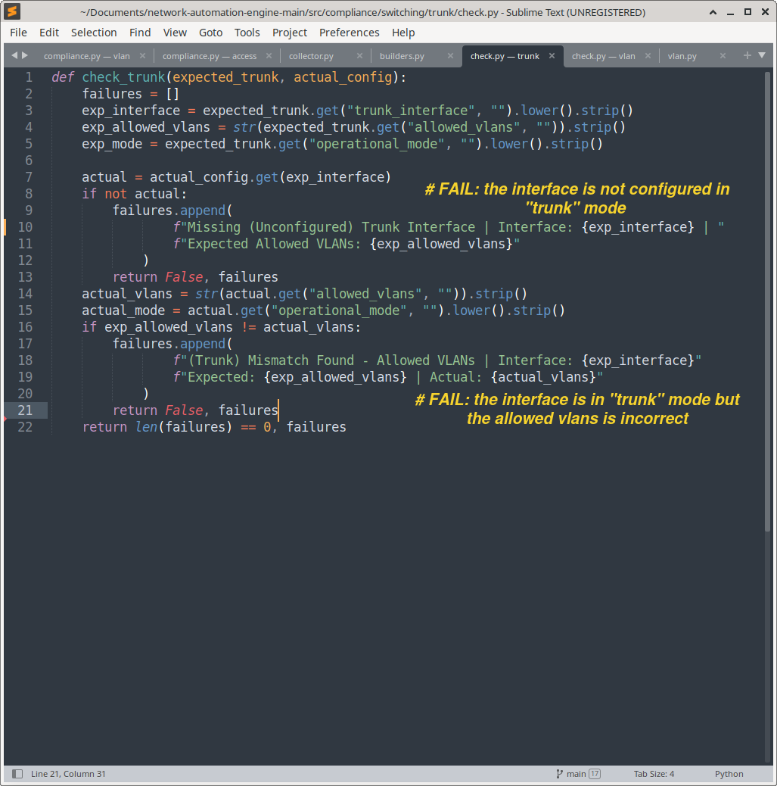

---

### 2. Closed-Loop Compliance Orchestration (`src/compliance/switching/trunk/compliance.py`)

The `compliance_trunk()` runner coordinates auditing, warning logs, remediation dispatch, and closed-loop post-validation:

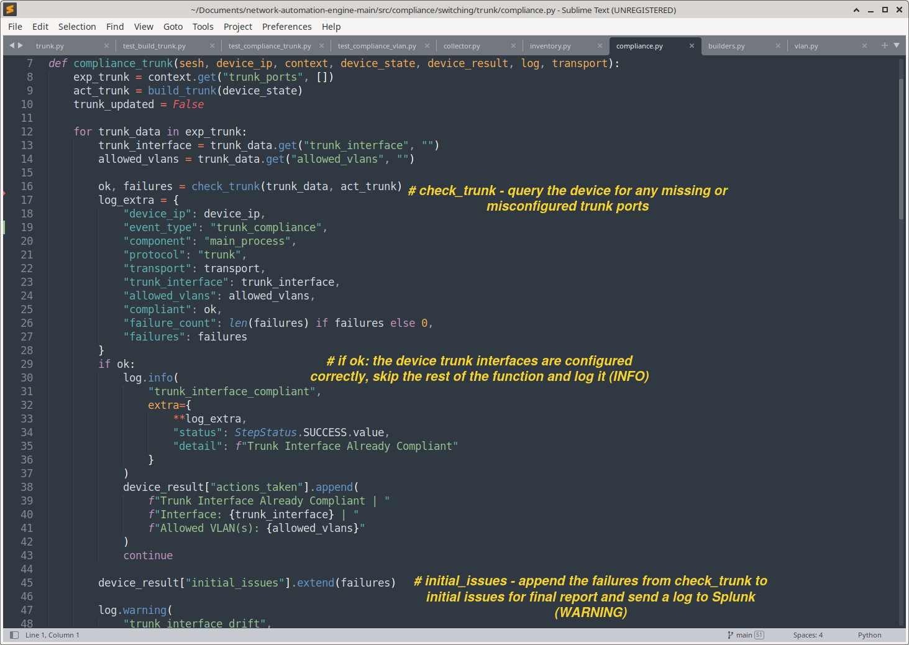

```python
# src/compliance/switching/trunk/compliance.py  (Lifecycle Head: lines 7-48)

def compliance_trunk(sesh, device_ip, context, device_state, device_result, log, transport):
    exp_trunk = context.get("trunk_ports", [])
    act_trunk = build_trunk(device_state)
    trunk_updated = False

    for trunk_data in exp_trunk:
        trunk_interface = trunk_data.get("trunk_interface", "")
        allowed_vlans = trunk_data.get("allowed_vlans", "")

        ok, failures = check_trunk(trunk_data, act_trunk)
        log_extra = {
            "device_ip": device_ip,
            "event_type": "trunk_compliance",
            "component": "main_process",
            "protocol": "trunk",
            "transport": transport,
            "trunk_interface": trunk_interface,
            "allowed_vlans": allowed_vlans,
            "compliant": ok,
            "failure_count": len(failures) if failures else 0,
            "failures": failures
        }
        if ok:
            log.info(
                "trunk_interface_compliant",
                extra={
                    **log_extra,
                    "status": StepStatus.SUCCESS.value,
                    "detail": f"Trunk Interface Already Compliant"
                }
            )
            device_result["actions_taken"].append(
                f"Trunk Interface Already Compliant | "
                f"Interface: {trunk_interface} | "
                f"Allowed VLAN(s): {allowed_vlans}"
            )
            continue

        device_result["initial_issues"].extend(failures)
        log.warning(
            "trunk_interface_drift",
            extra={
                **log_extra,
                "status": StepStatus.FAILED.value,
                "detail": "Trunk Interface Configuration Non-Compliant",
            },
        )
```
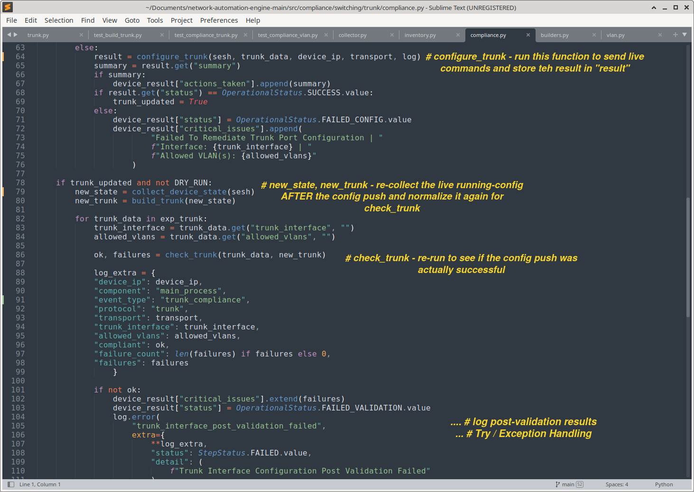

```python
# src/compliance/switching/trunk/compliance.py  (Remediation & Post-Validation: lines 49+)

        # 4. Dispatch targeted remediation
        result = configure_trunk(sesh, trunk_data, device_ip, transport, log)
        if result.get("status") == OperationalStatus.SUCCESS.value:
            trunk_updated = True
            device_result["actions_taken"].append(result.get("summary"))
        else:
            device_result["status"] = OperationalStatus.FAILED_CONFIG.value
            device_result["critical_issues"].append(
                f"Failed To Remediate Trunk Port Configuration | "
                f"Interface: {trunk_interface} | Allowed VLAN(s): {allowed_vlans}"
            )

    # 5. Closed-Loop Post-Validation Pass (Skipped if DRY_RUN)
    if trunk_updated and not DRY_RUN:
        new_state = collect_device_state(sesh)
        new_trunk = build_trunk(new_state)

        for trunk_data in exp_trunk:
            ok, failures = check_trunk(trunk_data, new_trunk)
            if not ok:
                device_result["critical_issues"].extend(failures)
                device_result["status"] = OperationalStatus.FAILED_VALIDATION.value
                log.error("trunk_interface_post_validation_failed", extra={...})
            else:
                log.info("trunk_interface_post_validation_success", extra={...})
```

---

### 3. Runtime Drift Scenarios & Evidence

The trunk compliance engine was validated on `CORE-SW-1` against two distinct operational drift conditions:

#### Scenario A - Missing / Unconfigured Trunk Interfaces
When `CORE-SW-1` had zero operational trunks configured, `build_trunk()` returned an empty dictionary (`{}`). The compliance checker identified that both required distribution uplinks (`Ethernet0/0` and `Ethernet0/3`) were unconfigured:

```text
2026-11-22 08:30:02,644 - WARNING - trunk_interface_drift
2026-11-22 08:30:02,644 - WARNING - trunk_interface_drift
{}
['Missing (Unconfigured) Trunk Interface | Interface: ethernet0/0 | Expected Allowed VLANs: 1,10,20,30,40,50,60,70,999']
['Missing (Unconfigured) Trunk Interface | Interface: ethernet0/3 | Expected Allowed VLANs: 1,10,20,30,40,50,60,70,999']
```
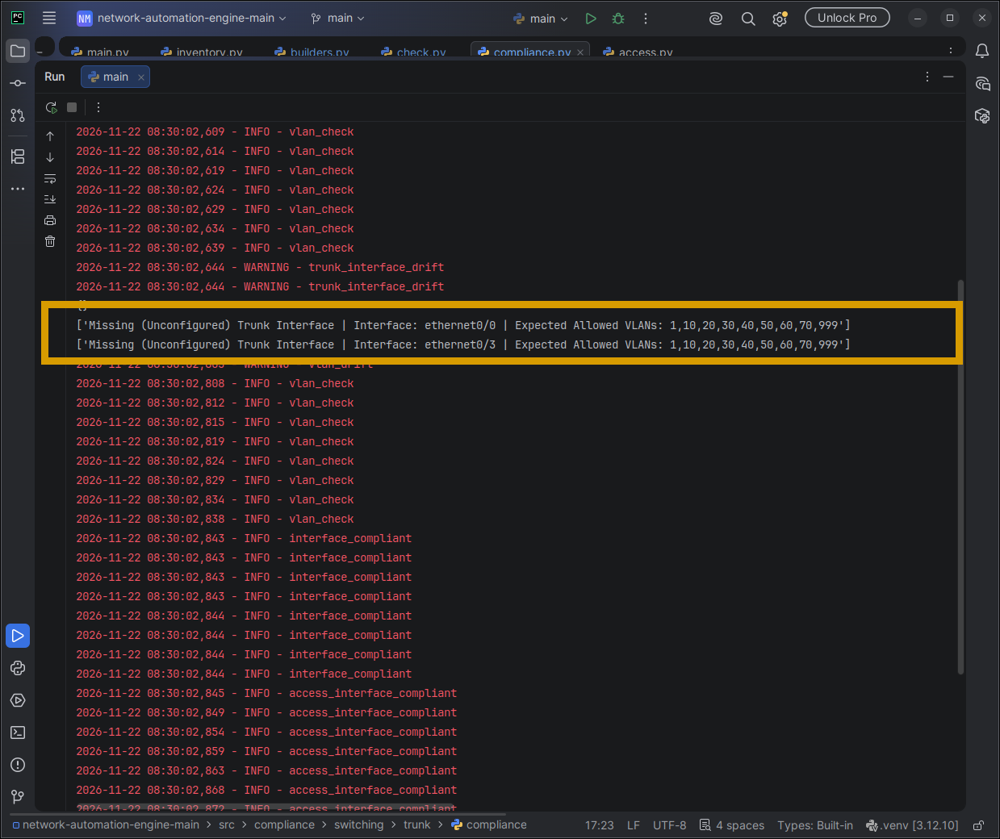

---

#### Scenario B — Allowed VLAN Whitelist Drift (Restricted Trunk)
To test attribute diffing, `Ethernet0/0` was configured out-of-band via console, but restricted to an incomplete VLAN scope (`1,10,20` instead of the 9 NetBox-mandated VLANs):

```cisco
CORE-SW-1(config)# int e0/0
CORE-SW-1(config-if)# switchport mode trunk
Command rejected: An interface whose trunk encapsulation is "Auto" can not be configured to "trunk" mode.
CORE-SW-1(config-if)# switchport trunk encapsulation dot1q
CORE-SW-1(config-if)# switchport mode trunk
CORE-SW-1(config-if)# switchport trunk allowed vlan 1,10,20
```
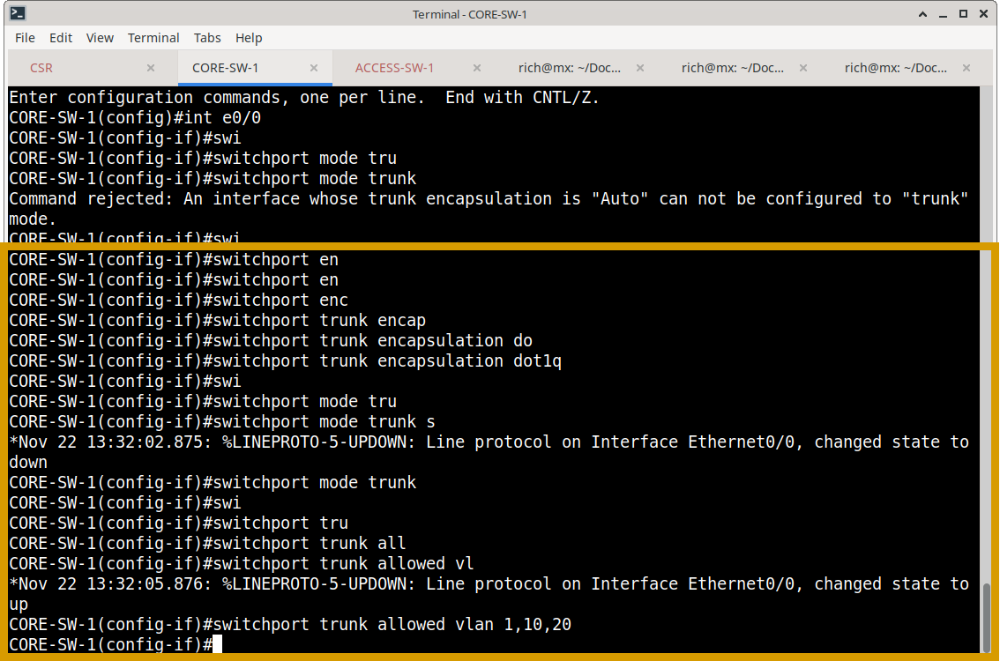

> **The Cisco CLI Encapsulation Trap:**
> On Cisco IOS-XE Catalyst switches, running `switchport mode trunk` without prior encapsulation definition is rejected by the parser (`Command rejected: An interface whose trunk encapsulation is "Auto" can not be configured to "trunk" mode.`).
> The remediation engine anticipates this: Jinja2 templates explicitly define `switchport trunk encapsulation dot1q` prior to setting the mode to trunk.

**Compliance Detection Output:**
The engine parsed the active trunk but detected the truncated whitelist. Meanwhile, `Ethernet0/3` was flagged as completely unconfigured:

```text
2026-11-22 08:38:05,862 - WARNING - trunk_interface_drift
2026-11-22 08:38:05,862 - WARNING - trunk_interface_drift
['(Trunk) Mismatch Found - Allowed VLANs | Interface: ethernet0/0 | Expected: 1,10,20,30,40,50,60,70,999 | Actual: 1,10,20']
['Missing (Unconfigured) Trunk Interface | Interface: ethernet0/3 | Expected Allowed VLANs: 1,10,20,30,40,50,60,70,999']
```
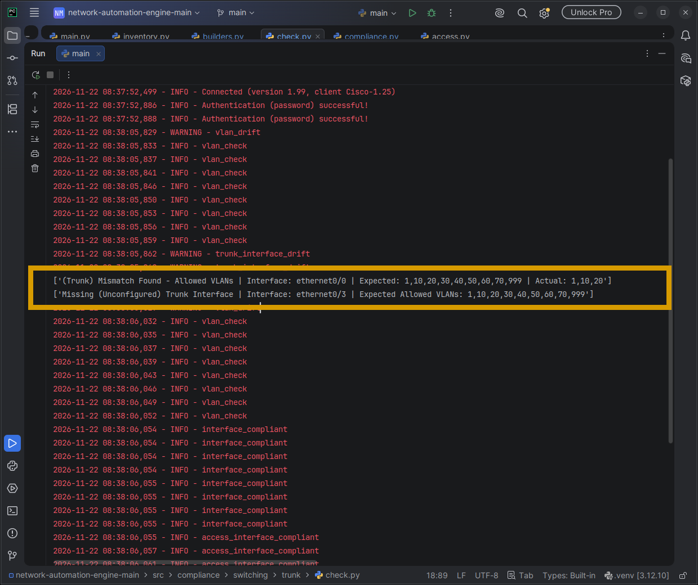

---

### 4. Compliance Evaluation Matrix

| Live Device State | NetBox Declared Intent | `check_trunk()` Result | Operational Action Taken |
| :--- | :--- | :---: | :--- |
| `mode: trunk`<br>`allowed: 1,10,20,30,40,50,60,70,999` | `mode: trunk`<br>`allowed: 1,10,20,30,40,50,60,70,999` | **PASS (Compliant)** | Log `trunk_interface_compliant`; bypass device push. |
| `mode: trunk`<br>`allowed: 1,10,20` *(Incomplete)* | `mode: trunk`<br>`allowed: 1,10,20,30,40,50,60,70,999` | **FAIL (Allowed VLAN Mismatch)** | Log `trunk_interface_drift`; push updated whitelist. |
| `mode: static access`<br>`vlan: 10` *(Wrong Mode)* | `mode: trunk`<br>`allowed: 1,10,20,30,40,50,60,70,999` | **FAIL (Missing Trunk Interface)** | Flag port mode violation; reconfigure port from access to trunk. |
| Port Unconfigured / Default | `mode: trunk`<br>`allowed: 1,10,20,30,40,50,60,70,999` | **FAIL (Unconfigured Trunk)** | Deploy encapsulation, mode trunk, and allowed list. |

## 4. Automated 802.1Q Trunk Remediation & Encapsulation Enforcement

When the compliance engine identifies an unconfigured trunk or a drifted allowed VLAN list, it routes the interface data into `configure_trunk()` in `src/remediation/switching/trunk.py`.

The remediation architecture resolves vendor-specific syntax constraints by combining a **declarative Jinja2 template** (`templates/trunk_ports.j2`) with an **interface defaulting strategy**.

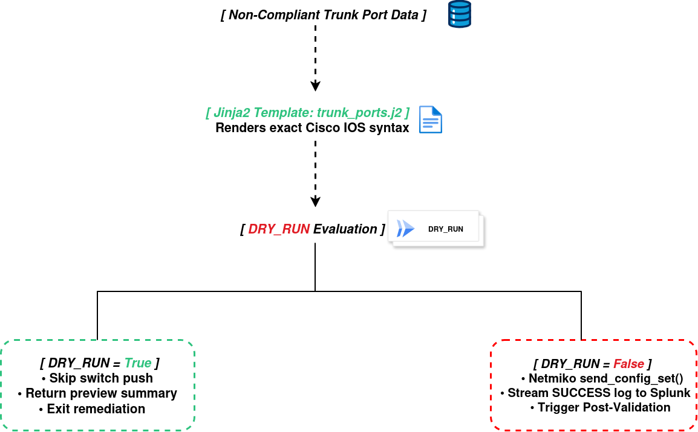

---

### 1. Declarative Interface Healing Template (`templates/trunk_ports.j2`)

On Cisco Catalyst platforms, running `switchport mode trunk` directly on an unconfigured or access interface causes the parser to reject the command:

```text
Command rejected: An interface whose trunk encapsulation is "Auto" can not be configured to "trunk" mode.
```
To eliminate this failure mode (and any lingering access/dynamic configuration that introduces race conditions), the Jinja2 template resets the interface to factory default, explicitly defines 802.1Q encapsulation, enables trunk mode, and binds the authorized VLAN whitelist:

```jinja2
{# templates/trunk_ports.j2 #}

default interface {{ t.trunk_interface }}
interface {{ t.trunk_interface }}
switchport trunk encapsulation dot1q
switchport mode trunk
switchport trunk allowed vlan {{ t.allowed_vlans }}

```
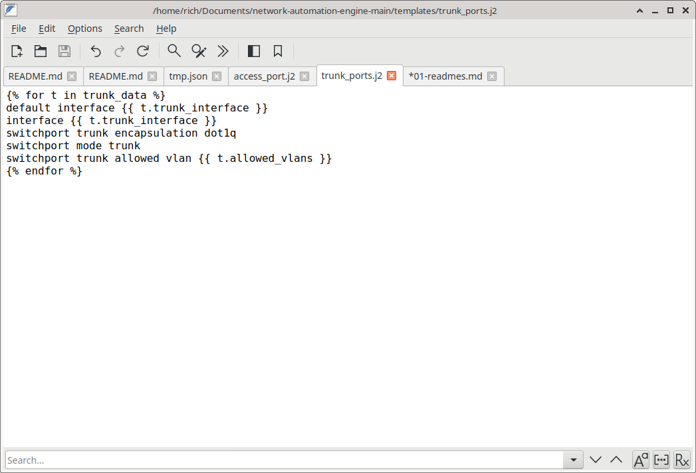

#### Rendered Command Example:
When remediating `Ethernet0/0` on `CORE-SW-1` to enforce the full 9-VLAN whitelist:

```cisco
default interface Ethernet0/0
interface Ethernet0/0
 switchport trunk encapsulation dot1q
 switchport mode trunk
 switchport trunk allowed vlan 1,10,20,30,40,50,60,70,999
```

> **Engineering Design Decision:**
> Issuing `default interface <id>` first wipes any residual access-mode or dynamic-auto configuration from the running config, guaranteeing a deterministic state before `switchport trunk encapsulation dot1q` is applied. Defining encapsulation *before* `switchport mode trunk` is the specific ordering that avoids the Cisco "Auto" parser rejection.

---

### 2. Remediation Handler Implementation (`src/remediation/switching/trunk.py`)

The `configure_trunk()` routine renders the template, verifies whether dry-run mode is enabled, applies the command set over Netmiko, and logs the execution event:

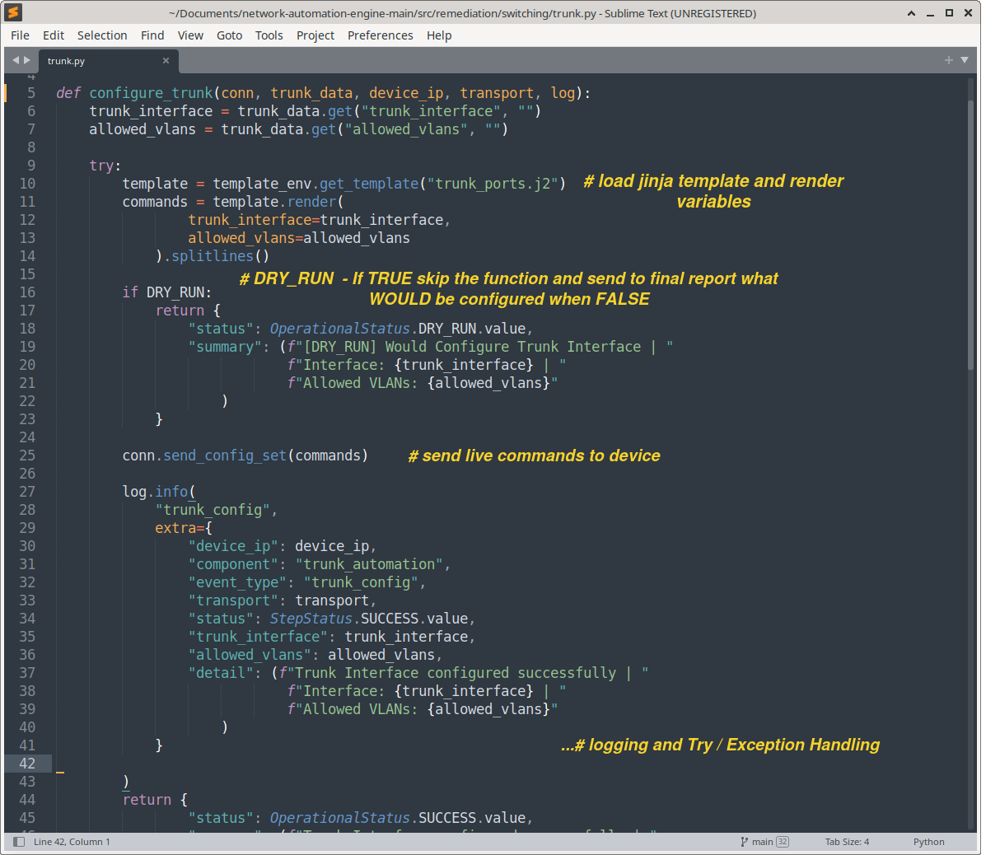

```python
# src/remediation/switching/trunk.py

def configure_trunk(conn, trunk_data, device_ip, transport, log):
    trunk_interface = trunk_data.get("trunk_interface", "")
    allowed_vlans = trunk_data.get("allowed_vlans", "")

    try:
        # Step 1: Render Jinja2 template with expected SoT parameters
        template = template_env.get_template("trunk_ports.j2")
        commands = template.render(
            trunk_interface=trunk_interface,
            allowed_vlans=allowed_vlans
        ).splitlines()

        # Step 2: Safe Deployment Guard (Dry-Run Check)
        if DRY_RUN:
            return {
                "status": OperationalStatus.DRY_RUN.value,
                "summary": (
                    f"[DRY_RUN] Would Configure Trunk Interface | "
                    f"Interface: {trunk_interface} | "
                    f"Allowed VLANs: {allowed_vlans}"
                )
            }

        # Step 3: Atomic configuration push via Netmiko
        conn.send_config_set(commands)

        # Step 4: Stream structured remediation telemetry to Splunk
        log.info(
            "trunk_config",
            extra={
                "device_ip": device_ip,
                "component": "trunk_automation",
                "event_type": "trunk_config",
                "transport": transport,
                "status": StepStatus.SUCCESS.value,
                "trunk_interface": trunk_interface,
                "allowed_vlans": allowed_vlans,
                "detail": (
                    f"Trunk Interface configured successfully | "
                    f"Interface: {trunk_interface}"
                    f"Allowed VLANs: {allowed_vlans}"
                )
            }
        )
        return {
            "status": OperationalStatus.SUCCESS.value,
            "summary": (
                f"Trunk Interface configured successfully | "
                f"Interface: {trunk_interface} | "
                f"Allowed VLANs: {allowed_vlans}"
            )
        }

    except Exception as e:
        log.error(
            "trunk_config_failed",
            extra={
                "device_ip": device_ip,
                "component": "trunk_automation",
                "trunk_interface": trunk_interface,
                "error": str(e)
            }
        )
        return {
            "status": OperationalStatus.FAILED_CONFIG.value,
            "summary": f"Failed to configure trunk {trunk_interface}: {str(e)}"
        }
```

---

## 5. Safe Change Management: Dry-Run Mode

To support production Change Advisory Board (CAB) review windows and eliminate the risk of unintended network outages, the engine provides a globally managed `DRY_RUN` setting (`src/core/settings.py`).


When `DRY_RUN = True`:
* **Full Audit Execution:** Live operational state collection, schema normalization, and compliance checks run normally against network switches.
* **In-Memory Verification:** Configuration drift is identified, and Jinja2 templates are rendered in memory to validate syntax and variables.
* **Zero-Touch Safety Barrier:** **Socket transmissions (`conn.send_config_set()`) are bypassed entirely.** No commands are sent to physical hardware.
* **Audit Trail Generation:** Drift warnings are streamed to Splunk, and planned remediation actions are cataloged in structured compliance artifacts.

---

### Machine-Readable Dry-Run Artifact (`final_compliance_report.json`)

At the conclusion of an audit run, the engine compiles the complete assessment into `src/final_compliance_report.json`. When running in dry-run mode, the `actions_taken` array documents both the items that were verified as already compliant and the exact remediations that **would** be applied during live execution. Each planned modification is tagged with the `[DRY_RUN]` prefix:

```json
{
  "devices": [
    {
      "device_name": "ACCESS-SW-1",
      "device_ip": "10.10.10.20",
      "hostname": null,
      "status": "COMPLIANT",
      "actions_taken": [
        "[DRY_RUN] Would Configure VLANs | VLAN: 1 | Name: 1",
        "VLAN Already Compliant | VLAN: 10 | Name: USERS",
        "VLAN Already Compliant | VLAN: 20 | Name: VOICE",
        "VLAN Already Compliant | VLAN: 30 | Name: SERVERS",
        "VLAN Already Compliant | VLAN: 40 | Name: GUEST",
        "VLAN Already Compliant | VLAN: 50 | Name: MANAGEMENT",
        "VLAN Already Compliant | VLAN: 60 | Name: PRINTERS_IOT",
        "VLAN Already Compliant | VLAN: 70 | Name: NETWORK_INFRASTRUCTURE",
        "VLAN Already Compliant | VLAN: 999 | Name: NATIVE_UNUSED",
        "Interface Configuration Already Compliant | Interface: Ethernet0/0 | Description: Configured via Netmiko | Should Be Up: True",
        "Interface Configuration Already Compliant | Interface: Ethernet0/1 | Description: Configured via Netmiko | Should Be Up: True",
        "Interface Configuration Already Compliant | Interface: Ethernet0/2 | Description:  | Should Be Up: True",
        "Interface Configuration Already Compliant | Interface: Ethernet0/3 | Description: Configured via Netmiko | Should Be Up: True",
        "Interface Configuration Already Compliant | Interface: Ethernet1/0 | Description: Configured via Netmiko | Should Be Up: True",
        "Interface Configuration Already Compliant | Interface: Ethernet1/1 | Description: Configured via Netmiko | Should Be Up: True",
        "Interface Configuration Already Compliant | Interface: Ethernet1/2 | Description: Configured via Netmiko | Should Be Up: True",
        "Interface Configuration Already Compliant | Interface: Ethernet1/3 | Description: Configured via Netmiko | Should Be Up: True",
        "[DRY_RUN] Would Configure Access Port | Interface: Ethernet0/0 | VLAN: 10",
        "[DRY_RUN] Would Configure Access Port | Interface: Ethernet0/2 | VLAN: 20",
        "[DRY_RUN] Would Configure Access Port | Interface: Ethernet0/3 | VLAN: 30",
        "[DRY_RUN] Would Configure Access Port | Interface: Ethernet1/0 | VLAN: 40",
        "[DRY_RUN] Would Configure Access Port | Interface: Ethernet1/1 | VLAN: 50",
        "[DRY_RUN] Would Configure Access Port | Interface: Ethernet1/2 | VLAN: 60",
        "[DRY_RUN] Would Configure Access Port | Interface: Ethernet1/3 | VLAN: 70",
        "[DRY_RUN] Would Configure_Trunk Port | Interface: Ethernet0/1 | Allowed VLAN(s): 1,10,20,30,40,50,60,70,999" <-----------
      ],
      "events": [],
      "checks_passed": 0
    }
  ]
}
```
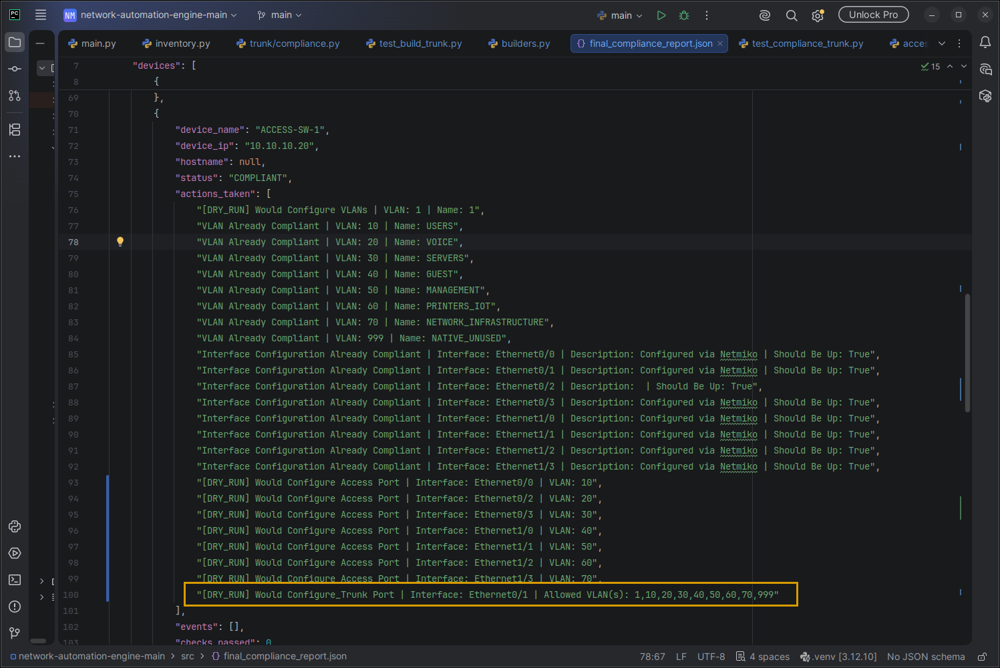

---

### What Dry-Run Captures in the Report

| Classification | Prefixed Log String | Operational Meaning in Dry-Run |
| :--- | :--- | :--- |
| **Trunk Remediation Preview** | `[DRY_RUN] Would Configure_Trunk Port` | Identifies the exact trunk interface and the full comma-separated allowed VLAN whitelist that would be pushed. |
| **Access Port Preview** | `[DRY_RUN] Would Configure Access Port` | Specifies the interface and target access VLAN ID to be applied. |
| **Compliant Verification** | `* Already Compliant` | Confirms operational parity with NetBox; no configuration will be generated or pushed. |

---

### Enterprise Value: Automated Change Ticket Documentation

This report serves as an auditable bridge between network automation and IT service management (ITSM):

1. **Pre-Change Verification:** Network engineers can run the pipeline with `DRY_RUN = True` prior to maintenance windows to inspect exactly what will change.
2. **Deterministic CAB Evidence:** `final_compliance_report.json` contains the full list of proposed commands and verified compliant states, allowing it to be attached directly to ServiceNow or Jira change requests as proof of intended impact.
3. **Risk Elimination:** Guarantees zero downtime or unintended configuration wipes by verifying template renders before granting execution approval.

---

## 6. Closed-Loop Post-Remediation Validation

In high-availability distribution topologies, **command acceptance by the switch does not guarantee compliance**. Interfaces can remain down, transceiver negotiation can stall, or hardware profile limits can drop configuration lines without returning a fatal SSH error.

To prove that the physical data plane is compliant, the engine enforces an immediate **second-pass operational audit**:

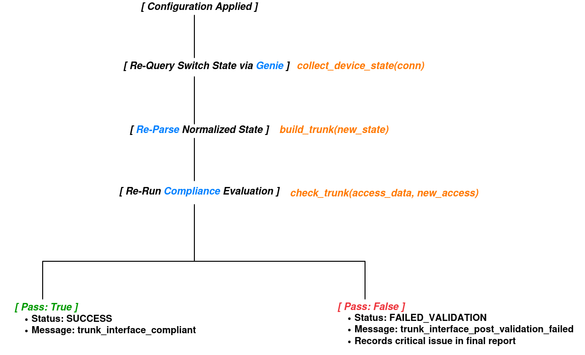

### Validation Outcomes:

| Outcome | Engine Status | Operational Significance |
| :--- | :--- | :--- |
| **Verification Pass** | `OperationalStatus.SUCCESS` | The switch was re-polled, and the live running state confirmed that the interface is operating in trunk mode with the complete authorized whitelist. |
| **Verification Fail** | `OperationalStatus.FAILED_VALIDATION` | The configuration commands executed over SSH, but the re-queried switchport state still deviates from NetBox intent. A critical issue is raised in the audit report. |

### 6.1 Physical Switch Verification: Before vs. After Configuration

To verify that the remediation commands took effect on physical hardware, running configurations were extracted from `CORE-SW-1` before and after automated execution.

#### 1. Running Configuration: BEFORE Remediation (Injected Drift)

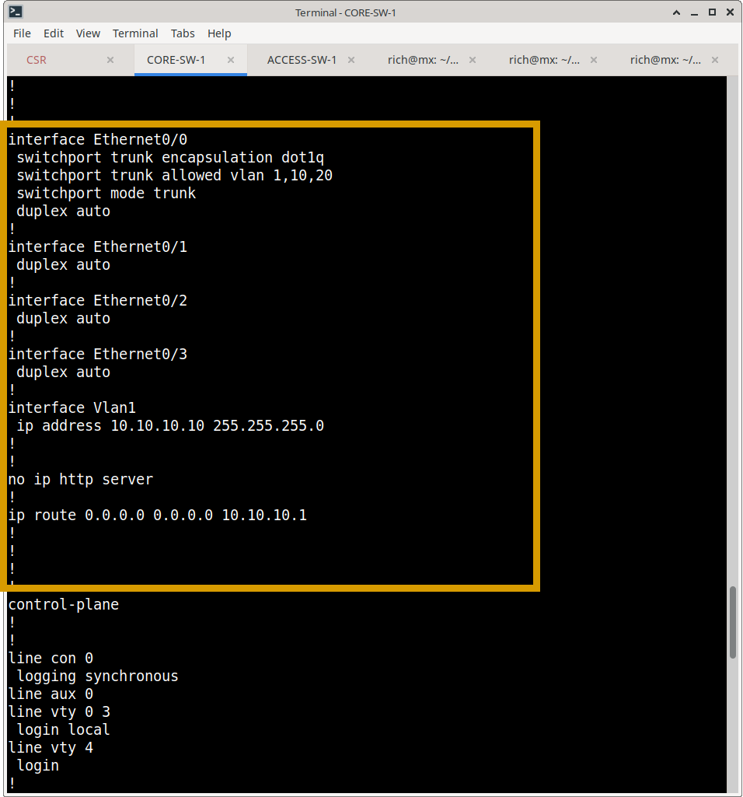

```cisco
interface Ethernet0/0
 switchport trunk encapsulation dot1q
 switchport trunk allowed vlan 1,10,20
 switchport mode trunk
 duplex auto
!
interface Ethernet0/1
 duplex auto
!
interface Ethernet0/2
 duplex auto
!
interface Ethernet0/3
 duplex auto
!
interface Vlan1
 ip address 10.10.10.10 255.255.255.0
```
> **Observed drift:** `Ethernet0/0` is restricted to `1,10,20` (missing `30,40,50,60,70,999`), and `Ethernet0/3` is completely unconfigured — no trunk encapsulation, no mode, no allowed list.

---

#### 2. Execution Audit: Cisco Console Syslog Trail (`vty0`)

When the automation engine connected to `CORE-SW-1` over Netmiko, the switch console generated `%SYS-5-CONFIG_I` syslog messages confirming that configuration changes were pushed over `vty0` by the automation service account:

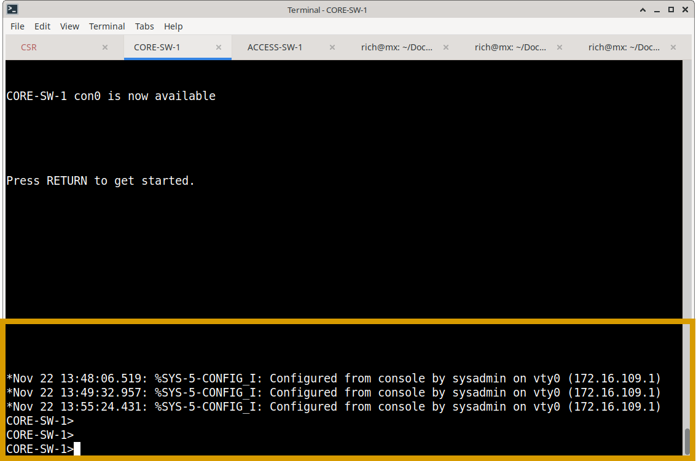

```cisco
*Nov 22 13:48:06.519: %SYS-5-CONFIG_I: Configured from console by sysadmin on vty0 (172.16.109.1)
*Nov 22 13:49:32.957: %SYS-5-CONFIG_I: Configured from console by sysadmin on vty0 (172.16.109.1)
*Nov 22 13:55:24.431: %SYS-5-CONFIG_I: Configured from console by sysadmin on vty0 (172.16.109.1)
```

The switch console records the remote configuration push executed by the engine's service account (`sysadmin`) over Netmiko SSH. Three distinct `CONFIG_I` events correspond to the drift injection and the two remediation pushes (`Ethernet0/0` and `Ethernet0/3`).

---

#### 3. Running Configuration: AFTER Remediation (Fully Compliant)

Following automated execution and closed-loop post-validation:
* `Ethernet0/0` has been updated with the complete 9-VLAN whitelist (`1,10,20,30,40,50,60,70,999`).
* `Ethernet0/3` was cleanly defaulted, configured with `dot1q` encapsulation, locked into `mode trunk`, and assigned the full authorized VLAN scope.

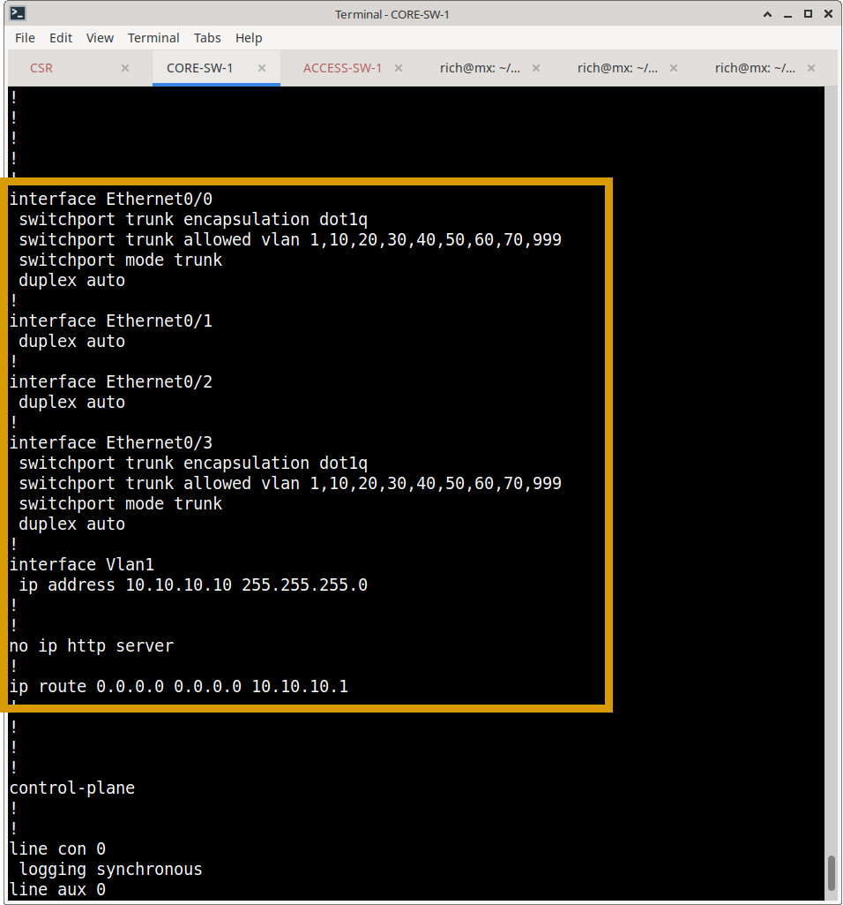

```cisco
interface Ethernet0/0
 switchport trunk encapsulation dot1q
 switchport trunk allowed vlan 1,10,20,30,40,50,60,70,999
 switchport mode trunk
 duplex auto
!
interface Ethernet0/1
 duplex auto
!
interface Ethernet0/2
 duplex auto
!
interface Ethernet0/3
 switchport trunk encapsulation dot1q
 switchport trunk allowed vlan 1,10,20,30,40,50,60,70,999
 switchport mode trunk
 duplex auto
!
interface Vlan1
 ip address 10.10.10.10 255.255.255.0
```
---

#### 4. Unified Configuration Diff

```diff
 interface Ethernet0/0
  switchport trunk encapsulation dot1q
- switchport trunk allowed vlan 1,10,20
+ switchport trunk allowed vlan 1,10,20,30,40,50,60,70,999
  switchport mode trunk
  duplex auto
 !
 interface Ethernet0/3
+ switchport trunk encapsulation dot1q
+ switchport trunk allowed vlan 1,10,20,30,40,50,60,70,999
+ switchport mode trunk
  duplex auto
```

> **Takeaway:** The engine doesn't just check for trunk status—it audits and enforces the specific VLANs allowed across the trunk, correcting both incomplete configurations and missing trunks without manual operator intervention.
## 7. Logging and Reporting

The compliance engine records structured events for trunk-port validation and remediation.

Logged fields include:

| Field | Description |
|---|---|
| `device_ip` | Device management IP address |
| `event_type` | Trunk compliance event classification |
| `component` | Component responsible for the event |
| `protocol` | Trunk compliance identifier |
| `transport` | Device connection transport |
| `trunk_interface` | Interface being evaluated |
| `allowed_vlans` | Expected allowed VLAN assignments |
| `compliant` | Compliance result |
| `failure_count` | Number of detected failures |
| `failures` | Detailed compliance failures |
| `status` | Execution status |
| `detail` | Event description |

The device result maintains three important collections:

- `initial_issues` — configuration drift detected before remediation.
- `actions_taken` — successful actions and planned dry-run actions.
- `critical_issues` — remediation or post-validation failures.

## 7. Splunk Observability & Incident Audit Trail

Every operational transition across the trunk lifecycle is serialized into structured JSON and ingested into **Splunk via HTTP Event Collector (HEC)** (`index="network_automation"`, `sourcetype="_json"`). The engine maps all events to standard Cisco syslog severities (`cisco_sev`), enabling NOC/SecOps teams to build real-time compliance dashboards, trigger alerts on unconstrained trunks, and maintain an immutable audit trail across both `CORE-SW-1` (`10.10.10.10`) and `ACCESS-SW-1` (`10.10.10.20`).

```spl
index="network_automation" sourcetype="_json" protocol="trunk"
| table asctime cisco_sev event_type message trunk_interface allowed_vlans status compliant detail
```

---

### Full Lifecycle Telemetry Matrix

The telemetry pipeline captures five distinct operational events across core and access switches:

| Lifecycle Phase | Event Type (`event_type`) | Splunk Message (`message`) | Cisco Severity | Status | Operational Significance |
| :--- | :--- | :--- | :---: | :---: | :--- |
| **1. Drift Detected** | `trunk_compliance` | `trunk_interface_drift` | `4 (WARN)` | `FAILED` | Allowed VLAN mismatch (e.g., trunk left open to `all` or restricted). |
| **2. Pre-Check Pass** | `trunk_compliance` | `trunk_interface_compliant` | `6 (INFO)` | `SUCCESS` | Trunk matches NetBox whitelist; changes bypassed without device push. |
| **3. Remediation Push** | `trunk_config` | `trunk_config` | `6 (INFO)` | `SUCCESS` | Declarative Jinja2 configuration applied over Netmiko. |
| **4. Post-Validation** | `trunk_compliance` | `trunk_interface_post_validation_success` | `6 (INFO)` | `SUCCESS` | Re-queried live switchport state confirms compliance on the data plane. |
| **5. Exception Tracking** | `trunk_config` | `trunk_config` | `6 (INFO)` | `ERROR` | Catches Jinja render errors or Netmiko channel timeouts for immediate triage. |

---

### Splunk Event Evidence & Payload Breakdown

#### 1. Configuration Drift Alert (`trunk_interface_drift`)
Triggered when an interface deviates from NetBox intent. On `CORE-SW-1` (`10.10.10.10`), `Ethernet0/0` was left open to all VLANs (`Actual: all`) rather than enforcing the authorized 9-VLAN whitelist:

```json
{
  "allowed_vlans": "1,10,20,30,40,50,60,70,999",
  "asctime": "2026-11-22 09:20:40,591",
  "cisco_appname": "SRC",
  "cisco_msgname": "WARNING",
  "cisco_sev": 4,
  "compliant": false,
  "component": "main_process",
  "detail": "Trunk Interface Non-Compliant",
  "dev": "10.10.10.10",
  "device_ip": "10.10.10.10",
  "event_type": "trunk_compliance",
  "failure_count": 1,
  "failures": [
    "(Trunk) Mismatch Found - Allowed VLANs | Interface: ethernet0/0 | Expected: 1,10,20,30,40,50,60,70,999 | Actual: all"
  ],
  "hostname": "mx",
  "level": "WARNING",
  "message": "trunk_interface_drift",
  "protocol": "trunk",
  "seqnum": 36,
  "status": "FAILED",
  "tags": {},
  "taskName": null,
  "transport": "NETMIKO",
  "trunk_interface": "Ethernet0/0"
}
```


---

#### 2. Baseline Compliant Pass (`trunk_interface_compliant`)
When `Ethernet0/1` on `ACCESS-SW-1` (`10.10.10.20`) was evaluated and found to already match the NetBox specification, the engine logged an informational pass and skipped configuration:

```json
{
  "allowed_vlans": "1,10,20,30,40,50,60,70,999",
  "asctime": "2026-11-22 09:19:03,458",
  "cisco_appname": "SRC",
  "cisco_msgname": "INFO",
  "cisco_sev": 6,
  "compliant": true,
  "component": "main_process",
  "detail": "Trunk Interface Already Compliant",
  "dev": "10.10.10.20",
  "device_ip": "10.10.10.20",
  "event_type": "trunk_compliance",
  "failure_count": 0,
  "failures": [],
  "hostname": "mx",
  "level": "INFO",
  "message": "trunk_interface_compliant",
  "protocol": "trunk",
  "seqnum": 62,
  "status": "SUCCESS",
  "tags": {},
  "taskName": null,
  "transport": "NETMIKO",
  "trunk_interface": "Ethernet0/1"
}
```
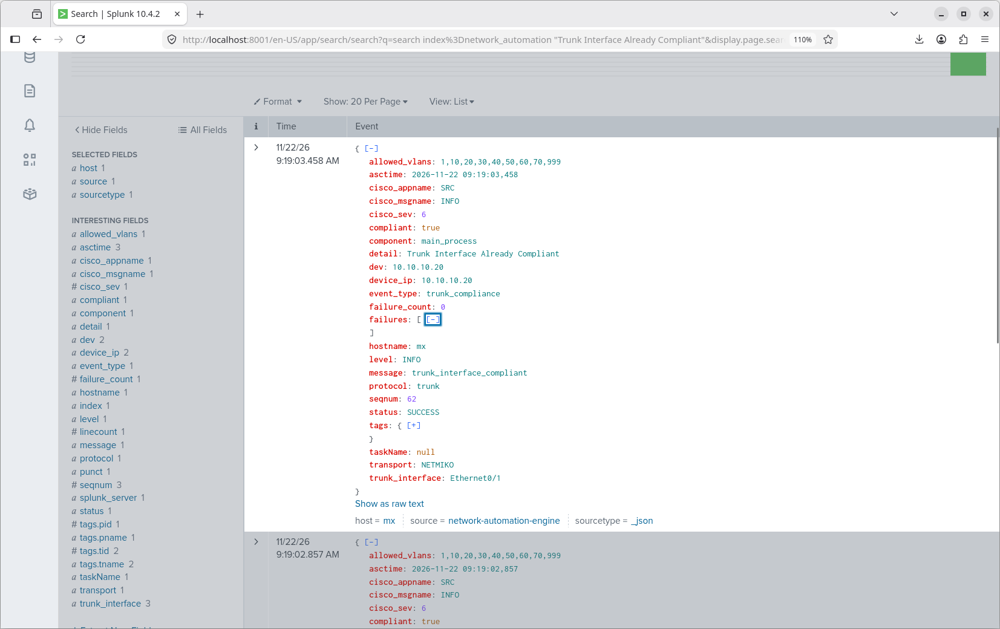

---

#### 3. Targeted Remediation Push (`trunk_config`)
Emitted immediately after Netmiko pushes the rendered `trunk_ports.j2` configuration commands. Notice the populated `tags` object detailing threaded execution (`ThreadPoolExecutor-0_0`), proving multi-threaded concurrency across devices:

```json
{
  "allowed_vlans": "1,10,20,30,40,50,60,70,999",
  "asctime": "2026-11-22 09:10:06,350",
  "cisco_appname": "SRC",
  "cisco_msgname": "INFO",
  "cisco_sev": 6,
  "component": "trunk_automation",
  "detail": "Trunk Interface configured successfully | Interface: Ethernet0/1 | Allowed VLANs: 1,10,20,30,40,50,60,70,999",
  "dev": "10.10.10.20",
  "device_ip": "10.10.10.20",
  "event_type": "trunk_config",
  "hostname": "mx",
  "level": "INFO",
  "message": "trunk_config",
  "seqnum": 63,
  "status": "SUCCESS",
  "tags": {
    "pid": 316023,
    "pname": "MainProcess",
    "tid": 139897268594368,
    "tname": "ThreadPoolExecutor-0_0"
  },
  "taskName": null,
  "transport": "NETMIKO",
  "trunk_interface": "Ethernet0/1"
}
```
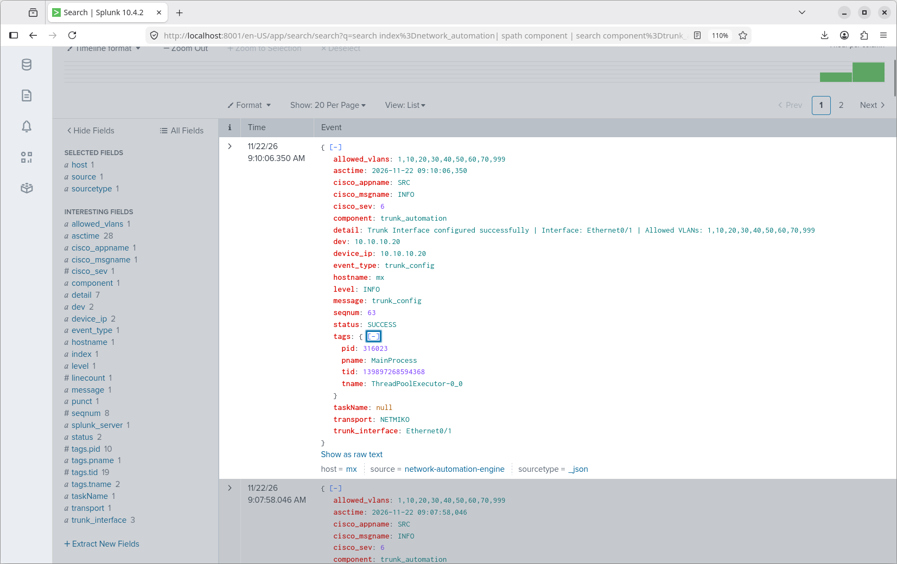

---

#### 4. Closed-Loop Post-Validation Success (`trunk_interface_post_validation_success`)
Following remediation, the engine re-queried `CORE-SW-1` via Genie. The post-audit confirmed that `Ethernet0/3` was successfully converted to a trunk and enforcing the full allowed whitelist:

```json
{
  "allowed_vlans": "1,10,20,30,40,50,60,70,999",
  "asctime": "2026-11-22 09:20:51,589",
  "cisco_appname": "SRC",
  "cisco_msgname": "INFO",
  "cisco_sev": 6,
  "compliant": true,
  "component": "main_process",
  "detail": "Trunk Interface Configuration Post Validation Successful",
  "dev": "10.10.10.10",
  "device_ip": "10.10.10.10",
  "event_type": "trunk_compliance",
  "failure_count": 0,
  "failures": [],
  "hostname": "mx",
  "level": "INFO",
  "message": "trunk_interface_post_validation_success",
  "protocol": "trunk",
  "seqnum": 67,
  "status": "SUCCESS",
  "tags": {},
  "taskName": null,
  "transport": "NETMIKO",
  "trunk_interface": "Ethernet0/3"
}
```
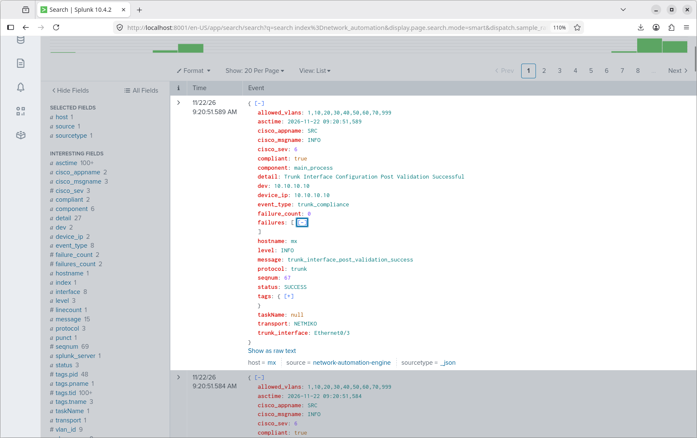

---

#### 5. Exception & Fault Observability (`status: ERROR`)
The remediation engine encapsulates command execution inside a comprehensive `try...except` boundary. If an operational failure occurs—such as a Jinja2 template rendering syntax error or an SSH channel timeout over Netmiko—the engine catches the error, streams an `ERROR` event to Splunk with full details, and continues auditing remaining interfaces.

```spl
index="network_automation" | spath component | search component="trunk_automation" "Exception"
```

##### Example A: Transport / SSH Channel Timeout (screenshot-verified)
```json
{
  "allowed_vlans": "1,10,20,30,40,50,60,70,999",
  "asctime": "2026-11-22 09:07:58,046",
  "cisco_appname": "SRC",
  "cisco_msgname": "INFO",
  "cisco_sev": 6,
  "component": "trunk_automation",
  "detail": "Try/Exception Error | Trunk Interface Configuration | Interface: Ethernet0/1 | Allowed VLANs: 1,10,20,30,40,50,60,70,999 | Error: Timed-out reading channel, data not available.",
  "dev": "10.10.10.20",
  "device_ip": "10.10.10.20",
  "event_type": "trunk_config",
  "hostname": "mx",
  "level": "INFO",
  "message": "trunk_config",
  "seqnum": 67,
  "status": "ERROR",
  "tags": {},
  "taskName": null,
  "transport": "NETMIKO",
  "trunk_interface": "Ethernet0/1"
}
```
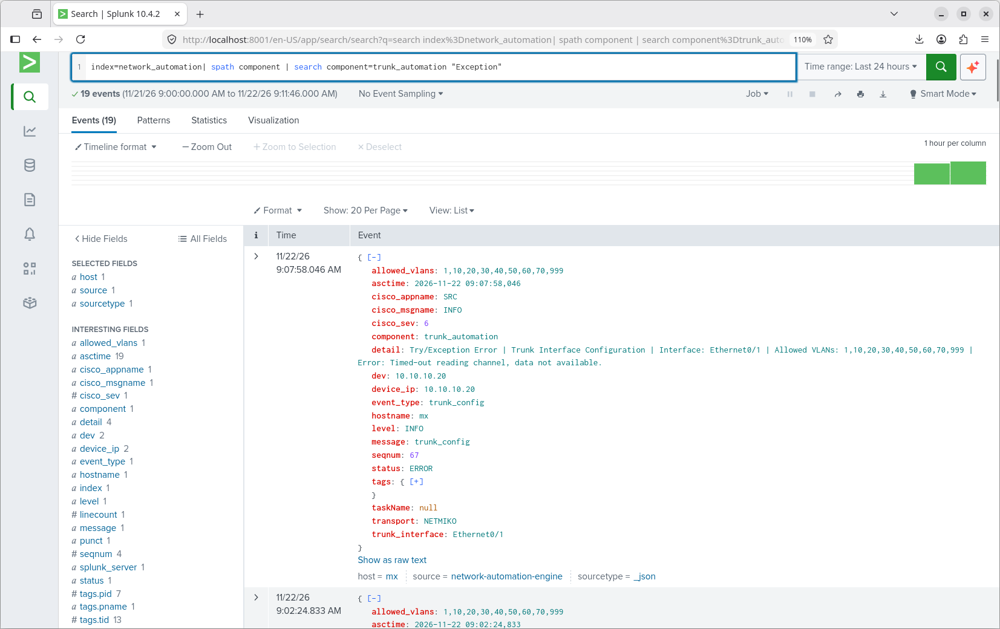

##### Example B: Jinja2 Template Syntax Fault (documented; not fully visible in screenshots)
```json
{
  "asctime": "2026-11-22 09:02:24,223",
  "component": "trunk_automation",
  "detail": "Try/Exception Error | Trunk Interface Configuration | Interface: Ethernet0/0 | Allowed VLANs: 1,10,20,30,40,50,60,70,999 | Error: Unexpected end of template. Jinja was looking for the following tags: 'endfor' or 'else'...",
  "device_ip": "10.10.10.10",
  "event_type": "trunk_config",
  "message": "trunk_config",
  "seqnum": 37,
  "status": "ERROR",
  "trunk_interface": "Ethernet0/0"
}
```
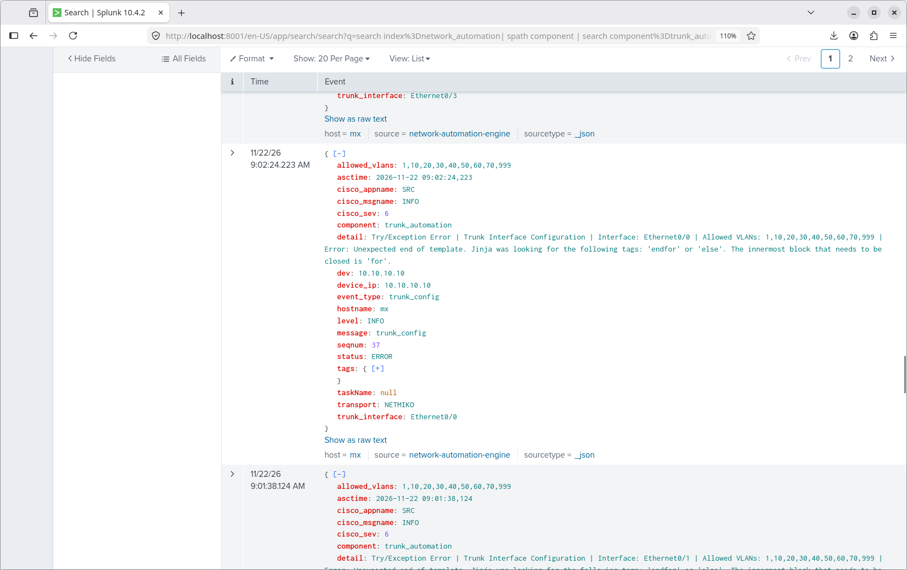

> **Enterprise Reliability Takeaway:**
> By streaming both successful state changes and unhandled transport/template exceptions into Splunk, the automation engine gives operations teams real-time visibility into silent failures without requiring manual jumpbox log inspection.

## 8. Automated Unit Testing & CI/CD Validation (Trunk Ports)

To ensure deterministic reliability and prevent regression bugs, the trunk compliance module includes a comprehensive offline test suite powered by **Pytest** and **unittest.mock**.

The test suite requires **zero live hardware connections**. Using pre-captured Cisco pyATS/Genie fixtures (`access_trunk_genie_output`) and mock isolation, all **13 test cases execute in 1.36 seconds** (0.58s builder + 0.78s compliance), making them ideal for high-speed CI/CD gates.


---

### Layer 1: Trunk State Builder Tests (`test_build_trunk.py`)

This suite verifies that `build_trunk()` correctly extracts active 802.1Q trunk interfaces, isolates allowed VLAN whitelists, drops access switchports, normalizes interface casing, and gracefully handles malformed or incomplete Genie payloads:

#### Test Cases Covered:
1. **`test_build_trunk_valid`**: Ingests realistic multi-port Genie output (`access_trunk_genie_output`). Asserts only the 2 trunk ports (`gigabitethernet0/3` and `gigabitethernet1/0`) are returned (`len == 2`), their allowed VLAN strings are extracted (`"10,20,30,40,50"` and `"10,20,30,40"`), and access ports (`gigabitethernet0/0`, `gigabitethernet0/1`) are **completely excluded**.
2. **`test_build_trunk_lowercase`**: Injects capitalized vendor interface names (`Gigabitethernet0/0`). Asserts the builder normalizes all dictionary keys to lowercase (`gigabitethernet0/0`), eliminating false-positive case mismatches during diff checks.
3. **`test_build_no_trunks`**: Simulates a switch where all interfaces operate in `static access` mode. Asserts the builder gracefully returns an empty dictionary (`{}`) without raising errors.
4. **`test_build_trunk_missing_vlans`**: Tests a trunk-mode interface record that lacks the `trunk_vlans` key. Confirms safe fallback to an empty string without raising `KeyError`.
5. **`test_build_trunk_missing_operational_mode`**: Tests interfaces missing the `operational_mode` attribute. Asserts they are safely bypassed.
6. **`test_build_trunk_empty_input`**: Boundary test confirming `build_trunk({})` and `build_trunk(None)` safely return `{}`.

#### Representative Builder Test Pattern:
```python
# tests/unit/collectors/cli/test_build_trunk.py (Excerpt)

def test_build_trunk_valid(access_trunk_genie_output):
    result = build_trunk(access_trunk_genie_output)

    assert len(result) == 2
    assert "gigabitethernet0/3" in result
    assert "gigabitethernet1/0" in result
    assert result["gigabitethernet0/3"]["trunk_vlans"] == "10,20,30,40,50"
    assert result["gigabitethernet1/0"]["trunk_vlans"] == "10,20,30,40"
    assert "gigabitethernet0/0" not in result
    assert "gigabitethernet0/1" not in result

def test_build_trunk_lowercase():
    data = {
        "switchports": {
            "Gigabitethernet0/0": {"operational_mode": "trunk"},
            "Gigabitethernet0/1": {"operational_mode": "trunk"}
        }
    }
    result = build_trunk(data)
    assert "GigabitEthernet0/0" not in result
    assert "GigabitEthernet0/1" not in result
    assert "gigabitethernet0/0" in result
    assert "gigabitethernet0/1" in result
```
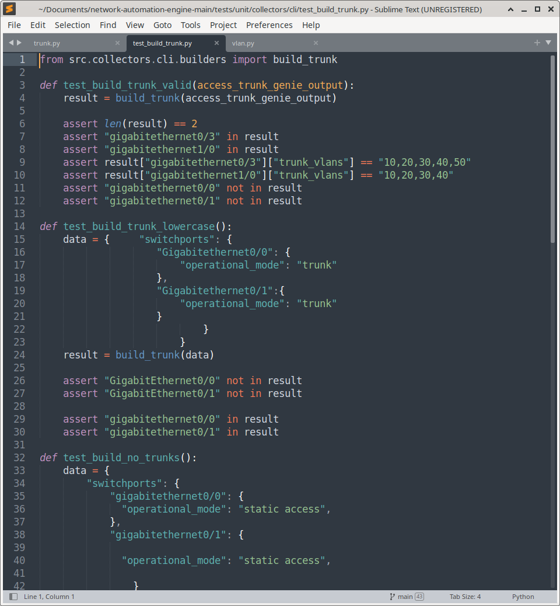

#### Terminal Execution:


```bash
$ PYTHONPATH=. pytest tests/unit/collectors/cli/test_build_trunk.py -v
============================= test session starts ==============================
platform linux -- Python 3.12.10, pytest-9.2.0, pluggy-1.7.0 -- /home/rich/Documents/network-automation-engine-main/.venv/bin/python
cachedir: .pytest_cache
rootdir: /home/rich/Documents/network-automation-engine-main
collected 6 items

tests/unit/collectors/cli/test_build_trunk.py::test_build_trunk_valid PASSED                   [ 16%]
tests/unit/collectors/cli/test_build_trunk.py::test_build_trunk_lowercase PASSED               [ 33%]
tests/unit/collectors/cli/test_build_trunk.py::test_build_no_trunks PASSED                     [ 50%]
tests/unit/collectors/cli/test_build_trunk.py::test_build_trunk_missing_vlans PASSED           [ 66%]
tests/unit/collectors/cli/test_build_trunk.py::test_build_trunk_missing_operational_mode PASSED [ 83%]
tests/unit/collectors/cli/test_build_trunk.py::test_build_trunk_empty_input PASSED             [100%]

============================== 6 passed in 0.58s ===============================
```
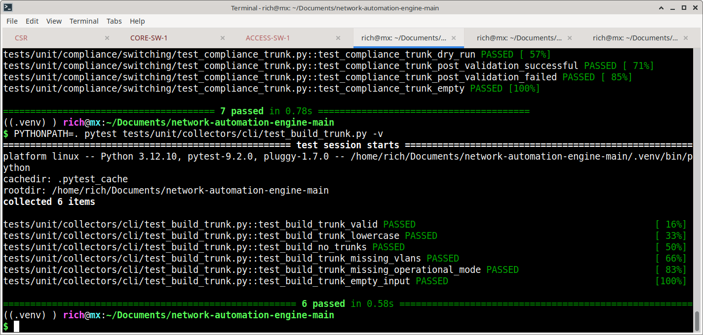

---

### Layer 2: Trunk Compliance Decision Engine Tests (`test_compliance_trunk.py`)

Using `@patch` and `MagicMock`, this suite isolates `compliance_trunk()` from physical SSH sockets. It evaluates the full closed-loop state-machine lifecycle, including fast-path bypasses, remediation triggers, dry-run safety gates, and post-validation re-polling:

#### Test Cases Covered:
1. **`test_compliance_trunk_already_compliant`**: Simulates an interface already operating in trunk mode with an exact allowed-VLAN match. Asserts `mock_log.info` was called once, `mock_log.warning` was **never called**, `actions_taken` logged `Trunk Interface Already Compliant`, and `initial_issues` remained empty.
2. **`test_compliance_trunk_non_complaint_config_succesful`**: Simulates an allowed-VLAN mismatch (`(Trunk) Mismatch Found - Allowed VLANS`) followed by successful remediation. Asserts the warning log was called, the drift diff was stored in `initial_issues`, the remediation summary was appended to `actions_taken`, and status resolved to `OperationalStatus.SUCCESS`.
3. **`test_compliance_trunk_non_complaint_config_failed`**: Simulates an SSH/CLI rejection during remediation (`OperationalStatus.FAILED_CONFIG`). Asserts the failure was captured under `critical_issues` and the overall status was flagged as `FAILED_CONFIG`.
4. **`test_compliance_trunk_dry_run`**: Patches `DRY_RUN = True`. Asserts drift was identified and logged, but `configure_trunk()` was **never called**, and actions reflected `[DRY_RUN] Would Configure Trunk Interface`.
5. **`test_compliance_trunk_post_validation_successful`**: Simulates the complete closed-loop cycle: initial check fails → remediation executes → `collect_device_state()` re-polls → post-check confirms compliance. Asserts post-validation success was recorded in `actions_taken`.
6. **`test_compliance_trunk_post_validation_failed`**: Simulates persistent drift where configuration was sent, but the re-queried switch state still fails the whitelist check. Asserts status is set to `OperationalStatus.FAILED_VALIDATION` and a critical error is logged.
7. **`test_compliance_trunk_empty`**: Evaluates behavior when no trunk interfaces are defined in NetBox context (`{"trunk_ports": []}`). Asserts the module completes with zero issues and zero actions taken.

#### Representative Compliance Mock Pattern:
```python
# tests/unit/compliance/switching/test_compliance_trunk.py (Excerpt)

@patch("src.compliance.switching.trunk.compliance.configure_trunk")
@patch("src.compliance.switching.trunk.compliance.build_trunk")
@patch("src.compliance.switching.trunk.compliance.check_trunk")
def test_compliance_trunk_non_complaint_config_succesful(
    mock_check_trunk, mock_build_trunk, mock_configure_trunk,
    mock_sesh, mock_context, mock_device_result, mock_log
):
    mock_build_trunk.return_value = {}
    mock_check_trunk.return_value = (False, ["(Trunk) Mismatch Found - Allowed VLANS"])
    mock_configure_trunk.return_value = {
        "status": OperationalStatus.SUCCESS.value,
        "summary": "Trunk Port Configuration Successful"
    }

    result = compliance_trunk(
        mock_sesh, mock_sesh.device_ip, mock_context, {}, mock_device_result, mock_log
    )

    mock_log.warning.assert_called_once()
    assert any("(Trunk) Mismatch Found - Allowed VLANS" in r for r in result["initial_issues"])
    assert any("Trunk Port Configuration Successful" in r for r in result["actions_taken"])
    assert result["status"] == OperationalStatus.SUCCESS.value
```
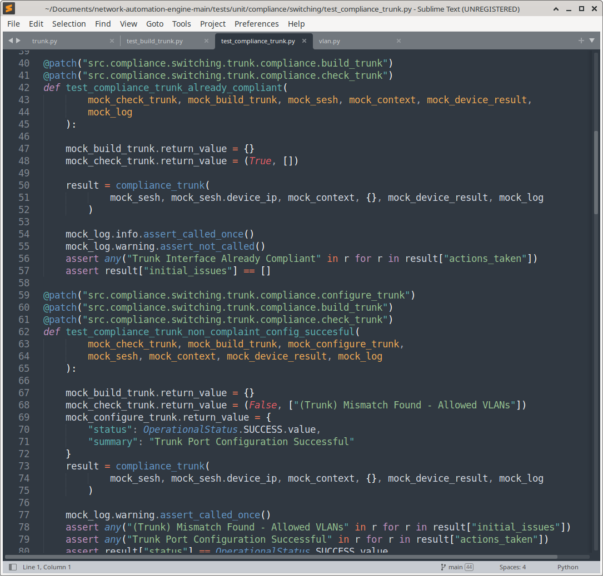

#### Terminal Execution:

```bash
$ PYTHONPATH=. pytest tests/unit/compliance/switching/test_compliance_trunk.py -v
============================= test session starts ==============================
platform linux -- Python 3.12.10, pytest-9.2.0, pluggy-1.7.0 -- /home/rich/Documents/network-automation-engine-main/.venv/bin/python
cachedir: .pytest_cache
rootdir: /home/rich/Documents/network-automation-engine-main
collected 7 items

tests/unit/compliance/switching/test_compliance_trunk.py::test_compliance_trunk_already_compliant PASSED             [ 14%]
tests/unit/compliance/switching/test_compliance_trunk.py::test_compliance_trunk_non_complaint_config_succesful PASSED [ 28%]
tests/unit/compliance/switching/test_compliance_trunk.py::test_compliance_trunk_non_complaint_config_failed PASSED   [ 42%]
tests/unit/compliance/switching/test_compliance_trunk.py::test_compliance_trunk_dry_run PASSED                        [ 57%]
tests/unit/compliance/switching/test_compliance_trunk.py::test_compliance_trunk_post_validation_successful PASSED    [ 71%]
tests/unit/compliance/switching/test_compliance_trunk.py::test_compliance_trunk_post_validation_failed PASSED        [ 85%]
tests/unit/compliance/switching/test_compliance_trunk.py::test_compliance_trunk_empty PASSED                          [100%]

============================== 7 passed in 0.78s ===============================
```
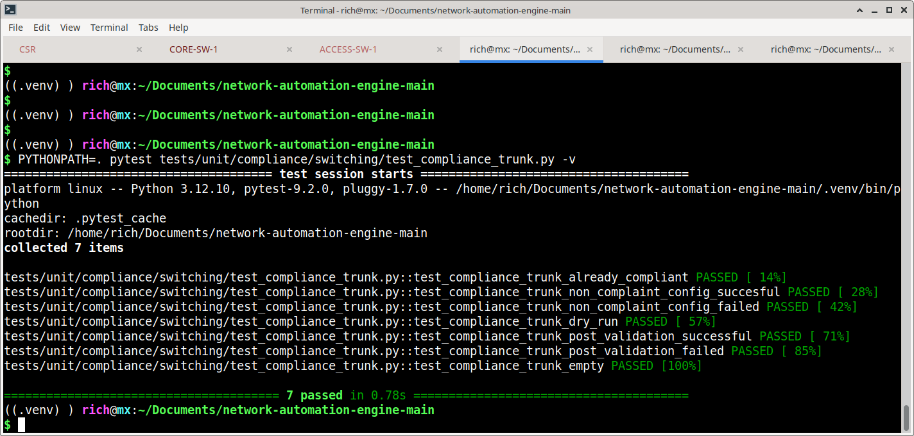

---

### Continuous Integration Ready

The test framework is designed for CI/CD pipeline integration:

```yaml
# .github/workflows/test.yml (GitHub Actions Example)
name: Run Unit Tests

on: [push, pull_request]

jobs:
  test:
    runs-on: ubuntu-latest
    steps:
      - uses: actions/checkout@v3
      - name: Set up Python
        uses: actions/setup-python@v4
        with:
          python-version: '3.12'
      - name: Install dependencies
        run: pip install -r requirements.txt
      - name: Run tests with coverage                            <--------- Pytests 
        run: pytest tests/unit/ --cov=src --cov-report=xml
      - name: Upload coverage to Codecov
        uses: codecov/codecov-action@v3
```
---

### Test Suite Summary

| Test Suite | File Path | Scope & Boundary Scenarios Covered | Status | Execution Time |
| :--- | :--- | :--- | :---: | :---: |
| **Builder Tests** | `tests/unit/collectors/cli/test_build_trunk.py` | Operational Genie parsing, case-normalization, access-port exclusion, missing VLAN/mode fallbacks, empty/None inputs | **PASSED (6/6)** | 0.58s |
| **Compliance Tests** | `tests/unit/compliance/switching/test_compliance_trunk.py` | State-machine reconciliation, bypass logic, remediation push, dry-run safety, closed-loop post-validation | **PASSED (7/7)** | 0.78s |
| **Total** | | **Comprehensive Offline Verification** | **13 / 13** | **1.36s** |

---

## Conclusion & Engineering Takeaways

This module demonstrates that network compliance is not just about running a `show run` and eyeballing the output. By decoupling data collection, normalization, decisioning, and remediation, this engine transforms trunk port management from a manual, error-prone chore into a **deterministic, observable, and reversible software pipeline**.

Key architectural wins validated in this project include:
1. **The "Default Interface" Reset Strategy:** Proactively clearing legacy configurations before applying new trunk settings eliminates race conditions and bypasses the infamous Cisco `encapsulation auto` parser rejection trap.
 is a critical differentiator for production reliability.
2. **Zero-Touch Safety:** The `DRY_RUN` gating ensures that change-advisory boards (CABs) can review exact, rendered CLI payloads before any socket transmission occurs.
3. **Closed-Loop Guarantees:** Pushing a config via Netmiko is not proof of compliance. Re-querying the device via Genie and re-running the diff engine guarantees the hardware actually accepted and applied the change.

### Next Steps & Future Enhancements
To further evolve this automation engine, the following enhancements are planned:
- **Multi-Vendor Abstraction:** Leverage Genie's vendor-agnostic parsing to extend this exact same compliance logic to Arista (EOS) and Juniper (Junos) platforms without rewriting the core diff engine.
- **CI/CD Pipeline Integration:** Embed the existing Pytest suite into GitHub Actions to automatically block Pull Requests that introduce regressions to the compliance logic or Jinja2 templates.
- **Advanced Security Posture:** Expand the compliance checks to verify that native VLANs on trunks are explicitly set to a quarantined "blackhole" VLAN (e.g. VLAN 999) and that `switchport nonegotiate` (DTP disabled) is enforced.

---

### Return to Main Repository

This module is part of a broader Network Automation Engine portfolio. 

**Explore other modules:**
- [Access Port Compliance & Remediation](../access-ports/)
- [F5 BIG-IP LTM Cloud Load Balancing](../f5-big-ip-ltm-lab/)

⬅️ **[Return to Main Repository README](../README.md)**
