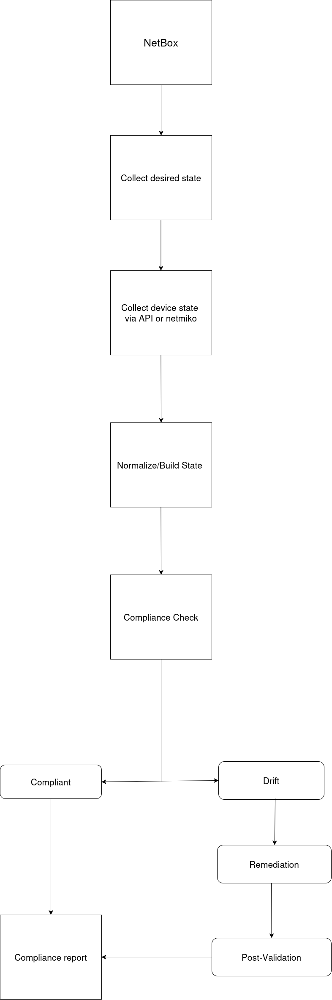

# Enterprise Closed-Loop Network Automation & Compliance Engine

[](https://www.python.org/)
[](https://netbox.dev/)
[](#architecture--engine-lifecycle)
[](#enterprise-observability--splunk-hec)
[](#automated-testing--cicd-validation)

An enterprise-grade, closed-loop network compliance and automated remediation framework. The engine continuously reconciles multi-vendor network devices against **NetBox (Single Source of Truth)**, identifies configuration drift, enforces declarative **Jinja2** policies with built-in **Dry-Run safety gates**, performs automated **post-remediation verification**, and streams real-time JSON audit events to **Splunk**.



---

## Feature Execution Walkthroughs

Each protocol implementation includes an end-to-end case study documenting **NetBox modeling → live collection → diff detection → Jinja2 remediation → physical switch verification → Splunk audit telemetry → offline unit tests**:

| Domain | Protocol / Feature | Transport Engine | Key Highlights & Verified Outcomes | Deep-Dive Guide |
| :--- | :--- | :---: | :--- | :---: |
| **Switching** | **VLAN Compliance** | Netmiko / Genie | NetBox IPAM sync, case-insensitive name diffing, dynamic broadcast domain provisioning, zero-touch remediation. | [**View Walkthrough**](Feature%20Execution%20Walkthrough/vlans-netmiko/README.md) |
| **Switching** | **Access Switchports** | Netmiko / Genie | Untagged VLAN validation, strict trunk exclusion, recovery from default VLAN 1 drift, automatic port healing. | [**View Walkthrough**](Feature%20Execution%20Walkthrough/access-ports-netmiko/README.md) |
| **Switching** | **802.1Q Trunk Ports** | Netmiko / Genie | Allowed VLAN whitelist enforcement, Cisco trunk encapsulation trap resolution, trunk hijack recovery. | [**View Walkthrough**](Feature%20Execution%20Walkthrough/trunk_ports-netmiko/README.md) |
| **Switching** | **Interface Baseline** | Netmiko / Genie | NetBox `should_be_up` custom field, compound L1/L2 link health, unmanaged active port isolation, phantom port detection. | [**View Walkthrough**](Feature%20Execution%20Walkthrough/interface-netmiko/README.md) |
| **Switching** | **Spanning Tree (STP)** | Netmiko / CiscoConfParse | Two-tier audit: Global root bridge priorities via Config Contexts + port-level edge guards (PortFast, BPDU Guard, Loop Guard). | [**View Walkthrough**](Feature%20Execution%20Walkthrough/stp-netmiko/README.md) |
| **Services** | **Centralized Syslog** | Netmiko / CiscoConfParse | Multi-collector validation (UDP/TCP), `Loopback0` source binding, `msec` timestamp enforcement, active drift purge. | [**View Walkthrough**](Feature%20Execution%20Walkthrough/syslog-netmiko/README.md) |
| **Services** | **SNMP Infrastructure** | Netmiko / CiscoConfParse | Read-Only/Read-Write community enforcement, rogue host purging (`no snmp-server`), MIB metadata and trap alerts. | [**View Walkthrough**](Feature%20Execution%20Walkthrough/snmp-netmiko/README.md) |

---

## Architecture & Closed-Loop Lifecycle

The engine operates on a deterministic, closed-loop reconciliation cycle:

```
[ NetBox (Source of Truth) ]             [ Live Network Infrastructure ]
  • IPAM / VLANs / Prefixes                • Cisco IOS-XE Switches / Routers
  • Device Interfaces & Custom Fields      • Operational Data (Show Commands)
  • Local Config Contexts                  • Running Configurations
             │                                         │
             ▼ (REST API Ingestion)                    ▼ (Netmiko / NETCONF / RESTCONF)
     [ Desired State ]                         [ Observed State ]
             │                                         │
             └───────────────────┬─────────────────────┘
                                 ▼
                    [ Compliance Diff Engine ]
                      ├── Rule Validation Gates
                      ├── Set & Attribute Diffing
                      └── Drift Identification
                                 │
                ┌────────────────┴────────────────┐
                ▼                                 ▼
        [ State Compliant ]              [ Drift Detected ]
                │                                 │
                │                                 ▼
                │                    [ Pre-Flight DRY_RUN Gate ]
                │                    ├── True: Log preview & skip push
                │                    └── False: Execute Remediation
                │                                 │
                │                                 ▼
                │                    [ Jinja2 Remediation Push ]
                │                    ├── Interface Defaulting / Purge
                │                    └── Netmiko atomic send_config_set
                │                                 │
                │                                 ▼
                │                    [ Closed-Loop Post-Validation ]
                │                    ├── Re-collect operational state
                │                    └── Assert 100% compliance
                │                                 │
                └────────────────┬────────────────┘
                                 ▼
                [ Auditing & Telemetry Dispatcher ]
                  ├── Splunk HEC Streamer (Real-time JSON events)
                  ├── JSON Report (`final_compliance_report.json`)
                  └── Technical Report (`network_compliance_report.txt`)
```

---

## Core Engineering Principles

### 1. Declarative Source of Truth (NetBox)
Configurations never originate on switch CLIs. NetBox models the entire desired network state:
* **IPAM & VLANs:** Authoritative broadcast domains and naming standards.
* **Interface Schema:** 802.1Q port modes, untagged VLANs, and tagged whitelists.
* **Custom Fields:** Granular operational intent (`should_be_up`, `stp_portfast`, `stp_bpdu_guard`, `stp_loop_guard`).
* **Config Contexts:** Global services (STP mode/priorities, Syslog collectors, SNMP communities/traps).

### 2. Multi-Transport Data Collection
* **CLI (Netmiko + Cisco pyATS/Genie):** Executes operational commands (`show vlan`, `show interfaces switchport`, `show ip int brief`, `show logging`) and converts raw terminal tables into structured Python dictionaries.
* **Hierarchical Parsing (`CiscoConfParse`):** Analyzes parent-child running configuration blocks for interface subcommands and global directives that operational show tables omit.
* **API Transports (NETCONF & RESTCONF):** Programmatic YANG-based state validation and remote procedure calls (RPCs).

### 3. Idempotent Two-Phase Remediation
To eliminate orphaned settings and rogue configurations:
* **Interface Defaulting:** Resets corrupted switchports (`default interface <name>`) to clear out encapsulation mismatches or lingering trunk configs before applying access modes.
* **Active Configuration Purge:** Reverses existing running lines (`no snmp-server ...`, `no logging host ...`) to actively delete unauthorized collectors before deploying the NetBox baseline.

### 4. Closed-Loop Post-Validation
A successful command push does not guarantee compliance. The engine re-queries the physical data plane after remediation, re-normalizes the operational state, and runs a secondary diff check to assert that running configurations took effect before updating the device status.

### 5. Safe Change Management (`DRY_RUN` Mode)
Built-in `DRY_RUN` execution intercepts the pipeline before any network sockets are touched. It evaluates drift, renders templates in memory, and writes planned changes to `final_compliance_report.json` for Change Advisory Board (CAB) review.

---

## Jinja2 Template Architecture

The engine uses three distinct template patterns depending on the remediation strategy required:

### Pattern 1: Two-Phase Active Purge (Syslog / SNMP)

For services where orphaned configurations create security risks (rogue syslog servers, unauthorized SNMP communities), templates implement **negation-then-enforcement**:

```jinja2
{# templates/syslog_netmiko.j2 #}

{# Phase 1: Negate observed drift #}



no logging host {{ h.get("host") }}




{# Phase 2: Enforce NetBox baseline #}


logging host {{ h.get("host") }} transport {{ h.get("transport") }} port {{ h.get("port") }}


```

**Why this matters:** Without the purge phase, a rogue `logging host 8.8.8.8` would persist alongside the authorized `10.10.10.50`, creating a silent data exfiltration channel.

### Pattern 2: Default Interface Purge (Access Ports)

For switchports that may have drifted into trunk mode or accumulated stale QoS/channel-group bindings:

```jinja2
{# templates/access_port.j2 #}

default interface {{ a.access_interface }}
interface {{ a.access_interface }}
 switchport mode access
 switchport access vlan {{ a.access_vlan }}

```

**Why this matters:** `default interface` wipes all residual trunk encapsulation (`switchport trunk encapsulation dot1q`), native VLAN overrides, and channel-group bindings in one atomic operation.

### Pattern 3: Standard Declarative (VLAN / STP / Interface)

For additive-only configurations where idempotency is guaranteed by the protocol:

```jinja2
{# templates/vlan.j2 #}

vlan {{ vlan.vlan_id }}
 name {{ vlan.name }}

```

---

## Automated Testing & CI/CD Validation

Every module includes a **100% offline Pytest suite** using `unittest.mock` and pre-captured Genie fixtures. Tests validate data parsing, boundary guards, compliance state machines, and multi-transport parity without requiring live network hardware.

### Test Coverage by Domain

| Module | Builder Tests | Compliance Tests | Total | Execution Time |
| :--- | :---: | :---: | :---: | :---: |
| **VLAN** | 5 | 8 | 13 | 1.56s |
| **Access Ports** | 6 | 7 | 13 | 1.32s |
| **Trunk Ports** | 6 | 7 | 13 | 1.40s |
| **Interface** | 6 | 7 | 13 | 1.53s |
| **STP** | 9 | 14 | 23 | 1.99s |
| **Syslog** | 6 | 14 | 20 | 1.45s |
| **SNMP** | 7 | 14 | 21 | 1.40s |
| **Total** | **45** | **71** | **116** | **~10.65s** |

### Multi-Transport Parametrization (STP / Syslog / SNMP)

For dual-transport modules, every compliance lifecycle test runs against **both NETCONF and NETMIKO** using `@pytest.mark.parametrize`:

```python
@pytest.mark.parametrize("transport", ["NETCONF", "NETMIKO"])
def test_compliance_snmp_already_compliant(
    transport, mock_sesh, mock_context, mock_device_result, mock_log
):
    mock_sesh.transport = transport
    transport_patch = patch_transports(transport)
    
    with patch(transport_patch["build_snmp"]) as mock_build_snmp, \
         patch(transport_patch["check_snmp"]) as mock_check_snmp:
        mock_build_snmp.return_value = {}
        mock_check_snmp.return_value = (True, [])
        
        result = compliance_snmp(
            mock_sesh, mock_sesh.device_ip, mock_context, {}, 
            mock_device_result, mock_log, transport
        )
        
        mock_log.info.assert_called_once()
        assert result["initial_issues"] == []
```

### CI/CD Integration

```yaml
# .github/workflows/test.yml
name: Network Automation Tests

on: [push, pull_request]

jobs:
  test:
    runs-on: ubuntu-latest
    steps:
      - uses: actions/checkout@v3
      - name: Set up Python 3.12
        uses: actions/setup-python@v4
        with:
          python-version: '3.12'
      - name: Install dependencies
        run: pip install -r requirements.txt
      - name: Run unit tests with coverage
        run: |
          PYTHONPATH=. pytest tests/unit/ \
            --cov=src \
            --cov-report=xml \
            --cov-report=term-missing
      - name: Upload coverage to Codecov
        uses: codecov/codecov-action@v3
```

---

## Enterprise Observability (Splunk HEC)

Every phase of execution streams structured JSON logs to **Splunk via HTTP Event Collector (HEC)** (`index="network_automation"`, `sourcetype="_json"`).

```spl
index="network_automation" sourcetype="_json"
| table asctime cisco_sev event_type message dev protocol status detail
```

### Standardized Severity & Event Mappings:
* **Cisco Severity 6 (`INFO`):** Baseline verified compliant, remediation commands applied, and post-validation passed.
* **Cisco Severity 4 (`WARNING`):** Configuration drift detected (e.g., `vlan_drift`, `access_interface_drift`, `trunk_interface_drift`, `stp_non_compliant`, `syslog_non_compliant`, `snmp_non_compliant`).
* **Cisco Severity 3 (`ERROR`):** Remediation command rejected, post-validation failed after push, or unhandled runtime exceptions.

### Event Catalog by Module

| Module | Event Type | Message | Severity | Trigger |
| :--- | :--- | :--- | :---: | :--- |
| **VLAN** | `compliance_vlan` | `vlan_check` | 6 (INFO) | Compliant VLAN |
| **VLAN** | `compliance_vlan` | `vlan_drift` | 4 (WARN) | Missing/mismatched VLAN |
| **Access** | `interface_compliance` | `access_interface_compliant` | 6 (INFO) | Compliant port |
| **Access** | `interface_compliance` | `access_interface_drift` | 4 (WARN) | Wrong VLAN/mode |
| **STP** | `snmp_compliance` | `snmp_compliant` | 6 (INFO) | Compliant SNMP |
| **STP** | `snmp_compliance` | `snmp_non_compliant` | 4 (WARN) | Rogue community/host |
| **Syslog** | `syslog_config` | `syslog_config` | 6 (INFO) | Remediation pushed |
| **Syslog** | `syslog_config` | `syslog_config` | 3 (ERROR) | Template/transport fault |

### Standardized Payload Schema

Every event includes:
```json
{
  "asctime": "2026-11-26 03:39:34,637",
  "cisco_appname": "SRC",
  "cisco_msgname": "INFO",
  "cisco_sev": 6,
  "compliant": true,
  "component": "main_process",
  "detail": "SNMP Configuration Already Compliant",
  "dev": "10.10.10.20",
  "device_ip": "10.10.10.20",
  "event_type": "snmp_compliance",
  "failures": [],
  "failures_count": 0,
  "hostname": "mx",
  "level": "INFO",
  "message": "snmp_compliant",
  "protocol": "snmp",
  "seqnum": 59,
  "status": "SUCCESS",
  "transport": "NETMIKO"
}
```

---

## Repository Layout

```
.
├── Feature Execution Walkthrough/     # Protocol-specific case studies & video demos
│   ├── access-ports-netmiko/          # Access switchport compliance & VLAN binding
│   ├── interface-netmiko/             # L1/L2 status & should_be_up custom fields
│   ├── snmp-netmiko/                  # SNMP community, host, and trap compliance
│   ├── stp-netmiko/                   # Global STP priorities & edge guard rails
│   ├── syslog-netmiko/                # Centralized logging & multi-collector validation
│   ├── trunk_ports-netmiko/           # 802.1Q trunk allowed-VLAN whitelists
│   └── vlans-netmiko/                 # VLAN database sync & drift correction
├── docs/
│   └── images/                        # Top-level architectural diagrams
├── src/
│   ├── collectors/                    # Data extractors (CLI, NETCONF, RESTCONF)
│   │   ├── cli/                       # Netmiko collectors & Genie/Regex builders
│   │   ├── netconf/                   # ncclient RPC collectors & XML builders
│   │   └── restconf/                  # requests/HTTP collectors & JSON builders
│   ├── compliance/                    # Rule diff engines & state checkers
│   │   ├── switching/                 # VLAN, Access, Trunk, Interface, STP
│   │   ├── services/                  # Syslog, SNMP, NTP, CDP, DHCP, QoS
│   │   ├── routing/                   # OSPF, HSRP, NAT, ROAS, Static Routes
│   │   └── security/                  # Port Security, DHCP Snooping, DAI, ACL
│   ├── remediation/                   # Jinja2 template controllers & push handlers
│   ├── sot/                           # NetBox REST API client & inventory builder
│   ├── reporting/                     # JSON & text compliance artifact generators
│   └── utils/                         # Splunk HEC forwarders & normalization helpers
├── templates/                         # Declarative Jinja2 configuration templates
├── tests/
│   ├── fixtures/                      # Offline Genie, NETCONF, & RESTCONF JSON mocks
│   └── unit/                          # 100% offline Pytest validation suite
├── final_compliance_report.json       # Generated machine-readable audit artifact
└── network_compliance_report.txt      # Generated human-readable technical report
```

---

## Performance Benchmarks

### Test Execution Speed

| Module | Tests | Time | Tests/Second |
| :--- | :---: | :---: | :---: |
| **VLAN** | 13 | 1.56s | 8.3 |
| **Access Ports** | 13 | 1.32s | 9.8 |
| **Trunk Ports** | 13 | 1.40s | 9.3 |
| **Interface** | 13 | 1.53s | 8.5 |
| **STP** | 23 | 1.99s | 11.6 |
| **Syslog** | 20 | 1.45s | 13.8 |
| **SNMP** | 21 | 1.40s | 15.0 |
| **Total** | **116** | **~10.65s** | **10.9** |

### Remediation Latency

- **VLAN creation:** ~200ms per VLAN (Netmiko `send_config_set`)
- **Access port reassignment:** ~150ms per port (includes `default interface` purge)
- **STP global mode change:** ~300ms (requires STP reconvergence)
- **Syslog host purge + reconfigure:** ~400ms (two-phase template)

---

## Extending the Engine: New Protocol Guide

To add a new protocol (e.g., NTP, QoS, BGP):

### Step 1: NetBox Modeling
- Define Custom Fields in `DCIM > Interfaces` (if interface-level)
- Define Config Context schema (if device-level)

### Step 2: Inventory Ingestion (`src/sot/inventory.py`)
```python
ntp_context = context.get("ntp", {})
if ntp_context:
    config_data[host_ip]["ntp"] = ntp_context
```

### Step 3: Collector (`src/collectors/cli/collector.py`)
```python
try:
    device_state["ntp"] = conn.send_command("show ntp associations", use_genie=True)
except Exception:
    device_state["ntp"] = {}
```

### Step 4: Builder (`src/collectors/cli/builders.py`)
```python
def build_ntp(device_state):
    if not device_state:
        return {}
    # Parse Genie output into normalized dict
    return actual_ntp
```

### Step 5: Compliance Checker (`src/compliance/services/ntp/check.py`)
```python
def check_ntp(expected_ntp, actual_config):
    failures = []
    # Compare expected vs actual
    return len(failures) == 0, failures
```

### Step 6: Compliance Orchestrator (`src/compliance/services/ntp/compliance.py`)
```python
def compliance_ntp(sesh, device_ip, context, device_state, device_result, log, transport):
    # Follow the pattern: check → log → remediate → post-validate
    pass
```

### Step 7: Remediation Handler (`src/remediation/services/ntp.py`)
```python
def configure_ntp(conn, ntp_data, device_ip, transport, log):
    # Render template, push via Netmiko, log to Splunk
    pass
```

### Step 8: Jinja2 Template (`templates/ntp.j2`)
```jinja2

ntp server {{ server }}

```

### Step 9: Unit Tests
- `tests/unit/collectors/cli/test_build_ntp.py` (5-7 tests)
- `tests/unit/compliance/services/test_compliance_ntp.py` (7-14 tests, parametrized if multi-transport)

### Step 10: Documentation
- Add to `Feature Execution Walkthrough/ntp-netmiko/README.md`
- Update root README table

---

## Verification & Audit Artifacts

Following execution, the engine produces three synchronized reporting artifacts:
1. **`final_compliance_report.json`**: Machine-readable JSON summary tracking `initial_issues`, `actions_taken`, and `critical_issues` per device for ticketing integration (ServiceNow / Jira).
2. **`network_compliance_report.txt`**: Human-readable technical report detailing device inventory, compliance percentages, and audit diffs.

---
